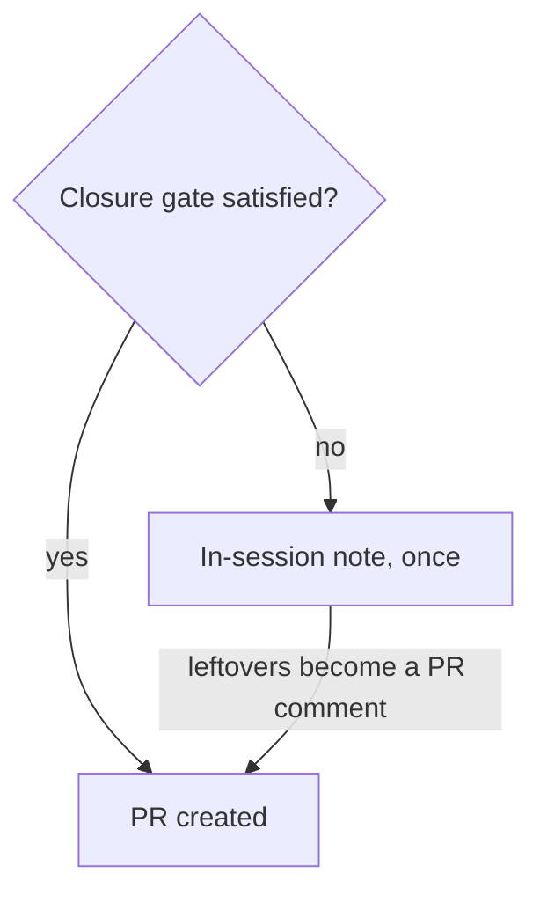

## Summary

`docs/workflows/issue-processing.md` ("Acceptance-criteria closure before the
PR") no longer says the closure gate blocks PR creation and fails the run. It
now describes the flow since Issue #4234: the verdict goes through
`reportSummaryRuleBlock`, the agent is told once in the same session, and
whatever remains on the re-run is one pull-request comment. The PR is still
raised and armed. The section's mermaid diagram now routes the failing branch
through the in-session note to the PR. A docs guard in
`worker/deno/tests/unmet_criteria_gate_test.ts` now covers the section.
Closes #4512.

## Spec

### Intent and Rationale

- The manual contradicted `reportSummaryRuleBlock`'s own comment
  (`worker/deno/lib/phases/completion_phase.ts`), so an operator would misread a
  raised PR as one that passed every closure rule.

### Essential Design Decisions

- The guard reuses the existing `STATED_ELSEWHERE` list and `STOPS_THE_PR`
  regex; `run fails` was added to the regex because every section already in the
  list passes it.

### Undiscoverable Facts

- None.

## Evidence

Docs and test-guard change only; no UI. The new wording was checked against
`reportSummaryRuleBlock` (`worker/deno/lib/phases/completion_phase.ts`) and the
module doc of `worker/deno/lib/summary_rule_gate_retry.ts`.

Docs greps for `blocks PR creation`, `run fails` and `closure gate` in
`issue-processing.md` were re-read. Remaining hits are history (a 2026-09 log
count in "The in-run recovery…") or about the note's shape ("One shape, both
gates"), not a stop. `docs/SPEC-KIT-COMPARISON.md:161` concerns the
reproduction gate, which is unchanged.

## Test Plan

- `deno task test:unit tests/unmet_criteria_gate_test.ts` (from `worker/deno`):
  3 passed, 0 failed. Entry added to `STATED_ELSEWHERE`:
  `docs/workflows/issue-processing.md` § "Acceptance-criteria closure before the
  PR".
- Red check: re-inserting "blocks PR creation" into the section turns
  `prompt and docs - no section says an unmet criterion blocks the PR` red,
  naming that section; restored and green.
- Edited expectation: `STOPS_THE_PR` gained `|run fails`; no assertion was
  removed. Red check for that operand: putting "run fails" back into the diagram
  label turns the same test red (the other operands do not match it); restored.
- `./quality.sh`: every stage passed except `deno tests`, which failed only on
  two Rust formatter tests in
  `worker/deno/tests/completion_phase_repo_formatters_test.ts` (lines 480 and
  567); this host's `cargo fmt` is unusable while the skip guard probes only
  `rustfmt`. That failure is on the base branch and unrelated (31302 other tests
  passed). The serial pass did not run because the parallel pass failed first.
