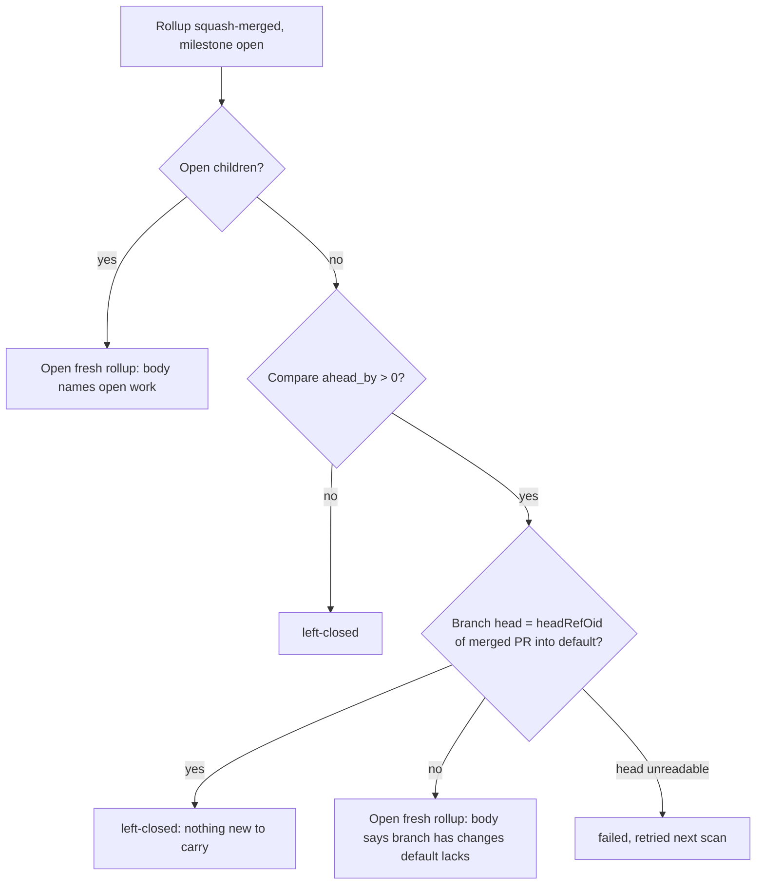

## Summary

After a milestone rollup is squash-merged, the worker no longer opens a second, no-op rollup from the same head. When the milestone has no open children and its branch head is still the head of a rollup already merged into the default branch, `restoreClosedMilestoneRoute` returns `left-closed`. `hasNothingToMerge` uses the same signal, so milestone completion does not raise a tracker and summary PR for such a milestone. The fresh-rollup body now claims "the milestone still has open work" only when there are open children. Closes #4514.

Version bump: not applicable; no `VERSION` file is touched.

## Spec

### Intent and Rationale

- A squash merge does not move the merge base, so the three-dot `compare/{default}...{milestone}` still lists every commit and file the rollup landed; `files` is empty only after a later sync merge (#3910). That compare cannot say whether a merged rollup already carried the branch.
- The branch head can: if it still equals the `headRefOid` of a MERGED PR into the default branch, nothing was pushed after the rollup landed. This is the issue's first proposed signal; a tree comparison would break as soon as the default branch moves on.

### Essential Design Decisions

- `isMilestoneHeadAlreadyMerged` (in `milestone_route_restore.ts`) is the single owner of the check; the route restore and `hasNothingToMerge` both call it.
- It matches only a MERGED PR whose `baseRefName` equals the default branch. A merged PR with no string `headRefOid` never matches, so the old compare-only behaviour applies.
- With open children the existing behaviour is kept: a rollup is still opened, and its body names the open work.
- A failed head read is an error: `failed` in the route restore, `false` (fail safe, milestone stays open) in `hasNothingToMerge`.
- `buildRestoredRollupBody` and `openFreshRollup` take a required `hasOpenWork`. `openRollupForLandedChild` passes `false`: a child has just landed, and the branch has changes the default branch lacks.

### Undiscoverable Facts

- Evidence is the NEAT-AI case in the issue (#4109 squash-merged, #4113 re-raised from head `d72da631`; both trees `0d9d8866`). I did not re-query it.
- `decideMilestoneBaseMerge` (the arming path) never reads the compare, so the closed-route docs were corrected rather than the code (`milestone_children_gate.ts`, `mergedRollupChildRoute`).

## Evidence

Backend only; no UI files touched. Tests are listed in the Test Plan. `hasExistingMilestoneSummaryPr` still uses the compare, unchanged; in milestone completion `hasNothingToMerge` runs before the tracker and summary PR are raised.

Issue numbers cited: #4514: After a milestone rollup is squash-merged, the worker opens a second rollup from the same head (this issue); #4175: A milestone whose rollup merged while children are open holds every PR on it for a human; #3910: Milestone completion raises an empty roll-up PR when the milestone branch is ahead only by main-sync merge commits.

## Test Plan

Added in `worker/deno/tests/milestone_route_restore_test.ts`:

- `a squash-merged rollup with an unchanged head is not re-opened (Issue #4514)`: merged rollup head equals branch head, no children, `ahead_by: 20` with 12 files; expects `left-closed` and no `pr create`.
- `a squash-merged rollup with an unchanged head still opens a rollup while a child is open (Issue #4514)`.
- `a head that moved after the squash-merged rollup opens a rollup without claiming open work (Issue #4514)`.
- `a squash-merged rollup into another base does not match the head (Issue #4514)`.
- `a merged rollup without headRefOid does not match the head (Issue #4514)`.
- `a branch head that cannot be read fails the route restore (Issue #4514)` and `a branch head that is not a commit sha fails the route restore (Issue #4514)`.
- `buildRestoredRollupBody - names open work only when the milestone has open children (Issue #4514)`.

Added in `worker/deno/tests/milestone_completion_test.ts`:

- `hasNothingToMerge - true when the head is the head of a squash-merged rollup (Issue #4514)`, `... false when the branch head has moved since the squash-merged rollup (Issue #4514)`, `... false (fail safe) when the rollup list fails (Issue #4514)`.
- `checkAndHandleMilestoneCompletions - closes a milestone whose rollup squash-merged with the head unchanged (Issue #4514)`.

Existing tests edited: three route-restore mocks (those behind "a protected not-ahead child opens a rollup on the scan after auto-merge lands", "a landed protected child whose rollup cannot be opened is not left closed", and `refusedRollupStdout`) gained a branch-head response so the new read does not fail. No assertion was removed or changed; their mocked merged PRs carry no `headRefOid`, so the new check does not match.

Red-checks (guard broken on purpose, then restored):

- Helper forced to `false`: the unchanged-head route test, the `hasNothingToMerge` true case and the completion-level test went red.
- `baseRefName === defaultBranch` dropped: the other-base test went red.
- `children.value.length === 0` dropped: the open-child test went red.
- Head comparison mutated: the moved-head test went red.

Results on the final head:

- `deno task test:unit tests/milestone_route_restore_test.ts tests/milestone_completion_test.ts`: 173 passed, 0 failed.
- `./quality.sh`: every stage passed except `deno tests`, which failed on two tests that do not touch this change: `tests/completion_phase_repo_formatters_test.ts` lines 480 and 567 (Rust `cargo fmt` cannot run on this host: no default rustup toolchain). 31314 passed, 2 failed; the serial pass did not run because the parallel pass failed. `config integration` and `checkov` were skipped (local prerequisites).

Docs read and updated: `docs/workflows/milestones.md` (fresh-rollup, closed-route, "nothing new to carry" and "Nothing to merge" bullets) and `docs/INTERNALS.md` (nothing-to-merge guard). The sync-PR passages that still use `ahead_by` (`milestone_sync_pr_retirement.ts`, INTERNALS ~4639) are a different path and unchanged.

🤖 Generated with [Claude Code](https://claude.com/claude-code)
