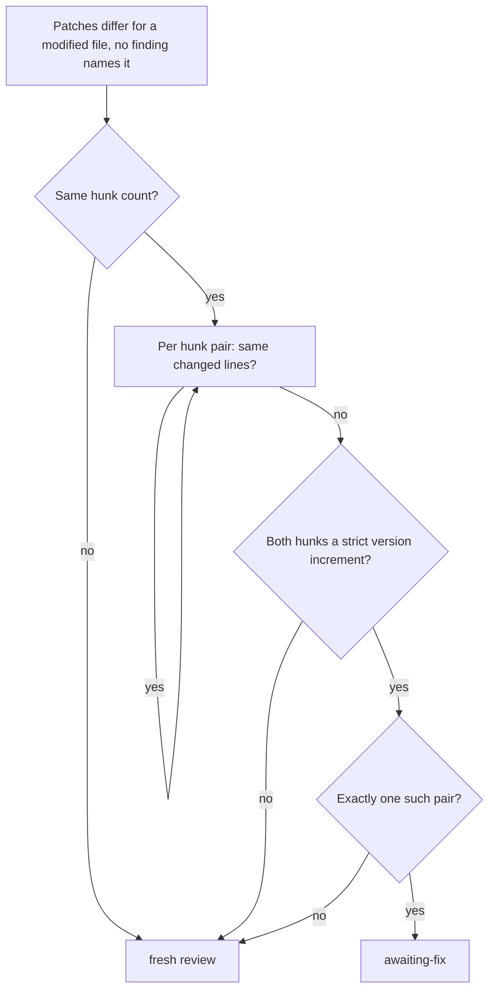

## Summary

`ownDiffUnchanged` (review-fleet-prs gate) now applies its version-increment
exception hunk by hunk. A sent-back PR whose `deno.json` carries a version
re-bump in one hunk and an unchanged dependency pin in another stays
`awaiting-fix` after a base merge, instead of being re-reviewed. Closes #4516.

Version bump: not applicable; no `VERSION` file is touched.

## Spec

### Intent and Rationale

- `isVersionIncrement` needs its input to be exactly one hunk, so a manifest
  patch with a second `@@` hunk never qualified, even when that hunk was
  identical at both heads (NEAT-AI#4116: version plus `@stsoftware/tags` pin).
- Comparing hunk by hunk keeps the exception exactly as strict for the version
  hunk and lets the unchanged hunks pass on the same "same changed lines" rule
  the non-version path already uses.

### Essential Design Decisions

- `onlyVersionHunkDiffers` requires the same hunk count, treats a pair as the
  same by `sameChangedLines` (so context moved by a base merge is ignored, as
  for any file no finding names, Issue #4476), and allows exactly one differing
  pair, where both hunks pass `isVersionIncrement` with their own header.
- The issue says "identical after `normalisePatch`"; this uses
  `sameChangedLines` instead, because the file here is one no earlier finding
  names, and that is the comparison the same function already applies to such a
  file one step earlier. A pair that differs in changed lines is never accepted.
- Unchanged guards: modified status, earlier-finding guard on the file, exact
  head findings, same file list. A patch not opening with `@@` fails closed.

### Undiscoverable Facts

- The NEAT-AI#4116 and #4104 evidence in the issue was not re-queried.

## Evidence

Backend/skill script only; no UI files touched.

Issue numbers cited: #4516: this issue (multi-hunk manifest re-bump); #4476:
context lines moved by a base merge are ignored (already at the base); #4391:
widened the version exception to JSON/TOML manifests; #3713: introduced the
version exception.

## Test Plan

Added `multi-hunk manifest version re-bump awaits the existing fix when the
other hunks are unchanged (Issue #4516)` in
`worker/deno/tests/review_fleet_prs_gate_2675_test.ts`, seven cases:

- version re-bumps, pin hunk identical: `awaiting-fix`.
- pin hunk changed at head: reviewed.
- two version hunks both changed: reviewed.
- hunk counts differ: reviewed.
- earlier finding on `deno.json`: reviewed.
- pin hunk context moved by a base merge, same changed lines: `awaiting-fix`.
- findings unavailable: reviewed.

No existing test was edited and no assertion removed; the single-hunk tests and
`manifest version exception still reviews other edits and malformed patches
(Issue #4391)` (including its "second hunk" case) pass unmodified.

Red-check: with the old `!isVersionIncrement(fa) || !isVersionIncrement(fb)`
condition restored, the first case failed (`null` instead of `"awaiting-fix"`);
restored, 36 passed.

Results on the final head:

- `deno task test:unit tests/review_fleet_prs_gate_2675_test.ts`: 36 passed, 0
  failed.
- `./quality.sh`: every stage passed except `deno tests`, which failed on two
  tests that do not touch this change:
  `tests/completion_phase_repo_formatters_test.ts` lines 480 and 567 (Rust
  `cargo fmt` cannot run on this host: no default rustup toolchain). 31305
  passed, 2 failed; the serial pass did not run because the parallel pass
  failed. `config integration` and `checkov` were skipped (local prerequisites).

Docs read and updated: `.claude/skills/review-fleet-prs/SKILL.md` rule 8 and
`.claude/skills/review-fleet-prs/references/edge-cases.md` "Version-only
re-bumps" (the pin sentence now says a pin that differs is still reviewed). No
other doc mentions the rule.

Not covered by a dedicated test: the "patch does not open with `@@`" null
branch of `splitHunks` (the version hunk check also rejects it).

🤖 Generated with [Claude Code](https://claude.com/claude-code)
