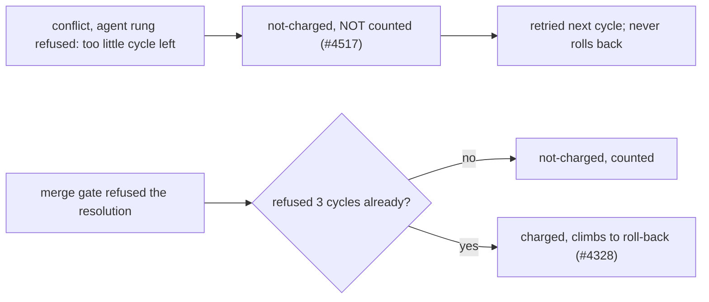

## Summary

A milestone branch refused the agent rung only because too little of the cycle
was left (`agent deferred: cycle budget`) was counted as a refusal. After
`MILESTONE_REFUSAL_CEILING` (3) such cycles the next one was charged `failed`
and climbed to the roll-back, which files the `merge-fallback` issue "agent
deferred" (#4517) and closes the milestone. No agent ever looked at the
conflict, and a roll-back frees no cycle budget. `judgeSyncFailure` now returns
the deferral as `not-charged` without the `refusal` flag, so it is never added
to `refusedCycles` and never reaches the ceiling; the branch waits for a cycle
with the runway. A merge-gate refusal of the resolution is still a counted
refusal and still climbs at the ceiling. Closes #4517.

Version bump: `VERSION` is not edited by this change; the merged commit records
the final version.

## Spec

### Intent and Rationale

- Same reasoning as #4451 (cargo withhold never climbs): the fault is the
  cycle's runway, not the branch, and rolling back frees no runway.
- Dropping the `refusal` flag (rather than special-casing the reason in
  `escalateRepeatedRefusal`) also keeps deferrals out of `refusedCycles`, so
  deferrals cannot pre-load the ceiling for a later gate refusal.

### Essential Design Decisions

- This reverses the part of #4328 that counted `agent deferred: cycle budget`
  towards the ceiling. Accepted trade-off: a branch whose cycles never reach the
  24-minute floor (`DEFAULT_MIN_MS_PER_CONFLICT_ATTEMPT` plus overhead) stays
  behind, visible in the per-cycle log line, rather than being rolled back for
  it. No lowered "starvation" floor was added; that would be new behaviour
  beyond the issue.
- The presync twin (`milestone_presync.ts`) needs no code change: it calls the
  same `judgeSyncFailure` and `escalateRepeatedRefusal`.

### Undiscoverable Facts

- The issue's runs ran on hosts whose logs are not in the repo; the cause of the
  short runway on those hosts was not observed. The fix removes the roll-back
  consequence, not the short runway itself.

## Evidence

Backend only; no UI files touched. Code:
`worker/deno/lib/milestone_branch_sync.ts` (`judgeSyncFailure`,
`AGENT_DEFERRED_CYCLE_BUDGET`, `escalateRepeatedRefusal`),
`worker/deno/lib/milestone_sync_streak.ts` (`concludeConflictAttempt` counts
only `refusal === true`). Docs updated: `docs/INTERNALS.md`,
`docs/workflows/milestones.md`, `docs/MERGE.md`. Issue number cited as
provenance: #4328 (refusal ceiling), #4451 (environment faults not climbing),
#4326 (cargo withhold), #2309 (cycle-budget deferral) — all looked up in the
existing code and docs.

## Reproduction

- **symptom** — `merge-fallback` "agent deferred":
  `refused 4 cycles in a row (agent deferred: cycle budget) — climbing to the next rung`
- **status** — `verified` — the new tests went red with `refusal: true` restored
  in `judgeSyncFailure` (3 failed, 0 passed) and pass with the fix
- **regression test** —
  `worker/deno/tests/milestone_cycle_budget_not_counted_4517_test.ts`

## Test Plan

- New `worker/deno/tests/milestone_cycle_budget_not_counted_4517_test.ts`, three
  tests: sweep with ceiling+3 deferrals (no roll-back, `refusedCycles` 0,
  `conflictAttempts` 0, sync really ran each cycle); presync twin likewise;
  mixed deferrals and gate refusals (deferrals do not advance the streak; the
  gate refusal still climbs on the fourth).
- Red check: restoring `refusal: true` in the `!agentAllowed` verdict fails all
  three (cycle 4 rolled back / deferral 1 counted / streak advanced).
- Edited `worker/deno/tests/milestone_sync_refusal_ladder_4328_test.ts`: tests
  that used the agent-deferred error as the counted, climbing refusal now use
  the gate-refused resolution (`gateRefusedError()`), with every assertion kept
  (only the expected reason text `(agent deferred` became
  `(the merge gate refused the resolution`); the ~239 test now asserts
  `refusal === undefined` for the deferral. The two-kind loop became the gate
  kind only. Removed from
  `worker/deno/tests/milestone_sync_refusal_ladder_4328_test.ts`: the agent-kind
  run of the climbing test. Required by: "refused 4 cycles in a row (agent
  deferred: cycle budget) — climbing to the next rung" (the behaviour the issue
  reports as a worker failure); the climb is still covered by the gate kind, and
  the deferral's no-climb by the new file.
- Edited `worker/deno/tests/milestone_merge_only_4326_test.ts:223`:
  `conclusion.refusal` for an agent-deferred conclusion is now `undefined` (was
  `true`); red check: with `refusal: true` restored it fails.
- Passed: `deno task test:unit` over the ladder, new, `milestone_branch_sync`,
  merge-only, env-fault and presync tests (166 passed, 0 failed), plus 61 passed
  in the related streak, cadence, gate-wedge and presync tests. `deno fmt`,
  `deno lint`, `deno check` on the edited files: clean. Full `./quality.sh`
  passed through markdownlint, semgrep and the release-tag ruleset checks, then
  timed out at 580 s in the unit-test stage.
- `deno fmt --check` fails on `docs/INTERNALS.md` and
  `docs/workflows/milestones.md` at HEAD for unrelated paragraphs; they were not
  reflowed.

<!-- vibe-quality-gate-skipped reason="the full ./quality.sh did not finish inside the 600s foreground cap (timed out in the unit-test stage after the lint, semgrep and markdownlint stages passed); targeted tests ran, CI runs the full gate" -->
