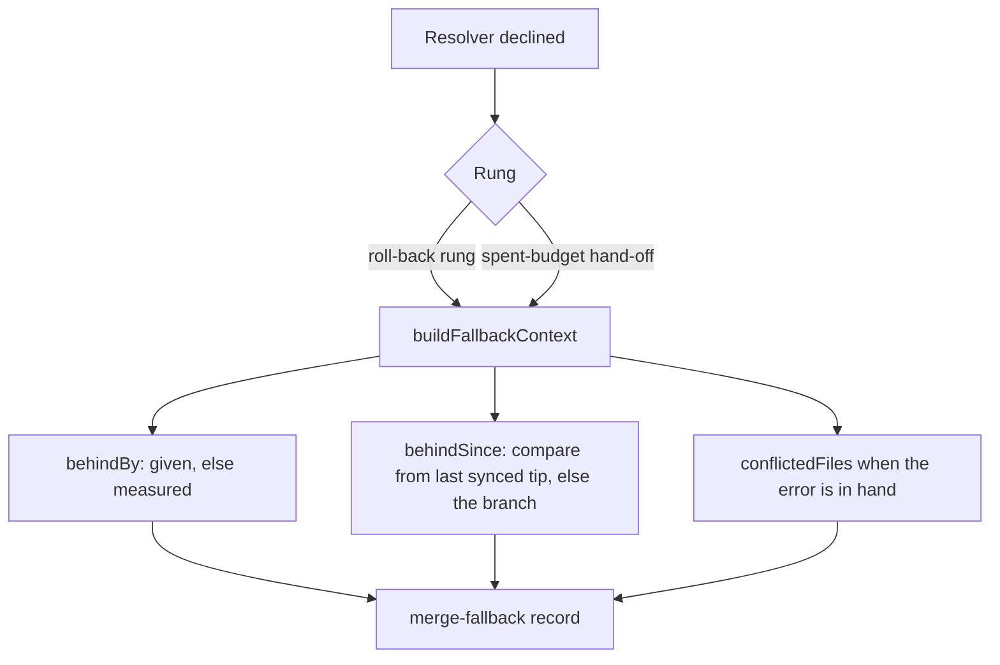

## Summary

The `merge-fallback` record filed by the conflict ladder's roll-back rung left
"Commits behind the base" and "Behind since" as `not recorded`, because that
rung passed an empty fallback context. The rung now fills both, through the same
builder the spent-budget hand-off uses. Closes #4521.

Version bump: not applicable; no `VERSION` file is touched.

## Spec

### Intent and Rationale

- #4521 is a worker-filed fallback record ("the conflict resolver declined").
  The decline and the roll-back are the designed ladder (Issue #4328); the
  defect in the record is the two `not recorded` fields, which the roll-back
  rung left empty (`fallback: {}`) while the hand-off path filled them.
- The pass measures how far behind a branch is only for a repository with two or
  more milestone branches (`orderRepoMilestones`), so a lone branch reached the
  filing unmeasured on both paths.

### Essential Design Decisions

- One `buildFallbackContext` now serves `applyResolverRecovery` and
  `handOffSpentBudget`; an unmeasured branch is measured at the fallback with
  the injected `behindCountFn` (rare path, best-effort, a failure is logged).
- The context is built **before** `rollbackFn` runs, in both functions. A merged
  roll-back pushes the base tip onto the branch, so measured afterwards the
  branch reads 0 behind and the behind-since compare lists no commits.
- A branch that never synced has no `lastSyncedDefaultSha`, so the behind-since
  compare is bounded by the branch itself: its first listed commit is the oldest
  one the branch lacks.
- Assumption: the conflicted-file list is passed only where the failing error is
  in hand (the same-cycle site); the cycle-start rung has no error to read.

### Undiscoverable Facts

- The source repository is private, so the issue names nothing; the cause was
  found from the `not recorded` fields and the code that fills them. The agent's
  692s decline itself is not diagnosed here.

## Evidence

Backend only; no UI files touched.

Issue numbers cited: #4521: this issue; #4328: the recovery ladder; #2311: the
fallback flag; #2309: the behind-by ordering; #4456: the record is filed in
VibeCoder.

## Reproduction

- **symptom** — the roll-back rung's `merge-fallback` record read "Commits
  behind the base: not recorded" and "Behind since: not recorded".
- **status** — `verified` — both new tests failed against the base-branch
  `milestone_branch_sync.ts` and pass after the fix.
- **regression test** —
  `worker/deno/tests/milestone_branch_sync_test.ts::syncMilestoneBranches - the ladder's roll-back of a lone branch files how far behind the base it was and since when (Issue #4521)`

## Test Plan

Added to `worker/deno/tests/milestone_branch_sync_test.ts` (helper
`rollbackFiling`, a lone milestone, injected filer and `gh`):

- `syncMilestoneBranches - the ladder's roll-back of a lone branch files how far behind the base it was and since when (Issue #4521)`:
  behind-by 7 and the date are filed, compare from the last synced tip.
- `syncMilestoneBranches - a branch that never synced bounds the behind-since compare with the branch itself (Issue #4521)`.
- `... a spent budget found at the start of a cycle files the gap read before the roll-back`
  (hand-off at the cycle-start site) and
  `... a budget spent in this cycle files
  the conflicted files and the gap read before the roll-back`
  (hand-off at the same-cycle site, where the error is in hand).
- `... the same-cycle ladder roll-back files the conflict and the gap before roll-back`:
  asserts the conflict path, behind-by count, behind-since date and ladder log.
- `... a behind-by that cannot be measured is logged with its reason and filed as not recorded`.

The helper `rollbackFiling` mocks a real roll-back: `behindCountFn` answers 7
before the roll-back and 0 after it, and the compare answers a date before and
`null` after, so a context read after the roll-back fails every test above. The
same-cycle ladder test also exercises `applyResolverRecovery` with the error in
hand.

Red checks: base-order production file (context built after `rollbackFn`) → 4
tests fail; `!(conflictedFiles.length > 0)` (line 1994 mutation) → the
same-cycle test fails; `err instanceof Error` negated (line 2034 mutation) → the
unmeasurable behind-by test fails; base-branch production file → the first two
fail; only `?? milestone.milestoneBranch` removed → the second fails; passing
`undefined` instead of `conflictError` at the same-cycle ladder call → the
same-cycle ladder test fails on `conflictedFiles`.

Verifier findings (all five): the ordering defect at the two
`buildFallbackContext` calls and the four callers it reaches (cycle-start rung,
same-cycle rung, cycle-start hand-off, same-cycle hand-off) are fixed by
building the context before the roll-back; the callers keep their signatures and
results.

No existing test was edited.

Results before the same-cycle ladder test was added:
`deno task test:unit tests/milestone_branch_sync_test.ts tests/milestone_fallback_flag_test.ts`:
93 passed, 0 failed.

After that test was added, `deno task test:unit tests/milestone_branch_sync_test.ts`:
82 passed, 0 failed.

`./quality.sh`: every stage passed except `deno tests` (31306 passed, 3 failed),
all three failing on the base branch too and not touching this change:
`tests/completion_phase_repo_formatters_test.ts` lines 480 and 567 (no default
rustup toolchain on this host) and `tests/pr_maintenance_command_test.ts` line
344 (`expected a merge-queue rules read`; re-run on a clean `origin/main`
checkout, same failure). The serial pass did not run. `config integration` and
`checkov` were skipped (local prerequisites).

Docs read and updated: `docs/workflows/milestones.md` (the spent-budget bullet).
`docs/workflows/merge-conflicts.md` lines 900-910 already say the record carries
how far behind and since when; they are true now for the roll-back rung.

🤖 Generated with [Claude Code](https://claude.com/claude-code)
