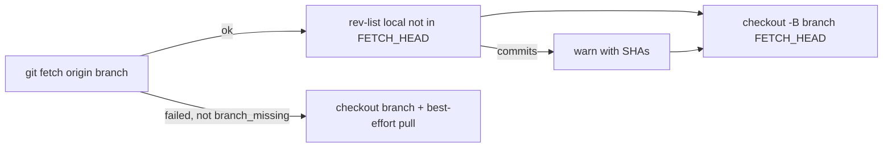

## Summary

`preparePrBranch` now starts every PR pass from origin's head of the PR branch:
after a successful fetch it runs `git checkout -B <branch> FETCH_HEAD` instead
of reusing the clone's local branch and trying `git pull --ff-only` (whose
failure was only logged at debug level). Local commits the reset drops are
logged at warn level by SHA. Closes #4530.

## Spec

### Intent and Rationale

- A PR-feedback pass cut its `milestone-fix/…` branch from an unpushed local
  merge commit because the diverged local branch survived `checkout` and the
  `--ff-only` pull failed silently. Resetting onto the fetched tip fixes that
  for the CI-fix, PR-feedback, spelling and merge-conflict passes, which share
  the helper.

### Essential Design Decisions

- When the fetch fails (not `branch_missing`) there is no fetched tip, and
  `FETCH_HEAD` could be stale from an earlier fetch, so the previous
  checkout-plus-pull fallback stays; a test asserts `FETCH_HEAD` is never used
  then.
- The dropped-commit warning runs
  `rev-list --max-count=20 refs/heads/<branch> --not FETCH_HEAD` before the
  reset; a missing local branch or a merely-behind branch produces no warning.
- No gate or refusal was added (the issue says so);
  `checkoutPrBranchAtRemoteHead` (which refuses a local-ahead branch) is a
  different, untouched caller path.

### Undiscoverable Facts

- Why the original 14:59 sync merge stayed unpushed is unknown (the issue says
  the fix does not depend on it).

## Evidence

Backend-only change; no UI files touched. Tests exercise real git: a bare remote
plus clone from `worker/deno/tests/support/git_repo_fixture.ts`.

- Diverged local branch (local commit not on origin, origin advanced): HEAD and
  `refs/heads/pr-branch` equal origin's tip, and the warning names exactly the
  unpushed SHA.

## Test Plan

- Added in `worker/deno/tests/pr_branch_preparation_test.ts`: diverged local
  branch reset onto origin's tip with SHA warning; behind-only branch
  fast-forwarded without a warning; branch with no local copy created at the
  tip; failed fetch falls back to checkout + pull and never uses `FETCH_HEAD`.
- Mutation survivors pinned (each applied by hand, a test goes red):
  - `pr_branch_preparation.ts:124` (dropped `fetchResult.ok`): "a fetch that
    could not run at all falls back to checkout and pull…".
  - `:218` (deleted `"--"`): "the rev-list ends its revisions with `--`…" (a
    working-tree file named `FETCH_HEAD` makes the rev-list ambiguous without
    it, hiding the dropped-commit warning).
  - `:223` (dropped `!result.ok`): "a rev-list that could not run is
    tolerated…".
  - `:223` (dropped `result.value.code !== 0`): "a failing rev-list never
    produces a discard warning…".
- Red checks: forcing the old path (`fetched = false`) turns the diverged test
  red; removing the warning call turns it red too.
- Edited existing tests (call shapes changed, intent kept):
  - `pr_branch_preparation_test.ts` "operates on the requested branch…": the
    every-call-targets-the-branch check now also accepts `refs/heads/<branch>`;
    the `pull` presence and `fetch` before `pull` assertions are replaced by
    `checkout -B … FETCH_HEAD` after fetch and no pull. Required by: "check the
    branch out at the fetched tip (`git checkout -B <branch> FETCH_HEAD`)
    instead of reusing the local branch".
  - "a checkout failure is reported": `calls.length === 2` replaced by the exact
    verb sequence `fetch, rev-list, checkout`.
  - "a branch held by one of this host's lane worktrees…":
    `the retry went on to pull` replaced by the retry being the `FETCH_HEAD`
    reset with no pull.
  - `pr_ci_processor_test.ts` and `pr_feedback_processor_milestone_fix_test.ts`:
    `checkout -B` matchers narrowed to the `milestone-fix/` branch (the helper's
    own `-B` now precedes it); held-branch mocks now key on
    `checkout -B <PR branch>`.
- Ran on the final head: `deno task test:unit` over the 65 `pr_spelling*`,
  `pr_merge_conflict*`, `pr_feedback_*`, `pr_ci_*` and `custom_label_pr*` test
  files: 809 passed, 0 failed; `pr_branch_preparation_test.ts`: 27 passed.
  `deno lint` and `deno check` clean on touched files.
- Twin/doc check: no other copy of the rule found; `docs/workflows/README.md`
  gained a paragraph on the behaviour, and a stale comment in
  `pr_merge_conflict_processor.ts` was corrected.

<!-- vibe-quality-gate-skipped reason="full ./quality.sh not run in this run's remaining budget; targeted tests, lint and check were run; CI runs the gate" -->
