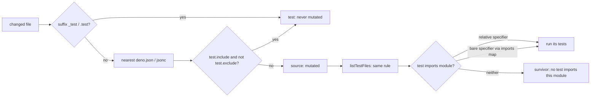

## Summary

The diff-scoped mutation check now reads the nearest `deno.json` / `deno.jsonc`
to decide what a Deno test is (`test.include` less `test.exclude`, as well as
the `_test` / `.test` suffix) and to resolve a test's bare imports through the
project's `imports` map. Test files are no longer mutated as source, and a
module whose tests import it through an alias is no longer reported as
`(no test imports this module)`. Closes #4533.

Version bump: no `VERSION` change in this diff; the merged commit records the
final version.

## Spec

### Intent and Rationale

- The check judged a test by file name and an import by relative specifier
  only, so in NEAT-AI (1,445 `.ts` files under `test/`, 37 with a suffix) edited
  tests were mutated and aliased modules looked untested. Reading the project's
  own config fixes the cause instead of telling agents to rename files.
- The rule lives in one new module, `worker/deno/lib/deno_test_config.ts`, and
  both the runner's source filter and the real `listTestFiles` seam call it.

### Essential Design Decisions

- The suffix rule always wins: an `exclude` entry never turns a `*_test.ts`
  file back into source, so the old guarantee that suffix-named files are not
  mutated holds.
- Globs are matched by a segment matcher with a memoised table, not by building
  a regular expression, so a hostile `include` cannot backtrack. `!` negation
  is refused with an error rather than guessed at. A malformed `deno.json`
  fails the check as an `error` naming the file and field, not as an empty
  config.
- Only direct imports count, as before. `importMap` files and `scopes` are not
  read; the docs and the module header say so.

### Undiscoverable Facts

- The five NEAT-AI PRs in the issue (#4129, #4104, #4103, #4093, #4059) show
  agents exempting or rewriting around the false survivors; none were opened or
  re-run here.
- `coverage_carryover_gate.ts` and `security_fix_discrimination.ts` still use
  the suffix-only `isDenoTestFile`. The issue names the mutation check only, so
  they are unchanged. `coverage_carryover_runner.ts` shares the
  `listTestFiles` seam, so it now sees include-matched tests as candidates; it
  still matches importers by relative specifier only.

## Evidence

Backend only, no UI. Code: `worker/deno/lib/deno_test_config.ts` (new),
`worker/deno/lib/mutation_runner.ts`. Docs: `docs/mutation-check.md` (new
paragraph on how tests are found, and the "Survivor in an untested module"
bullet). The `isDenoTestFile` doc comment in `worker/deno/lib/mutation_gate.ts`
now points to the config-aware rule. New sweep slice
`docs/audits/lib-sweep-coverage/top-up-4533.json` claims the new module.

Doc sweep: grepped `docs/` (excluding `docs/archive/`) and `README.md` for the
mutation check's test detection; `docs/coverage-carryover-check.md` describes
the other gate, which keeps the suffix rule, and is unchanged.

## Test Plan

- New `worker/deno/tests/deno_test_config_test.ts` (26 tests): parsing (JSONC,
  empty, invalid JSON, wrong types, `!` entries, non-local import targets),
  `isDenoTestPath` (suffix, `test/**/*.ts`, exclude wins, directory entry, `./`
  prefix, braces, `?`, suffix not un-tested by exclude, a hostile `**` pattern),
  and `resolveImportSpecifier` (prefix, exact, longest key, key without `/`,
  `jsr:` target, nested config directory, unmapped, above the root).
- Added to `worker/deno/tests/mutation_runner_test.ts` (nine tests, with the
  NEAT-AI-shaped fixture of unsuffixed tests under `test/` and `@neat/` aliases):
  a test under `test.include` is not mutated; with a test and its source in the
  diff only the source is mutated; an aliased import runs its test and leaves
  no untested survivor, with a control that omits the map entry; a nested
  project decides its own tests; an invalid `deno.json` is an `error`;
  `detectMutationLanguage` ignores a changed included file; the real
  `listTestFiles` seam on a temporary repository; `importsModule` with and
  without a project, including a nested one.
- No assertion removed from any existing test; existing tests needed no fixture
  change.
- Reproduction: with `mutation_runner.ts` restored to `origin/main` and the new
  tests kept, 9 of the 78 tests in `mutation_runner_test.ts` fail, one per
  behaviour above; with the fix all 78 pass.
- Red checks, each applied by hand and restored: skipping the config test in
  `isDenoSource` (4 red); deleting the bare-specifier loop in `importsModule`
  (3 red); passing an empty project to `findImportingTests` (1 red); using the
  suffix rule in the real `listTestFiles` (1 red); dropping the exclude operand
  in `isDenoTestPath` (2 red); dropping its suffix operand (4 red); dropping
  the longest-key comparison (1 red); turning off directory semantics (1 red);
  no longer refusing `!` (1 red). Two breaks first stayed green, so a test was
  added for each: dropping the `key.endsWith("/")` operand
  (`resolveImportSpecifier - a key without a trailing slash is not a prefix`)
  and swallowing a parse error in `loadProjectConfig`
  (`runMutationCheck deno - an invalid deno.json fails the check loud, not as an
  empty config`).
- Callers of `importsModule` and `listTestFiles` checked: `findImportingTests`
  and `runDeno` pass the project; `coverage_carryover_runner.ts` calls
  `importsModule` with three arguments, so behaviour there is the relative-only
  rule as before, and `tests/coverage_carryover_runner_test.ts` (43 tests)
  passes. `security_fix_discrimination.ts` uses `findDenoConfigDir` only.
- Regexes added: `QUOTED_SPECIFIER` runs on test source text; it has one
  quantifier, and the `importsModule` hostile case (200,000 quote characters
  then a non-match) returns false.
- `./quality.sh < /dev/null` (run before the last commit): every stage passed
  except `deno tests` and `deno type check`. The type-check failure was a
  `TS2339` in the new invalid-`deno.json` test; it is fixed and
  `deno check` of both test files is clean, but I did not re-run the full gate
  after the fix. `deno tests` failed on two tests unrelated to this change,
  `completion - an unformatted Rust change is formatted and committed, then
  passes the gate` and `completion - cargo fmt stages only the branch's .rs
  files, not an unrelated uncommitted edit` in
  `tests/completion_phase_repo_formatters_test.ts` (no rustup toolchain on this
  host). I did not run them on the base branch. `config integration` and
  `checkov` were skipped for local prerequisites.
