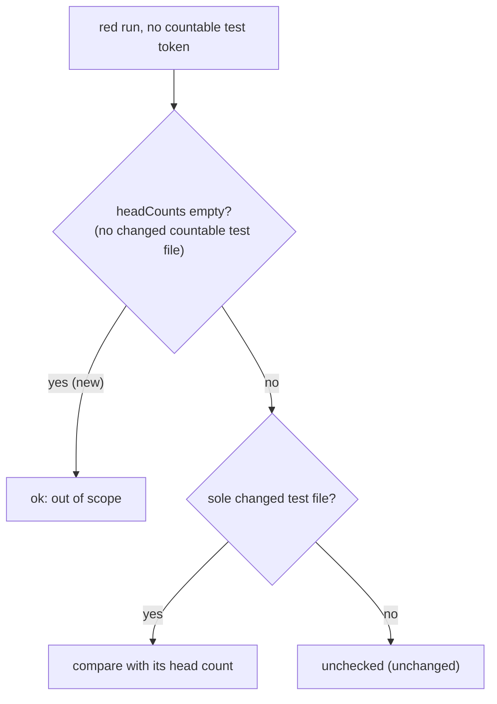

## Summary

The Test Plan recount no longer reports a file-less red run
(`N passed, M failed` with failures, naming no countable test file) as unchecked
when the PR changed no test file the recount can count. In a Rust, shell or
unsuffixed-TypeScript repo that figure could never be checked and the recovery
turn could never clear it, so every review-fix push spent a full-tools agent
turn and posted a false "names no test file" residual. Closes #4537.

Version bump: no `VERSION` change in this diff; the merged commit records the
final version.

## Spec

### Intent and Rationale

- `computeHeadCounts` keeps only paths passing `isCountableTestPath` (JS/TS
  `_test`/`.test`/`.spec`), so in a non-JS/TS PR `headCounts` is empty and
  `checkRunResults` can only answer `unchecked` for a red run. Treating it as
  out of scope matches how `quality.sh` results are already handled.

### Essential Design Decisions

- The guard sits only in the branch where the line names no countable test
  token, after the green-run skip, exactly as the issue proposes. A line naming
  a JS/TS token the PR did not change is still `unchecked`, and a PR with at
  least one changed countable test file behaves exactly as before.
- A stale count in a non-JS/TS repo is left to PR review, as it was before.

### Undiscoverable Facts

- Observed on NEAT-AI-Discovery#2490 (Rust) and two private fleet PRs, per the
  issue; none were re-run here.

## Evidence

Backend only, no UI. Code: `worker/deno/lib/test_plan_recount.ts`
(`checkRunResults`, and the `findUncheckedRunResults` doc comment). Docs:
`docs/workflows/pr-feedback.md` (deterministic Test Plan recount, both passages
that state the sole-changed-test-file rule; the old "skipped when there are none
or several" wording was also corrected, since several files are reported
unchecked, not skipped). A grep of `docs/` (excluding `docs/archive/`) and
`worker/deno/lib` for `sole changed` and `names no test file` found no other
statement of the rule.

Callers of `checkRunResults`: only `scanTestPlan`, which feeds both
`findTestPlanMismatches` and `findUncheckedRunResults`;
`pr_feedback_drift_check.ts` `collect` reads both.

## Test Plan

- Added to `worker/deno/tests/test_plan_recount_red_on_base_3381_test.ts`:
  `unchecked run results - a file-less red result is out of scope when the PR changed no countable test file (Issue #4537)`.
  Empty `headCounts` gives `[]` from both finders; the control with two
  countable changed files still reports one unchecked result ("no sole changed
  test file").
- Added to `worker/deno/tests/pr_feedback_drift_check_3740_test.ts`: a Rust-only
  fix push with a red line naming `tests/rule_regression.rs` stays clean, one
  read-only agent call, no recovery turn, no recount warning, no reply file; and
  a sibling where the same push also changes `tests/rule_test.ts` is still
  unchecked and runs the recovery turn (2 calls).
- Edited fixture (no assertion removed or changed):
  `worker/deno/tests/pr_feedback_drift_check_3143_test.ts`
  `a red run result the recount cannot check is warned about (Issue #3381)`
  changed only `lib/rule.ts`, so its `headCounts` would now be empty; it also
  writes `tests/rule_test.ts` so it still reaches the unchecked outcome. It
  stays green with the guard in place, and acts as a positive control that the
  unchecked outcome is still reached when `headCounts` is non-empty.
- Red check: with the `headCounts.size === 0` guard deleted, both new tests go
  red (`test_plan_recount_red_on_base_3381_test.ts` 1 failed;
  `pr_feedback_drift_check_3740_test.ts` Rust test 1 failed); restored, all
  green.
- `deno task test:unit` over the `test_plan_recount_*`,
  `pr_feedback_drift_check_*`, `pr_feedback_processor_drift_check_3143`,
  `pr_feedback_test_plan_recount_3117` and `pr_feedback_red_on_base_3381` test
  files: parallel 136 passed, serial 47 passed, 0 failed.
- `./quality.sh < /dev/null` on the head: every stage passed except `deno tests`
  (31396 passed, 2 failed). The two failures are the Rust-formatter tests in
  `worker/deno/tests/completion_phase_repo_formatters_test.ts` (no rustup
  toolchain on this host); that file alone fails 2 of 8 here, and it does not
  touch the recount. I did not run them on the base branch. `config integration`
  and `checkov` were skipped for local prerequisites. Serial pass did not run
  because the parallel pass failed; the serial files touching this change were
  run directly (above).
