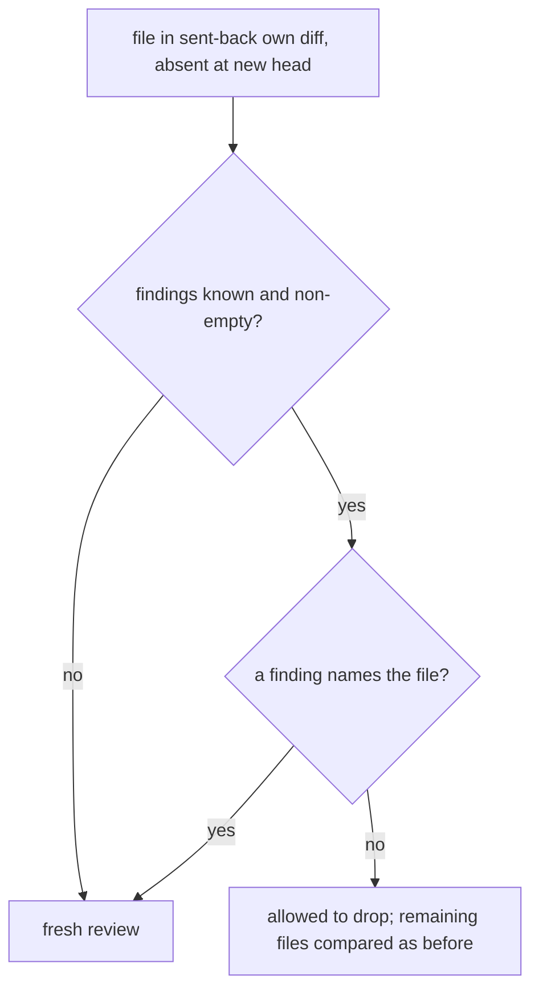

## Summary

`ownDiffUnchanged` (review-fleet-prs gate) no longer forces a re-review when a
base merge takes a file out of a sent-back PR's own diff. A file present in
`compare/{base}...{since}` but absent from `compare/{base}...{head}` may now
drop out, provided earlier findings are known, there is at least one, and none
names that file. The PR then stays `awaiting-fix` until the fleet pushes its
fix. Closes #4542.

## Spec

### Intent and Rationale

- A merge of the base that already carries an equivalent edit removes the file
  from the own diff, but the old `a.length !== b.length` check turned that into
  a full xhigh re-review that ended in the same send-back.
- Files are now paired by filename instead of sorted index, so a dropped file is
  a lookup miss rather than a length mismatch.

### Essential Design Decisions

- A drop needs non-empty known findings; `undefined` or `[]` keep the fresh
  review, matching the version exception's reliance on findings. A finding that
  names the file (qualified paths included, via the shared `findingNamesFile`
  helper) forces a fresh review, since the drop could be its fix.
- A file only the new head lists always gets a fresh review. This also refuses a
  truncated 300-file head listing, so only the sent-back listing keeps the
  300-file cap.
- Repeated filenames in either listing fail closed, because pairing by name
  cannot represent them.

### Undiscoverable Facts

- Evidence comes from two private fleet PRs sent back on 2026-10-31, where two
  docs files left the own diff after a base merge and the re-review marked every
  earlier finding "not fixed".

## Evidence

Backend/CLI change only (a skill script and its docs), no UI. Verified by the
unit tests below, run on the final head. Docs updated:
`.claude/skills/review-fleet-prs/SKILL.md` (rule 8) and
`.claude/skills/review-fleet-prs/references/edge-cases.md` ("Version-only
re-bumps", plus two sentences made true for dropped files). A grep of both files
for "file list", "same files", "still matches" and "awaiting-fix" found no other
sentence the change makes false.

## Test Plan

New tests in `worker/deno/tests/review_fleet_prs_gate_2675_test.ts`, all named
`(Issue #4542)`:

- a file a base merge absorbed may drop out when no finding names it (also
  asserts `awaiting-fix` through `skipReason`, and a control where a finding
  names a remaining file)
- a dropped file that a finding names is a fresh review, qualified paths
  included; this also applies when the name is nested in an earlier-finding gap
- a dropped file with unknown or empty findings is a fresh review
- a file only the head lists is a fresh review
- a dropped file beside a real change to a remaining file is a fresh review
  (the sent-back listing puts the dropped file first, so the test also checks
  that comparison continues to the changed file)
- a 300-file head listing is refused as head-only files
- a repeated filename in either listing is a fresh review

Result: `deno task test:unit tests/review_fleet_prs*_test.ts` passed, 287 tests,
0 failed. `deno fmt --check`, `deno lint` and `deno check` on the two changed
code files are clean.

Red checks (each break restored afterwards):

- allow a drop with unknown or empty findings: the "unknown or empty findings"
  test goes red
- skip the naming check on dropped files: the "finding names it" test goes red
- allow files only the head lists: the "only the head lists" test goes red (and
  the existing #3063 new-file case)
- remove the repeated-filename check: the repeated-filename test goes red
- the `b.length >= 300` check was dead code (the head-only rule already refuses
  such a listing), so it was removed rather than tested

Review-fix push: `deno task test:unit tests/review_fleet_prs_gate_2675_test.ts`
passed, 43 tests, 0 failed, with the dropped file ordered before the changed
file in the shared fixture. No existing assertion was removed or edited.
Callers of `ownDiffUnchanged`: the gate's single production call site
passes the findings of the exact sent-back head, unchanged; the existing tests
of the function still pass.

Second review-fix push: `findingNamesFile` follows earlier-finding gaps when
checking a dropped file, so restoring a file named by an unresolved earlier
finding triggers a fresh review. `deno task test:unit
tests/review_fleet_prs_gate_2675_test.ts` passed, 44 tests, 0 failed, including
the new gap-shaped finding case.

Twinned rules: SKILL.md rule 8 and `edge-cases.md` both restate the comparison
and were updated together; no other copy of the rule was found.

<!-- vibe-quality-gate-skipped reason="full ./quality.sh not run in this run; targeted fmt, lint, check and the review_fleet_prs test files were run; CI runs the full gate" -->
