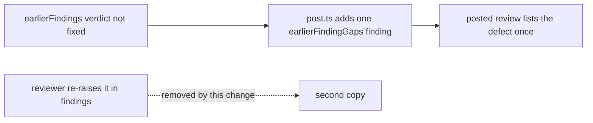

## Summary

The fleet reviewer's brief no longer tells it to re-raise an unfixed earlier
finding as a fresh finding. In `.claude/skills/review-fleet-prs/SKILL.md`, the
`{{PREVIOUS_FINDINGS}}` value ended "A partial fix is still a finding."; it now
ends "A verdict other than `fixed` already sends that finding back with your
note, so leave it out of `findings`." Closes #4548.

## Spec

### Intent and Rationale

- `post.ts` already appends one gap finding per earlier finding whose verdict is
  not `fixed`, quoting the original problem and Fix plus the reviewer's note.
  The old sentence made the reviewer also write a fresh finding, so every
  send-back added another copy.
- Rewording only, as the issue proposes: the gap still blocks, so the PR is
  still sent back.

### Essential Design Decisions

- No script change: the pre-PR verifier fills the same field without the
  sentence, so the duplication came only from this wording.

### Undiscoverable Facts

- Evidence is in the issue: reviews on NEAT-AI-Discovery#2481, VibeCoder#4500,
  NEAT-AI-Discovery#2428 and a private fleet PR listed a defect two or three
  times.

## Evidence

Prompt-wording change in a skill file only, no UI. Read before writing:
`worker/deno/lib/earlier_findings.ts` `earlierFindingGaps` returns no gap only
when exactly one verdict for the index is `fixed`, so `partly`, `not fixed`, a
missing verdict and duplicate verdicts each still produce a blocking gap.
`.claude/skills/review-fleet-prs/scripts/post.ts` appends those gaps after the
reviewer's own `findings`. The brief's own rule that a partial fix is not fixed
is in `prompts/pr_review_brief/prompt.md` ("Partial fixes, narrower wording and
documented limitations are not fixed.").

Docs sweep: grepped `.claude/skills/review-fleet-prs`, `prompts/` and `docs/`
(excluding the archive) for "partial fix", "still a finding", "re-raise" and
"partly". The only other description of the gaps, `docs/INTERNALS.md` (the
`pr_review` verifier paragraph), concerns the worker's review-fix verifier and
is unchanged and still true.

## Test Plan

No new test: the change is one sentence in a skill's prompt wording, and no test
pins that sentence (grep of `worker/deno/tests` found none). Existing tests that
read the skill or the shared brief were run on the final head:
`deno task test:unit` on `claude_skill_frontmatter_test.ts`,
`pr_review_brief_shared_3395_test.ts`, `review_fleet_prs_skill_labels_2882_test.ts`,
`review_fleet_prs_learn_3396_test.ts`, `review_fleet_prs_private_refs_test.ts`,
`references_source_probe_test.ts` (56 passed, 0 failed), and
`pre_pr_verifier_3395_test.ts` with `review_fleet_prs_checklists_3594_test.ts`.
No assertion was removed or edited.

Not checked: the posted effect on a live re-review, which needs a fleet round.

<!-- vibe-quality-gate-skipped reason="full ./quality.sh not run in this run; the touched tests were run; CI runs the full gate" -->
