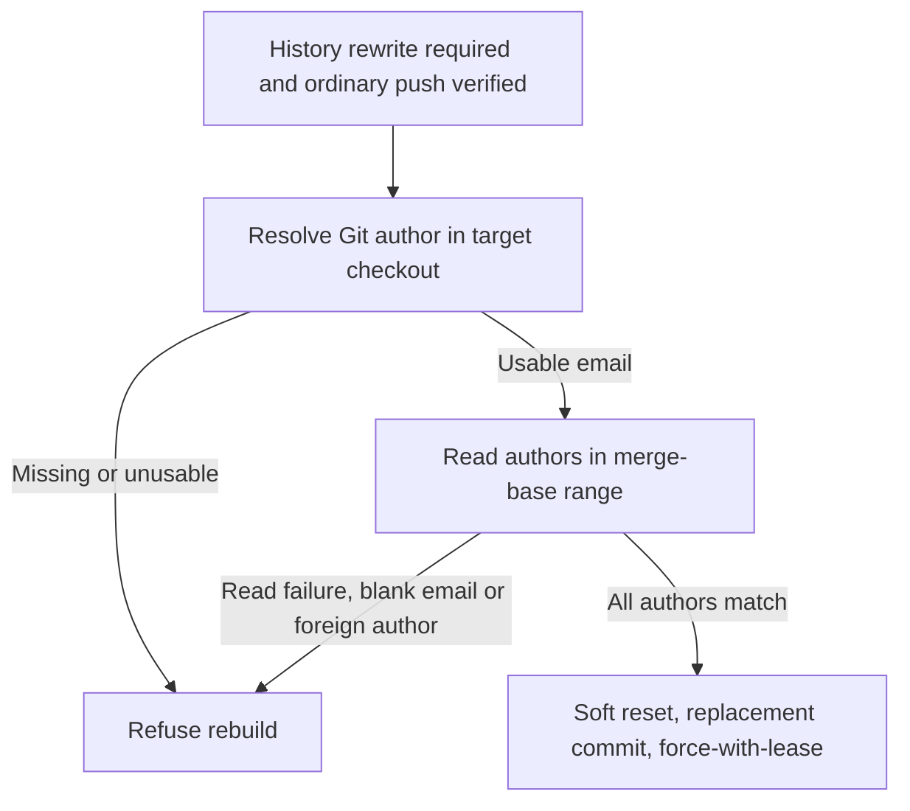

## Summary

History rebuilds now resolve the effective Git author in the target checkout and
refuse to collapse commits by another author, or to proceed when identity or
commit authors cannot be read. Blank author emails are preserved and refused
before reset, replacement commit or force-push. `ownedAuthorEmails` is required
and validated. Tests now detect all 11 mutations reported by completion. Closes
#4554.

Version bump: no version file was changed for this fix; the merged commit
records the final version.

## Spec

### Intent and Rationale

- Prevent the CI-fix lane from rewriting a human or another bot's commit as a
  worker-authored commit.
- Resolve ownership from Git's effective author identity in the checkout where
  the rebuild runs.

### Essential Design Decisions

- Trust only the resolved author email. No additional fleet emails were found in
  an authoritative allow-list, and commit history is not used to infer
  ownership.
- Refuse before reset, replacement commit or force-push if the identity is
  missing or malformed, commit authors cannot be read, or any commit author is
  blank or not the resolved worker email.
- Remove only the final newline from Git's author output. An empty line for a
  commit is an author record, and is reported as `(blank author email)`.

### Undiscoverable Facts

- `git var GIT_AUTHOR_IDENT` was observed to honour both `GIT_AUTHOR_EMAIL` and
  repository `user.email` overrides in this environment.
- Real Git accepted a commit with `user.email=`. Between two worker commits,
  `git log --format=%ae` returned `worker@example.com\n\nworker@example.com\n`;
  the middle empty line must survive parsing.

## Evidence

Backend-only change; verified through the CI processor and history rewrite
tests. Read the secret-finding history-rebuild guards in `docs/CONFIGURATION.md`
and updated that manual to include identity resolution and blank-email refusal.

### Deno regression avoided

- Used the repository's Deno tasks and Deno lint, check and formatter; no Node
  tooling or dependency changes were added.

Observed Git identity resolution:

- `env GIT_AUTHOR_EMAIL=override@example.invalid git var GIT_AUTHOR_IDENT`
  returned `VibeCoderST <override@example.invalid> …`.
- `git -c user.email=repo-config@example.invalid var GIT_AUTHOR_IDENT` returned
  `VibeCoderST <repo-config@example.invalid> …`.

## Test Plan

- From `worker/deno`,
  `deno task test tests/branch_history_rewrite_test.ts tests/pr_ci_processor_test.ts`:
  65 passed, 0 failed.
- `branch_history_rewrite_test.ts` covers explicit `ok: false` refusal results,
  both command-runner errors and non-zero Git exits, and blank emails at the
  start, middle and end of the author output, including a sole blank author and
  a whitespace-only email. An empty commit range retains the existing no-commits
  refusal. Worker-only, foreign-author, merge-base and lease cases remain
  covered.
- `pr_ci_processor_test.ts` covers the existing production caller: foreign
  authors refuse; worker-only history rebuilds; unresolved, malformed and failed
  identity commands refuse; unreadable commit authors refuse. It now checks
  refusal context, the replacement commit's explanation, rebuild logs and the
  posted history-rewrite notice.
- Reproduction at the incoming head: the two new blank-email regressions failed
  (63 passed, 2 failed). The processor regression created real Git commits, fed
  their actual author output through `processCiFailure` and observed reset,
  replacement commit and force-push commands. With the fix, it asserts that none
  of those commands runs, the blank-email cause is reported, and no
  history-rebuild notice is posted.
- The sole production caller of `rebuildBranchHistory` remains
  `worker/deno/lib/pr_ci_processor.ts`. No twinned ownership rule was found.
  Existing helper tests provide explicit ownership; no assertions were removed.
- `deno lint`, `deno fmt --check` and `deno check` on the four changed
  TypeScript files passed.
- `deno task check:manifests` passed: 846 passed, 0 failed, 1 ignored.
- The full quality gate will be rerun by completion. Its earlier run passed the
  parallel and serial test stages but failed the unit-test time-budget audit
  (123 tests over one second, including unchanged launcher and parallel safety
  suites). Config integration and Checkov were unavailable in that run.

### Reported mutation checks

Each listed mutation survived the original 63 tests at the incoming head. After
strengthening the tests, each was reapplied individually using
`deno test --no-check -A tests/branch_history_rewrite_test.ts tests/pr_ci_processor_test.ts`:
all 11 made a test fail. Production files were restored after every mutation.
Four additional flips of the new parser's empty-output decision and blank-email
diagnostic also made tests fail. No exemptions are claimed. The completion gate
will rerun its broader mutation check; its original budget exhaustion did not
establish results for the remaining candidates.

The table uses the locations from the completion notice. Helper tests below are
in `worker/deno/tests/branch_history_rewrite_test.ts`; processor tests are in
`worker/deno/tests/pr_ci_processor_test.ts`.

| Reported location                                         | Mutation                     | Test that failed                                                                                                     |
| --------------------------------------------------------- | ---------------------------- | -------------------------------------------------------------------------------------------------------------------- |
| `worker/deno/lib/branch_history_rewrite.ts:176`           | Delete `ok`                  | `rebuildBranchHistory - refuses missing or unusable author ownership before git`                                     |
| `worker/deno/lib/branch_history_rewrite.ts:218`           | Drop `!authors.ok`           | `rebuildBranchHistory - refuses when commit authors cannot be read` (command-runner error)                           |
| `worker/deno/lib/branch_history_rewrite.ts:223`           | Delete `ok`                  | `rebuildBranchHistory - refuses when commit authors cannot be read`                                                  |
| `worker/deno/lib/branch_history_rewrite.ts:236` (now 239) | Delete `ok`                  | `rebuildBranchHistory - refuses a branch carrying someone else's commits`                                            |
| `worker/deno/lib/pr_ci_processor.ts:2359`                 | Drop `authorIdentity.ok`     | `processCiFailure - refuses history rebuild when author identity is unresolved (Issue #4554)` (command-runner error) |
| `worker/deno/lib/pr_ci_processor.ts:2374`                 | Delete `repo`                | `processCiFailure - refuses history rebuild when author identity is unresolved (Issue #4554)`                        |
| `worker/deno/lib/pr_ci_processor.ts:2375`                 | Delete `prNumber`            | `processCiFailure - refuses history rebuild when author identity is unresolved (Issue #4554)`                        |
| `worker/deno/lib/pr_ci_processor.ts:2376`                 | Delete `branchName`          | `processCiFailure - refuses history rebuild when author identity is unresolved (Issue #4554)`                        |
| `worker/deno/lib/pr_ci_processor.ts:2384`                 | Delete `commitMessage`       | `processCiFailure - rebuilds a worker-only branch (Issue #4554)`                                                     |
| `worker/deno/lib/pr_ci_processor.ts:2392`                 | Delete `logger`              | `processCiFailure - rebuilds a worker-only branch (Issue #4554)`                                                     |
| `worker/deno/lib/pr_ci_processor.ts:2395`                 | Set `historyRewritten` false | `processCiFailure - rebuilds a worker-only branch (Issue #4554)`                                                     |
