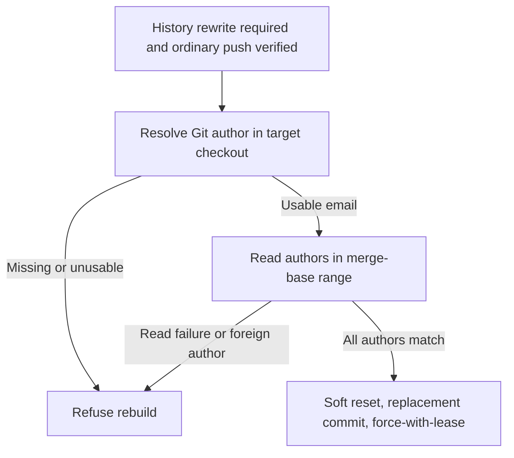

## Summary

History rebuilds now resolve the effective Git author in the target checkout and refuse to collapse commits by another author, or to proceed when identity or commit authors cannot be read. `ownedAuthorEmails` is required and validated. Closes #4554.

Version bump: no version file was changed for this fix; the merged commit records the final version.

## Spec

### Intent and Rationale

- Prevent the CI-fix lane from rewriting a human or another bot's commit as a worker-authored commit.
- Resolve ownership from Git's effective author identity in the checkout where the rebuild runs.

### Essential Design Decisions

- Trust only the resolved author email. No additional fleet emails were found in an authoritative allow-list, and commit history is not used to infer ownership.
- Refuse before reset, replacement commit or force-push if the identity is missing or malformed, commit authors cannot be read, or any commit author is not the resolved worker email.

### Undiscoverable Facts

- `git var GIT_AUTHOR_IDENT` was observed to honour both `GIT_AUTHOR_EMAIL` and repository `user.email` overrides in this environment.

## Evidence

Backend-only change; verified through the CI processor and history rewrite tests.

### Deno regression avoided

- Used the repository's Deno tasks and Deno lint, check and formatter; no Node tooling or dependency changes were added.

Observed Git identity resolution:

- `env GIT_AUTHOR_EMAIL=override@example.invalid git var GIT_AUTHOR_IDENT` returned `VibeCoderST <override@example.invalid> …`.
- `git -c user.email=repo-config@example.invalid var GIT_AUTHOR_IDENT` returned `VibeCoderST <repo-config@example.invalid> …`.

## Test Plan

- `worker/deno/tests/pr_ci_processor_test.ts`: foreign-author branch refuses before reset, commit or force-push; worker-only branch rebuilds; unresolved and malformed identities refuse; unreadable commit authors refuse. Final targeted run: 63 passed, 0 failed.
- `worker/deno/tests/branch_history_rewrite_test.ts`: missing/unusable ownership and author-read failure refuse; existing branch ownership, merge-base, foreign-author, no-commit and lease cases remain covered. Final targeted run: 63 passed, 0 failed.
- Reproduction: with `origin/main` production files restored and the new `processCiFailure` regression test retained, the foreign-author test failed at the no-mutation assertion (actual mutation detected, expected none). Restoring the fix made the same targeted suite pass.
- Caller-wiring mutation: replacing the `git var GIT_AUTHOR_IDENT` request with a non-identity command made the foreign-author regression test fail; the identity lookup was restored.
- Real Git identity checks confirmed environment and repository-config overrides as recorded in Evidence. The history author query uses `git log --format=%ae` in the merge-base range.
- The touched tests were the only call-site coverage added; the sole production caller of `rebuildBranchHistory` is `worker/deno/lib/pr_ci_processor.ts`. Existing helper tests now provide explicit ownership; no assertions were removed.
- `deno lint`, `deno fmt --check` and `deno check` on the four changed TypeScript files passed.
- `./quality.sh < /dev/null` ran and failed only its unit-test time-budget audit: all tests passed in the parallel and serial test stages, but it reported 123 tests over one second, including both tests in unchanged `tests/launcher_harness_reclaim_stub_test.ts` (7.26s) and both tests in unchanged `tests/parallel_safety_cap_test.ts` (3.19s). Config integration and Checkov were skipped by the gate because `.config.json`/the required tool were unavailable. Other quality checks passed.
