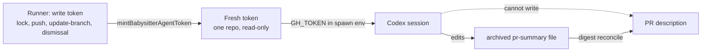

## Summary

The fleet PR babysitter's Codex session now gets its own installation token,
created fresh for each repair, scoped to the target repository only, and limited
to read permissions (contents, pull requests, issues, checks, actions). It no
longer inherits the runner's App write token from `GH_TOKEN`, so it cannot edit
a PR description with `gh`. A description fix can then land only through the
archived summary, and the existing digest reconcile (#3760) rebuilds the
description from it. Closes #4572.

Version bump: no `VERSION` change in this diff; the merged commit records the
final version.

## Spec

### Intent and Rationale

- Least privilege: every GitHub write the repair needs is made by the runner, so
  the agent only needs reads. Minting a separate token fixes the cause rather
  than adding a gate or prompt rule.
- `getInstallationToken` gained an optional `permissions` argument because
  GitHub's `POST /app/installations/{id}/access_tokens` already accepts it;
  `ensureValidToken` and its cache are unchanged.

### Essential Design Decisions

- The agent token is minted uncached, immediately before the attempt-file write,
  so it lasts a full hour and a transient mint failure does not consume the
  per-head attempt. It is not refreshed (the issue allows letting late reads
  fail); a repair can run for 90 minutes.
- `mintBabysitterAgentToken` fails closed: it throws when GitHub reports no
  permissions or grants anything other than `read`. `getInstallationToken`
  refuses an empty `permissions` object, because GitHub would then mint the
  full-permission token.
- The prompt gains one sentence telling the agent that `gh` is read-only and
  that description fixes go in the archived summary. That is advice only; the
  token is the control.

### Undiscoverable Facts

- The evidence in the issue (App edits to descriptions seconds before repair
  commits) comes from GitHub's `userContentEdits`, which only the issue author
  could see. I did not re-check it.
- The five read permissions are already required of the App by
  `fleet_pr_babysitter_setup.ts` (checked in the setup docs), so no App
  reconfiguration is needed.

## Evidence

Backend/CLI change, no UI. Tests that cover it:

- `worker/deno/tests/github_app_installation_permissions_4572_test.ts`:
  `permissions` and `repositories` reach the request body, an empty
  `permissions` is refused, and omitting it keeps the old body.
- `worker/deno/tests/fleet_babysitter_app_test.ts`: `mintBabysitterAgentToken`
  requests one bare repository and the exact read-only scope, returns its token,
  rejects a write grant (naming it) and a response without permissions;
  `babysitterAgentEnv` carries the token and rejects an empty one. The RSA key
  is generated at test time, so no key is committed. The launch test exercises
  the mint-to-spawn path in a subprocess with a distinct runner token and checks
  the requested scope and the token passed to Codex.
- `worker/deno/tests/fleet_pr_babysitter_test.ts` checks the spawn environment,
  codex arguments and 90-minute limit with a fake spawn.

Existing callers: `getInstallationToken` is also called by `ensureValidToken`
and `fleet_pr_babysitter_setup.ts`; neither passes `permissions`, and the
existing `github_app_auth_test.ts` is unchanged and passes.

## Test Plan

- Red then green: the new body tests failed before the implementation; after it,
  the three test files pass (52 tests).
- Guard breaks, each seen red and restored: dropping `permissions` from the
  request body (3 tests red); skipping the write-permission check in
  `mintBabysitterAgentToken` (`rejects a token GitHub grants a write permission`
  red); spawning with the old `{ TMPDIR, XDG_CACHE_HOME }` env (the spawn test
  red at its `GH_TOKEN` assertion).
- Changed call sites: `fix()` calls `startBabysitterAgent`, which mints the
  token and calls `spawnBabysitterAgent`; `pass()` and `main` thread `app`
  through as a required parameter. The launch test exercises that helper with
  a fake token exchange and spawn, in an isolated process.
- Mutation check: the spawn test asserts the full codex argument list (`-c`,
  `--output-last-message` and the rest, in order) and the `stdin`, `stdout` and
  `stderr` options. The `fix()` call needs a real clone and PR lock; `dir` is a
  required field, so dropping it fails `deno check`. The `pass(...)` call inside
  `main` needs live GitHub App credentials and a running watch loop.
- Docs read and updated: `docs/workflows/fleet-pr-babysitter.md` (Codex
  paragraph), `docs/workflows/fleet-pr-babysitter-github-app.md` (permissions
  list and token-refresh sentence). `fleet-pr-babysitter/README.md` and
  `README.md` were read and name no token behaviour made false.
- No assertion was removed from any existing test; `github_app_auth_test.ts` is
  untouched.
- On the earlier implementation, `./quality.sh < /dev/null`: every stage passed
  (semgrep, lint, type check, fmt, markdownlint, mermaid) except `deno tests`, whose only
  2 failures are
  `completion - an unformatted Rust change is formatted and committed, then passes the gate`
  and
  `completion - cargo fmt stages only the branch's .rs files, not an unrelated uncommitted edit`
  (`tests/completion_phase_repo_formatters_test.ts`). They need a default rustup
  toolchain this host lacks and fail the same way without this change. The
  serial pass did not run because the parallel pass failed; `config integration`
  and `checkov` were skipped for local prerequisites.
- CI repair: the launch and parallel-safety tests passed (13 tests) after
  isolating the runner token in a subprocess; this summary reflects the head.
  `deno task check:manifests` passed. The local quality gate passed formatting,
  lint, type checking and completeness checks, but its parallel test pass
  panicked in Deno 2.9.0 while restoring test permissions; the serial pass did
  not run. Semgrep, Checkov and config integration lacked local prerequisites.
