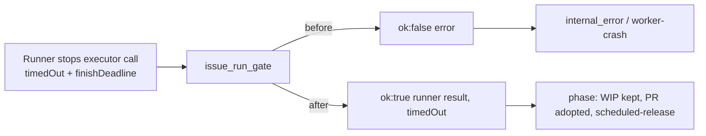

## Summary

With external orchestration on, a runner timeout or scheduled release of the
executor call was returned as an error, so the execute phase filed it as
`internal_error` and the run-failure filer raised a `worker-crash` issue. The
gate now returns the runner's own timed-out result, so the phase's existing
timeout and scheduled-release handling applies, and a scheduled release is not
retried. Closes #4584.

Version bump: no `VERSION` change in this diff; the merged commit records the
final version.

## Spec

### Intent and Rationale

- The failed run (GRQ-AutoTrader#4521, host `vibe-coder-39983`, 6140 s) was cut
  off by the cycle's finish deadline at 15:59:21; the sibling run
  GRQ-AutoTrader#4968 in the same process was released correctly as
  `scheduled-release` two seconds later. The orchestrated path turned the same
  stop into
  `Claude execution failed: executor call timed out after 2 attempt(s): The agent run was stopped by the worker's watchdog.`,
  which skipped WIP preservation and the existing-PR check (the agent had
  already opened PR #5014).
- Returning the runner's result fixes the cause, rather than teaching the
  classifier to ignore this message.

### Essential Design Decisions

- A genuine hard timeout is returned the same way as a release: the
  non-orchestrated path already treats both as `timedOut`, so one mechanism
  covers both. Exit code 124 without `timedOut` stays an error, as before.
- `AgentCallResult` gains `retryable?: false`; the gate sets it only for a
  scheduled release or finish deadline, because a retry past the deadline cannot
  help. Attempt counts in the orchestrator's messages now report attempts
  actually made.

### Undiscoverable Facts

- The issue body carries no failure excerpt because the source repository is
  private. The cause was found in the host's run log for the failed run and in
  the release comment on GRQ-AutoTrader#4521.
- In that run the first executor attempt's agent kept running after its attempt
  timed out and finished PR #5014 itself. I did not find why it survived the
  watchdog kill; that is not changed here.

## Evidence

Backend only, no UI. Tests: `worker/deno/tests/orchestration_3642_gate_test.ts`
and `worker/deno/tests/orchestration_3642_orchestrator_test.ts`.

## Reproduction

- **symptom** — an orchestrated executor call stopped at the finish deadline
  ended the run as `internal_error` (`worker-crash`) instead of a scheduled
  release
- **status** — `verified` — with the three `worker/deno/lib/orchestration/`
  files restored to the base branch, 4 tests in the two files fail; with the fix
  they pass
- **regression test** — `worker/deno/tests/orchestration_3642_gate_test.ts`, the
  new tests on a finish-deadline release and a hard-cap release

## Test Plan

- Added to the gate test: finish-deadline release returns `ok` with `timedOut`
  and `finishDeadline` and the executor is called once; hard-cap release
  likewise; a genuine hard timeout is retried and then returns the last
  timed-out result.
- Added to the orchestrator test: a call marked `retryable: false` is called
  once and ends `timed_out`; the same call without it is called twice (positive
  control).
- No assertion removed from any existing test; the existing exit-124 test is
  unchanged and passes.
- Mutation check: two gate tests pin the surviving mutants. An exit 124 the
  runner did not mark `timedOut`, with `finishDeadline` set, is retried (kills
  dropping `result.timedOut === true` at `issue_run_gate.ts:166`). A `timedOut`
  result with exit 2 (quota) ends the run as an error, not the runner's result
  (kills dropping `outcome.state === "timed_out"` at `issue_run_gate.ts:339`).
  Both mutations were applied by hand and each turns its test red.
- `worker/deno/lib/orchestration/types.ts:140` and
  `worker/deno/lib/orchestration/types.ts:144` exempt (untestable): type-only
  declarations erased at runtime, so no runtime test can see the swap. A
  `@ts-expect-error` test in the orchestrator test pins them at type-check time
  (`retryable: true` and `retryable` on a success are rejected).
- Red checks, each restored afterwards: removing the `lastTimedOut` return turns
  the gate tests red; removing the `retryable !== false` check turns the
  orchestrator test and gate finish-deadline tests red; dropping
  `retryable: false` in `toAgentCallResult` turns the gate release tests red
  while the genuine-timeout test stays green.
- Entry points: `runOrchestratedIssueRun` is called by `executeClaudeBody` (via
  `invokeAgent`) and `createDefaultDeps`; the phase code is unchanged and
  already handles a timed-out result.
- `./quality.sh < /dev/null`: every stage passes (semgrep, lint, type check,
  fmt, markdownlint, mermaid) except `deno tests`, which has 3 failures
  unrelated to this change: the two Rust formatter tests in
  `tests/completion_phase_repo_formatters_test.ts` (no default rustup toolchain
  on this host) and `run.sh and run.ps1 - hand the runtime the same invocation`
  in `tests/launcher_parity_test.ts` (host memory and CPU values). I did not
  re-run them on the base branch. The serial pass did not run;
  `config integration` and `checkov` were skipped for local prerequisites.
- Docs: `docs/MANAGER-WORKER-CONTRACT.md` was read; it does not describe how a
  timeout reaches the phase, so it is unchanged.
