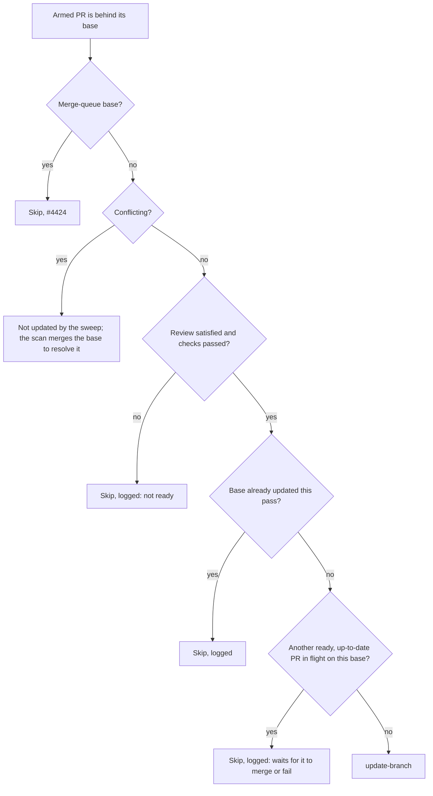

## Summary

On a base with no merge queue, a behind PR is now refreshed only once it is
armed, review-satisfied, conflict-free and green, and only one PR per base is
refreshed at a time. The auto-merge sweep, the branch-update scan and the fleet
PR babysitter all follow it, and every skipped update is logged with its reason.
Closes #4613.

## Spec

### Intent and Rationale

- Merging the base into every behind PR reruns full CI on PRs still waiting for
  review (43% of one private repository's PR runs). Refreshing only the PR that
  can merge does the queue's job serially without changing a check or ruleset.
- The scan stops refreshing a merely-behind PR on every base, not only strict
  ones: it reads a git ahead/behind count and has no `mergeStateStatus`. The
  sweep is the single owner of the refresh.

### Essential Design Decisions

- No strictness lookup: a base that is not strict never reports a PR as
  `BEHIND`, so the sweep and babysitter never reach the rule there.
- Review is satisfied when `reviewDecision` is `APPROVED`, empty or null (no
  review required). `REVIEW_REQUIRED`, `CHANGES_REQUESTED`, a missing key or an
  unparseable payload is not ready.
- Checks are judged from `statusCheckRollup` on the same `gh pr view` round
  trip: every entry must have completed successfully (an empty rollup counts as
  passed). The required-check set is not in that read, so a failing or stuck
  non-required check also holds the refresh.
- "In flight" is stateless: another armed PR on the same base that is up to
  date, review-satisfied, conflict-free and passed or pending. The sweep counts
  only the fleet PRs it lists; the babysitter counts every open PR in the
  listing.
- Not gated: the merge ladder's `behind_target` retry
  (`lib/merge_block_escalation.ts`), reached for unarmed PRs at merge time. It
  is a different path the issue does not name.

### Undiscoverable Facts

- The issue's 43% and 23% figures were measured on a private fleet repository
  over 1.5 days to 2026-11-01; they are not reproduced here.

## Evidence

Backend only; no UI file changed. Production wiring needs no change:
`readPrLiveState` carries the new fields and `PR_LIVE_STATE_JSON_FIELDS` now
ends `…reviewDecision,statusCheckRollup`.

Sibling members grepped for the docs sweep: `Priority 1.6`, `1.65`,
`update-branch`, `behind_target`, `keep branches current`.

## Acceptance Criteria

<!-- vibe-spec-review inputs="diff+issue-body" -->

- **met** — Update a behind PR only when it is otherwise ready to merge:
  auto-merge is armed, the required review is satisfied, there are no conflicts,
  and the required checks passed on its current head — evidence:
  `worker/deno/lib/auto_merge_sweep.ts`,
  `worker/deno/tests/auto_merge_sweep_ready_only_4613_test.ts` — reviewer:
  partial — reason: the reviewer noted all rollup checks (not only required
  ones) are judged and `UNKNOWN` mergeable counts as not conflicting; both are
  documented in `docs/MERGE.md` and the required set is not in the live-state
  read
- **met** — Update at most one such PR per base at a time. Wait for it to merge,
  or to fail, before updating the next — evidence:
  `worker/deno/tests/auto_merge_sweep_ready_only_4613_test.ts` (three-pass test)
  — reviewer: met
- **met** — A fleet session merges the base into a PR branch only to resolve a
  conflict, or when the PR is the one being updated — evidence:
  `worker/deno/lib/pr_branch_update.ts`,
  `worker/deno/commands/fleet_pr_babysitter.ts`,
  `worker/deno/tests/fleet_pr_babysitter_test.ts` — reviewer: partial — reason:
  the reviewer saw the babysitter and merge ladder still updating; the
  babysitter is gated in this diff, and the merge ladder's `behind_target` retry
  is left ungated and documented
- **met** — Log every skipped update with the reason — evidence:
  `worker/deno/tests/auto_merge_sweep_ready_only_4613_test.ts`,
  `worker/deno/tests/pr_branch_update_test.ts` — reviewer: met
- **met** — Unit test: a behind PR that is awaiting review is not updated —
  evidence: `worker/deno/tests/auto_merge_sweep_ready_only_4613_test.ts` —
  reviewer: met
- **met** — Unit test: an approved, green, behind PR is updated — evidence:
  `worker/deno/tests/auto_merge_sweep_ready_only_4613_test.ts` — reviewer: met
- **met** — Unit test: two ready PRs on one base are updated one after the other
  — evidence: `worker/deno/tests/auto_merge_sweep_ready_only_4613_test.ts` —
  reviewer: met
- **met** — Unit test: a merge-queue base is untouched (#4424) — evidence:
  `worker/deno/tests/auto_merge_sweep_ready_only_4613_test.ts`,
  `worker/deno/tests/auto_merge_sweep_merge_queue_test.ts` — reviewer: met
- **met** — The docs for the sweep describe the policy — evidence:
  `docs/MERGE.md` (Branch updates without a merge queue),
  `docs/workflows/pr-feedback.md` — reviewer: met
- **unrequested** — the scan also stops refreshing a merely-behind PR on
  non-strict and milestone bases, and reads mergeability for every PR —
  reviewer: unrequested — reason: the scan cannot tell a strict base apart; the
  issue's point 3 asks for conflict-only merges

## Standards Review

<!-- vibe-standards-review inputs="diff+CODING-STANDARDS.md" -->

- **violation** — milestone behind-count test lost its check — evidence:
  `worker/deno/tests/milestone_merge_behaviour_test.ts:384` — reason: fixed in
  this diff (asserts the scan's `4 commit(s) behind` log line)
- **violation** — in-flight operands untested — evidence:
  `worker/deno/lib/auto_merge_sweep.ts:305` — reason: fixed in this diff (six
  single-operand tests plus a control)
- **violation** — dead `deferBehind` outcome — evidence:
  `worker/deno/lib/pr_branch_update.ts:857` — reason: fixed in this diff
  (parameter and behind outcome removed)
- **violation** — stale doc comments — evidence:
  `worker/deno/lib/direct_merge.ts:1071` — reason: fixed in this diff (also
  `lib/pr_maintenance.ts`, `lib/auto_merge_sweep.ts`,
  `lib/merge_queue_runtime.ts`, `DESIGN-PRINCIPLES.md`)
- **violation** — docs dropped the "armed" condition — evidence:
  `docs/MERGE.md:344` — reason: fixed in this diff (also
  `docs/workflows/pr-feedback.md`, `docs/OVERVIEW.md`,
  `docs/workflows/README.md`)
- **clean** — Australian English, no hidden paths staged, tests call real code,
  ready-gate outcomes each have a test

## Test Plan

- `deno task test:unit` over the touched test files plus
  `run_core_production_deps_test.ts` and `pr_maintenance_command_test.ts`: 220
  passed, 0 failed. `deno fmt --check`, `deno lint` and `deno check` clean on
  the touched `.ts` files. `markdownlint_check_test.ts`: 23 passed.
- New: `worker/deno/tests/auto_merge_sweep_ready_only_4613_test.ts` (review,
  checks, one per pass, in-flight across passes, per-base, failed update, queue
  base, read-once, six not-in-flight operands plus a control);
  `worker/deno/tests/pr_live_fields_4613_test.ts` (`reviewSatisfied`,
  `classifyCheckRollup`); babysitter `reason` and `behindUpdateHeld` cases in
  `worker/deno/tests/fleet_pr_babysitter_test.ts`; two `readPrLiveState` cases
  in `worker/deno/tests/pr_live_state_test.ts`.
- Break-checks (code edited, test red, code restored): review check removed →
  red; checks check removed → red; per-pass set removed → red; in-flight check
  removed → red; set-on-failure → red; each `findInFlightOnBase` operand (draft,
  needs-human, open, armed, mergeable, `checks === "passed"`) → red; babysitter
  armed, review and base-filter checks → red; scan wrong behind count / skipped
  log → red.
- Removed or changed in existing tests (all Required by: "A fleet session merges
  the base into a PR branch only to resolve a conflict"):
  - `worker/deno/tests/pr_branch_update_test.ts`,
    `pr_branch_update_integration_test.ts`,
    `pr_branch_update_merge_queue_test.ts`, `milestone_merge_behaviour_test.ts`:
    assertions that a merely-behind PR yields a `behind` action
    (`reason === "behind"`, `behindBy`) now assert no action and a skipped
    count. Fixtures whose purpose was not "behind" became CONFLICTING and keep
    every assertion. The queued-base-yields-no-action case for
    `decidePrUpdateAction` was removed because the function no longer takes a
    queue input.
  - `worker/deno/tests/auto_merge_sweep_test.ts`,
    `auto_merge_sweep_merge_queue_test.ts`,
    `auto_merge_sweep_keeps_armed_test.ts`, `fleet_pr_babysitter_test.ts`:
    fixtures gained `reviewSatisfied`/`checks` (or approved review, armed,
    completed checks); no assertion removed.
- Callers of `decidePrUpdateAction` checked: `scanPrBranchUpdates` only. Callers
  of the live-state read: sweep, merge-conflict drain and CI-fix passes read the
  new fields as optional and ignore them.
- Not covered by a unit test: the babysitter's `discover` skip logic and its
  per-pass set (a closure over `gh`).
- Related docs rules checked: none found in prompts or `CODING-STANDARDS.md` on
  this subject.

<!-- vibe-quality-gate-skipped: full ./quality.sh not run in this session; targeted tests, fmt, lint and check are green and CI runs the gate -->
