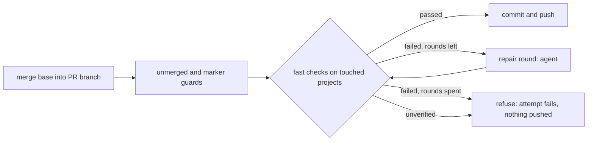

## Summary

Before the merge-conflict path pushes a base merge onto a PR branch, the worker
now runs the repository's fast local checks for the projects the merge touched.
A failing check goes back to the merge-conflict agent as a repair round in the
same attempt (two at most), and a check that still fails refuses the push. The
`merge_conflict` prompt no longer says CI is the check. Closes #4616.

Version bump: no `VERSION` change in this diff; the merged commit records the
final version.

## Spec

### Intent and Rationale

- CI was the first thing to see what a base merge broke, so each break cost a CI
  run and a CI-fix session. The check now runs in the clone before the push,
  deterministically, not by the agent's judgement.
- The repair loop reuses the agent's existing repair mode (Issue #1965) rather
  than a new prompt; the verification, the loop and the refusal live in one new
  module, `worker/deno/lib/merge_fast_checks.ts`, so the 3000-line processor
  only calls it.

### Essential Design Decisions

- The check covers clean merges too (the processor merges first, then checks,
  then pushes), not only conflicted ones: the issue's evidence includes clean
  merges.
- A project is "touched" when a path from `git diff --name-only -z
  <head before merge>` lies under its directory; the root project is touched by
  any path. Per touched project: Deno runs `fmt --check`, `lint`, the type check
  (the repo's `check` task if defined), then `check:manifests` and `test:unit`
  or `test` when defined; Cargo runs `fmt --all -- --check`, `clippy --workspace
  --all-targets -- -D warnings`, and `cargo test --workspace` (`--locked` with a
  committed `Cargo.lock`). The clippy flags are `-D warnings`, an assumption:
  the repository's CI flags are not read.
- Fail closed: a tool that is not installed, a check that times out, or the 900
  s budget being spent refuses the push as `unverified` with no repair round
  (the agent cannot fix those). Only the two environment faults the milestone
  gate already recognises (unreachable remote modules, Issue #4422; `rustc`
  older than `rust-version`, Issue #3255) are left to CI and named on the
  resolved comment.
- On refusal or cut-short the local branch is reset to the attempt's starting
  tip (`discardLocalMerge`); only commits made after that tip in this attempt
  are destroyed and none was pushed.
- The milestone takeover path is unchanged; it has its own gate.

### Undiscoverable Facts

- Not run against a live PR with a real conflict: the processor tests inject the
  verifier, and the module tests inject the runner. The default runner was not
  exercised in a unit test (it spawns the real toolchain).
- The pre-push time is recorded under the existing `gate` stage of the stage
  timer; no new stage was added.

## Evidence

Backend and prompt only, no UI. No fleet-wide measurement is claimed.

- `worker/deno/tests/merge_fast_checks_test.ts` (28 tests): planning, running,
  fail-closed outcomes, and the repair loop.
- `worker/deno/tests/pr_merge_conflict_processor_test.ts`: the verifier is
  called after the marker guard and before the push, on conflicted and clean
  merges; a refusal pushes nothing; cut-short withdraws; repair runs reach the
  agent in repair mode; repair cost is ledgered per round.
- `worker/deno/tests/merge_conflict_prompt_v2_test.ts` and
  `worker/deno/tests/milestone_gate_repair_prompt_test.ts`: prompt wording.
- Issue numbers cited: #4616 (this issue), #1965 (gate repair mode), #4422
  (remote-module gap), #3255 (rustc gap), #2306 (agent runs no gate), #2260
  (inert text in comments); each appears in the code or docs this diff edits.

## Test Plan

- `deno task test:unit` on `tests/merge_fast_checks_test.ts`,
  `tests/pr_merge_conflict_processor_test.ts`,
  `tests/pr_merge_conflict_milestone_takeover_test.ts`,
  `tests/pr_merge_conflict_scan_test.ts`, `tests/conflict_1957_replay_test.ts`,
  `tests/conflict_2028_replay_test.ts`, `tests/gated_head_passes_test.ts`,
  `tests/merge_conflict_agent_test.ts`,
  `tests/merge_conflict_intent_processor_test.ts`: all passed (processor file
  106 tests; module file 28). `tests/merge_conflict_prompt_v2_test.ts`,
  `tests/milestone_gate_repair_prompt_test.ts`, `tests/prompt_builder_test.ts`:
  103 passed. `tests/lib_sweep_coverage_test.ts`: 39 passed.
- Red checks (each break restored afterwards):
  - Verifier call moved after `commitAndPushPending` => the
    refused-pushes-nothing, clean-merge ordering, cut-short and stage-order
    tests red.
  - `refused` treated as passed => the refused test red.
  - Verifier skipped on the clean-merge path => the clean-merge test and the
    clean-merge repair test red.
  - `discardLocalMerge` call deleted from the refused path => the reset test and
    the failed-restore test red.
  - Stop-at-first-failure broken in `runMergeFastChecks` => 2 tests red.
  - Runner throw counted as ran (fail-open) => the runner-throws test red.
  - Repair round count off by one => 2 tests red.
  - Exit code 124 branch removed => the timed-out test red.
  - Staged-merge repair wording forced to the committed text, the PR repair
    opening disabled, and the `prompt.md` paragraph reverted => each new prompt
    test red.
- Existing tests edited:
  - Removed from `worker/deno/tests/merge_conflict_prompt_v2_test.ts`:
    `assertStringIncludes(flat, "CI on the pushed merge");` Required by: "Update
    the prompt so it no longer says that CI is the check." Replaced by:
    `assertEquals(flat.includes("CI on the pushed merge"), false)` and the
    assertions that the prompt names the worker's pre-push checks.
  - Removed from `worker/deno/tests/merge_conflict_prompt_v2_test.ts`:
    `assertStringIncludes(flat, "Resolve carefully enough that those checks pass");`
    Required by: "Update the prompt so it no longer says that CI is the check."
    Replaced by:
    `assertStringIncludes(flat, "A failing check is never a reason to push")`.
  - Changed in `worker/deno/tests/pr_merge_conflict_processor_test.ts`: the
    `buildAttemptComment` assertion `"CI on the pushed merge"` now asserts the
    new wording ("the fast checks on the packages the merge touched" and "CI on
    the pushed merge is the full gate"); red when the comment is reverted. The
    #2308 stage-order expectation now includes `gate`, because the verifier is
    timed under that stage; red when the timer call is removed.
- Callers and siblings checked: the verifier is called from `resolveConflict`
  only; `takeOverMilestoneConflict` and the stale-verdict and nudge rungs push
  no base merge and are unchanged. Five other test files that import the
  processor pass without changes.
- `./quality.sh`: every stage passed except `deno tests`, where the parallel
  pass ended with 31604 passed and 2 failed, both in
  `tests/completion_phase_repo_formatters_test.ts` (lines 480 and 567, the cargo
  fmt commit tests; this host has no rustup/cargo and this diff does not touch
  that code). The serial pass did not run because the parallel pass failed.
  `config integration` and `checkov` were skipped for local prerequisites.
- Docs updated: `docs/workflows/merge-conflicts.md` (TL;DR, the contract list,
  the stage-timings section), `README.md` (Merge conflict row),
  `prompts/merge_conflict/prompt.md`, and the comment in
  `worker/deno/lib/prompt_manager.ts`. Sibling docs grepped:
  `docs/INTERNALS.md`, `docs/EXTENDING.md`, `docs/PROMPT-HOUSE-VOCABULARY.md`.
- Related prompt rules checked: the prompt's "run one test suite at a time"
  sentence is kept verbatim; the repair-mode steps keep their committed wording
  for milestone repairs.
- `docs/audits/lib-sweep-coverage/top-up-4616.json` claims the new module for
  the sweep ledger.
- Not done: no live run against a real conflicting PR; clippy flags beyond
  `-D warnings` are not read from the repository's CI; the mutation check was
  not run locally.
