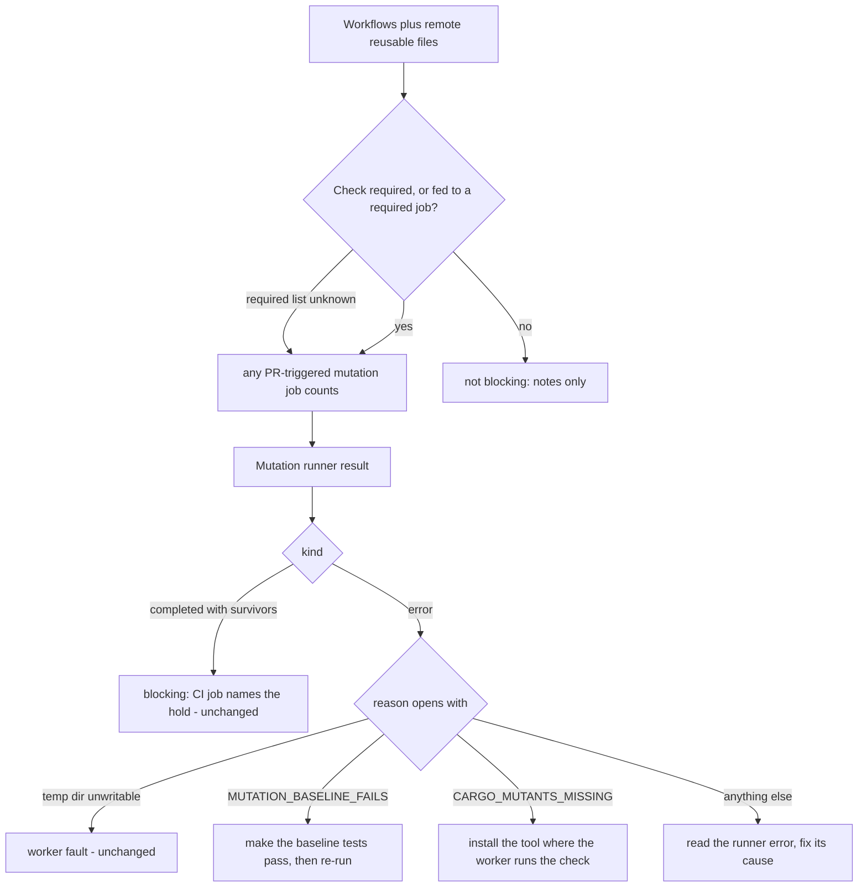

## Summary

Continues #4617 after #4744 (survivors block when the repository's CI runs a
blocking mutants job), #4801 (a job calling one local reusable workflow is
followed) and #4814 (nested local reusable workflows are followed). Earlier in
this branch, the "Distinguish survivors from baseline compilation/test failures
and an unavailable mutation tool" line: when the mutation check errors on a
repository whose CI blocks on a mutation job, the note names a different next
action for a baseline build or test failure, for an uninstalled `cargo-mutants`,
and for any other runner error. This change adds three more pieces of the
agreement:

- **Remote reusable workflows.** A job that `uses:`
  `owner/repo/.github/workflows/x.yml@ref` is followed when the worker can read
  the file (`gh api repos/<owner>/<repo>/contents/...`), through the same
  nine-level bound and cycle guard as local calls, at most eight distinct remote
  files. One that cannot be read is listed as unreadable, never read as
  non-blocking. Remote files are inspected only through a caller, never as
  this repository's top-level PR workflows.
- **The real required-check contract.** The worker reads the base branch's
  required checks (rulesets and classic protection) and counts a mutation job
  only when its check, or the check of a job that needs it directly or through
  others (the aggregator), is required. An unreadable or empty list is unknown,
  so every PR-triggered job still counts then.
- **CI flags.** `--timeout`, `--cargo-arg` and `--test-tool` of the CI
  `cargo mutants` line are carried to the worker's run, with a value check each.
  A missing cargo-nextest is identified before the run and gets an install
  action. Reusable child checks are matched by their full caller path, including
  a required child that depends on the mutation job, rather than by a sibling.

The flags of a `deno task` are still not read: the worker's Deno runner does not
run the repository's task, so there is nothing to apply them to. Part of #4617.

Version bump: no `VERSION` change in this diff; the merged commit records the
final version.

## Spec

### Intent and Rationale

- The agreement on the issue asks that a baseline failure, a missing tool and a
  survivor each get an accurate next action. Survivors and the worker fault
  already did; the other two shared one sentence that told a reader to do
  either.

### Essential Design Decisions

- The cause is read from the start of the runner's reason, using constants now
  exported by `worker/deno/lib/mutation_gate.ts` (`MUTATION_BASELINE_FAILS`,
  `CARGO_MUTANTS_MISSING`) that the runner imports and emits, so the producer
  and the classifier cannot drift apart. An unrecognised reason falls to the
  generic action rather than guessing.
- A runner error still raises the PR ready and armed (#4820): it is reported as
  unvalidated, not passed, because CI's job gives the full verdict. Only the
  wording of the next action changed.

- The required-check list comes from `readRequiredCheckNames`
  (`worker/deno/lib/required_branch_checks_4613.ts`), which shares its two reads
  with `readRequiredChecksPassed`. A read failure is logged and read as unknown
  (never as "none required"), so a lookup fault cannot silently turn the hold
  off. `worker/deno/lib/ci_mutation_lookup.ts` builds the options for the three
  call sites: the completion phase, the review-fix mutation check and the
  review-fix drift check.
- A remote `owner/repo` with a `.` or `..` segment, a path with `..` or a
  subdirectory, and a `${{ }}` ref are not remote calls, because the text comes
  from a pull request and builds an API path. A `./` call inside a remote file
  names a file of the remote repository, so it is not followed.

### Undiscoverable Facts

- None.

## Evidence

The #4617 security-sweep coverage slice also claims `ci_mutation_lookup.ts`,
which reads required checks and remote workflow text through the injected GitHub
runner. This repairs the CI ledger coverage failure without claiming a sweep.

Backend-only change; no UI file is touched. Tests call the real verdict function
(`worker/deno/tests/mutation_gate_test.ts`) and the real runner with stubbed
processes (`worker/deno/tests/mutation_runner_test.ts`). Docs read and updated:
`docs/mutation-check.md` (new remote-workflow and required-check paragraphs, the
flag list and the "not evaluated" sentence; point 4 of the blocking-CI section
and the Error row of the outcomes table, which said "a draft PR" for an error
and now says the PR is raised ready and armed, as the code does). Consumers of
the reason text (`completion_phase.ts`, `pr_deferral.ts`) only display it.

## Acceptance Criteria

<!-- vibe-spec-review inputs="diff+issue-body" -->

- **met** — For a repository whose CI runs a blocking mutants job, a PR is not
  reported ready or successfully validated while the worker's mutation check
  reports genuine unresolved survivors, for a mutants job in a remote reusable
  workflow (`owner/repo/.github/workflows/...@ref`) — evidence:
  `worker/deno/tests/ci_mutation_contract_remote_test.ts::a remote reusable workflow with a blocking mutants job is followed when fetched`
  and
  `worker/deno/tests/completion_phase_mutation_gate_test.ts::completion - a survivor a remote reusable mutants workflow blocks on holds the PR as a draft (Issue #4617)`
  — reviewer: met
- **met** — Use the repository's actual required CI contract (including jobs
  feeding an aggregator) for branch-protection required-check names — evidence:
  `worker/deno/tests/ci_mutation_contract_remote_test.ts::a mutants job counts when its own check, or an aggregator needing it, is required`,
  `worker/deno/tests/ci_mutation_lookup_test.ts::readRequiredCheckNames merges rulesets and classic protection without duplicates`
  and
  `worker/deno/tests/completion_phase_mutation_gate_test.ts::completion - a CI mutants job that no required check covers does not hold the PR (Issue #4617)`
  — reviewer: met
- **partial** — Run the applicable changed-code mutation command with
  CI-equivalent flags for `deno task` flags and cargo `--timeout`, `--cargo-arg`
  and `--test-tool` — evidence:
  `worker/deno/tests/ci_mutation_contract_remote_test.ts::extractCargoMutantsArgs carries --timeout, --cargo-arg and --test-tool`
  — reviewer: partial — reason: the three cargo flags are carried; the flags of
  a `deno task` are not read, because the worker's Deno runner does not run the
  repository's task and has nothing to apply them to.
- **met** — Distinguish survivors from baseline compilation/test failures and an
  unavailable mutation tool; all need an accurate next action — evidence:
  `worker/deno/tests/mutation_gate_test.ts::evaluateMutationGate - a baseline failure on a blocking CI job names the baseline next action (Issue #4617)`
  and the two sibling tests beside it — reviewer: met

## Test Plan

- Review follow-up: reusable checks match the full caller and child name;
  a sibling is no longer treated as the mutation job. Required feeders still
  count, as verified by
  `worker/deno/tests/ci_mutation_contract_remote_test.ts::reusable mutation jobs match their own required checks and feeders`.
  The runner probes nextest before passing the CI flag and reports a missing
  tool with its install action, covered by
  `worker/deno/tests/mutation_runner_test.ts::runMutationCheck rust - missing nextest is reported as a missing tool`.
  No twinned copy of these rules was found.

- `worker/deno/tests/lib_sweep_coverage_test.ts` verifies that every module is
  claimed by exactly one security-sweep slice.
- Added in `worker/deno/tests/mutation_gate_test.ts`: a baseline failure, a
  missing `cargo-mutants`, an unrelated runner error (each with a positive
  control that the other two actions are absent and that "unvalidated, not
  passed" is present), the no-CI-block case (none of the three actions appear),
  and a direct `mutationErrorNextAction` test.
- Edited `worker/deno/tests/mutation_runner_test.ts`: the baseline and missing
  tool tests assert the exported constants as well as the original literal
  wording, retaining coverage of both the classifier contract and the message.
  - Added: exit code 4 gives the baseline prefix and code 1 does not, in
    `worker/deno/tests/mutation_runner_test.ts::runMutationCheck rust - baseline failure and usage errors are errors`.
  - Red check: the classifier returning only the generic action turned the
    baseline, cargo-mutants and direct tests red (3 failed); restored.
- Ran, with stdin from `/dev/null`:
  `deno task test:unit tests/ci_mutation_contract_test.ts tests/ci_mutation_contract_remote_test.ts tests/ci_mutation_lookup_test.ts tests/mutation_gate_test.ts tests/mutation_runner_test.ts tests/completion_phase_mutation_gate_test.ts tests/pr_feedback_drift_check_3750_test.ts tests/pr_feedback_mutation_check_3750_test.ts tests/pr_feedback_processor_drift_check_3143_test.ts tests/pr_feedback_processor_mutation_check_3750_test.ts tests/required_branch_checks_4613_test.ts`
  — passed (212 parallel, 162 serial); `deno fmt --check`, `deno lint` and
  `deno check` over `worker/deno/lib` and `worker/deno/tests` — passed.
- Callers of the reason text checked: `completion_phase.ts` and `pr_deferral.ts`
  display it only; their tests in
  `worker/deno/tests/completion_phase_mutation_gate_test.ts` pass.
- Added for the remote workflow, required-check and flag work:
  `worker/deno/tests/ci_mutation_contract_remote_test.ts` (fetched, unreadable,
  nested, self-calling and capped remote workflows; the remote-call shape
  including `..` owner or repository segments; required checks by own name,
  aggregator, chain of `needs`, matrix and reusable child, and a templated name;
  the flag values), `worker/deno/tests/ci_mutation_lookup_test.ts` (the stubbed
  `gh` reads) and one test each in `completion_phase_mutation_gate_test.ts`,
  `pr_feedback_drift_check_3750_test.ts` and
  `pr_feedback_mutation_check_3750_test.ts` for the call sites. Red check:
  leaving `requiredChecks` out of `ciMutationLookupOptions` turned the
  completion test red; restored.
- Review regression coverage:
  `worker/deno/tests/ci_mutation_contract_remote_test.ts::a remote PR workflow reached only from a non-PR path is not a local PR workflow`
  and
  `worker/deno/tests/ci_mutation_contract_remote_test.ts::a remote PR workflow with a templated job name does not bypass the caller's required check`.
  Both failed before restricting the top-level scan to local files and passed
  afterwards. No twinned copy of this detector was found.
- Not done: the flags of a `deno task` (the `partial` entry above).
- `./quality.sh`: the earlier head's run failed only two
  `formatter should commit the Rust fix` tests in
  `worker/deno/tests/completion_phase_repo_formatters_test.ts`, a file this
  change does not touch. This head's gate is re-run by the worker after this
  commit; it was not re-run in this session.
