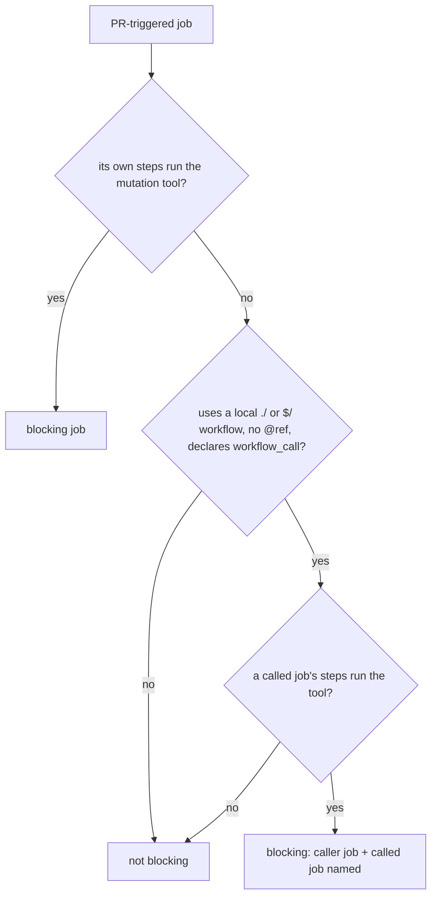

## Summary

Continues #4617 after the first PR (#4744, merged) made the worker treat
surviving mutants as blocking when the repository's CI runs a blocking mutants
job. That detection missed a mutation run that lives in a local reusable
workflow, which is a common way to share a `cargo mutants` job. The detector now
follows a PR-triggered job's `uses: ./.github/workflows/<name>.yml` (or
`$/.github/workflows/<name>.yml`) one level deep, when the called workflow
declares `workflow_call`, so those repositories get the same hold-as-draft
behaviour. A remote reusable workflow, a ref-qualified `uses:` and a nested call
are not followed. The job is reported as
`caller job (reusable called.yml: inner
job)` under the caller's workflow file,
with the caller's aggregator. Part of #4617.

Version bump: no `VERSION` change in this diff; the merged commit records the
final version.

## Spec

### Intent and Rationale

- The base PR read only a job's own steps, so a repository whose CI job
  delegates to a reusable workflow still had its survivors written off as
  reviewer notes, then failed in CI.

### Essential Design Decisions

- The `uses:` value is parsed by the existing `calledWorkflowPath`
  (`worker/deno/lib/pr_check_contexts.ts`), then confined to a file directly
  under `.github/workflows/` by an anchored pattern, and refused if it carries
  an `@ref`. The name is only looked up in the in-memory map of parsed
  workflows, never joined into a filesystem path.
- Files are now read and parsed in a first pass, so the callee is available when
  its caller is scanned. `unreadable` stays complete.
- Called jobs share the caller's alias-dedup set and 1 MiB scan budget, so many
  callers cannot multiply the work. A callee that exhausts it reports the
  calling file as unreadable.
- A malformed or missing callee leaves the contract unknown, as for any
  unreadable workflow (logged, not blocking).

### Undiscoverable Facts

- GitHub does not allow `continue-on-error` on a job that calls a reusable
  workflow, so no guard for it was added.

## Evidence

Backend-only change; no UI file is touched. Tests call the real detector over
temporary repositories (`worker/deno/tests/ci_mutation_contract_test.ts`):
positive and aggregator case, `$/` form, `with:`/`secrets: inherit`, every
`workflow_call` trigger shape; negatives for remote, `@ref`, `..`, subdirectory,
bare path, missing, push-only, nested, `continue-on-error` callee step, callee
with no `jobs`, scalar or list `jobs`; a malformed callee listed as unreadable;
a counted shared-budget case; and hostile `uses:` values of 200000 characters
(letters, then dots followed by `!`).

Docs read and updated: `docs/mutation-check.md` (the blocking-CI section and the
scan-budget paragraph) and the module doc of
`worker/deno/lib/ci_mutation_contract.ts`.

## Acceptance Criteria

<!-- vibe-spec-review inputs="diff+issue-body" -->

- **partial** — For a repository whose CI runs a blocking mutants job, a PR is not
  reported ready or successfully validated while the worker's mutation check
  reports genuine unresolved survivors; any preserved draft/checkpoint remains
  explicitly incomplete. A unit test covers this. — evidence:
  `worker/deno/tests/ci_mutation_contract_test.ts::a PR job calling a local reusable workflow with a mutation run is blocking`
  extends detection to reusable-workflow jobs; the hold itself is covered on
  base by
  `worker/deno/tests/completion_phase_mutation_gate_test.ts::completion - a survivor the repository's CI blocks on holds the PR as a draft`
  — reviewer: partial — reason: nested local and remote reusable-workflow
  mutants jobs are not detected, so those repositories' PRs can still be
  reported ready with unresolved survivors.
- **met** — Repositories without one are unchanged. — evidence:
  `worker/deno/tests/ci_mutation_contract_test.ts::a remote or ref-qualified reusable workflow is not followed`
  and the other negatives — reviewer: met
- **partial** — Use the repository's actual required CI contract (including jobs
  feeding an aggregator) — evidence:
  `worker/deno/tests/ci_mutation_contract_test.ts::a PR job calling a local reusable workflow with a mutation run is blocking`
  — reviewer: partial — reason: branch protection and required-check names are
  still not read, remote reusable workflows and nested calls are not followed
- **partial** — Run the applicable changed-code mutation command with
  CI-equivalent flags after the final relevant edit — evidence:
  `worker/deno/tests/ci_mutation_contract_test.ts::a PR job calling a local reusable workflow with a mutation run is blocking`
  (flags are now read from the called workflow's command) — reviewer: partial —
  reason: flags of a `deno task` are still not read

## Standards Review

<!-- vibe-standards-review inputs="diff+CODING-STANDARDS.md" -->

- **violation** — two guards in `blockingJobHit` had no test — evidence:
  `worker/deno/lib/ci_mutation_contract.ts:369` — reason: fixed in this diff
  (callee with no `jobs`, and a null job beside a real one)
- **violation** — stale doc comment on `BlockingMutationJob.job` — evidence:
  `worker/deno/lib/ci_mutation_contract.ts:55` — reason: fixed in this diff
- **violation** — the `uses:` parser was re-implemented instead of calling
  `calledWorkflowPath` — evidence: `worker/deno/lib/ci_mutation_contract.ts:94`
  — reason: fixed in this diff (the helper is called, then the result is
  confined)
- **violation** — a `continue-on-error` guard on a calling job, which GitHub
  does not allow — evidence: `worker/deno/lib/ci_mutation_contract.ts:362` —
  reason: fixed in this diff (guard and its test removed)
- **clean** — Australian English, path confinement, regex vetted with hostile
  cases, no secret or hidden file staged

## Test Plan

- Tests added in `worker/deno/tests/ci_mutation_contract_test.ts` (listed under
  Evidence); no existing test was edited and no assertion removed.
- Red checks, each break applied alone then restored: dropping the
  `workflow_call` check, the one-level limit, the pattern's `^` anchor, the `$/`
  support, the `@` refusal, the `!isMapping(calledJobs)` guard and the
  `isMapping(body)` test each turned a named test red. The malformed-callee test
  pins existing behaviour (base already listed unreadable files) and is green on
  base.
- `deno task test:unit tests/ci_mutation_contract_test.ts
  tests/completion_phase_mutation_gate_test.ts tests/mutation_gate_test.ts`:
  114 passed in the parallel pass, 69 in the serial pass, 0 failed. `deno fmt`,
  `deno lint`, `deno check` and `markdownlint-cli2 docs/mutation-check.md`
  passed.
- Mutation check (`ci_mutation_contract.ts:425`, dropping `blocking !== null`):
  killed by `with two blocking workflows the first in sorted order is reported`
  (two blocking workflows; the later one overwrote the first with the operand
  dropped, the test went red; restored, 70 passed).
- `listWorkflowFiles` (verifier finding at `ci_mutation_contract.ts:116`): the
  function is module-private and its body is unchanged in this diff (only the
  neighbouring `triggersOn` rename and new helpers moved around it). The other
  eight "callers" the verifier listed in `supply_chain_gate.ts` and
  `workflow_hygiene_check.ts` call those modules' own, separately defined
  `listWorkflowFiles` (`supply_chain_gate.ts:883`,
  `workflow_hygiene_check.ts:304`), not this one; the only caller of this one is
  `findBlockingMutationJob`, whose tests all pass. Verdict for every listed
  caller: unchanged.
- Callers of `findBlockingMutationJob` checked: the completion phase and the
  review-fix mutation check both read only `workflow`, `job` as text,
  `cargoArgs` and `tool`; both see the reusable hit through the same function.
- Full `./quality.sh < /dev/null` on the final code head:
  `Result: PASSED (with
  skipped checks)`, including deno tests, lint, type
  check and fmt. Skipped by the gate itself: config integration and checkov.

🤖 Generated with [Claude Code](https://claude.com/claude-code)
