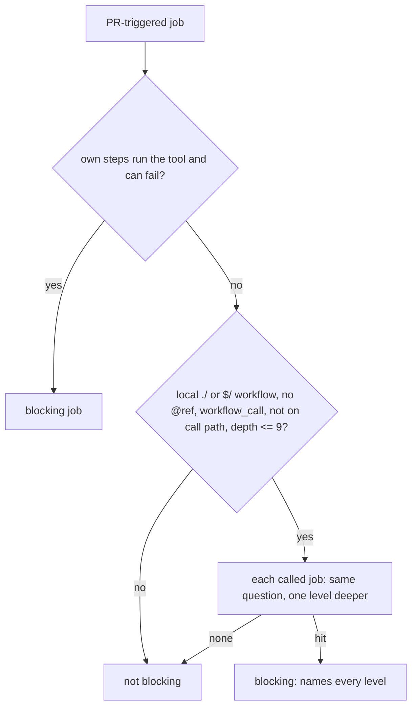

## Summary

Continues #4617 after #4744 (survivors block when the repository's CI runs a
blocking mutants job) and #4801 (a PR-triggered job that calls one local
reusable workflow is followed). The detector now also follows **nested** local
reusable workflows: a called job that itself `uses:` another local
`./.github/workflows/<name>.yml` (or `$/...`) workflow that declares
`workflow_call` is followed, up to nine callee levels, with a refusal to follow a
workflow already on the call path. The job is named as
`caller (reusable a.yml: mid (reusable b.yml: inner))`. Remote and `@ref` calls
are still not followed, branch protection is still not read, and the flags of a
`deno task` are still not read. Part of #4617.

Version bump: no `VERSION` change in this diff; the merged commit records the
final version.

## Spec

### Intent and Rationale

- A mutants job two or more reusable calls away from the PR-triggered workflow
  was written off as reviewer notes, then failed in CI. Following the chain
  closes that gap for the shape the previous PR left out.

### Essential Design Decisions

- The `uses:` check moved into `localReusableCallee`, which still calls the
  existing `calledWorkflowPath` and the anchored pattern; names are looked up in
  the in-memory map of parsed workflows, never joined into a path.
- `MAX_REUSABLE_DEPTH = 9` and a call-path cycle guard bound the walk. Every job
  visited charges the shared scan budget, so fan-out across nested calls cannot
  multiply work; exhausting it reports the calling file as unreadable.
- The cap is set at or above GitHub's nesting limit. I could not read GitHub's
  current documentation from this environment (the fetch was refused), so the
  limit is not cited; a deeper chain is bounded rather than unlimited.

### Undiscoverable Facts

- GitHub does not allow `continue-on-error` on a job that calls a reusable
  workflow, so no guard for it was added.

## Evidence

Backend-only change; no UI file is touched. Tests call the real detector over
temporary repositories (`worker/deno/tests/ci_mutation_contract_test.ts`).
Docs read and updated: `docs/mutation-check.md` (the blocking-CI section) and
the module doc of `worker/deno/lib/ci_mutation_contract.ts`; consumers of the
job string (`mutation_gate.ts`, `completion_phase.ts`, `pr_deferral.ts`) only
interpolate it for display.

## Acceptance Criteria

<!-- vibe-spec-review inputs="diff+issue-body" -->

- **partial** — For a repository whose CI runs a blocking mutants job, a PR is
  not reported ready or successfully validated while the worker's mutation check
  reports genuine unresolved survivors; any preserved draft/checkpoint remains
  explicitly incomplete. A unit test covers this. — evidence:
  `worker/deno/tests/ci_mutation_contract_test.ts::a nine-level nested reusable call with a mutation run is blocking at the depth cap`
  (detection); the hold itself is covered on base by
  `worker/deno/tests/completion_phase_mutation_gate_test.ts::completion - a survivor the repository's CI blocks on holds the PR as a draft`
  — reviewer: met — reason: the reviewer judged this met; I keep `partial`
  because remote reusable workflows are not followed, so those repositories can
  still be reported ready with unresolved survivors
- **met** — Repositories without one are unchanged. — evidence:
  `worker/deno/tests/ci_mutation_contract_test.ts::a nested reusable callee without workflow_call is not followed`
  and
  `worker/deno/tests/ci_mutation_contract_test.ts::a nested remote or ref-qualified reusable call is not followed`
  — reviewer: met
- **partial** — Use the repository's actual required CI contract (including jobs
  feeding an aggregator) — evidence:
  `worker/deno/tests/ci_mutation_contract_test.ts::a reusable workflow calling another reusable workflow with a mutation run is blocking`
  — reviewer: met — reason: the reviewer judged this met; I keep `partial`
  because branch protection and required-check names are still not read and
  remote reusable workflows are not followed
- **partial** — Run the applicable changed-code mutation command with
  CI-equivalent flags after the final relevant edit — evidence:
  `worker/deno/tests/ci_mutation_contract_test.ts::a reusable workflow calling another reusable workflow with a mutation run is blocking`
  (`cargoArgs` carried through nesting) — reviewer: met — reason: the reviewer
  judged this met; I keep `partial` because the flags of a `deno task` are still
  not read

## Standards Review

<!-- vibe-standards-review inputs="diff+CODING-STANDARDS.md" -->

- **violation** — the cycle test claimed to pin the guard but the depth cap alone
  ended it — evidence: `worker/deno/tests/ci_mutation_contract_test.ts:1268` —
  reason: fixed in this diff (renamed termination-only; the guard is pinned by
  the "nested call back" test, red without the guard)
- **violation** — GitHub's nesting limit asserted without a source — evidence:
  `worker/deno/lib/ci_mutation_contract.ts:108` — reason: fixed in this diff (the
  claim is removed; the cap is documented as a bound)
- **clean** — Australian English, no hidden file staged, no new regex, no new
  member that only a test reads, docs updated, no assertion removed apart from
  the edited one below

## Test Plan

- Edited: `a reusable workflow calling another reusable workflow with a mutation run is blocking`
  (was "...is not followed twice"). Removed from
  `worker/deno/tests/ci_mutation_contract_test.ts`: the assertion
  `blocking: null` for a nested call.
  - Obsolete: nested calls were not followed; this change follows them.
  - Still covered by:
    `worker/deno/tests/ci_mutation_contract_test.ts::a nested reusable callee without workflow_call is not followed`
    (the `null` result for a nested non-followable callee, with a positive
    control).
  - Red check: one level only (`MAX_REUSABLE_DEPTH = 1`) turns it red.
- New tests, each with a positive control; red checks, each applied alone then
  restored:
  - depth cap: `MAX_REUSABLE_DEPTH = 8` turns the nine-level test red;
    `= 10` turns `a tenth nested reusable callee level is not followed` red.
  - cycle guard: removing `chain.includes(file)` turns
    `a nested call back to a workflow on the call path is refused, and a later job still blocks`
    red (the termination-only cycle test stays green, as stated in its name).
  - per-job budget charge: removing it turns
    `nested reusable fan-out shares the caller's scan budget` red.
  - `workflow_call`, `@ref`/remote and non-failing-callee refusals at nested
    depth: each probed with only the probed element made legal, which blocks.
- Callers of the changed `findBlockingMutationJob` (`completion_phase.ts`,
  `pr_feedback_mutation_check.ts`, `pr_feedback_drift_check.ts`) read `job` as
  display text; their tests
  (`worker/deno/tests/mutation_gate_test.ts`,
  `worker/deno/tests/completion_phase_mutation_gate_test.ts`) pass.
- Ran: `deno task test:unit tests/ci_mutation_contract_test.ts tests/mutation_gate_test.ts tests/completion_phase_mutation_gate_test.ts`
  — passed (114 parallel, 78 serial); `deno fmt --check`, `deno lint`,
  `deno check` on the two TypeScript files — passed.
- `./quality.sh`: every stage up to the release-tag ruleset passed (including
  markdownlint, mermaid, semgrep, completeness checks); the run then reached my
  590 s bound inside the long unit-test stage, so the full gate did not finish
  on this head. CI runs it on the PR.
- Not done: remote reusable workflows, branch protection / required-check
  names, `deno task` flags; GitHub's current nesting limit not verified.

<!-- vibe-quality-gate-skipped reason="the full ./quality.sh unit-test stage exceeded the run's 590 s bound; all earlier stages passed; CI runs the full gate on the PR" -->
