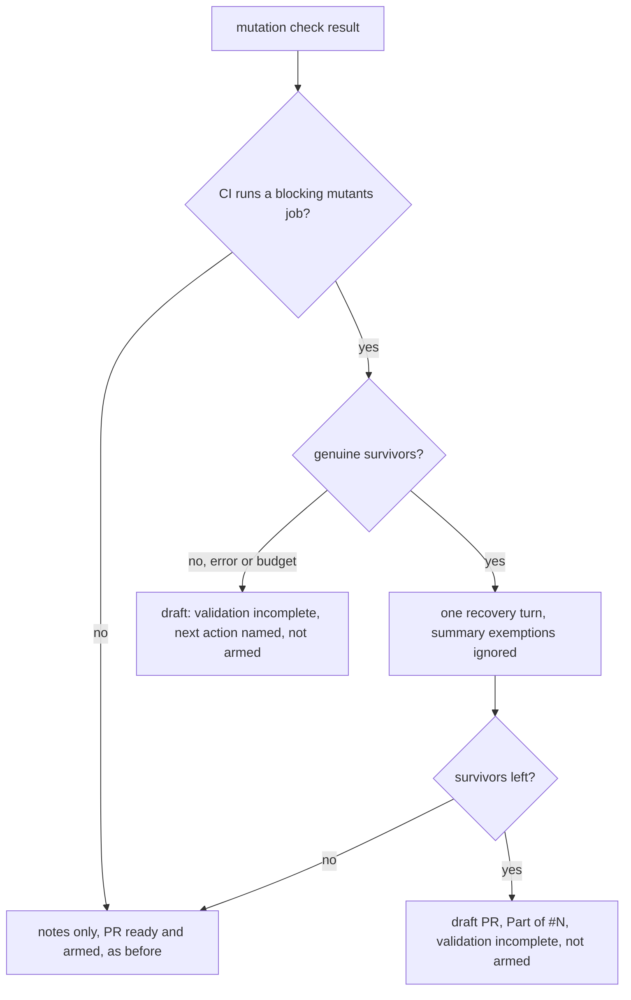

## Summary

When the repository's own CI runs a blocking mutants job, the worker's
diff-scoped mutation check now treats genuine surviving mutants as blocking
instead of leaving them as "Notes for the reviewer". The survivors are put to
the implementing run in the existing one recovery turn, with the CI job named.
If any remain after that turn, the pull request is raised as a draft
`Part of #4617` that states the validation is incomplete, is not marked ready
and is not auto-merged. A check that cannot finish (runner error, missing tool,
baseline failure, worker fault, budget or mutant cap short of the diff) holds
the pull request the same way and names the next action. A pull request parked
by the secondary-rate-limit deferral is recorded with `draft: true` and opened
as a draft by the drain. The worker's `cargo mutants` run uses the CI job's
scope flags (package, features, exclude patterns). The issue stays open, and the
next run continues the branch. Repositories without such a job behave exactly as
before. Part of #4617.

Version bump: no `VERSION` change in this diff; the merged commit records the
final version.

## Spec

### Intent and Rationale

- CI's `cargo mutants` job failed on 15 fleet PRs in 7 days on the same
  survivors the reviewer notes had listed, so a survivor CI rejects must not be
  shipped as an advisory note.

### Essential Design Decisions

- Detection is local: `worker/deno/lib/ci_mutation_contract.ts` reads
  `.github/workflows/*.yml|yaml` and treats any `pull_request` job that runs
  `cargo mutants`, `cargo-mutants`, `cargo +toolchain mutants` or
  `deno task *mutat*` and can fail as blocking. Branch protection is not read,
  `if:`/path filters are not evaluated and reusable-workflow callers are not
  followed (the module and `docs/mutation-check.md` say so). An unreadable
  workflow is logged and read as unknown, never as a pass.
- On a blocking-CI repository a survivor, or a check that cannot finish (runner
  error, missing tool, baseline failure, worker fault, exhausted budget or
  mutant cap), holds the PR as a draft. The incomplete case carries an
  `incomplete.nextAction` into the draft body and comment. No recovery turn runs
  for the budget case, since a turn cannot add mutants. A repository whose cap
  is always short of its diff stays a draft until the change is narrower or the
  budget is raised; that is the cost of not reporting unvalidated work ready.
- The contract is read before the check so the CI job's `cargo mutants` scope
  flags (`--package`, `--workspace`, `--features`, `--exclude`, `--exclude-re`,
  `--examine-re` and similar, values passed as argv words, never through a
  shell) reach the worker's run. A job another job lists under `needs` is
  reported with that aggregator.
- On a blocking-CI repository a summary `exempt (untestable)` line no longer
  clears a survivor, since CI never reads the summary; the comment points at the
  tool's own skip mechanism. No new exemption and no lowered threshold was
  added.
- The hold reuses the draft-continuation path (`convertToDraftContinuation`,
  `withholdIssueClose`); the fleet's own draft does not hold its issue, so the
  next run resumes the branch.

### Undiscoverable Facts

- A PR opened later by the secondary-rate-limit deferral drain
  (`worker/deno/lib/deferred_pr_drain.ts`) is created over REST. The parked
  record now carries `draft: true` for a held PR and the REST create sends
  `-F draft=true` (a boolean; `-f` would send the string).

## Evidence

Backend-only change; no UI file is touched. The decision above is exercised
through the real `workOnIssueCompletion`.

- `worker/deno/tests/ci_mutation_contract_test.ts` (34 tests): detector forms,
  look-alikes (`|| true`, `||true`, `|| :`, `|| exit 0`, `# || true`,
  `echo "|| true"; cargo mutants`), `+toolchain`, `\` continuations, step and
  job `continue-on-error`, trigger shapes, missing directory, malformed file
  reported in `unreadable`, and one hostile 200000-character case per pattern.
- `worker/deno/tests/mutation_gate_test.ts` (10 new tests): with the CI block a
  summary exemption does not clear a survivor (positive control without it),
  error and clean results carry no `ciBlock`, and the comment and reason
  sanitise hostile job names.
- `worker/deno/tests/completion_phase_mutation_gate_test.ts` (new tests):
  `completion - a survivor the repository's CI blocks on holds the PR as a draft`,
  the exemption-ignored and clean/error/`continue-on-error` controls, the
  existing-PR conversion,
  `completion - a held PR the REST fallback opens is converted to a draft and not armed`,
  `completion - a workflow lookup that throws is noted as non-blocking and the PR is raised ready`
  and
  `completion - an unreadable workflow file is logged by name and does not hold the PR`.
- `worker/deno/tests/draft_continuation_mutation_hold_test.ts`: the hold body
  and the `draftBody` override.
- `worker/deno/tests/pr_feedback_drift_check_3750_test.ts` (one new test): the
  review-fix path, the second production caller of `evaluateMutationGate`, now
  passes the contract, so an exemption no longer clears a survivor there either.
- Follow-up for the verifier and the unmet criteria:
  `tests/deferred_pr_drain_test.ts` (draft record reaches the create; ordinary
  record is not a draft), `tests/pr_create_rest_test.ts` (`-F draft=true`),
  `completion - a held PR parked by the secondary limit is recorded as a draft for the drain`,
  `completion - a runner error with a blocking CI job holds the PR as an incomplete-validation draft`,
  `completion - an exhausted mutation budget with a blocking CI job holds the PR as a draft`,
  `completion - the CI job's cargo mutants flags reach the worker's runner`,
  `tests/mutation_runner_test.ts` (flags in the cargo argv), and in
  `tests/ci_mutation_contract_test.ts` the aggregator, `extractCargoMutantsArgs`
  and the cases that kill the surviving mutants of `isMapping`, `isTrueFlag`,
  `listWorkflowFiles` and the trigger fallthrough (directory named `x.yml`,
  non-workflow extensions, non-mapping documents, `"true"` string flags, a
  trigger that is a number).
- Docs: `docs/mutation-check.md` (new section and the sentences it made false),
  `docs/workflows/issue-processing.md`, `CODING-STANDARDS.md` and its declared
  twin `prompts/coding_guidelines/prompt.md`, and `prompts/issue/prompt.md`.
  Ledger entry `docs/audits/lib-sweep-coverage/top-up-4617.json`.

## Acceptance Criteria

<!-- vibe-spec-review inputs="diff+issue-body" -->

- **partial** — Use the repository's actual required CI contract (including jobs
  feeding an aggregator) — evidence:
  `worker/deno/tests/ci_mutation_contract_test.ts::a job another job needs is reported with its aggregator`
  — reviewer: partial — reason: branch protection and rulesets are not read,
  any PR-triggered job counts, and reusable workflows are not followed
- **partial** — Run the applicable changed-code mutation command with CI-equivalent
  flags after the final relevant edit — evidence:
  `worker/deno/tests/completion_phase_mutation_gate_test.ts::completion - the CI job's cargo mutants flags reach the worker's runner`
  — reviewer: partial — reason: Deno task flags and review-fix cargo flags are
  not carried; the worker also adds its own `--package` and `--in-diff`
- **partial** — retain an explicit resumable state if validation cannot finish —
  evidence: `worker/deno/lib/mutation_gate.ts` (`incomplete`),
  `completion - a runner error with a blocking CI job holds the PR as an incomplete-validation draft`
  — reviewer: partial — reason: unresolvable `quality_credentials` and an
  unreadable or throwing workflow lookup still raise the PR ready, by design
  (the contract or the check is then unknown)
- **met** — a PR is not reported ready … while the worker's mutation check
  reports genuine unresolved survivors, on the deferred-creation path —
  evidence:
  `worker/deno/tests/completion_phase_mutation_gate_test.ts::completion - a held PR parked by the secondary limit is recorded as a draft for the drain`,
  `worker/deno/tests/deferred_pr_drain_test.ts` — reviewer: met

## Standards Review

<!-- vibe-standards-review inputs="diff+CODING-STANDARDS.md" -->

- **clean** — Australian English, KISS/DRY, tests added with each behaviour
  change, no secret or shell interpolation of workflow-file values (flags are
  argv words, length-capped, metacharacters refused)

## Test Plan

- `deno task test:unit` over `tests/ci_mutation_contract_test.ts`,
  `tests/mutation_gate_test.ts`, `tests/completion_phase_mutation_gate_test.ts`,
  `tests/draft_continuation_mutation_hold_test.ts` and
  `tests/pr_feedback_drift_check_3750_test.ts` from `worker/deno`: passed on the
  head (with `tests/mutation_runner_test.ts`, `tests/deferred_pr_drain_test.ts`
  and `tests/pr_create_rest_test.ts`); `deno check` on the edited modules,
  `deno fmt` and `deno lint`: passed. `deno task check:manifests`: 847 passed, 0
  failed.
- Red checks (break applied, test run, restored): hold never set → the
  held-draft, exemption-ignored and existing-PR tests red; `--draft` not pushed
  → held tests red; hold intro not used → the advisory test red; recovery arming
  a held PR → the existing-PR test red; REST-fallback conversion removed → its
  test red; catch branch rethrows → the lookup-throws test red; review-fix third
  argument removed → the new review-fix test red; detector's non-failing helper
  forced false, `+toolchain` removed, continuation join disabled → the matching
  detector tests red.
- Callers of `evaluateMutationGate` checked: the completion phase and the
  review-fix path (`worker/deno/lib/pr_feedback_drift_check.ts`) both pass the
  contract; the parameter stays optional so the many two-argument test calls
  keep their old meaning.
- Existing tests: no assertion was removed or edited in an existing test; the
  shared double in `completion_phase_mutation_gate_test.ts` gained counters and
  scenario flags, and its `gh pr view` stub now reports `isDraft: false`.
- Full `./quality.sh` ran and failed in `deno tests` on three tests this diff
  does not touch: `babysitter default heartbeat resolves its checkout revision`
  (a JSR manifest download for `@std/crypto` fails on this host),
  `verifyResolvedTree - the repository's own task sees only the allowlisted environment (Issue #4659)`
  (the `agent` account probe fails on this host) and
  `every non-test module under the ledger roots is claimed by exactly one sweep slice`,
  which this diff caused and fixed afterwards with the ledger entry; the last
  was re-run and passes (39 passed). The serial pass did not run after the
  parallel failure, so CI runs the rest.
- Docs sweep: grepped `mutation check`, `survivor` and `skip_mutation_check`
  across `docs/` and the prompts; `docs/CONFIGURATION.md`, `docs/INTERNALS.md`,
  `docs/CONTAINER.md`, `docs/workflows/pr-feedback.md` and
  `docs/coverage-carryover-check.md` hits stay true (review-fix and disk-parking
  text). Twin rule checked: `CODING-STANDARDS.md` and
  `prompts/coding_guidelines/prompt.md` carry the same sentence.

<!-- vibe-quality-gate-skipped: the full gate ran once and failed on two host-dependent tests this diff does not touch (JSR download, agent-account probe); no re-run fits the remaining budget, CI runs the full suite -->

## Known gaps

- Detection approximates the required-check contract from workflow files and
  `needs`; branch protection is not read.
- A repository whose workflows cannot be read, or whose `quality_credentials`
  cannot be resolved, is not held: the contract or check is unknown.
- The review-fix path reports but never holds a push.

Review follow-up: REST creation carries the draft flag, held bodies obey the
GitHub length limit, and CI detection ignores installation commands while
carrying the supported cargo-mutants filter flags.
