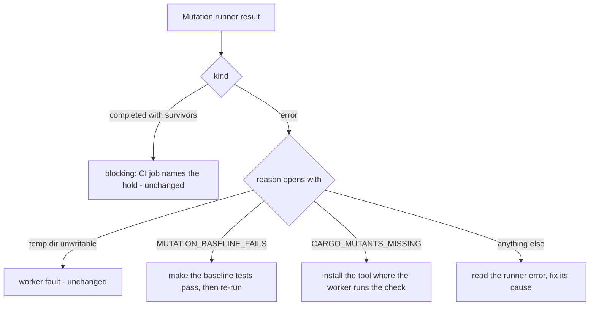

## Summary

Continues #4617 after #4744 (survivors block when the repository's CI runs a
blocking mutants job), #4801 (a job calling one local reusable workflow is
followed) and #4814 (nested local reusable workflows are followed). This change
closes the issue's "Distinguish survivors from baseline compilation/test
failures and an unavailable mutation tool; all need an accurate next action
rather than a generic reviewer note" line: when the mutation check errors on a
repository whose CI blocks on a mutation job, the note now names a different
next action for a baseline build or test failure, for an uninstalled
`cargo-mutants`, and for any other runner error, instead of one sentence that
named the first two together. Remote reusable workflows, branch protection and
the flags of a `deno task` are still not read. Part of #4617.

Version bump: no `VERSION` change in this diff; the merged commit records the
final version.

## Spec

### Intent and Rationale

- The agreement on the issue asks that a baseline failure, a missing tool and a
  survivor each get an accurate next action. Survivors and the worker fault
  already did; the other two shared one sentence that told a reader to do
  either.

### Essential Design Decisions

- The cause is read from the start of the runner's reason, using constants now
  exported by `worker/deno/lib/mutation_gate.ts` (`MUTATION_BASELINE_FAILS`,
  `CARGO_MUTANTS_MISSING`) that the runner imports and emits, so the producer
  and the classifier cannot drift apart. An unrecognised reason falls to the
  generic action rather than guessing.
- A runner error still raises the PR ready and armed (#4820): it is reported as
  unvalidated, not passed, because CI's job gives the full verdict. Only the
  wording of the next action changed.

### Undiscoverable Facts

- None.

## Evidence

Backend-only change; no UI file is touched. Tests call the real verdict function
(`worker/deno/tests/mutation_gate_test.ts`) and the real runner with stubbed
processes (`worker/deno/tests/mutation_runner_test.ts`). Docs read and updated:
`docs/mutation-check.md` (point 4 of the blocking-CI section and the Error row
of the outcomes table, which said "a draft PR" for an error and now says the PR
is raised ready and armed, as the code does). Consumers of the reason text
(`completion_phase.ts`, `pr_deferral.ts`) only display it.

## Acceptance Criteria

- **missing** — For a repository whose CI runs a blocking mutants job, a PR is
  not reported ready or successfully validated while the worker's mutation check
  reports genuine unresolved survivors, for a mutants job in a remote reusable
  workflow (`owner/repo/.github/workflows/...@ref`) — reason: such workflows are
  not read, so a PR can be reported ready with unresolved survivors. Local and
  nested local chains are covered by #4744, #4801 and #4814.
- **missing** — Use the repository's actual required CI contract (including jobs
  feeding an aggregator) for branch-protection required-check names — reason:
  not read; any PR-triggered job that runs the tool and can fail counts, which
  over-approximates. Aggregators by `needs` are covered.
- **missing** — Run the applicable changed-code mutation command with
  CI-equivalent flags for `deno task` flags and cargo `--timeout`, `--cargo-arg`
  and `--test-tool` — reason: not read; the other cargo flags are carried.
- Met in this change: "Distinguish survivors from baseline compilation/test
  failures and an unavailable mutation tool; all need an accurate next action" —
  evidence:
  `worker/deno/tests/mutation_gate_test.ts::evaluateMutationGate - a baseline failure on a blocking CI job names the baseline next action (Issue #4617)`
  and the two sibling tests beside it.

## Test Plan

- Added in `worker/deno/tests/mutation_gate_test.ts`: a baseline failure, a
  missing `cargo-mutants`, an unrelated runner error (each with a positive
  control that the other two actions are absent and that "unvalidated, not
  passed" is present), the no-CI-block case (none of the three actions appear),
  and a direct `mutationErrorNextAction` test.
- Edited `worker/deno/tests/mutation_runner_test.ts`: the baseline assertion is
  now `startsWith(MUTATION_BASELINE_FAILS)` (was a substring check for "baseline
  tests fail") and the cargo-mutants-missing assertion is
  `assertEquals(r.reason, CARGO_MUTANTS_MISSING)`.
  - Removed from `worker/deno/tests/mutation_runner_test.ts`: the substring
    assertion `assertStringIncludes(r.reason, "baseline tests fail")`.
    - Obsolete: the literal is now the exported constant, asserted as the
      prefix.
    - Still covered by:
      `worker/deno/tests/mutation_runner_test.ts::runMutationCheck deno - failing baseline is an error and nothing is mutated`,
      now asserting `startsWith(MUTATION_BASELINE_FAILS)`.
  - Removed from `worker/deno/tests/mutation_runner_test.ts`: the substring
    assertion
    `assertStringIncludes(r.reason, "cargo-mutants is not installed")`.
    - Obsolete: the literal is now the exported constant, asserted whole.
    - Still covered by:
      `worker/deno/tests/mutation_runner_test.ts::runMutationCheck rust - missing cargo-mutants is an error`,
      now asserting `assertEquals(r.reason, CARGO_MUTANTS_MISSING)`.
  - Added: exit code 4 gives the baseline prefix and code 1 does not, in
    `worker/deno/tests/mutation_runner_test.ts::runMutationCheck rust - baseline failure and usage errors are errors`.
  - Red check: the classifier returning only the generic action turned the
    baseline, cargo-mutants and direct tests red (3 failed); restored.
- Ran:
  `deno task test:unit tests/mutation_gate_test.ts tests/mutation_runner_test.ts tests/completion_phase_mutation_gate_test.ts`
  — passed (121 parallel, 84 serial); `deno fmt`, `deno lint`, `deno check` on
  the four TypeScript files — passed.
- Callers of the reason text checked: `completion_phase.ts` and `pr_deferral.ts`
  display it only; their tests in
  `worker/deno/tests/completion_phase_mutation_gate_test.ts` pass.
- Not done: remote reusable workflows, branch-protection required-check names,
  `deno task` flags (the three `missing` entries above).
