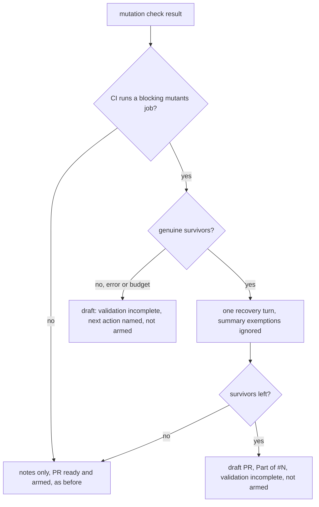

## Summary

When the repository's own CI runs a blocking mutants job, the worker's
diff-scoped mutation check now treats genuine surviving mutants as blocking
instead of leaving them as "Notes for the reviewer". The survivors are put to
the implementing run in the existing one recovery turn, with the CI job named.
If any remain after that turn, the pull request is raised as a draft
`Part of #4617` that states the validation is incomplete, is not marked ready
and is not auto-merged. A check that cannot finish (runner error, missing tool,
baseline failure, worker fault, budget or mutant cap short of the diff) holds
the pull request the same way and names the next action. A pull request parked
by the secondary-rate-limit deferral is recorded with `draft: true` and opened
as a draft by the drain. The worker's `cargo mutants` run uses the CI job's
scope flags (package, features, exclude patterns). The issue stays open, and the
next run continues the branch. CI holds only results for the language its tool checks: cargo-mutants for Rust,
Deno tasks for Deno. Results for the other language remain advisory, including
summary exemptions. Runner errors have no language and remain incomplete.
Repositories without such a job behave exactly as before. Part of #4617.

Version bump: no `VERSION` change in this diff; the merged commit records the
final version.

## Spec

### Intent and Rationale

- CI's `cargo mutants` job failed on 15 fleet PRs in 7 days on the same
  survivors the reviewer notes had listed, so a survivor CI rejects must not be
  shipped as an advisory note.

### Essential Design Decisions

- Detection is local: `worker/deno/lib/ci_mutation_contract.ts` reads
  `.github/workflows/*.yml|yaml` and treats any `pull_request` job that runs
  `cargo mutants`, `cargo-mutants`, `cargo +toolchain mutants` or
  `deno task *mutat*` and can fail as blocking. Branch protection is not read,
  `if:`/path filters are not evaluated and reusable-workflow callers are not
  followed (the module and `docs/mutation-check.md` say so). An unreadable
  workflow is logged and read as unknown, never as a pass.
- On a blocking-CI repository a survivor for the matching language, or a check
  that cannot finish (runner error, missing tool, baseline failure, worker fault, exhausted budget or
  mutant cap), holds the PR as a draft. The incomplete case carries an
  `incomplete.nextAction` into the draft body and comment. No recovery turn runs
  for the budget case, since a turn cannot add mutants. A repository whose cap
  is always short of its diff stays a draft until the change is narrower or the
  budget is raised; that is the cost of not reporting unvalidated work ready.
- The contract is read before the check so the CI job's `cargo mutants` scope
  flags (`--package`, `--workspace`, `--features`, `--exclude`, `--exclude-re`,
  `--examine-re` and similar, values passed as argv words, never through a
  shell) reach the worker's run. A job another job lists under `needs` is
  reported with that aggregator.
- For matching CI, a summary `exempt (untestable)` line cannot clear a
  survivor; the comment points at the tool's own skip mechanism. No exemption
  or lowered threshold was added. The hold reuses the draft-continuation path
  (`convertToDraftContinuation`,
  `withholdIssueClose`); the fleet's own draft does not hold its issue, so the
  next run resumes the branch.

### Undiscoverable Facts

- A PR opened later by the secondary-rate-limit deferral drain
  (`worker/deno/lib/deferred_pr_drain.ts`) is created over REST. The parked
  record now carries `draft: true` for a held PR and the REST create sends
  `-F draft=true` (a boolean; `-f` would send the string).

## Evidence

Backend-only change; no UI file is touched. Tests drive the real detector,
mutation verdict, completion phase, deferral and review-fix paths.

- `worker/deno/tests/ci_mutation_contract_test.ts`: cargo and Deno tool
  identification, installation commands excluded, filter aliases carried,
  aggregator reporting and scope extraction after `;`, `&&` and `||`.
  Hostile inputs include a separator followed by 200000 spaces and no cargo,
  cargo whitespace, toolchain text, a Deno task name and a non-no-op tail.
- `worker/deno/tests/mutation_gate_test.ts`: matching CI ignores summary
  exemptions; mismatched tools retain exemptions in both language directions;
  errors, budget, cap and hostile job labels retain their coverage.
- `worker/deno/tests/completion_phase_mutation_gate_test.ts`: held survivors,
  existing PRs, runner errors and exhausted budgets; the current REST test is
  `completion - a held PR the REST fallback opens is a draft and not armed`
  and asserts the REST draft flag. Both secondary-only and exhausted-create
  deferrals assert that the issue note names the CI job, calls mutation
  validation incomplete, promises a draft and says the next run continues.
  The near-limit summary test checks the held body size. Cargo scope flags
  reach the runner. A cargo CI job with a Deno survivor stays ready and armed.
- `worker/deno/tests/pr_feedback_drift_check_3750_test.ts`: a matching Deno CI
  job ignores the exemption; absent CI and cargo CI honour that Deno exemption.
- Supporting coverage: `draft_continuation_mutation_hold_test.ts`,
  `deferred_pr_drain_test.ts`, `pr_create_rest_test.ts` and
  `mutation_runner_test.ts` cover the held body, persisted draft, REST boolean
  and cargo argv respectively. `deferred_pr_store_test.ts` and
  `completion_phase_secondary_limit_test.ts` cover ordinary parked PRs.
- Read `docs/mutation-check.md`, including its blocking-CI and review-fix
  sections; updated it for language matching and the held pending note.
  Earlier changes also update `docs/workflows/issue-processing.md`,
  `docs/workflows/pr-feedback.md`, `prompts/issue/prompt.md`,
  `CODING-STANDARDS.md` and its twin `prompts/coding_guidelines/prompt.md`.
  REST creation carries the draft flag; held bodies obey the GitHub limit.
  Ledger entry: `docs/audits/lib-sweep-coverage/top-up-4617.json`.

## Acceptance Criteria

<!-- vibe-spec-review inputs="diff+issue-body" -->

- **partial** — Use the repository's actual required CI contract (including jobs
  feeding an aggregator) — evidence:
  `worker/deno/tests/ci_mutation_contract_test.ts::a job another job needs is reported with its aggregator`
  — reviewer: partial — reason: branch protection and rulesets are not read,
  any PR-triggered job counts, and reusable workflows are not followed
- **partial** — Run the applicable changed-code mutation command with CI-equivalent
  flags after the final relevant edit — evidence:
  `worker/deno/tests/completion_phase_mutation_gate_test.ts::completion - the CI job's cargo mutants flags reach the worker's runner`
  — reviewer: partial — reason: Deno task flags and review-fix cargo flags are
  not carried; the worker also adds its own `--package` and `--in-diff`
- **partial** — retain an explicit resumable state if validation cannot finish —
  evidence: `worker/deno/lib/mutation_gate.ts` (`incomplete`),
  `completion - a runner error with a blocking CI job holds the PR as an incomplete-validation draft`
  — reviewer: partial — reason: unresolvable `quality_credentials` and an
  unreadable or throwing workflow lookup still raise the PR ready, by design
  (the contract or the check is then unknown)
- **met** — a PR is not reported ready … while the worker's mutation check
  reports genuine unresolved survivors, on the deferred-creation path —
  evidence:
  `worker/deno/tests/completion_phase_mutation_gate_test.ts::completion - a held PR parked by the secondary limit is recorded as a draft for the drain`,
  `worker/deno/tests/deferred_pr_drain_test.ts`; both held deferral tests also
  assert the pending note states incomplete mutation validation — reviewer: met

## Standards Review

<!-- vibe-standards-review inputs="diff+CODING-STANDARDS.md" -->

- **clean** — Australian English, KISS/DRY, tests added with each behaviour
  change, no secret or shell interpolation of workflow-file values (flags are
  argv words, length-capped, metacharacters refused)

## Test Plan

- Focused local tests use `deno task test:unit` from `worker/deno`, with the
  detector, gate, completion, review-fix, deferred store and secondary-limit
  files named in Evidence. Formatter, linter, type check and manifest checks
  use the same Deno configuration and frozen lockfile as `quality.sh`.
- Reproduced before the fix: separator extraction returned no flags; both
  held deferrals posted the finished-work note; cargo CI held a Deno survivor.
  Each corresponding regression failed, then passed after the fix. The hostile
  separator test exercises the removed overlapping whitespace quantifiers.
- Existing assertions are retained. Detector expectations gain the production
  tool field; completion hold fixtures now return Rust for cargo CI, and the
  review-fix hold fixture uses a Deno CI task for its Deno result. Those
  fixtures keep exercising the original hold behaviour with matching tools.
- Both production callers pass the tool to the shared `evaluateMutationGate`;
  it owns language matching, so completion and review fixes use one rule.
  No second detector or verdict implementation was found.
- Docs sweep: checked mutation/survivor references in the operator manual and
  review workflow. `docs/workflows/pr-feedback.md` was corrected earlier in
  this PR; it is not an unchanged-hit claim. The coding-standard sentence and
  its prompt twin remain aligned.
- Results: the six focused files passed (180 tests); full-tree `deno fmt`,
  `deno lint`, `deno check`, Mermaid and Markdown lint passed. Manifest checks
  passed (847 tests, one existing ignored case). `pr-summary-check` reported
  zero blocked gates; closure, independent review and reproduction were not
  checked without issue-body/label inputs.
- Full `./quality.sh < /dev/null` failed at the parallel Deno test pass. A
  repeat of `deno task test:unit` reproduced a Deno 2.9.5 macOS/aarch64 runtime
  panic: `pledge test permissions called before restoring previous pledge`.
  The serial pass did not run after that crash. The base branch merge (PR
  #4715, Quality run 41555343824) and the existing PR head (Quality run
  41557562405) passed all CI test shards, confirmed with `gh`.
- Local Semgrep and Checkov were unavailable (no installed binary or cached
  container); config integration was skipped because no local config exists.
  CI remains authoritative for those checks. No tests were skipped or changed
  to work around the runtime panic.
- Red checks: removing only the language filter made the mixed-language
  completion test, both-direction exemption test and review-fix control fail.
  Inverting the detected tool made all edited detector tool expectations and
  the matching-language completion/review-fix hold tests fail. Restored both
  changes before the final focused run.

## Known gaps

- Detection approximates the required-check contract from workflow files and
  `needs`; branch protection is not read.
- A repository whose workflows cannot be read, or whose `quality_credentials`
  cannot be resolved, is not held: the contract or check is unknown.
- The review-fix path reports but never holds a push.
