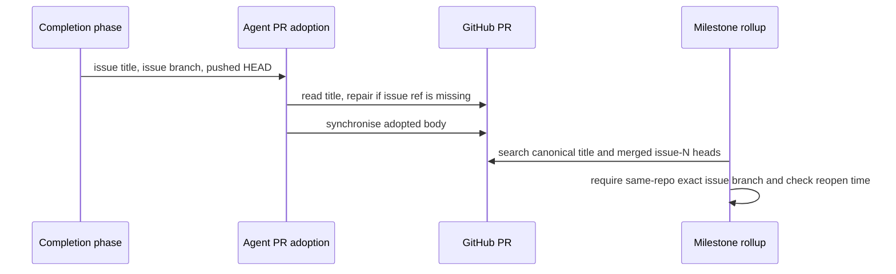

## Summary

Agent-raised PRs now receive the worker's canonical issue title during adoption.
Milestone rollups also recover merged deliveries from a same-repository
`issue-N` head branch, so older PRs without a title reference are claimed
accurately. Closes #4621.

Version bump: none for this change.

## Spec

### Intent and Rationale

- Adoption previously rebuilt the PR body but kept an agent-chosen title,
  leaving issue-title matchers unable to identify the delivery.
- Title repair handles new adoptions; a separate branch search recovers
  already-merged PRs without broadening the shared canonical title-search
  contract.

### Essential Design Decisions

- Keep recognised title references unchanged; otherwise use
  `buildPrTitle(issueTitle, issueNumber)` so normal scrubbing and formatting
  remain authoritative.
- The fallback requires a merged PR, a same-repository head, and an exact issue
  number parsed by `issueNumberFromBranch`; sync branches, forks, prefix matches
  and unmerged PRs do not qualify.
- Bump the claim-verdict cache prefix from v1 to v2 and test that an old
  `sync-pr-only` verdict is ignored. Preserve whether each PR search succeeded;
  never cache a verdict from partial results, including a `predates-reopen`
  verdict based on an older delivery. A recovered search is retried even when
  the issue's `updatedAt` is unchanged. The shared title helper still returns an
  empty list on failure; its optional failure callback supplies the status
  needed by milestone classification.
- The issue's private-repository examples did not include repository or PR
  identifiers. The public examples were verified; the private examples were not
  independently inspectable.

### Undiscoverable Facts

- `gh pr view` showed VibeCoder PR #3783 with head
  `issue-3614-enableautomerge-…`, a `milestone/*` base, and a same-repository
  merged head. NEAT-AI-Discovery PRs #2406 and #2464 had heads beginning
  `issue-2263-…` and `issue-2271-…` respectively and also targeted milestone
  branches.
- A real
  `gh pr list --repo stSoftwareAU/VibeCoder --state merged --search 'head:issue-3614' --json number,title,headRefName,baseRefName,mergedAt,isCrossRepository --limit 1000`
  returned PR #3783 with `isCrossRepository: false`; the query result is
  rechecked against the exact issue number in code.
- The private-repository examples lack repository and PR identifiers in the
  issue, so their branch metadata could not be checked independently.

## Evidence

- The regression test for branch recovery failed against the pre-fallback
  classifier, then passed with the fallback. Disabling title repair made the
  title-repair and already-marked-body tests fail. Replacing the completion
  caller's issue title made its wiring test fail.
- Mutating the same-repository filter, exact branch-number check, merged-state
  query, reopen comparison, or v1-to-v2 cache prefix made the corresponding
  milestone tests fail. The title-edit failure test also confirms the error is
  logged while body adoption continues.
- **Required item 1:** reapplied all 24 listed mutations individually and ran
  the relevant adoption or issue-query tests. Each mutation made a test fail;
  all 24 were killed, with no untestable exemptions. Tests pin malformed title
  responses, the complete warning context and cause, the exact branch-search
  command, unreadable-result sentinels, and row validation.
- **Required item 2:** reproduced both partial-failure directions in
  `classifyClosedIssues` and in the rollup caller
  `checkAndHandleMilestoneCompletions`: four tests failed on the incoming head
  because the second scan retained `predates-reopen`. All pass after retaining
  search status and withholding the verdict cache write for incomplete searches.
  Additional cases cover malformed JSON and non-array search responses.
- The branch retry test now keeps title results empty, fails only the first
  branch lookup, then returns a merged same-repository `issue-1` head. It
  asserts two branch lookups and a claimed delivery on the second scan. Making
  the branch helper remember its first failure and never retry made this test
  fail.
- This change is backend and documentation only; no screenshot applies.

## Test Plan

- `worker/deno/tests/agent_pr_adoption_test.ts`:
  `repairs a noncanonical title before adopting the body`,
  `preserves a canonical title`,
  `repairs title when the marked body is skipped`,
  `repeats safely after repairing the title`, and
  `reports title edit failures and still syncs the body`, plus five malformed
  title-response cases that assert the diagnostic cause and continued body sync.
- `worker/deno/tests/issue_query_test.ts`:
  `fetchMergedPRsByIssueBranch - requests merged issue heads and returns validated delivery metadata`,
  `fetchMergedPRsByIssueBranch - distinguishes unreadable searches from empty results`,
  and
  `fetchMergedPRsByIssueBranch - rejects malformed rows without claiming a delivery`.
- `worker/deno/tests/milestone_completion_test.ts`:
  `recovers merged same-repo issue-branch PRs and preserves reopen checks`,
  `ignores the persisted v1 verdict after branch recovery changes`,
  `unreadable branch PR search retries instead of claiming no delivery`, six
  partial-search recovery cases with unchanged `updatedAt`, and two rollup
  recovery cases exercising the existing `getClosedIssues` caller through
  `checkAndHandleMilestoneCompletions`.
- `worker/deno/tests/completion_phase_acceptance_closure_test.ts`:
  `passes the issue title to agent-raised PR adoption`.
- `deno task test:unit tests/agent_pr_adoption_test.ts tests/issue_query_test.ts tests/milestone_completion_test.ts tests/completion_phase_acceptance_closure_test.ts`
  from `worker/deno` — passed, 317 tests after the retry fixes.
- `deno fmt --check` on the eight changed TypeScript files — passed.
- `deno lint` on the eight changed TypeScript files — passed.
- `deno check --frozen --lock=deno.lock` on the four changed production modules
  — passed.
- **Docs sweep** — searched root and nested READMEs, active docs, and source for
  `agent_pr_adoption`, `agent-raised PR`, `classifyClosedIssues`,
  `sync-pr-only`, and `milestone_claim_verdict_v1`. Read the milestone
  completion sections in `docs/INTERNALS.md` and `docs/workflows/milestones.md`,
  plus the adoption passage in `docs/USAGE.md`; updated all three docs.
  Remaining hits: `docs/INTERNALS.md:5876` still describes the body-sync
  helper's adoption role, and `docs/USAGE.md:118` correctly leaves marker-less
  PRs on other branches alone. For the retry fixes, updated both milestone
  classification passages to describe partial-search cache suppression.
- `markdownlint-cli2` on `docs/INTERNALS.md`, `docs/USAGE.md`,
  `docs/workflows/milestones.md` and this summary after the retry fixes —
  passed; 0 reported issues.
- Earlier validation: `runMermaidCheck` across the repository after writing the
  unchanged summary diagram — passed; 1,601 Markdown files and 1,367 Mermaid
  blocks checked.
- Earlier validation:
  `deno task pr-summary-check --base main --issue-body-file /tmp/vibe-issue-4621-body.md --labels work-on,idle-task ../../docs/archive/pr-summaries/pr-summary-4621.md`
  from `worker/deno` — passed; 0 blocked and 0 not checked.
- `deno task check:manifests` from `worker/deno` on the merged head (including
  main's PR #4667 sweep-ledger fix) — passed. Main's `top-up-4664.json` is kept
  unchanged; this PR carries no sweep-ledger or growth-bound change (main's PR
  #4681 version of those test files is taken).
- `deno task test:unit` over `milestone_completion_test.ts`,
  `agent_pr_adoption_test.ts`, `completion_phase_acceptance_closure_test.ts`,
  `issue_query_test.ts` and `growth_bound_test.ts` on the merged head — passed;
  317 passed in the parallel pass and 15 in the serial pass, 0 failed. The full
  `./quality.sh` gate was not rerun after the merge.
- Removed from `worker/deno/tests/milestone_completion_test.ts`:
  `assertEquals(bad[0]?.claimProblem, "sync-pr-only");`
  - Required by: "So the rollup body tells the reviewer that delivered work may
    be missing from the branch."
  - Replaced by:
    `assertEquals(bad[0]?.claimProblem, "merged-pr-search-unreadable");` — an
    unsuccessful PR read is no longer described as proof that no delivery
    exists.
- The title-edit warning assertion was strengthened to compare the full
  diagnostic context and cause; its body-sync assertion remains. The rebuilt
  branch retry test retains both classification assertions and adds lookup
  counts. No assertions were weakened. No `deno.lock` change was made.
- **Not checked:** the private-repository PR examples could not be queried
  because the issue omitted their repository and PR identifiers. No other known
  risk remains.
