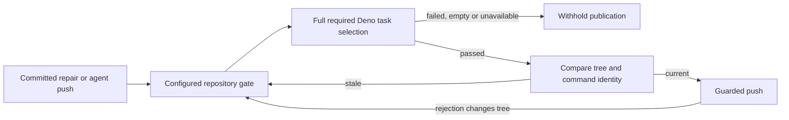

## Summary

Added runner-owned repository validation before issue completion, PR-feedback,
CI-repair and babysitter publication, including agent self-pushes and push
rejection recovery. Required checks must execute and pass for the tree being
published. Unavailable execution defers repairs without spending their failure
allowances. Closes #4625.

Version bump: no version file changed.

## Spec

### Intent and Rationale

- Agent readiness and targeted checks did not prove that a completed repair
  passed its repository's required checks before publication.
- The shared runner uses the trusted configured `quality_command`, preserving
  its flags and working directory, or `./quality.sh` by default.
- The repository gate owns test permissions and selection. An empty or
  explicitly filtered run is supplemented with its full Deno task; a complete
  gate is not followed by an assumed CI-equivalent manifest task.

### Essential Design Decisions

- Success binds the commit, working-tree digest, resolved commands and working
  directories, non-credential environment, and Bash/Deno versions. Every publisher checks
  freshness immediately before pushing and after recovery changes the tree.
- The agent hook applies the same validator. Validation refusals retain their
  typed gate/infrastructure outcome through internal and outer recovery;
  recovery and retry pushes receive the guard too.
- Unavailable validation before publication refunds its retry and writes no
  failed-attempt marker. A refused optional history rebuild after a content
  push retains the successful push outcome and its retry charge. Feedback releases its claim without charging a review failure.
  Babysitter releases the per-head attempt and retains its committed checkout,
  including when the state directory is on another filesystem.
- Project discovery and unit-task priority reuse the merge gates' owners. The
  manifest-task reader moved to `project_manifests.ts` and remains re-exported
  from its old module. Infrastructure classification reads execution diagnostics
  and check outcomes; substantive failures take precedence.

### Undiscoverable Facts

- The merge-base heartbeat child fails fetching JSR metadata on this host. The
  head fixture explicitly supplies its repository Deno configuration and cache
  selection instead of depending on the child's configuration discovery.
- Unchanged milestone gate tests also fail their account-access probes on this
  host; the two real-check failures reproduce at the merge base.
- The prior three full strict-gate attempts failed on host prerequisites, JSR
  access and inaccessible untrusted checkouts. This follow-up ran focused
  checks; it does not claim a successful full strict gate.

## Evidence

Backend/worker changes; no screenshot applies. No dependency, workflow or
cross-repository check policy was added. Deno projects use their configured
quality entry point; empty or explicitly filtered runs additionally use their
`test:unit`, then `test` task where present.
The runner requires a positive executed-test count. This repository's unit task
uses the same parallel/serial manifests that CI divides across four shards.

## Test Plan

- Focused worker suite: 323 passed, 0 failed. Files:
  `publication_validation_test.ts`,
  `completion_phase_pre_push_gate_3689_test.ts`, `pr_ci_processor_test.ts`,
  `pr_feedback_processor_test.ts`, `fleet_pr_babysitter_test.ts`,
  `fleet_babysitter_app_test.ts`, `git_push_test.ts`, `pre_push_hook_test.ts`,
  `pre_push_gate_cli_test.ts`, `agent_pre_flight_test.ts`, and
  `project_manifests_4413_test.ts` and `lib_sweep_coverage_test.ts`, using
  `deno task test:unit` in `worker/deno`.
- `deno fmt --check`, `deno lint`, and frozen `deno check` on all changed
  TypeScript sources/tests — passed.
- `deno task check:manifests` — 847 passed, 0 failed, 1 ignored.
- The validator's passing-negative-test-name/failing-assertion, repeated-prefix
  hostile input, and zero-exit empty-selection regressions each failed before
  their fixes and passed afterwards.
- Initial completion and both later repair processors execute real full, sharded
  and impacted Deno fixtures, accepting sound trees and refusing required
  regressions and empty selections. The self-push regression uses a real bare
  remote and confirms failed or unexecuted tests leave it unchanged.
- The real rejection regression advances origin between lookup and push,
  observes the recovered tree in the guard, refuses its check and confirms
  origin remains unchanged. The completion regression separately exercises the
  outer recovery callback. The former evidence labelled “push recovery
  revalidates a stale successful result” exercised only a push-boundary refresh;
  it is now named accurately and is not recovery evidence.
- Eight deliberate mutations in a disposable checkout made their focused tests
  fail: removing completion recovery validation, internal recovery validation,
  the agent publication gate, CI/feedback unavailable result types, configured
  command resolution, full repository-defined Deno task selection, or babysitter attempt release.
  Restored implementations passed the focused suite.
- Unavailable-then-recovered regressions cover CI retry accounting, review
  failure allowances, and a retained babysitter commit validated through an
  alternative entry point without `quality.sh`. A real cross-filesystem test
  covers checkpoint persistence.
- Broader milestone suites reproduced host access failures: the resolution
  suite's repository-task account probe fails, and three merge-gate account
  probes fail. The two real-check cases also fail on the untouched merge base.
  Project discovery and manifest-task selection checks pass independently.

### REQUIRED ITEM 1 — mutation baseline

The notice reported failed baseline execution, with no surviving `file:line`
mutations. The two named head suites now pass together: 77 passed, 0 failed. The
heartbeat child now uses the checked-in Deno configuration and selected cache.
The eight guard mutations above are additional observed red checks; this summary
does not claim an exhaustive mutation pass or any untestable-line exemption. A
subsequent run of the actual diff-scoped mutation runner also got past its
baselines and killed its one selected mutant. It reported `budget_exhausted`
with `limit: mutant_cap`: 1 tested/killed out of 298 candidates, no survivors
among those tested. This capped probe is evidence that the baseline now runs,
not an exhaustive mutation verdict. No mutation-check skip was configured.

### REQUIRED ITEM 2 — coverage carry-over baseline

Reproduced at merge-base `a9dcdc3792313a96b714bf09083aafa839511053` in a
separate worktree, using all five named suites: 203 passed, 1 failed. The only
failure was `babysitter default heartbeat resolves its checkout revision`, whose
child reported `JSR package manifest for '@std/crypto' failed to load`. The
other four suites passed. This historical baseline failure is not evidence of
lost head coverage. The head heartbeat fixture is fixed and the focused head
suites pass, but a carry-over verdict at the historical base remains unmeasured;
no coverage-check skip was configured.

### REQUIRED ITEM 3 — verifier defects

- Completion and CI recovery/retry pushes carry the validator, and gate refusals
  stop completion before ordinary push recovery. Real-remote and processor
  regressions cover these paths.
- Agent self-pushes use the shared validator through the production hook.
- Typed unavailable results release/defer instead of charging CI or review
  failures; babysitter attempts are released and useful commits retained.
- Test names and quoted assertion data no longer classify infrastructure;
  substantive failures survive mixed output. Repeated-prefix scanning is linear
  rather than an unbounded repeated search.
- Configured alternative gates preserve their command/flags and participate in
  identity checks; default `quality.sh` matches the non-strict local gate.
- Full repository-owned Deno task selection and positive execution evidence
  reject empty or incomplete impacted runs. Real execution covers initial
  completion and subsequent CI/feedback repair.
- Updated the operator guide, internals and all three prompt copies to name the
  configured entry point and the shared agent hook.

Removed/changed assertions in `worker/deno/tests/fleet_pr_babysitter_test.ts`:

- The old direct `validateAndCommit` success expectation is replaced by a
  required-check rejection: agent readiness alone is not validation.
- The prompt's “confirm they pass before”, host-unavailable waiver,
  unrelated-failure waiver, commit-history waiver, and “reads commit history”
  expectations are replaced by runner-owned validation after committing,
  immediately before pushing, with unavailable checks blocking publication.
  Those waivers contradict #4625's requirement to pass checks before repair
  publication.
- “required quality.sh before it can push” now reads “required repository gate
  before it can push”, because the trusted configured alternative is supported.
  Actual alternative-command execution and identity tests cover that contract.

The `publication_validation_test.ts` runner helper no longer asserts that every
invocation receives only `--strict`: configured entry points own their flags.
Real execution now asserts the configured flag, failure exit, working directory
and command-bound identity, covering the replacement contract.

Twinned rules checked: initial/retry/recovery publisher callbacks, the agent
hook, merge/publication unit-task priority, `docs/CONFIGURATION.md`,
`docs/INTERNALS.md`, and issue/CI/feedback prompt descriptions were updated
together. No summary/accounting gate was added.

## Deno regression avoided

CI repair: the agent-push fixture now supplies an executable repository-owned
quality gate, with a failing-gate case asserting that publication is refused
and the remote stays unchanged. The recovery fixture allows repeated validation
of the original commit and rejects the distinct merged head, retaining its
remote-preservation assertions. Both failures were reproduced with the canonical
`deno task test` command before updating the fixtures.

Repair validation: all 25 focused tests pass; manifest checks pass (847 tests),
as do type checking, formatting, lint, Markdown, Mermaid and static policy checks
in `quality.sh`. The full unit runner panics inside the host's Deno 2.9.5
permission implementation; the repository pins 2.9.8. Exact CI shard launches
require unavailable `setsid`. Semgrep, Checkov and config integration are
unavailable locally. The current base's merged PR #4740 has 22 passing CI checks.

Used Deno tasks, the frozen lockfile and repository-owned gates. No Node tool or
dependency was added; checkpoint copying uses the runtime standard library.

## Merge conflict repair

Retained the base branch’s injectable GitHub and sleep functions in the
babysitter repair entry point alongside the PR’s configured quality command.
Updated the production caller to pass that command after the base parameters,
preserving existing callers and branch-update coordination.

## Requested review corrections

- The default publication command is `./quality.sh`, matching the worker's
  non-strict local gate. Clone-inapplicable config integration and optional
  security-tool skips no longer make publication impossible. An explicitly
  configured strict command still retains its flags and fails on skips.
- Deno summaries accept optional test-step counts for both executed-test
  evidence and substantive-failure precedence.
- Only repository-defined `test:unit` or `test` tasks receive an additional
  full run. Taskless Deno projects retain the quality entry point's selection,
  permissions and flags and must show executed tests there. Non-Deno
  JavaScript projects stay on their own gate.
- Deferred repairs keep one checkpoint per PR, replacing the previous head's
  checkpoint and deleting it after publication. Copying excludes ignored build
  products, checks available space and file sizes before copying, and enforces
  10,000 entries and 128 MiB while streaming. Failed copies clean partial output,
  retain the source and release the repair attempt. The source remains owned
  by the caller until checkpoint handling finishes.
- The earlier verifier's missing-executable finding is covered by actual POSIX
  missing-tool and Bash missing-entry-point execution, followed by recovery.
  Missing-tool shell diagnostics on either stream are unavailable; assertion
  failures retain precedence.
- The earlier verifier's history-rewrite finding is also fixed: CI passes the
  shared guard to the history rebuilder, which checks the replacement commit
  after committing and immediately before force-with-lease. A refusal preserves
  its typed error and prevents that push; unavailable validation refunds the
  retry.

Twinned copies updated: the agent hook default, publication validator,
babysitter prompt, issue/CI/feedback prompts and configuration/internals guides.
No tests were removed or weakened. New tests exercise real Deno steps,
taskless read permissions, excluded performance fixtures, non-Deno JavaScript,
default command flags, repeated checkpoints, ignored products, budget failure,
missing tools and history-rewrite validation ordering/refusal.

Review-repair validation: 177 focused tests passed (103 publication/hook/
babysitter tests, 69 CI/history tests and five production Claude-push tests).
Manifest checks passed: 847 tests, one ignored. Formatting, lint and frozen
type checks passed for every changed TypeScript source and test. The full gate
passed its static policies, completeness, Markdown, Mermaid, formatting, lint
and type checks, but its full parallel test pass hit the host Deno 2.9.5 panic
`pledge test permissions called before restoring previous pledge`; the
repository pins 2.9.8. Config integration, Semgrep and Checkov were unavailable.
GitHub confirms the base's merged PR #4740 passed all four unit-test shards.
The Linux-only cross-filesystem fixture is inapplicable on this macOS host.

## Review corrections for the current requested changes

- Moved verifier ownership to the immediate push boundary. An unrejected push
  invokes it once; rejection recovery invokes it again for the changed head.
  Restored the recovery test to record every invocation, retaining exactly two
  calls and distinct-head assertions.
- Complete gate runs own their test permissions. A fixture with a narrower
  manifest task requires real write and subprocess permissions: its gate passes,
  its manifest task fails, and publication passes. Impacted fixtures now include
  an actually filtered test, while retaining their failing required regression.
  Their full-run expected count increases from two to three for that added test.
- A refused history rebuild preserves the already-published content outcome,
  retry charge, body synchronisation and auto-merge path. The result comment
  distinguishes the refused rebuild from the successful content push. Tests
  cover foreign authors and failed/unavailable replacement-commit validation.
- Production CLI repair tests now make an agent change, run a real configured
  gate, and push only to a local bare remote. They cover failed checks,
  unavailable checks across two consecutive passes followed by recovery,
  configured flags, and a checkout changed between validation and push.
- Deferred checkpoints record their original PR head. Each pass removes them
  for changed heads, closed PRs or repairs completed elsewhere. Legacy records
  without ownership metadata are discarded. A failed bounded copy retains one
  original source by same-filesystem rename, outside interrupted-clone cleanup;
  repeated failures replace that source without copying it again. Both source
  and copied checkpoint are removed after success or by the same stale-state
  pruning. The caller clears its clone only after successful retention.

Read the agent/testing standards and the publication-gate sections of
`docs/CONFIGURATION.md` and `docs/INTERNALS.md`; updated both operator references
and this archived summary. No new dependency or test exclusion was added.

Validation of the current review corrections:

- Focused suites: 290 passed, 0 failed, one existing Linux-only cross-filesystem
  test inapplicable on macOS. This includes 184 validator, Git push, CI,
  babysitter and production App tests, and 106 completion/feedback/push tests.
  The final CI/babysitter rerun passed 116 tests; the final production App rerun
  passed all 22 tests and checks the actual bare remote before and after repair.
- Deliberately restoring the duplicate verifier call made its one-invocation
  regression fail. Restoring unconditional manifest-task execution made the
  complete-gate permission regression fail. The corrected implementations pass.
- `deno fmt --check`, `deno lint`, frozen `deno check`, and manifest checks
  passed (847 manifest tests, one ignored). The full `./quality.sh` run passed
  static policies, completeness, formatting, lint, type checking, Markdown and
  Mermaid. Its full parallel unit pass hit Deno 2.9.5's internal panic:
  `pledge test permissions called before restoring previous pledge`.
  The repository pins Deno 2.9.8. GitHub confirms the current base commit
  `0a4d803ab862753bd35fcf39f5df4b3c91545504` came from merged PR #4715,
  whose four unit shards and required gate passed. Config integration lacks a
  local `.config.json`; Semgrep and pinned Checkov are not installed. These
  unavailable checks were not represented as passing.

Review follow-up: verify already-published heads exactly once, isolate malformed or
inaccessible checkpoints and skip repositories outside the pass scope. Credential
rotation does not invalidate validation. Agent readiness retains host-unavailable,
unrelated host-only and commit-history waivers; the runner still gates publication.

Review regression validation: 139 focused tests passed (one existing host-only
cross-filesystem test ignored); the revised identity and parallel-safety suites
passed 28 tests. The once-per-unrejected-push test is retained. No twinned rule
was found for these changes. Prompt expectations now preserve the existing
host and commit-history readiness contracts alongside runner enforcement.

Final local gate: formatting, lint, type check, completeness (847 passed),
Markdown and Mermaid checks passed. The full parallel test run stopped on an
internal Deno 2.9.5 macOS panic: pledge test permissions called before restoring
previous pledge. Semgrep and Checkov were unavailable on this host.
