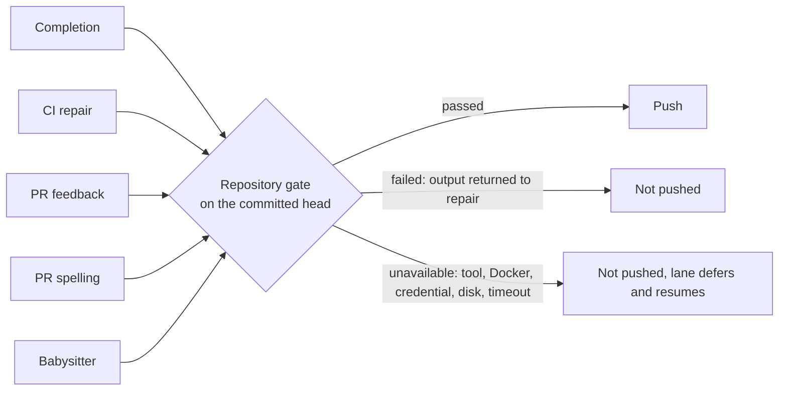

## Summary

Every lane that publishes agent-authored work now runs the target repository's
own gate (`./quality.sh`, or its configured `quality_command`, in its
`docker_image` and with its declared `quality_credentials`) on the committed
head before the push. A failed or unrun gate can no longer become a successful
completion. A new shared module, `worker/deno/lib/publication_validation.ts`,
owns the result contract and five lanes consume it:

- issue completion (`completion_phase.ts`: `gateBeforePush`, and the
  last-currency push of a head merged with a moved base);
- CI repair (`pr_ci_processor.ts`), PR feedback (`pr_feedback_processor.ts`) and
  PR spelling (`pr_spelling_processor.ts`), through the existing `beforePush`
  seam of `commitAndPushPending` and `recoverFromPushRejection`;
- babysitter repair (`fleet_pr_babysitter.ts`), after the commit and before the
  push, so `BABYSITTER_READY` alone is no longer the quality result;
- the completion recovery turns (`summary_rule_gate_retry.ts`,
  `screenshot_gate_retry.ts`, `pr_body_length.ts`), which push the issue branch
  before completion's own gate, now pass the same guard as `beforePush`.

In the CI lane an `unavailable` gate now releases the pull request: the retry
charge is refunded (`refundCiCheckRetry` in `pr_ci_checks.ts`), no failed-push
comment or attempt marker is written, and the round returns `processed: false`.
Part of #4625: commits an agent pushes itself in the CI and feedback lanes are
still gated only by the changed-file pre-push hook (see Acceptance Criteria).

Version bump: `VERSION` is not touched by this change.

## Spec

### Intent and Rationale

- The same `deno test` step failed on CI for 13 fleet PRs because paths
  published without a passing local gate: a gate skipped for budget, a
  best-effort post-run check that pushed anyway, and a babysitter push after
  only `git diff --check`. One runner-owned check at the push boundary closes
  them.
- It reuses `runQualityGateCheck` (Docker, credentials, missing-tool and
  Docker-infrastructure classification) rather than a second runner. The
  checkout is passed in, so a babysitter clone is validated, not the process
  cwd.

### Essential Design Decisions

- Three outcomes. `unavailable` (missing tool, Docker or credential fault, disk
  full, gate timeout, unreadable checkout) is infrastructure: never pushed,
  never a content failure, never charged as a fix attempt, and the lane retries.
  A repository with no `quality.sh` is an explicit `gate: "absent"` pass;
  `skip_quality_check` is `gate: "opted-out"`.
- The result is tied to the head: a dirty working tree (worker state files
  excepted) is a failure, a head that moves during the run is discarded, and the
  guard re-validates any new head. A pass is reused only for the same clean
  head.
- A zero exit is not enough: a Deno summary totalling `0 passed | 0 failed` is a
  failure. The 30-minute default timeout stops this repository's multi-minute
  gate being killed; a repository's own `quality_check_timeout` still overrides
  it, the host-wide 600 s default does not apply.
- The runner executes the target repository's own checks and centralises no
  policy. No prose or evidence accounting was added (#4234).

### Undiscoverable Facts

- `pr_feedback_processor.ts` marks non-review comments processed before
  publication, so a gate failure there leaves that mark (as any push failure
  does today); `pr_review` is held and not marked addressed.
- In this sandbox two existing tests fail on the base commit too, so they are
  environmental: `babysitter default heartbeat resolves its checkout revision`
  (jsr.io unreachable) and
  `verifyResolvedTree - the repository's own task sees
  only the allowlisted environment (Issue #4659)`
  (untrusted account cannot use `/tmp`, #4697). Checked by running both files on
  `392748f3`: 2 failed.

## Evidence

Backend-only change; no UI file touched. Tests drive real functions with temp
git repositories and bare origins:

- `worker/deno/tests/publication_validation_test.ts`: every gate action mapped,
  real `quality.sh` pass and fail, a zero-test Deno run, a dirty tree, HEAD
  moved during the run, opt-out, `qualityCommand`, deps bound to the checkout,
  the 30-minute timeout, exit 124/137/143 and disk-full as `unavailable`, an
  unreadable checkout, and the guard (once per head, new commit, edit after a
  pass, failed output, in-sync branch).
- `worker/deno/tests/completion_phase_publication_validation_4625_test.ts`:
  failed (one repair turn, then `pre_push_gate`, no push), fail then pass,
  unavailable (`push_failure`, no push, no repair turn), pass for `ran`,
  `absent` and `opted-out`, noop skip, merged head failing and passing.
- `worker/deno/tests/pr_ci_processor_test.ts`,
  `worker/deno/tests/pr_feedback_processor_test.ts` and
  `worker/deno/tests/pr_spelling_processor_test.ts`: the `beforePush` argument
  at each push site yields the validator verdicts; real `commitAndPushPending`
  against a bare origin leaves the branch unmoved with the cause in the reported
  failure; feedback runs the gate before the verifier, unavailable releases the
  claim, failed is not marked addressed.
- `worker/deno/tests/pr_ci_processor_test.ts` also runs six unavailable rounds
  against one state directory: each returns `processed: false` with `retryCount`
  0, the retry file stays at 0, no comment is posted, and a failed gate in the
  next round still costs one attempt. `pr_ci_checks_test.ts` covers
  `refundCiCheckRetry` (one back, floor at zero, other checks untouched).
- `worker/deno/tests/recovery_turn_publication_guard_4625_test.ts` drives each
  of the three recovery turns against a real bare origin: a failed or an
  unavailable gate leaves origin unmoved, a passed gate publishes. The work
  clone has its own Git identity, so the commit does not depend on the host's
  global Git configuration.
- Documentation assertions tolerate Markdown line wrapping and table padding;
  the obsolete requirement was literal whitespace, while the required proxy
  footprint, update-mode default and Haiku pricing row remain covered by
  `tests/containment_docs_test.ts::CONTAINMENT.md's egress proxy section states the proxy opens no files, keeps no cache and needs --allow-read --allow-env --allow-net`,
  `tests/update_mode_docs_test.ts::SETUP.md - the update-mode section states both accepted modes and the default setup offers`,
  and
  `tests/config_docs_consistency_test.ts::config docs - Haiku 5.5 price rows match token_usage (Issue #3407)`.
- `worker/deno/tests/publication_validation_test.ts` runs the real
  `runQualityGateCheck` over a `quality.sh` that runs `deno test`: a test module
  that does not compile (TS2322) is `failed` with the compiler output; a failing
  Deno test is `failed` on the initial run, then the same entry point passes on
  the repaired head.
- `worker/deno/tests/fleet_pr_babysitter_validation_test.ts` runs the scenarios
  in `worker/deno/tests/fixtures/fleet_pr_babysitter_validation_scenarios.ts` in
  a child `deno test` (they set `HOME`, which the process-state cap forbids in a
  suite): failed gate, unavailable gate then resume on the same head, passed
  gate, `BABYSITTER_READY` with a failed gate, validate receives the clone and
  repo configs after the commit, a lock-renewal failure during the gate, and a
  config that cannot be loaded.

## Acceptance Criteria

<!-- vibe-spec-review inputs="diff+issue-body" -->

- **met** — "Include the test targets CI compiles" / "CI's impacted-test
  selection": the runner executes the repository's own entry point
  (`quality.sh`), rejects a Deno run that executed no tests, and this repository
  has no impacted-test selection to mirror — evidence:
  `tests/publication_validation_test.ts::the real quality gate: Deno tests run in the initial run and again in the repair`,
  `tests/publication_validation_test.ts::a Deno run that executed no tests is not a pass`
  — reviewer: met
- **partial** — "Tests exercise every publishing path": every worker-owned push
  now carries the gate, including the three completion recovery turns —
  evidence: `tests/recovery_turn_publication_guard_4625_test.ts` — reviewer:
  partial — reason: commits an agent pushes itself in the CI and feedback lanes
  reach origin through the pre-push hook, which runs only the changed-file
  checks; running a multi-minute gate inside the agent's `git push` was not
  attempted
- **met** — "infrastructure outcome ... release/defer": an unavailable gate in
  the CI lane refunds the retry, writes no comment or marker and returns
  `processed: false` — evidence:
  `tests/pr_ci_processor_test.ts::processCiFailure - an unavailable repository check releases the PR`,
  `tests/pr_ci_checks_test.ts::refundCiCheckRetry gives back one recorded retry`
  — reviewer: met
- **met** — "test compilation failure" as its own case — evidence:
  `tests/publication_validation_test.ts::the real quality gate: a test module that does not compile is a failed verdict, naming the compile error`
  — reviewer: met

## Standards Review

<!-- vibe-standards-review inputs="diff+CODING-STANDARDS.md" -->

- **violation** — DRY: the state-file path was rebuilt by hand in
  `refundCiCheckRetry` — evidence: `worker/deno/lib/pr_ci_checks.ts:73` —
  reason: fixed in this diff (`retryStateFile`)
- **violation** — DRY: the `createPublicationGuard({...})` block is repeated at
  three recovery-turn sites — evidence:
  `worker/deno/lib/summary_rule_gate_retry.ts`, `screenshot_gate_retry.ts`,
  `pr_body_length.ts` — reason: left as is; each site names its own branch and
  the three files share no helper module
- **clean** — Australian English, comments explaining why with the issue
  reference, `Result` use, `@std/assert`, temp directories removed, docs updated
  in `docs/INTERNALS.md`

## CI repair

Regenerated `docs/audits/dependency-inventory.md` with the supply-chain gate’s
`--write-inventory` option so its generated content matches the current tree.
The workflow’s frozen supply-chain gate passes after regeneration. Restored the
contiguous prompt-vocabulary citation expected by its completeness test after
the branch rewrapped it.

## Test Plan

Commands run from `worker/deno` on the final head (stdin from `/dev/null`):

- `deno test --allow-all` on `tests/publication_validation_test.ts`,
  `tests/completion_phase_publication_validation_4625_test.ts`,
  `tests/pr_ci_processor_test.ts`, `tests/pr_feedback_processor_test.ts`,
  `tests/pr_feedback_review_dismissal_3383_test.ts`,
  `tests/pr_spelling_processor_test.ts`,
  `tests/fleet_pr_babysitter_validation_test.ts`,
  `tests/parallel_safety_cap_test.ts`, `tests/pr_ci_checks_test.ts`,
  `tests/recovery_turn_publication_guard_4625_test.ts`,
  `tests/summary_rule_gate_retry_test.ts`, `tests/pr_body_length_4359_test.ts`,
  `tests/gate_retry_finish_deadline_4245_test.ts`: passed.
- `./quality.sh`: every stage passed except `deno tests`, whose only two
  failures (32278 passed) are the two base-commit failures named above;
  `config integration` and `checkov` were skipped by the gate on this host.
- `deno task check:manifests`: passed (the new module is registered in
  `docs/audits/lib-sweep-coverage/top-up-4625.json`).

Red checks (the change broken on purpose, test goes red, then restored):

- validation call removed from completion's gate: the completion tests for
  failed, fail-then-pass, unavailable and pass go red; unavailable treated as
  passed: the unavailable test goes red; noop guard removed: the noop test goes
  red; merged-head check ignored: the merged-head test goes red.
- CI/feedback/spelling: guard dropped from the retry call, verifier-first order,
  unavailable treated as passed: the matching `beforePush` tests go red.
- babysitter: `validate` call removed: 6 of 8 scenarios go red through the
  parent test; unavailable treated as passed, attempt record not removed, the
  renewal re-check removed, and the config load removed each turn their scenario
  red.
- CI unavailable release: the refund call removed, the retry stays charged and
  the repeated-rounds test goes red. Screenshot recovery turn: the `beforePush`
  argument removed, the failed and unavailable tests go red (origin moves).
- `publication_validation.ts`: timeout mapping, disk mapping, the 1800 s default
  timeout and the re-read error cause each removed: the matching test goes red.

The mutation check reported that it could not run because
`tests/fleet_babysitter_app_test.ts`,
`tests/fleet_pr_babysitter_single_push_test.ts` and
`tests/fleet_pr_babysitter_test.ts` fail before any mutation. The failing test
in that set, `babysitter default heartbeat resolves its checkout revision`, is
the base-commit failure named above (jsr.io unreachable from this sandbox,
`Import 'https://jsr.io/@std/crypto/meta.json' failed`), so it is environmental,
not caused by this change.

No existing assertion was removed. Existing fixtures changed only to supply the
new seam: `validatePublication: passingPublication` in
`tests/pr_feedback_processor_test.ts` (one test) and
`tests/pr_feedback_review_dismissal_3383_test.ts` (`runScenario`).

Callers of `commitAndPushPending` checked: CI (final and retry), feedback (final
and retry), spelling (final and retry) pass the guard;
`recoverFromPushRejection` in those three lanes passes it; completion uses
`gateBeforePush` and validates before `pushUnpushedCommits`; the completion
recovery turns (`summary_rule_gate_retry.ts`, `screenshot_gate_retry.ts`,
`pr_body_length.ts`) pass the guard too.
