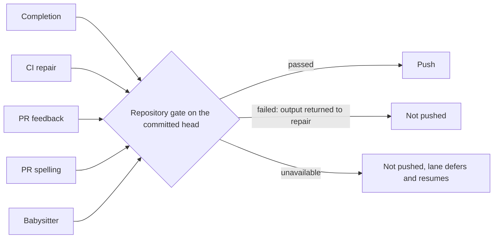

## Summary

Every lane that publishes agent-authored work now runs the target repository's
own gate (`./quality.sh`, or its `quality_command`, in its `docker_image` with
its declared `quality_credentials`) on the committed head before the push. A
failed or unrun gate can no longer become a successful completion. The shared
contract lives in `worker/deno/lib/publication_validation.ts`; the consumers
are:

- issue completion (`completion_phase.ts`), including the last-currency push;
- CI repair (`pr_ci_processor.ts`), PR feedback (`pr_feedback_processor.ts`) and
  PR spelling (`pr_spelling_processor.ts`), through the `beforePush` seam;
- babysitter repair (`fleet_pr_babysitter.ts`), after the commit and before the
  push, so `BABYSITTER_READY` is no longer the quality result;
- the completion recovery turns (`summary_rule_gate_retry.ts`,
  `screenshot_gate_retry.ts`, `pr_body_length.ts`).

Two paths the first cut missed are now covered. When `syncBaseBranch` merges the
base into the branch in the same push, `commitAndPushPending` runs the guard on
the merged head before pushing it. When the agent pushes its own commits in the
CI, feedback or spelling lane, the lane validates the moved head after the run
(`validateSelfPushedHead`); a rejected or unrunnable head is not reported as a
successful push.

Review round (PR #4800): the babysitter gate runs only as a separate account
(`requireSeparateAccount`, THREAT-MODEL C37) and its `failed` verdict is a
`BabysitterFailure` of class `code`; completion validates a head merged by
push-rejection recovery before it is pushed; the spelling and feedback lanes
stop spending sessions after `MAX_PUBLICATION_DEFERRALS` (3) rounds per key
(spelling charges deferred and rejected heads, feedback only deferred ones); a
gate failure that reproduces on the base commit is `unavailable`.

In the CI lane an `unavailable` gate releases the PR: the local retry charge is
retained, no failed-push comment is written and the round returns
`processed: false`. Closes #4625.

Version bump: `VERSION` is not touched by this change.

## Spec

### Intent and Rationale

- The same `deno test` step failed on CI for many fleet PRs because paths
  published without a passing local gate. One runner-owned check at the push
  boundary closes them, reusing `runQualityGateCheck` rather than a second
  runner.

### Essential Design Decisions

- Three outcomes: `passed`, `failed` (output goes back for repair) and
  `unavailable` (missing tool, Docker or credential fault, disk full, or a gate
  failure that reproduces on the PR's base commit on this host: never pushed,
  never a content failure, retried later; a gate timeout is a charged failure).
- The result is tied to the head: a dirty tree fails, and any new commit is
  validated afresh. A Deno run that executed zero tests fails. Default timeout
  is 30 minutes; a repository's `quality_check_timeout` overrides it.
- The target repository's own checks run; no prose or evidence accounting was
  added (#4234).

### Undiscoverable Facts

- This work was redone on a fresh branch after two earlier PRs for #4625 closed
  (stall, then merge conflict); it reapplies that work onto current `main`.

## Evidence

Backend only. Tests (all passed on this head in the targeted run):
`worker/deno/tests/publication_validation_test.ts`,
`worker/deno/tests/completion_phase_publication_validation_4625_test.ts`,
`worker/deno/tests/fleet_pr_babysitter_validation_test.ts`,
`worker/deno/tests/recovery_turn_publication_guard_4625_test.ts`,
`worker/deno/tests/pr_ci_processor_test.ts`,
`worker/deno/tests/pr_feedback_processor_test.ts`,
`worker/deno/tests/pr_feedback_processor_milestone_fix_test.ts`,
`worker/deno/tests/pr_feedback_processor_self_push_test.ts`,
`worker/deno/tests/pr_ci_processor_no_changes_test.ts`,
`worker/deno/tests/pr_spelling_processor_test.ts`,
`worker/deno/tests/pr_push_base_sync_test.ts`. They cover a real failing
command, a claimed-but-not-run check, edits after validation, zero Deno tests
executed, an unavailable host, and Deno tests running in both an initial run and
a repair.

Docs updated: `docs/INTERNALS.md` (new section), `docs/CONFIGURATION.md`,
`docs/workflows/fleet-pr-babysitter.md`, `docs/THREAT-MODEL.md` (control C37);
coverage ledger `docs/audits/lib-sweep-coverage/top-up-4625.json`.

## Test Plan

- Merge resolution: main replaces the orphan test's process-name snapshot with
  the shell's returned PID and waits for exec and re-parenting. The obsolete
  lookup is removed; the unrelated orphan must still survive, covered by
  `worker/deno/tests/loop_supervisor_test.ts::loop.sh #4568 - a registered orphan with a different command survives`.
- CI repair: the review-dismissal scenario now invokes the separate verifier
  hook passed to `commitAndPushPending`, rather than the publication guard. The
  existing verifier rejection, recovery and body-sync assertions remain covered
  by
  `worker/deno/tests/pr_feedback_review_dismissal_3383_test.ts::review-fix verifier - recovery must clear before pushing`
  and the other scenarios in that file. No mirrored rule changed.
- CI repair: the feedback and CI self-push tests now inject a passing
  publication validator and assert it runs once. Their mocked pushes do not
  invoke the guard, and their temporary work directories are not repositories.
  The supported behaviour remains a success reply only after remote push
  verification and publication validation; coverage remains in
  `worker/deno/tests/pr_feedback_processor_self_push_test.ts::processPrFeedback - claude self-pushed: HEAD moved => success reply`
  and
  `worker/deno/tests/pr_ci_processor_no_changes_test.ts::processCiFailure - Claude self-pushed: HEAD moved triggers success reply (Issue #1863)`.
  Both files pass with `deno task test` (21 tests); both failed before the
  fixture repair. No mirrored rule changed.
- Head push `c92357559`: `pr_feedback_processor_milestone_fix_test.ts` now
  injects a passing `validatePublication` stub. Its mocked push never reaches
  the publication guard, and the real gate finds no repository in the fake
  `workDir` and reports `unavailable`, so those tests would otherwise stop at
  the new post-run head validation.
  `deno task test:unit
  tests/pr_feedback_processor_milestone_fix_test.ts`: 16
  passed, 0 failed.
- Targeted run of the files above plus `pr_ci_checks_test.ts`,
  `babysitter_fix_orchestration_test.ts`,
  `pr_feedback_review_dismissal_3383_test.ts`,
  `config_docs_consistency_test.ts`, `containment_docs_test.ts`,
  `update_mode_docs_test.ts` (the three docs-pin tests are unchanged from
  `main`): passed.
- `deno fmt --check` and `deno lint` on the changed `.ts` files: passed.
- `./quality.sh` on this head earlier failed only the parallel Deno test pass,
  on two cargo-fmt tests that need a configured `rustup` default (the host had
  none). `worker/deno/tests/completion_phase_repo_formatters_test.ts` (8 tests
  at head): on this host's re-run 6 passed and the same 2 cargo-fmt tests failed
  for want of a `rustup` default. This PR changes neither `repo_formatters.ts`
  nor that test.
- Mutation check (review round 3): with the baseline green, the survivors were
  `completion_phase.ts` (the HEAD read, the passed-head cache and the recovery
  guard's options) and `fleet_pr_babysitter.ts` (`requireSeparateAccount`).
- `worker/deno/tests/completion_phase_publication_validation_4625_test.ts` (19
  tests at head, 19 passed) now pins each: the HEAD read's cwd, exit code and
  output, reuse of a passed head, the guard's `cwd`, `repo`, `repoConfigs`,
  `branchName` and `validate`, and that a guard block ends the run without a
  repair turn. Each was applied by hand and turned a test red.
- `worker/deno/tests/fleet_pr_babysitter_validation_test.ts` (1 test at head, 1
  passed) already turned the `requireSeparateAccount` mutants red; its scenarios
  run in a child `deno test` process the mutation check does not see.

Not done: the agent's own pre-push hook still checks changed files only, so a
commit the agent pushes itself is judged by the full gate after it has left the
host (the round is then not reported as a clean push), not before. Parity with
mutation, clippy, cargo-deny and ShellCheck (#4617, #4630, #4626, #4631),
durable retry (#4656) and review dismissal (#4657) belong to those issues.

- Review follow-up: CI deferrals retain their local retry charge; a gate timeout
  is a failed verdict. The obsolete free-retry and timeout deferral expectations
  are replaced by the bounded retry and failure coverage in
  `worker/deno/tests/pr_ci_processor_test.ts::processCiFailure - an unavailable repository check releases the PR: retry charged, no comment, no marker (Issue #4625)`
  and
  `worker/deno/tests/publication_validation_test.ts::a gate killed by its timeout is failed, whatever its output`.
- The obsolete pre-merge repository gate and its ordering before the review
  verifier are replaced by verification of the fix before base sync and one gate
  on the resulting head. Coverage remains in
  `worker/deno/tests/pr_push_base_sync_test.ts::the merged head is validated before it is pushed; a verdict on the pre-merge head does not stand in for it (Issue #4625)`
  and
  `worker/deno/tests/pr_push_base_sync_test.ts::base sync verifies the fix once and gates the merged head once`.
  The obsolete expectation that the repository gate precedes the verifier is
  replaced by
  `worker/deno/tests/pr_feedback_processor_test.ts::feedback publication - the verifier runs before the repository checks reject the head (Issue #4625)`,
  which still proves a rejected head is neither pushed nor marked addressed. A
  rejected self-push remains unsuccessful, covered by
  `worker/deno/tests/pr_spelling_processor_test.ts::processSpellingFailure - a self-pushed spelling fix rejected by the repository checks is not reported as successful (Issue #4625)`.
  No mirrored rule was found for these push hooks.

## Review round 2 (PR #4800)

- Babysitter credential boundary: `PublicationRequest.requireSeparateAccount`
  makes the gate's `runCommand` refuse (and the result `unavailable`) when
  `canRunAsUntrustedUser` is false, instead of the `untrustedSpawn` fallback to
  the runner. Tests:
  `worker/deno/tests/publication_validation_test.ts::requireSeparateAccount: with no separate account the repository's command never runs`
  (spawn count 0, positive control with a droppable host, and an unchanged
  caller that does not ask). The babysitter passes the flag; asserted in
  `worker/deno/tests/fixtures/fleet_pr_babysitter_validation_scenarios.ts` ("the
  gate runs on the committed head..."). Recorded as THREAT-MODEL C37.
  Consequence: a host with no `agent` account defers babysitter repairs rather
  than running PR code as the key holder.
- Babysitter failure class: a `failed` verdict throws
  `BabysitterFailure(..., "code")`. Scenario "a failed gate is a code failure
  whatever its output says, and counts one substantive attempt" uses output
  containing `needs-human`, `changed during` and a timeout line; red with the
  plain `Error` restored (class `owner`).
- Completion push self-heal: `pushUnpushedCommits` (4th argument) and
  `recoverFromPushRejection` receive the publication guard at all four push
  sites; a head validated earlier in the phase is not validated again. Tests in
  `worker/deno/tests/completion_phase_publication_validation_4625_test.ts`:
  merged head validated before its push, rejected merged head never pushed
  (`pre_push_gate`), unavailable merged head retried (`push_failure`); the first
  is red with the first push's hook removed.
- Review round 4 (pre-PR verifier): completion's publication check was skipped
  on any fast-gate `noop`; with an unresolvable base the gate falls back to
  unpushed-only, where `noop` means every commit is already on origin (WIP
  checkpoints), so the head went unchecked. It now skips only when the base
  resolved (`completion_phase.ts`, `gateBeforePush`). Test
  `an already-pushed branch with an unresolvable base still runs the publication
  check`;
  red with the `comparableBase.ok` operand removed. The babysitter base-ref
  assertions (`babysitter_fix_orchestration_test.ts`,
  `fixtures/fleet_pr_babysitter_validation_scenarios.ts`) now use a `release/2`
  base and expect `origin/release/2`; red when `fleet_pr_babysitter.ts` passes
  the literal `origin/main`.
- Deferral bounds: new `worker/deno/lib/publication_deferral_budget.ts`.
  Spelling (`spelling-<checkRunId>`) and feedback
  (`feedback-<type>-<id>-<head>`) stand down after 3 rounds, charged on
  `unavailable` and, in spelling, on a rejected head too; a rejected head's
  output is fenced into the next spelling prompt. Tests:
  `pr_spelling_processor_test.ts` (bound, self-push `unavailable`,
  `processed: false` and no comment in the deferred case; red with the early
  return disabled and with the charge removed) and
  `pr_feedback_processor_test.ts` (bound; red with the charge removed). Not done
  in these two lanes: capability probes before the agent starts (the babysitter
  has them, see review round 3); the bound limits their cost.
- Base reproduction: a failing gate is re-run in a detached worktree of the base
  ref, cached per base SHA; reproduces when every head failure line
  (`failureEvidenceLines`, see review round 3) is in the base's. Tests:
  `publication_validation_test.ts` (reproduces and is cached; base passes, head
  has a new line, no base ref: all stay `failed`). The comparison base is
  `baseRef` when a caller supplies one, else `origin/HEAD`, `origin/main` or
  `origin/master`. Only the babysitter passes `baseRef` (the PR's own base); the
  other lanes compare against the default branch, so a milestone PR there
  compares against the wrong base and a shared failure stays `failed`.
- Removed `refundCiCheckRetry` and its test (no caller); corrected the
  `publication_validation.ts` header so a gate timeout is under `failed`.

## Review round 3 (PR #4800)

Findings and what settles each:

- Babysitter session cost on an incapable host: `probePublicationCapability`
  (`publication_validation.ts`) runs on the clone before the base merge and
  before the agent: a separate account when the repository has a gate
  (`quality.sh` or a `quality_command`, not `skip_quality_check`), and Docker
  for a `docker_image` repository. A failing probe throws a `capability`
  `BabysitterFailure` with `deferral: "publication"`; so does the gate's
  `unavailable` verdict after a session. The catch in `fix()` charges each such
  deferral to PR, failure and head (`recordPublicationDeferral`); at
  `MAX_PUBLICATION_DEFERRALS` it posts one deduplicated pause comment (the
  handoff marker, with a `pause` text) and sets the retry record's `escalation`,
  so no session starts until the head changes. Setup `--check` prints an
  `ACTION:` line for a host with no `agent` account or no Docker, and
  `docs/workflows/fleet-pr-babysitter.md` names the requirement. Scenarios in
  `worker/deno/tests/fixtures/fleet_pr_babysitter_validation_scenarios.ts` (11
  scenarios at head): "a host that cannot run the repository checks starts no
  session and records a capability deferral" (agentRuns 0, no push, probe asked
  about the clone with `requireSeparateAccount`; red with the throw disabled)
  and "repeated unavailable rounds on one head stop at the bound and hand the PR
  on once" (red with the charge disabled).
- Sweeps and refusal order: `gateDepsFor` replaces `cleanupPorts` and
  `cleanupSubprocesses` with no-ops for a `requireSeparateAccount` caller, and
  the account refusal is decided before the credential mint and the gate when
  the repository has a gate. Container callers keep their sweeps. Test
  `publication_validation_test.ts::requireSeparateAccount: the real gate is never entered on a host that cannot drop`
  drives the real `runQualityGateCheck`: refused is `[]` calls, a droppable host
  is `["runCommand"]`, a caller without the flag keeps
  `["cleanupPorts", "runCommand", "cleanupSubprocesses"]`; red with the no-op
  replacement removed. `...a repository with no gate is not refused` guards the
  gate-exists operand.
- Refusal tied to the spawned argv:
  `createDefaultDeps(env, timeout,
  requireSeparateAccount)` makes the spawn
  throw `SeparateAccountRequiredError` when `untrustedAccountOf(argv)` is
  undefined (rethrown, not folded into command output). The in-process
  credential-denial profile for the gate (the Codex profile of C36) is not
  built: it is a sandbox design of its own, and the finding's fallback,
  `unavailable` where neither a separate account nor a denial exists, is what
  this PR implements. Test:
  `requireSeparateAccount: the default spawn refuses the runner account by the argv it would run`
  (asserts the refusal where the host cannot drop, a successful run where it
  can).
- Base comparison on real output: `failureEvidenceLines` replaces each checkout
  path (as given and as resolved) with one token and drops `... ok`,
  `ok | N
  passed` and `running N tests` lines; the base tree's parent is
  `chmod 0755`. Tests:
  `a failure that is the same on the base reproduces despite checkout paths and an added passing test`
  (a real `quality.sh` printing `file://$PWD/...`, the head adding a passing
  test),
  `a head that adds a failure line the base lacks stays failed under the real gate`,
  `failureEvidenceLines: ...`,
  `the base-commit tree is reachable by another account`. Each red with its
  piece removed (path token, line filter, chmod). The babysitter passes
  `baseRef: origin/<PR base>` (asserted in the "gate runs on the committed head"
  scenario).
- Spelling tests: `pr_spelling_processor_test.ts` (36 tests at head) adds
  "rounds the repository checks reject stop at the bound, and the next round is
  shown why". Red with `|| publicationRejected` removed, with the save of the
  rejected output removed, and with the load removed.

Branch outcomes: probe incapable (scenario 1) / capable (its positive control);
deferral charge below the bound (scenario 2 rounds 1-2) / at the bound (round 3,
pause posted once) / after the pause (round 4 starts no session);
`requireSeparateAccount` refused vs droppable vs not requested
(`publication_validation_test.ts`); gate present vs absent under the flag;
docker probe unavailable/available and opted-out (`probePublicationCapability`
test). exempt (untestable): the `quality.sh`-exists operand of the early refusal
and the `command !== "./quality.sh"` operand give the same `unavailable` result
as the later `runCommand` refusal, so no input tells them apart; the search was
`publication_validation_test.ts` and the babysitter scenarios, which only see
the result.

Not done: capability probes in the spelling and feedback lanes (the 3-round
bound limits them); the credential-denial profile for the gate; the tools
`quality.sh` needs are not probed before the session (that needs the script's
text; the gate still reports them as `unavailable`).

Related existing rules checked: C36/C37 in `docs/THREAT-MODEL.md` (updated), the
babysitter section of `docs/workflows/fleet-pr-babysitter.md` and
`docs/INTERNALS.md` (updated). No other restatement of the sweeps or the
comparison base was found. Targeted run on this head:
`publication_validation_test.ts` (37 tests, 37 passed),
`pr_spelling_processor_test.ts` (36 passed),
`fleet_pr_babysitter_validation_test.ts` (11 scenarios passed), plus the
babysitter, setup, retry-state and quality-gate unit tests (298 passed in the
parallel pass).

## Review round 4 (PR #4800, redone as the current branch)

The earlier PR #4800 was closed after its feedback run hit the turn limit; this
branch carries that work plus the fixes for its last open review:

- Babysitter clone reachable by the separate account: `fix()` now `chmod 0755`s
  the `Deno.makeTempDir` clone (a 0700 directory the `agent` account could not
  enter, so `Permission denied` would have been charged as a `code` failure).
  Nothing else is made writable; `.git` and the tree stay operator-owned.
  `probePublicationCapability` and `validateRepositoryForPublication` also ask
  `separateAccountCanReach`
  (`sudo -n -u agent -- sh -c 'test -x dir && test -r
  dir && test -r dir/quality.sh'`,
  argv list only): an unreachable checkout is `unavailable` (probe: a capability
  deferral before any session), never `failed`. Tests in
  `worker/deno/tests/publication_validation_test.ts`: the probe names the
  unreachable clone and passes when reachable; the dep receives
  `(dir, dir/quality.sh)`; an unreachable checkout returns `unavailable` with
  the gate never run, and a reachable one runs it. The "gate runs on the
  committed head" scenario in
  `worker/deno/tests/fixtures/fleet_pr_babysitter_validation_scenarios.ts`
  asserts the clone's mode is traversable and readable by others.
- Base comparison on real VibeCoder output: `failureEvidenceLines` also drops
  `<label>: PASSED` lines (`NON_FAILURE_LINE`), so a head that adds a file and
  moves a `... PASSED (N files scanned)` count still reproduces a shared host
  fault on the base. Tests:
  `publication_validation_test.ts::a head whose PASSED count moved, failing the same way as the base, reproduces on the base`
  and
  `...failureEvidenceLines drops a <label>: PASSED line but keeps FAILED and real failure lines`
  (both red with the alternative removed; the over-matching and 100000-character
  input cases pass either way and guard against over-matching and hangs).
- Docs: `docs/workflows/fleet-pr-babysitter.md` and `docs/INTERNALS.md` name the
  `agent` account, the traversable clone and Docker as host requirements for a
  repository with a gate.

Not done: the default sudo reachability probe was exercised only through the
injected dep (no real `agent` account in this environment); the Codex
credential-denial profile for the gate; capability probes in the spelling and
feedback lanes; the base comparison in the non-babysitter lanes still uses the
default branch. Quality gate: `./quality.sh` on this head: Result PASSED (with
skipped checks: config integration, checkov).

## Completion-check round (pre-PR verifier and mutation check)

- Disk-fault false positive (verifier finding,
  `worker/deno/lib/publication_validation.ts` `gateInfrastructureFault`): the
  disk-full match ran over every output line, so a failing Deno gate whose
  passing transcript named a test such as
  `classifyBuildFailure - names the
  ENOSPC export failure as builder storage ... ok`
  was reported `unavailable` and never returned for repair. Lines that only name
  or quote text are now skipped (`QUOTED_TEXT_LINE`: `... ok|FAILED|ignored`
  result lines, the `name => file:line:col` failure listing, quoted `N | source`
  lines and the `ok|FAILED | N passed` count line); a real error line such as
  `write failed: No space left on device` still reads as a full disk. Test:
  `publication_validation_test.ts::a failed gate that only names a disk fault in test names stays failed, with its output returned`
  (red with the filter removed; the existing "full disk is unavailable" tests
  still pass).
- Mutation survivors in `fleet_pr_babysitter.ts`: the gate request fields (1388
  `repoConfigs`, 1391 `requireSeparateAccount`, 1393 `baseRef`) were asserted
  only by the child-process scenarios, which the mutation runner does not
  attribute to the module.
  `babysitter_fix_orchestration_test.ts::fix asks for the repository gate on the committed head as a separate account, with the loaded configs and the PR's base`
  now asserts them in-process, and
  `...a paused failed-CI repair is handed off as a handoff, not as the auto-fix cap`
  pins `request.pause === undefined` (1968). Each of the five listed mutations
  was applied by hand and turned the file's tests red.
- PR #4826 CI repair: the in-process gate-request test now stubs the capability
  probe alongside its mocked checkout and validation. This keeps the request
  assertions independent of the runner's separate-account availability; the real
  probe remains covered by `publication_validation_test.ts`.
- PR #4826 integration CI repair: the orphan-survival test waits for the
  background sleep to appear in the process list before registering it. The
  shell can exit before the child has executed sleep, making an immediate lookup
  race. The test still requires exactly one process, an orphaned parent, and
  survival after the probe sweep. No mirrored rule was found.
- Repository review checklist `capsec-safe-execution` ("Untrusted text reaches a
  process or query only as data, through the platform's argument list or
  parameter binding. A wrapper that is never called, or a check that rejects
  every call, does not pass."): **met**. The gate and its probes spawn through
  argv lists (`runGitCommand`, `Deno.Command` with an args array); the one
  `sh -c` in `separateAccountCanReach` has a constant script that reads the
  checkout and gate paths as positional parameters (`"$1"`, `"$2"`), never
  spliced into the script text; the wrapper is called from
  `validateRepositoryForPublication` and `probePublicationCapability`, and
  `publication_validation_test.ts::requireSeparateAccount: ...` shows it passes
  a reachable clone and rejects an unreachable one.
