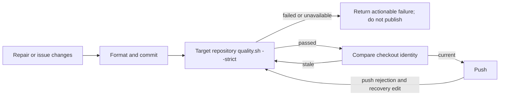

## Summary

Added runner-owned strict repository validation before issue completion, PR-feedback and CI-repair pushes, and babysitter repair pushes. Validation is tied to the checked-out tree and is repeated after an edit or push-rejection recovery; a missing, failed or unavailable required check cannot be reported as passed. Closes #4625.

Version bump: no version file changed for this change.

## Spec

### Intent and Rationale

- Previous publication paths could rely on agent readiness, a whitespace check, or CI after publication instead of a worker-run quality result.
- One shared result contract uses each target repository's own strict `quality.sh`, so check policy remains in the repository that owns it.

### Essential Design Decisions

- The result binds the commit, working-tree digest, command, working directory, environment and Bash/Deno tool versions; publishers recheck it at the push boundary and rerun when stale.
- Existing checkpoints remain separate from validated completion. Conflict/merge-specific wiring remains for #4616 to consume through `QualityDeps`.
- Failed commands return redacted head-and-tail output; unavailable check hosts return a recoverable infrastructure result.

### Undiscoverable Facts

- The full strict gate was observed failing on this host because JSR could not load `@std/crypto`'s manifest and a temp checkout was inaccessible to the untrusted account; the gate output is recorded below.
- The new library module required an entry in the existing lib-sweep coverage inventory.

## Evidence

Backend and worker changes; no screenshot applies. `quality.sh --strict` uses this repository's existing full parallel and serial unit-test passes and test-target type check. CI derives four shards from the same unit-test manifests. The implementation adds no cross-repository gate policy, new dependency, workflow change, or summary/accounting gate.

## Test Plan

- `deno task test:unit tests/git_push_test.ts tests/publication_validation_test.ts tests/completion_phase_pre_push_gate_3689_test.ts tests/pr_ci_processor_test.ts tests/pr_feedback_processor_test.ts tests/lib_sweep_coverage_test.ts` — passed, 201 passed, 0 failed.
- `deno fmt --check` on the changed TypeScript files — passed.
- `deno lint` on the changed TypeScript files — passed.
- `deno check --frozen --lock=deno.lock --config=deno.json` on changed sources and tests — passed.
- `deno task check:manifests` — passed, 847 passed, 0 failed, 1 ignored.
- `deno task test:unit tests/git_push_test.ts` — passed, 26 passed, 0 failed. With the direct pre-push callback removed, `pushUnpushedCommits - creates remote branch on first push (Issue #1463 regression)` failed at the callback-count assertion; restoring the callback made it pass.
- `tests/publication_validation_test.ts` exercises an actual failing command and its cause, a Deno test compilation failure, unexecuted command rejection, unavailable dependency-service recovery, skipped strict checks, inaccessible checkouts, stale tree identity, and long hostile classifier input.
- Caller mutation checks: removing issue-completion recovery validation made `completion - push recovery revalidates a stale successful result` fail; removing CI validation made `processCiFailure - a gated head with no fix PR in flight pushes to a milestone-fix branch and raises a PR (Issue #2907)` fail; removing PR-feedback validation made `processPrFeedback - pushes commits after Claude makes changes (Issue #1412)` fail; making babysitter validation return pass without running the runner made `babysitter stages resolved merge files and refuses conflict markers` fail.
- `deno task test:unit tests/fleet_pr_babysitter_test.ts` — 55 passed, 1 failed. The unrelated existing babysitter heartbeat test could not download `https://jsr.io/@std/crypto/meta.json`; its JSR manifest request failed.
- The observed JSR error classification test goes red when its JSR matcher is removed; the long partial-JSR input remains a failed-check result rather than an unavailable result.
- `timeout 900 ./quality.sh --strict < /dev/null` — failed: 31,927 passed, 2 failed. `babysitter default heartbeat resolves its checkout revision` could not download `https://jsr.io/@std/crypto/meta.json`; `verifyResolvedTree - the repository's own task sees only the allowlisted environment` reported `untrusted account cannot use '/tmp/issue-1559-gate-9fb67cfce61dc335' (probe 1)`. The config integration check and Checkov also reported their host prerequisites unavailable. The shared runner classifies the observed JSR and checkout-access failures as unavailable, never passed.

Removed from `worker/deno/tests/fleet_pr_babysitter_test.ts`: `await validateAndCommit(dir, 123, { login: "test-app[bot]", id: "12345" });`

- Required by: "BABYSITTER_READY plus a successful agent exit is not a runner-verified quality result."
- Replaced by: `assertRejects(..., "required quality checks failed")`.

Removed from `worker/deno/tests/fleet_pr_babysitter_test.ts`: `assertStringIncludes(prompt, "confirm they pass before");`

- Required by: "The babysitter's prompt asks the model to run repository checks, but BABYSITTER_READY plus a successful agent exit is not a runner-verified quality result."
- Replaced by: `assertStringIncludes(prompt, "required quality.sh before it can push");`.

Removed from `worker/deno/tests/fleet_pr_babysitter_test.ts`: `assertStringIncludes(prompt, "name it in your final response");`

- Required by: "A missing tool, incompatible environment, unavailable dependency service or insufficient disk is a recoverable capability/infrastructure outcome; release/defer/route through the existing fleet instead of pushing as passed."
- Replaced by: `assertStringIncludes(prompt, "A missing gate, failed required check or unavailable check host blocks the repair push");`.

Removed from `worker/deno/tests/fleet_pr_babysitter_test.ts`: `assertStringIncludes(prompt, "does not by itself withhold BABYSITTER_READY");`

- Required by: "A missing tool, incompatible environment, unavailable dependency service or insufficient disk is a recoverable capability/infrastructure outcome; release/defer/route through the existing fleet instead of pushing as passed."
- Replaced by: `assertStringIncludes(prompt, "A missing gate, failed required check or unavailable check host blocks the repair push");`.

Removed from `worker/deno/tests/fleet_pr_babysitter_test.ts`: `assertStringIncludes(prompt, "unrelated to the files you changed and passes in CI on the base branch");`

- Required by: "require it to pass, before a PR is raised or a fix is pushed."
- Replaced by: `assertStringIncludes(prompt, "unavailable check host blocks the repair push");`.

Removed from `worker/deno/tests/fleet_pr_babysitter_test.ts`: `assertStringIncludes(prompt, "reads commit history");`

- Required by: "Tie results to the validated tree/commit and command/toolchain."
- Replaced by: `assertStringIncludes(prompt, "after committing the repair");` and `assertStringIncludes(prompt, "immediately before pushing");`.

## Deno regression avoided

Used the existing Deno tasks, frozen lockfile and Deno quality gate; added no Node tooling or dependency.
