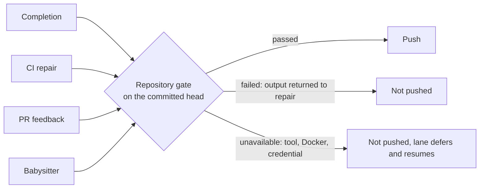

## Summary

Every lane that publishes agent-authored work now runs the target repository's
own gate (`./quality.sh`, or its configured `quality_command`, in its
`docker_image` and with its declared `quality_credentials`) on the committed
head before the push. A failed or unrun gate can no longer become a successful
completion. A new shared module, `worker/deno/lib/publication_validation.ts`,
owns the result contract and the four lanes consume it:

- issue completion (`completion_phase.ts`, `gateBeforePush` and the
  last-currency push of a head merged with a moved base);
- CI repair (`pr_ci_processor.ts`) and PR feedback (`pr_feedback_processor.ts`),
  through the existing `beforePush` seam of `commitAndPushPending` and
  `recoverFromPushRejection`;
- babysitter repair (`fleet_pr_babysitter.ts`), after the commit and before the
  push, so `BABYSITTER_READY` alone is no longer the quality result.

Part of #4625: the CI/feedback lanes' agent self-pushes are still gated only by
the changed-file pre-push hook (see the `missing` entries below).

Version bump: `VERSION` is not touched by this change.

## Spec

### Intent and Rationale

- The same `deno test` step failed on CI for 13 fleet PRs because a path
  published without a passing local gate (a gate skipped for budget, a
  best-effort post-run check, or a babysitter push after only `git diff --check`).
  One runner-owned check at the push boundary closes all of them.
- It reuses `runQualityGateCheck` (Docker, credentials, missing-tool and
  Docker-infrastructure classification) instead of a second runner; the
  checkout is passed in, so a babysitter clone is validated, not the process cwd.

### Essential Design Decisions

- Three outcomes. `unavailable` (missing tool, Docker or credential fault,
  unreadable checkout) is infrastructure: never pushed, never a content
  failure, and the lane retries. A repository with no `quality.sh` is an
  explicit `gate: "absent"` pass; `skip_quality_check` is `gate: "opted-out"`.
- The result is tied to the head: a dirty working tree (worker state files
  excepted) is a failure, a head that moves during the run is discarded, and
  the guard re-validates any new head. Reuse is only for the same clean head.
- A zero exit is not enough: a Deno summary of `0 passed | 0 failed` is a
  failure ("claimed but not run"). The 30-minute default timeout stops this
  repository's multi-minute gate being killed and misreported as a failure;
  `quality_check_timeout` still overrides it.
- Non-Deno repos and the repository's own policy are untouched: the runner
  executes the target repository's checks and centralises no policy (#4234 is
  respected: no prose or evidence accounting was added).

### Undiscoverable Facts

- `pr_feedback_processor.ts` marks non-review comments processed before
  publication, so a gate failure there leaves that mark (as any push failure
  does today); `pr_review` is held and not marked addressed.
- The completion-phase `tests` in this sandbox cannot reach the untrusted
  account (`/tmp` not accessible, #4697) and jsr.io is unreachable; two existing
  tests fail here for those reasons on the base as well (see Test Plan).

## Evidence

Backend-only change; no UI file touched. Tests drive the real functions with
temp git repositories and bare origins:

- `worker/deno/tests/publication_validation_test.ts` (17 steps): every gate
  action mapped, real `quality.sh` pass and fail, zero-test run, dirty tree,
  HEAD moved during the run, opt-out, `qualityCommand`, deps bound to the
  checkout, 30-minute timeout, the guard (once per head, new commit, edit after
  pass, failed output, in-sync branch).
- `worker/deno/tests/completion_phase_publication_validation_4625_test.ts`:
  failed (one repair turn, then `pre_push_gate`, no push), fail then pass,
  unavailable (`push_failure`, no push, no repair turn), pass for `ran`,
  `absent`, `opted-out`, noop skip, merged head failing and passing.
- `worker/deno/tests/pr_ci_processor_test.ts` and
  `worker/deno/tests/pr_feedback_processor_test.ts`: the `beforePush` argument
  at each push site yields the validator verdicts; real `commitAndPushPending`
  against a bare origin leaves the branch unmoved with the cause in the
  reported failure; feedback order (gate before verifier), unavailable releases
  the claim, failed is not marked addressed.
- `worker/deno/tests/fleet_pr_babysitter_validation_test.ts` (runs the
  scenarios in `worker/deno/tests/fixtures/fleet_pr_babysitter_validation_scenarios.ts`
  in a child process): failed gate, unavailable gate then resume on the same
  head, passed gate, `BABYSITTER_READY` with a failed gate, validate receives the
  clone and repo configs after the commit, a renewal failure during the gate,
  a config that cannot be loaded.

## Acceptance Criteria

- **missing** — Tests exercise every publishing path ("agent edits after validation invalidate affected results"): commits an agent pushes itself in the CI and feedback lanes reach origin through the pre-push hook, which runs only the changed-file checks, not the repository gate — reason: running a multi-minute gate inside the agent's `git push` was not attempted; the guard covers every worker-owned push.
- **missing** — "Include the test targets CI compiles" / "CI's impacted-test selection": the runner executes the repository's own entry point and rejects an empty Deno selection, but no impacted-test selection exists in this repository to mirror — reason: nothing to reuse here; the full `quality.sh` is what runs.

## Test Plan

See the final results recorded at the end of this file after the last run.
