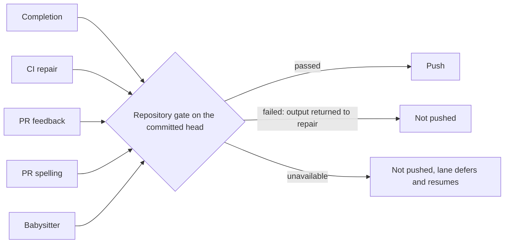

## Summary

Every lane that publishes agent-authored work now runs the target repository's
own gate (`./quality.sh`, or its `quality_command`, in its `docker_image` with
its declared `quality_credentials`) on the committed head before the push. A
failed or unrun gate can no longer become a successful completion. The shared
contract lives in `worker/deno/lib/publication_validation.ts`; the consumers
are:

- issue completion (`completion_phase.ts`), including the last-currency push;
- CI repair (`pr_ci_processor.ts`), PR feedback (`pr_feedback_processor.ts`) and
  PR spelling (`pr_spelling_processor.ts`), through the `beforePush` seam;
- babysitter repair (`fleet_pr_babysitter.ts`), after the commit and before the
  push, so `BABYSITTER_READY` is no longer the quality result;
- the completion recovery turns (`summary_rule_gate_retry.ts`,
  `screenshot_gate_retry.ts`, `pr_body_length.ts`).

Two paths the first cut missed are now covered. When `syncBaseBranch` merges the
base into the branch in the same push, `commitAndPushPending` runs the guard on
the merged head before pushing it. When the agent pushes its own commits in the
CI, feedback or spelling lane, the lane validates the moved head after the run
(`validateSelfPushedHead`); a rejected or unrunnable head is not reported as a
successful push.

Review round (PR #4800): the babysitter gate runs only as a separate account
(`requireSeparateAccount`, THREAT-MODEL C37) and its `failed` verdict is a
`BabysitterFailure` of class `code`; completion validates a head merged by
push-rejection recovery before it is pushed; the spelling and feedback lanes
stop spending sessions after `MAX_PUBLICATION_DEFERRALS` (3) rounds per key
(spelling charges deferred and rejected heads, feedback only deferred ones); a
gate failure that reproduces on the base commit is `unavailable`.

In the CI lane an `unavailable` gate releases the PR: the local retry charge is
retained, no failed-push comment is written and the round returns
`processed: false`. Closes #4625.

Version bump: `VERSION` is not touched by this change.

## Spec

### Intent and Rationale

- The same `deno test` step failed on CI for many fleet PRs because paths
  published without a passing local gate. One runner-owned check at the push
  boundary closes them, reusing `runQualityGateCheck` rather than a second
  runner.

### Essential Design Decisions

- Three outcomes: `passed`, `failed` (output goes back for repair) and
  `unavailable` (missing tool, Docker or credential fault, disk full, or a gate
  failure that reproduces on the PR's base commit on this host: never pushed,
  never a content failure, retried later; a gate timeout is a charged failure).
- The result is tied to the head: a dirty tree fails, and any new commit is
  validated afresh. A Deno run that executed zero tests fails. Default timeout
  is 30 minutes; a repository's `quality_check_timeout` overrides it.
- The target repository's own checks run; no prose or evidence accounting was
  added (#4234).

### Undiscoverable Facts

- This work was redone on a fresh branch after two earlier PRs for #4625 closed
  (stall, then merge conflict); it reapplies that work onto current `main`.

## Evidence

Backend only. Tests (all passed on this head in the targeted run):
`worker/deno/tests/publication_validation_test.ts`,
`worker/deno/tests/completion_phase_publication_validation_4625_test.ts`,
`worker/deno/tests/fleet_pr_babysitter_validation_test.ts`,
`worker/deno/tests/recovery_turn_publication_guard_4625_test.ts`,
`worker/deno/tests/pr_ci_processor_test.ts`,
`worker/deno/tests/pr_feedback_processor_test.ts`,
`worker/deno/tests/pr_feedback_processor_milestone_fix_test.ts`,
`worker/deno/tests/pr_feedback_processor_self_push_test.ts`,
`worker/deno/tests/pr_ci_processor_no_changes_test.ts`,
`worker/deno/tests/pr_spelling_processor_test.ts`,
`worker/deno/tests/pr_push_base_sync_test.ts`. They cover a real failing
command, a claimed-but-not-run check, edits after validation, zero Deno tests
executed, an unavailable host, and Deno tests running in both an initial run and
a repair.

Docs updated: `docs/INTERNALS.md` (new section), `docs/CONFIGURATION.md`,
`docs/workflows/fleet-pr-babysitter.md`, `docs/THREAT-MODEL.md` (control C37);
coverage ledger `docs/audits/lib-sweep-coverage/top-up-4625.json`.

## Test Plan

- CI repair: the review-dismissal scenario now invokes the separate verifier
  hook passed to `commitAndPushPending`, rather than the publication guard. The
  existing verifier rejection, recovery and body-sync assertions remain covered
  by
  `worker/deno/tests/pr_feedback_review_dismissal_3383_test.ts::review-fix verifier - recovery must clear before pushing`
  and the other scenarios in that file. No mirrored rule changed.
- CI repair: the feedback and CI self-push tests now inject a passing
  publication validator and assert it runs once. Their mocked pushes do not
  invoke the guard, and their temporary work directories are not repositories.
  The supported behaviour remains a success reply only after remote push
  verification and publication validation; coverage remains in
  `worker/deno/tests/pr_feedback_processor_self_push_test.ts::processPrFeedback - claude self-pushed: HEAD moved => success reply`
  and
  `worker/deno/tests/pr_ci_processor_no_changes_test.ts::processCiFailure - Claude self-pushed: HEAD moved triggers success reply (Issue #1863)`.
  Both files pass with `deno task test` (21 tests); both failed before the
  fixture repair. No mirrored rule changed.
- Head push `c92357559`: `pr_feedback_processor_milestone_fix_test.ts` now
  injects a passing `validatePublication` stub. Its mocked push never reaches
  the publication guard, and the real gate finds no repository in the fake
  `workDir` and reports `unavailable`, so those tests would otherwise stop at
  the new post-run head validation.
  `deno task test:unit
  tests/pr_feedback_processor_milestone_fix_test.ts`: 16
  passed, 0 failed.
- Targeted run of the files above plus `pr_ci_checks_test.ts`,
  `babysitter_fix_orchestration_test.ts`,
  `pr_feedback_review_dismissal_3383_test.ts`,
  `config_docs_consistency_test.ts`, `containment_docs_test.ts`,
  `update_mode_docs_test.ts` (the three docs-pin tests are unchanged from
  `main`): passed.
- `deno fmt --check` and `deno lint` on the changed `.ts` files: passed.
- `./quality.sh` on this head earlier failed only the parallel Deno test pass,
  on two cargo-fmt tests that need a configured `rustup` default (the host had
  none). Re-run on this head:
  `worker/deno/tests/completion_phase_repo_formatters_test.ts` (8 tests at head,
  8 passed). This PR changes neither `repo_formatters.ts` nor that test.
- Mutation check (review round 3): with the baseline green, the survivors were
  `completion_phase.ts` (the HEAD read, the passed-head cache and the recovery
  guard's options) and `fleet_pr_babysitter.ts` (`requireSeparateAccount`).
  `worker/deno/tests/completion_phase_publication_validation_4625_test.ts` (18
  tests at head) now pins each: the HEAD read's cwd, exit code and output, reuse
  of a passed head, the guard's `cwd`, `repo`, `repoConfigs`, `branchName` and
  `validate`, and that a guard block ends the run without a repair turn. Each
  was applied by hand and turned a test red. The `requireSeparateAccount`
  mutants were already red under
  `worker/deno/tests/fleet_pr_babysitter_validation_test.ts`, whose scenarios
  run in a child `deno test` process the mutation check does not see.

Not done: the agent's own pre-push hook still checks changed files only, so a
commit the agent pushes itself is judged by the full gate after it has left the
host (the round is then not reported as a clean push), not before. Parity with
mutation, clippy, cargo-deny and ShellCheck (#4617, #4630, #4626, #4631),
durable retry (#4656) and review dismissal (#4657) belong to those issues.

- Review follow-up: CI deferrals retain their local retry charge; a gate timeout
  is a failed verdict. The obsolete free-retry and timeout deferral expectations
  are replaced by the bounded retry and failure coverage in
  `worker/deno/tests/pr_ci_processor_test.ts::processCiFailure - an unavailable repository check releases the PR: retry charged, no comment, no marker (Issue #4625)`
  and
  `worker/deno/tests/publication_validation_test.ts::a gate killed by its timeout is failed, whatever its output`.
- The obsolete pre-merge repository gate and its ordering before the review
  verifier are replaced by verification of the fix before base sync and one gate
  on the resulting head. Coverage remains in
  `worker/deno/tests/pr_push_base_sync_test.ts::the merged head is validated before it is pushed; a verdict on the pre-merge head does not stand in for it (Issue #4625)`
  and
  `worker/deno/tests/pr_push_base_sync_test.ts::base sync verifies the fix once and gates the merged head once`.
  The obsolete expectation that the repository gate precedes the verifier is
  replaced by
  `worker/deno/tests/pr_feedback_processor_test.ts::feedback publication - the verifier runs before the repository checks reject the head (Issue #4625)`,
  which still proves a rejected head is neither pushed nor marked addressed. A
  rejected self-push remains unsuccessful, covered by
  `worker/deno/tests/pr_spelling_processor_test.ts::processSpellingFailure - a self-pushed spelling fix rejected by the repository checks is not reported as successful (Issue #4625)`.
  No mirrored rule was found for these push hooks.

## Review round 2 (PR #4800)

- Babysitter credential boundary: `PublicationRequest.requireSeparateAccount`
  makes the gate's `runCommand` refuse (and the result `unavailable`) when
  `canRunAsUntrustedUser` is false, instead of the `untrustedSpawn` fallback to
  the runner. Tests:
  `worker/deno/tests/publication_validation_test.ts::requireSeparateAccount: with no separate account the repository's command never runs`
  (spawn count 0, positive control with a droppable host, and an unchanged
  caller that does not ask). The babysitter passes the flag; asserted in
  `worker/deno/tests/fixtures/fleet_pr_babysitter_validation_scenarios.ts` ("the
  gate runs on the committed head..."). Recorded as THREAT-MODEL C37.
  Consequence: a host with no `agent` account defers babysitter repairs rather
  than running PR code as the key holder.
- Babysitter failure class: a `failed` verdict throws
  `BabysitterFailure(..., "code")`. Scenario "a failed gate is a code failure
  whatever its output says, and counts one substantive attempt" uses output
  containing `needs-human`, `changed during` and a timeout line; red with the
  plain `Error` restored (class `owner`).
- Completion push self-heal: `pushUnpushedCommits` (4th argument) and
  `recoverFromPushRejection` receive the publication guard at all four push
  sites; a head validated earlier in the phase is not validated again. Tests in
  `worker/deno/tests/completion_phase_publication_validation_4625_test.ts`:
  merged head validated before its push, rejected merged head never pushed
  (`pre_push_gate`), unavailable merged head retried (`push_failure`); the first
  is red with the first push's hook removed.
- Deferral bounds: new `worker/deno/lib/publication_deferral_budget.ts`.
  Spelling (`spelling-<checkRunId>`) and feedback
  (`feedback-<type>-<id>-<head>`) stand down after 3 rounds, charged on
  `unavailable` and, in spelling, on a rejected head too; a rejected head's
  output is fenced into the next spelling prompt. Tests:
  `pr_spelling_processor_test.ts` (bound, self-push `unavailable`,
  `processed: false` and no comment in the deferred case; red with the early
  return disabled and with the charge removed) and
  `pr_feedback_processor_test.ts` (bound; red with the charge removed). Not
  done: cheap capability probes before the agent starts; the capability decision
  lives inside the gate runner, so a probe would duplicate it. The bound is what
  limits the cost.
- Base reproduction: a failing gate is re-run in a detached worktree of the base
  ref, cached per base SHA; reproduces when every normalised head failure line
  is in the base's. Tests: `publication_validation_test.ts` (reproduces and is
  cached; base passes, head has a new line, no base ref: all stay `failed`). The
  comparison base is `baseRef` when a caller supplies one, else `origin/HEAD`,
  `origin/main` or `origin/master`; no lane passes `baseRef` yet, so a milestone
  PR compares against the default branch.
- Removed `refundCiCheckRetry` and its test (no caller); corrected the
  `publication_validation.ts` header so a gate timeout is under `failed`.
