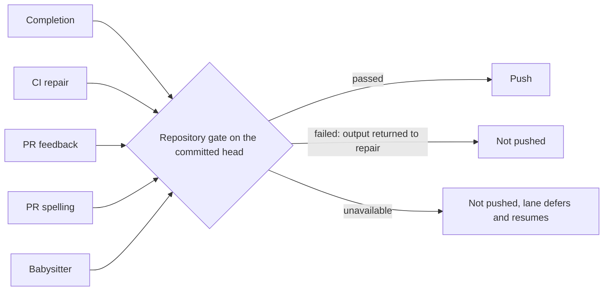

## Summary

Every lane that publishes agent-authored work now runs the target repository's
own gate (`./quality.sh`, or its `quality_command`, in its `docker_image` with
its declared `quality_credentials`) on the committed head before the push. A
failed or unrun gate can no longer become a successful completion. The shared
contract lives in `worker/deno/lib/publication_validation.ts`; the consumers are:

- issue completion (`completion_phase.ts`), including the last-currency push;
- CI repair (`pr_ci_processor.ts`), PR feedback (`pr_feedback_processor.ts`) and
  PR spelling (`pr_spelling_processor.ts`), through the `beforePush` seam;
- babysitter repair (`fleet_pr_babysitter.ts`), after the commit and before the
  push, so `BABYSITTER_READY` is no longer the quality result;
- the completion recovery turns (`summary_rule_gate_retry.ts`,
  `screenshot_gate_retry.ts`, `pr_body_length.ts`).

In the CI lane an `unavailable` gate releases the PR: the retry charge is
refunded (`refundCiCheckRetry`), no failed-push comment is written and the round
returns `processed: false`. Closes #4625.

Version bump: `VERSION` is not touched by this change.

## Spec

### Intent and Rationale

- The same `deno test` step failed on CI for many fleet PRs because paths
  published without a passing local gate. One runner-owned check at the push
  boundary closes them, reusing `runQualityGateCheck` rather than a second runner.

### Essential Design Decisions

- Three outcomes: `passed`, `failed` (output goes back for repair) and
  `unavailable` (missing tool, Docker or credential fault, disk full, timeout:
  never pushed, never a content failure, retried later).
- The result is tied to the head: a dirty tree fails, and any new commit is
  validated afresh. A Deno run that executed zero tests fails. Default timeout is
  30 minutes; a repository's `quality_check_timeout` overrides it.
- The target repository's own checks run; no prose or evidence accounting was
  added (#4234).

### Undiscoverable Facts

- This work was redone on a fresh branch after two earlier PRs for #4625 closed
  (stall, then merge conflict); it reapplies that work onto current `main`.

## Evidence

Backend only. Tests (all passed on this head, 264 tests in the targeted run):
`worker/deno/tests/publication_validation_test.ts`,
`worker/deno/tests/completion_phase_publication_validation_4625_test.ts`,
`worker/deno/tests/fleet_pr_babysitter_validation_test.ts`,
`worker/deno/tests/recovery_turn_publication_guard_4625_test.ts`,
`worker/deno/tests/pr_ci_processor_test.ts`,
`worker/deno/tests/pr_feedback_processor_test.ts`,
`worker/deno/tests/pr_spelling_processor_test.ts`. They cover a real failing
command, a claimed-but-not-run check, edits after validation, zero Deno tests
executed, an unavailable host, and Deno tests running in both an initial run and
a repair.

Docs updated: `docs/INTERNALS.md` (new section), `docs/CONFIGURATION.md`,
`docs/workflows/fleet-pr-babysitter.md`; coverage ledger
`docs/audits/lib-sweep-coverage/top-up-4625.json`.

## Test Plan

- Targeted run of the files above plus `pr_ci_checks_test.ts`,
  `babysitter_fix_orchestration_test.ts`, `pr_feedback_review_dismissal_3383_test.ts`,
  `config_docs_consistency_test.ts`, `containment_docs_test.ts`,
  `update_mode_docs_test.ts`: passed.
- `deno fmt --check` and `deno lint` on the changed `.ts` files: passed.
- `./quality.sh` on this head: every stage passed except the parallel Deno test
  pass, where 2 of 32,486 tests failed:
  `completion - an unformatted Rust change is formatted and committed...` and
  `completion - cargo fmt stages only the branch's .rs files...` in
  `worker/deno/tests/completion_phase_repo_formatters_test.ts`. Both are
  environmental (`rustup could not choose a version of cargo-fmt ... no default
  is configured` on this host); this PR changes neither `repo_formatters.ts` nor
  that test. The serial Deno pass did not run after that failure.

Not done: commits an agent pushes itself in the CI and feedback lanes go through
the agent's changed-file pre-push hook, not this full gate. Parity with
mutation, clippy, cargo-deny and ShellCheck (#4617, #4630, #4626, #4631), durable
retry (#4656) and review dismissal (#4657) belong to those issues.
