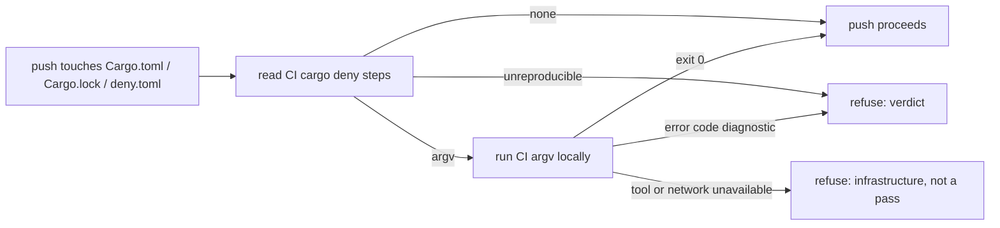

## Summary

The fleet's push gates now run the repository's own CI `cargo deny` check
before a push that touches cargo inputs, so a dependency-audit failure is
caught on the Mac instead of in CI. Closes #4626.

- New `worker/deno/lib/cargo_deny_gate.ts` reads the repository's
  `.github/workflows/*.yml|yaml`, finds each `cargo deny … check …` `run:` step
  and each `EmbarkStudios/cargo-deny-action` step, and runs CI's exact argv.
  No `--offline`, ignore list or reduced-scope flag is added.
- `runPrePushGate` (agent `pre-push` hook, `commitAndPushPending` Step 1b and
  the completion phase's `gateBeforePush`) calls it after the changed-file
  checks. It is never skipped for run budget, and the heavy-build gate's
  "cargo builds wait for CI" deferral does not cover it.
- `finishBabysitterRepair` calls it before the babysitter's `git push`. That
  path previously pushed with no local gate.
- Tool or network unavailability (no `cargo-deny`, advisory database or
  registry unreachable, timeout) is returned as an infrastructure error, never
  a pass. A cargo-deny `error[...]` diagnostic is a verdict. A CI invocation
  the gate cannot reproduce (`$`, `${{ }}`, backtick) refuses the push.

Version bump: no `VERSION` file in this repository.

## Spec

### Intent and Rationale

- The 6 failing fleet PRs ran `cargo deny check` only in CI. The pre-push gate
  already runs the cheap changed-file checks on every worker push, so cargo
  deny is added there (one place), plus the babysitter push, which bypassed it.
- The repository's workflows are the source of truth for "the way CI does", as
  the existing cspell check already does for its own CI step.

### Essential Design Decisions

- Triggered only by a push that changes `Cargo.toml`, `Cargo.lock`,
  `deny.toml`, `.deny.toml`, `.cargo/config.toml` or `.cargo/deny.toml`: the
  advisory database can change without a push, so an unrelated push is not
  blamed for it.
- Classification is anchored per line and an `error[code]` diagnostic always
  wins, so quoted advisory text cannot turn a verdict into an infrastructure
  deferral (the over-broad "command not found" match fixed in eb861bdb).
- Infrastructure failures are `PrePushGateInfrastructureError` /
  `BabysitterFailure("infrastructure")`; verdicts reach the existing one-turn
  agent recovery (`gateBeforePush`) or count as a `code` attempt.
- Assumption: the earlier shared runner (#4625) was reverted in 1f8d83a1, so
  this reuses the pre-push gate and `runPreFlightGate` instead.

### Undiscoverable Facts

- `EmbarkStudios/cargo-deny-action` builds `cargo deny --log-level <warn>
  --manifest-path <./Cargo.toml> <--all-features> <check> <args>` and runs from
  the repo root (read from the action's `action.yml` and `entrypoint.sh`).
- Not read: job-level `defaults.run.working-directory`, matrix expansion and
  invocations hidden in scripts (documented, `SIMPLE-ON-PURPOSE`).

## Evidence

Observed with the real tool (cargo-deny 0.20.2) in a scratch crate:

- `cargo deny check` with an unreachable `db-urls` entry:
  `[ERROR] failed to fetch advisory database https://invalid.invalid/x with cli: failed to clone …`
  then `fatal: unable to access 'https://invalid.invalid/x/': CONNECT tunnel failed, response 403`, exit 1.
- `cargo nosuchcmd`: `error: no such command: \`nosuchcmd\`` (the `deny` form
  is the same line).
- A licence failure prints `error[unlicensed]: …` and `licenses FAILED`.
- Other tool-unavailable phrases (`spurious network error`, `Could not resolve
  host`, `Network is unreachable`, `Connection refused|timed out|reset`) come
  from cargo/libcurl's documented messages and were not provoked here.

## Test Plan

- Added `worker/deno/tests/cargo_deny_gate_test.ts` (46 tests): workflow
  parsing (inline, re-wrapped `run: |`, continued lines, `&&`/`;` segments, env
  prefixes, `working-directory`, action defaults and overrides, look-alikes
  that must not fire), trigger paths, failure classification, runner order and
  hostile-input cases.
- Added `worker/deno/tests/pre_push_gate_cargo_deny_test.ts` (7 tests) driving
  `runPrePushGate`: exact argv and cwd, no run for unrelated pushes, verdict is
  not infrastructure, unreachable advisory database and missing binary are
  `PrePushGateInfrastructureError` quoting the cause, repo without cargo deny
  in CI runs nothing, `${{ }}` invocation refused.
- Added `worker/deno/tests/fleet_pr_babysitter_cargo_deny_test.ts` (4 tests)
  driving `finishBabysitterRepair`: verdict is a `code` failure with no push,
  infrastructure is an `infrastructure` failure with no push, a pass runs
  before the push, and the default gate reads the repair's own commit with real
  git.
- Edited `worker/deno/tests/fleet_pr_babysitter_test.ts` and
  `worker/deno/tests/babysitter_review_dismissal_4657_test.ts` only to inject a
  passing `cargoDenyGate` through the shared deps builders (and two inline
  deps), with positive controls that the stub is reached on a push. No
  assertion was removed.
- Red checks (each break applied, test seen red, then restored): drop the
  anchor on the advisory-database pattern; disable verdict-wins; disable the
  shell-operator cut and segment split; disable env-prefix stripping; disable
  the `$`-without-`check` rule; remove the gate call from
  `finishBabysitterRepair`; swap infrastructure/verdict mapping; call the gate
  after the push; drop the cargo-deny block from `runPrePushGate`; map
  infrastructure to a plain `Error` in `runPrePushGate`.
- Callers of `runPrePushGate` checked: the agent hook
  (`pre_push_gate_cli.ts`) and `gateUnpushedCommits` (Step 1b and the
  completion phase); all inherit it. Babysitter: `finishBabysitterRepair` is
  the only push of a repair. Not gated (unchanged policy): WIP-preservation
  pushes.
- Ran: the three new test files, `lib_sweep_coverage_test.ts` and the 21 test
  files that read the edited docs: 319 passed, 0 failed. The full
  `./quality.sh` run before the sweep top-up failed only
  `lib_sweep_coverage_test.ts` (module unclaimed); that is fixed by
  `docs/audits/lib-sweep-coverage/top-up-4626.json` and the full gate was not
  re-run afterwards (it takes about 8 minutes).
- Docs: `docs/CONFIGURATION.md` (pre-push hook section) and
  `docs/workflows/fleet-pr-babysitter.md` updated; sibling check lists grepped
  (`cargo fmt, markdownlint, cspell`, `Floci`); `docs/INTERNALS.md` and
  `README.md` carry no such list.

Not done: an end-to-end run of the gate through the real `cargo deny` binary
inside the test suite (tests inject the runner); the full gate after the final
edits.
