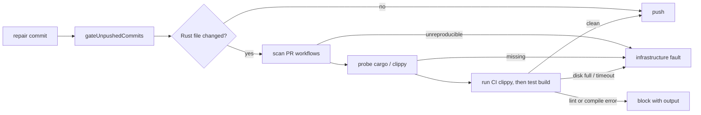

## Summary

Before a repair is pushed, the worker now runs the `cargo clippy` and
test-target compile commands that the repo's own pull-request workflows run. A
lint (`clippy::assert_is_empty`, `clippy::must_use_candidate`) or a test-only
compile error is therefore caught before the push, not by a CI run. Closes
#4630.

- `worker/deno/lib/ci_cargo_checks.ts` (new) reads the repo's tracked
  `.github/workflows/*.yml|yaml` as data. Only workflows triggered on
  `pull_request` count. It derives each `cargo clippy` command verbatim
  (toolchain, flags such as `--all-targets --locked -- -D warnings`,
  workspace/package/feature selection, working directory, cargo-relevant env).
  Where no clippy run already compiles the same test targets, it derives a
  `cargo test --no-run` from a CI `cargo test`, `cargo nextest run` or
  `cargo llvm-cov`, keeping only build flags. A clippy run with `--all-targets`
  or `--tests` covers a test build only when the directory, toolchain,
  package/workspace selection, features, profile, target, manifest path and env
  all match; otherwise the test build is kept.
- `worker/deno/lib/pre_push_gate.ts` plans those checks after `cargo fmt`, for
  each directory a pushed Rust-relevant file touches. A toolchain probe runs
  first. A failing lint or test build blocks the push with its output. A missing
  toolchain, a command that cannot start or times out, host disk-full output, a
  working directory that is missing or escapes the repo, or a CI command the
  scanner cannot reproduce is a `PrePushGateInfrastructureError`: the push is
  refused but the branch is not blamed, and the checked set is never reduced.
- `worker/deno/lib/git_push.ts` wires `repoCiCargoChecks` into
  `gateUnpushedCommits` (so Step 1b of `commitAndPushPending` and the completion
  phase run it). New `CI_CARGO_ONLY_PRE_FLIGHT` spec; `pr_ci_processor.ts` and
  `pr_feedback_processor.ts` pass it when a repo has no pre-flight commands, so
  repair pushes run only the CI cargo checks.
- Docs: `docs/CONFIGURATION.md` (pre-flight / pre-push gate section) and
  `docs/INTERNALS.md`.
- Not done here: `cargo deny` (owned by #4626, still open).

## Spec

### Intent and Rationale

- The same CI step failed on 9, then 50+, fleet PRs; matching CI's own
  invocation (rather than a generic `cargo clippy`) is what makes the local
  result agree with CI.
- Reading the workflow YAML keeps one source of truth: nothing is hard-coded per
  repo.

### Essential Design Decisions

- The scanner is opt-in (`findCiCargo`) and loaded by dynamic import in
  `gateUnpushedCommits`: the agent's `--no-config` pre-push hook cannot resolve
  `@std/yaml`, so that hook runs no CI cargo check; the worker's own gates do.
- Anything the scanner cannot reproduce faithfully fails loud as infrastructure
  instead of dropping to a smaller check set (the issue requires this).
- Repair processors use a cargo-only spec for repos without pre-flight, so the
  full changed-file gate does not newly apply to repair pushes.

### Undiscoverable Facts

- #4625 (shared validation contract) is closed; #4626 (cargo deny) is open and
  untouched.
- `docs/audits/lib-sweep-coverage/top-up-4630.json` registers the new lib module
  with the security-sweep ledger.

## Evidence

Backend/CLI change, no UI files. Tests (all under `worker/deno/`):

- `tests/ci_cargo_checks_test.ts`: verbatim clippy argv,
  workspace/package/features/locked, working directory (step, job, workflow,
  `cd`), `RUSTFLAGS`, toolchain, unverifiable forms, test-build derivation,
  hostile 200,000-character input. Added for the completion-check findings: a
  test build is kept when clippy `--all-targets` lacks `--workspace` and the
  test run has `--workspace --all-features` (and for differing `-p`, features,
  profile, target, manifest path, env and toolchain), and dropped when the
  selection matches in another order or spelling; every kept env key, every kept
  test-build flag (both `--flag v` and `--flag=v`), and a workflow that parses
  to `null` or a list are each pinned, so deleting one entry or the `isMapping`
  null/array guard turns a test red (each checked by hand).
- `tests/pre_push_gate_test.ts` (fixtures' covered test build now uses the same
  selection as its clippy):
  `a clippy lint denied by -D warnings blocks the push, and is not infrastructure`
  (`clippy::must_use_candidate`, `clippy::assert_is_empty`),
  `a compile failure in a test target from CI's test build blocks the push with its output`
  (`E0432`), probe / disk-full / timeout / symlink-escape infrastructure cases,
  `ciCargoOnly` cases.
- `tests/git_push_preflight_test.ts`, `tests/pr_ci_processor_test.ts`,
  `tests/pr_feedback_processor_pre_flight_4630_test.ts`: wiring of the
  cargo-only spec into both repair processors and the ungated WIP path.

## Test Plan

- `deno test -A` on `ci_cargo_checks_test.ts`, `pre_push_gate_test.ts`,
  `git_push_preflight_test.ts`, `pr_feedback_processor_pre_flight_4630_test.ts`,
  `pr_ci_processor_test.ts` after merging main and the completion-check fixes:
  192 passed, 0 failed.
- Edited `tests/pr_feedback_review_dismissal_3383_test.ts` expectation:
  `preFlightSpecs` now `[CI_CARGO_ONLY_PRE_FLIGHT, CI_CARGO_ONLY_PRE_FLIGHT]`
  (was `[undefined, undefined]`), required by #4630 (repair pushes now carry the
  cargo-only spec). It goes red if the processor passes `undefined` again. 30
  passed.
- `./quality.sh` on the head before that last test edit: all stages passed
  except `deno tests`, with 2 failures. One was the test above, now fixed. The
  other, `tests/merge_fast_checks_credentials_4705_test.ts`, fails only because
  this host has `HTTP(S)_PROXY` set; with the proxy variables unset it passes
  6/6, so it is unrelated. The full gate was not re-run after the one-line test
  fix.
- Callers of the changed shared items: `git_push.ts` `gateUnpushedCommits`
  (completion phase, `commitAndPushPending`) and both repair processors checked;
  the agent hook (`pre_push_gate_cli.ts`) deliberately passes no `findCiCargo`.
- Not checked: a real `cargo clippy` run against a Rust repo (tests use injected
  runners and real workflow scans); `if:` conditions, matrices and reusable
  workflows are not evaluated (documented as known limits).
