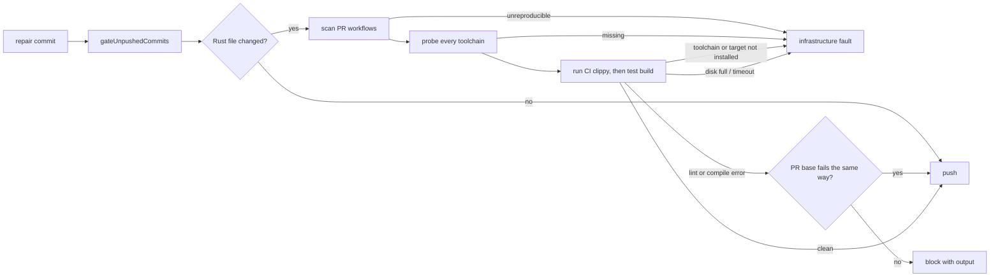

## Summary

Before a repair is pushed, the worker now runs the `cargo clippy` and
test-target compile commands that the repo's own pull-request workflows run. A
lint (`clippy::assert_is_empty`, `clippy::must_use_candidate`) or a test-only
compile error is therefore caught before the push, not by a CI run. Closes
#4630.

- `worker/deno/lib/ci_cargo_checks.ts` (new) reads the repo's tracked
  `.github/workflows/*.yml|yaml` as data. Only workflows triggered on
  `pull_request` count. It derives each `cargo clippy` command verbatim
  (toolchain, flags such as `--all-targets --locked -- -D warnings`,
  workspace/package/feature selection, working directory, cargo-relevant env).
  Where no clippy run already compiles the same test targets, it derives a
  `cargo test --no-run` from a CI `cargo test`, `cargo nextest run` or
  `cargo llvm-cov`, keeping only build flags. A clippy run with `--all-targets`
  or `--tests` covers a test build only when the directory, toolchain,
  package/workspace selection, features, profile, target, manifest path and env
  all match; otherwise the test build is kept.
- `worker/deno/lib/pre_push_gate.ts` plans those checks after `cargo fmt`, for
  each directory a pushed Rust-relevant file touches. Before any CI cargo
  command runs, every distinct toolchain the plan uses is probed
  (`cargo +T
  --version`, and `cargo +T clippy --version` where a clippy check
  uses it). A failing lint or test build blocks the push with its output, unless
  the PR base already fails the same way (below). A missing toolchain, component
  or `--target` (probe failure, or rustup/rustc output saying it is not
  installed), a command that cannot start or times out, host disk-full output, a
  working directory that is missing or escapes the repo, or a CI command the
  scanner cannot reproduce is a `PrePushGateInfrastructureError`: the push is
  refused but the branch is not blamed, and the checked set is never reduced.
- Base-failure comparison: when the gate knows the PR base (`compareRef`, set
  from `syncBaseBranch` by `commitAndPushPending`, or the completion gate's
  `baseRef`), a failing CI cargo check is re-run, as CI wrote it, in a detached
  worktree of that base. If every diagnostic the push shows (message, file and
  how many times; not line) is also on the base, the failure is a
  `[PRE_PUSH_WARNING]`, not a verdict. A base that passes, times out, fails for
  the host or lacks a diagnostic, an unresolvable ref, or no known base leaves
  it a verdict.
- Scanner fixes: a `cd <dir>` on its own line now holds for the rest of that
  step's run block (any `cd` form it cannot follow, including `pushd`, `popd`, a
  `cd` after `then`/`do`/`else`/`{` and a `cd ... || true`, makes the later
  cargo lines of the step unverifiable), and `cargo nextest run` /
  `cargo llvm-cov nextest` drop `--profile`/`-P` (a nextest profile) and map
  `--cargo-profile` to cargo's `--profile`.
- `worker/deno/lib/git_push.ts` wires `repoCiCargoChecks` into
  `gateUnpushedCommits` (so Step 1b of `commitAndPushPending` and the completion
  phase run it). New `CI_CARGO_ONLY_PRE_FLIGHT` spec; `pr_ci_processor.ts` and
  `pr_feedback_processor.ts` pass it when a repo has no pre-flight commands, so
  repair pushes run only the CI cargo checks, the ShellCheck policy and the
  `cargo deny` gate that every gate run applies (#4631, #4626, merged from
  main).
- Infrastructure is not charged, up to a cap (new
  `worker/deno/lib/gate_infra_release.ts`): when the pre-push gate fails with
  `PrePushGateInfrastructureError` (on the first push or on the retry after push
  recovery), `pr_ci_processor.ts` writes no attempt marker and replies that the
  gate could not run on this host, and `pr_feedback_processor.ts` posts a short
  comment and releases the comment uncharged through its existing host-fault
  release path (`releaseUncharged`). Each release carries a
  `vibe-gate-infra-release` marker; after two fleet-authored markers for the
  same comment (feedback) or failure signature (CI fix) the next fault is
  charged like any failed attempt, so a lasting fault cannot re-run the agent
  without end. An unreadable PR or no trusted author is unknown, and releases
  again. A lint or compile failure still blocks the push and is charged, unless
  the PR base already has it (see "Base-failure comparison").
- Merge with main (#4631, #4909): the ShellCheck policy and `shellcheckOnly`
  stay as main has them. The cargo checks are planned from a changed-file list
  that keeps a file reached through a symlinked parent directory
  (`listPushedFiles(..., containToCheckout = false)`), so the cargo working
  directory containment check still refuses a crate symlinked outside the
  repository, while main's other changed-file checks keep skipping such files.
- Docs: `docs/CONFIGURATION.md` (pre-flight / pre-push gate section) and
  `docs/INTERNALS.md`; `docs/audits/lib-sweep-coverage/top-up-4630.json` also
  lists the new module.
- Not done here: the `cargo deny` implementation itself (owned by #4626, merged
  from main). `ciCargoOnly` only keeps it running for changed cargo inputs.

## Spec

### Intent and Rationale

- The same CI step failed on 9, then 50+, fleet PRs; matching CI's own
  invocation (rather than a generic `cargo clippy`) is what makes the local
  result agree with CI.
- Reading the workflow YAML keeps one source of truth: nothing is hard-coded per
  repo.

### Essential Design Decisions

- The scanner is opt-in (`findCiCargo`) and loaded by dynamic import in
  `gateUnpushedCommits`: the agent's `--no-config` pre-push hook cannot resolve
  `@std/yaml`, so that hook runs no CI cargo check; the worker's own gates do.
- Anything the scanner cannot reproduce faithfully fails loud as infrastructure
  instead of dropping to a smaller check set (the issue requires this).
- A failure the PR base already has is compared by diagnostic message, file and
  count, not line number, on a detached worktree of the base: cheap, and it
  never excuses a diagnostic the base lacks. Re-running on the base costs one
  extra cargo build, only when a check has already failed.
- Repair processors use a cargo-only spec for repos without pre-flight, so the
  full changed-file gate does not newly apply to repair pushes. The ShellCheck
  policy (#4631) and the cargo-deny gate (#4626, for changed cargo inputs) run
  in every gate, so these repairs keep both. The spelling and merge-conflict
  repairs keep main's `resolveRepairPreFlightSpec` (`shellcheckOnly`), with no
  cargo check.

### Undiscoverable Facts

- #4625 (shared validation contract) is closed; #4626 (cargo deny) is merged
  from main and its gate is kept under `ciCargoOnly`.
- `docs/audits/lib-sweep-coverage/top-up-4630.json` registers the new lib module
  with the security-sweep ledger.

## Evidence

Backend/CLI change, no UI files. Tests (all under `worker/deno/`):

- `tests/ci_cargo_checks_test.ts`: verbatim clippy argv,
  workspace/package/features/locked, working directory (step, job, workflow,
  `cd`), `RUSTFLAGS`, toolchain, unverifiable forms, test-build derivation,
  hostile 200,000-character input. Added for the completion-check findings: a
  test build is kept when clippy `--all-targets` lacks `--workspace` and the
  test run has `--workspace --all-features` (and for differing `-p`, features,
  profile, target, manifest path, env and toolchain), and dropped when the
  selection matches in another order or spelling; every kept env key, every kept
  test-build flag (both `--flag v` and `--flag=v`), and a workflow that parses
  to `null` or a list are each pinned, so deleting one entry or the `isMapping`
  null/array guard turns a test red (each checked by hand).
- `tests/pre_push_gate_test.ts` (fixtures' covered test build now uses the same
  selection as its clippy):
  `a clippy lint denied by -D warnings blocks the push, and is not infrastructure`
  (`clippy::must_use_candidate`, `clippy::assert_is_empty`),
  `a compile failure in a test target from CI's test build blocks the push with its output`
  (`E0432`), probe / disk-full / timeout / symlink-escape infrastructure cases,
  `ciCargoOnly` cases.
- `tests/git_push_preflight_test.ts`, `tests/pr_ci_processor_test.ts`,
  `tests/pr_feedback_processor_pre_flight_4630_test.ts`: wiring of the
  cargo-only spec into both repair processors and the ungated WIP path;
  `pr_ci_processor_test.ts` and `pr_feedback_review_dismissal_3383_test.ts` also
  pin the uncharged release of an infrastructure gate failure.

## Test Plan

- `./quality.sh` was not run on this head (run budget); the targeted checks
  were: `deno fmt`, `deno lint` and `deno check` on every changed `.ts` file
  (clean), and `deno task test:unit` on `ci_cargo_checks_test.ts`,
  `pre_push_gate_test.ts`, `git_push_preflight_test.ts`,
  `pr_feedback_processor_pre_flight_4630_test.ts`, `pr_ci_processor_test.ts`,
  `pr_feedback_review_dismissal_3383_test.ts`, `gate_infra_release_test.ts` and
  `pr_round_repo_formatters_test.ts`: 298 passed, 0 failed.
- PR #4896 review tests, each shown red by breaking only its own code:
  - `worker/deno/tests/pre_push_gate_test.ts` (probe only the first check, and
    drop the missing-capability line test, and `every` to `some` in the base
    comparison):
    `a second toolchain that is missing is infrastructure, and no
    CI cargo command runs`,
    `a clippy component missing from a second toolchain
    is probed and is infrastructure`,
    `rustup and rustc output for a missing
    toolchain, component or target is infrastructure, not a block`,
    `a clippy
    failure that is new on the push blocks, whatever the base shows`
    (all red). Review round 2:
    `a clippy failure that is new on the push
    blocks, whatever the base shows`
    gained a case where the push repeats a diagnostic the base shows once
    (counts per signature; red when the comparison goes back to a set). Also
    green-by-design:
    `a clippy failure the PR base already has is no
    verdict on the push`,
    `a lint whose source excerpt quotes 'is not
    installed' still blocks`,
    `a comparison ref that cannot be resolved leaves
    the failure a verdict`.
  - `worker/deno/tests/ci_cargo_checks_test.ts` (reset the directory per line,
    and stop treating nextest differently):
    `a cd on its own line holds for the
    later lines of the same step only`,
    `a cd the scanner cannot follow makes
    the later cargo lines of that step unverifiable`
    (gained `if ...; then cd rust; fi`, `for ...; do cd $d; done` and
    `{ cd rust; }` cases; red when keywords are no longer skipped),
    `nextest's --profile
    names a nextest profile and is not passed to cargo as a build profile`
    (all red).
  - `worker/deno/tests/git_push_preflight_test.ts` (stop passing the base ref
    from `syncBaseBranch`): both `a CI clippy failure the PR base ...` tests
    went red.
  - `worker/deno/tests/pr_feedback_review_dismissal_3383_test.ts` and
    `worker/deno/tests/pr_ci_processor_test.ts` (raise the cap to 9999):
    `a
    gate-infrastructure fault is released only up to the cap, then charged`
    and
    `a CI fix released for a gate fault records the release, and the third is
    charged`
    went red.
  - `worker/deno/tests/gate_infra_release_test.ts` pins the key allow-list, the
    trusted-author count and the unknown outcome.
- Edited expectations: `pr_feedback_review_dismissal_3383_test.ts`
  `assertGateInfraFaultReleases` now expects the one marker comment a release
  posts (it expected none); it goes red if the marker comment is dropped.
  `preFlightSpecs` there, and the observed spec in
  `pr_round_repo_formatters_test.ts`, are now `CI_CARGO_ONLY_PRE_FLIGHT` (was
  `{ commands: [], shellcheckOnly: true }`), required by #4630 (a repo with no
  pre-flight commands gets the cargo-only spec on a repair push).
- Callers of the changed shared items: `gateUnpushedCommits` (completion phase
  with `baseRef`, `commitAndPushPending` with `syncBaseBranch`), both repair
  processors and the agent hook (`pre_push_gate_cli.ts`, which passes no
  `findCiCargo` and no `compareRef`) checked. Spelling and merge-conflict
  repairs use `shellcheckOnly`, which plans no cargo check, so they need no base
  comparison.
- A pre-existing `merge_fast_checks_credentials_4705_test.ts` failure under
  `HTTP(S)_PROXY` is unrelated.
- Not checked: a real `cargo clippy` run against a Rust repo (tests use injected
  runners and real workflow scans); `if:` conditions, matrices and reusable
  workflows are not evaluated (documented as known limits); a gated head's fix
  branch (no `syncBaseBranch`) gets no base comparison; the `llvm-cov nextest`
  build profile is not reproduced.
