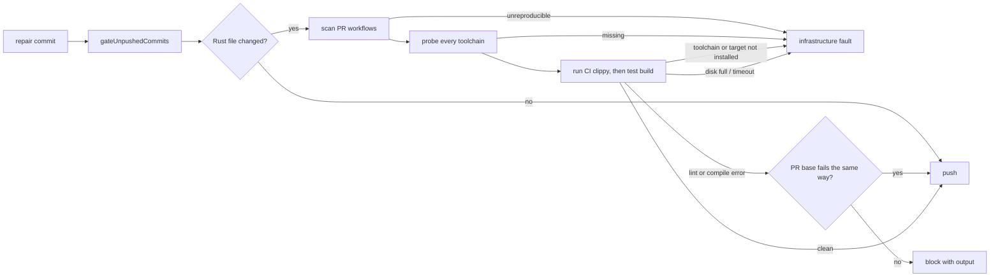

## Summary

Before a repair is pushed, the worker now runs the `cargo clippy` and
test-target compile commands that the repo's own pull-request workflows run. A
lint (`clippy::assert_is_empty`, `clippy::must_use_candidate`) or a test-only
compile error is therefore caught before the push, not by a CI run. Closes
#4630.

- `worker/deno/lib/ci_cargo_checks.ts` (new) reads the repo's tracked
  `.github/workflows/*.yml|yaml` as data. Only workflows triggered on
  `pull_request` count. Explicitly optional jobs and steps are excluded;
  job-level `continue-on-error` expressions are unverifiable. It derives each
  `cargo clippy` command verbatim (toolchain, flags such as
  `--all-targets --locked -- -D warnings`, workspace/package/feature selection,
  working directory, cargo-relevant env). Output-directory overrides
  (`CARGO_TARGET_DIR` and `CARGO_BUILD_TARGET_DIR`) are excluded so the worker
  retains its own cache isolation; target-specific compiler and linker settings
  remain. Where no clippy run already compiles the same test targets, it derives
  a `cargo test --no-run` from a CI `cargo test`, `cargo nextest run` or
  `cargo llvm-cov`, keeping only build flags. A clippy run with `--all-targets`
  or `--tests` covers a test build only when the directory, toolchain,
  package/workspace selection, features, profile, target, manifest path and env
  all match; otherwise the test build is kept.
- `worker/deno/lib/pre_push_gate.ts` plans those checks after `cargo fmt`, for
  each directory a pushed Rust-relevant file touches. Before any CI cargo
  command runs, every distinct toolchain the plan uses is probed
  (`cargo +T
  --version`, and `cargo +T clippy --version` where a clippy check
  uses it). A failing lint or test build blocks the push with its output, unless
  the PR base already fails the same way (below). A missing toolchain, component
  or `--target` (probe failure, or rustup/rustc output saying it is not
  installed), a command that cannot start or times out, registry/network or host
  disk-full output, a working directory that is missing or escapes the repo, or
  a CI command the scanner cannot reproduce is a
  `PrePushGateInfrastructureError`: the push is refused but the branch is not
  blamed, and the checked set is never reduced.
- Base-failure comparison: the repair processors pass the PR base independently
  of whether they merge it into the repair branch; the completion gate uses its
  `baseRef`. A failing CI cargo check is re-run, as CI wrote it, in a detached
  worktree of that base: the refreshed tip of the base ref and, when the
  checked-out head forked from an older commit (`git merge-base HEAD <tip>`,
  deepening a shallow checkout first), that fork point too, because the base is
  merged into the repair only after this gate. A diagnostic either shows counts
  as the base's; a fork point that cannot be found is infrastructure, not a
  pass. Remote base refs are refreshed before resolution; failed fetches remain
  infrastructure faults with redacted, capped head diagnostics. A check
  directory absent from the base is a new failure on the head, not
  infrastructure. If every diagnostic the push shows (message, file and how many
  times; not line) is also on the base, the failure is a `[PRE_PUSH_WARNING]`,
  not a verdict. Only error-level diagnostics are compared: a warning never
  fails a CI cargo command, so a warning the push adds, or cargo's
  `warning: build failed, waiting for other jobs to
  finish...`, does not make
  a base-only failure a verdict. A base that passes or lacks an error the push
  shows leaves it a verdict. An unavailable repair base or a host failure during
  comparison is infrastructure, not a branch verdict.
- Scanner fixes: a `cd <dir>` on its own line now holds for the rest of that
  step's run block (any `cd` form it cannot follow, including `pushd`, `popd`, a
  `cd` after `then`/`do`/`else`/`{` and a `cd ... || true`, makes the later
  cargo lines of the step unverifiable), and `cargo nextest run` /
  `cargo llvm-cov nextest` drop `--profile`/`-P` (a nextest profile) and map
  `--cargo-profile` to cargo's `--profile`.
- `worker/deno/lib/git_push.ts` wires `repoCiCargoChecks` into
  `gateUnpushedCommits` (so Step 1b of `commitAndPushPending` and the completion
  phase run it). New `CI_CARGO_ONLY_PRE_FLIGHT` spec; `pr_ci_processor.ts` and
  `pr_feedback_processor.ts` pass it when a repo has no pre-flight commands, so
  repair pushes run only the CI cargo checks, the ShellCheck policy and the
  `cargo deny` gate that every gate run applies (#4631, #4626, merged from
  main).
- The agent's own `git push` now runs the same checks (Issue #4630 review):
  before the agent starts, `claude_runner.ts` scans the repo's workflows with
  `repoCiCargoChecks` (loaded with a dynamic `import()` inside
  `scanAgentCiCargoChecks`, not a top-level import, so scripts that reach
  `claude_runner.ts` without the worker's import map, such as the
  review-fleet-prs helpers, never reach its bare `@std/yaml/parse` specifier)
  and writes the derived checks (and any unverifiable reasons) into the hook's
  `pre-push-spec.json`. `pre_push_gate_cli.ts` reads that entry and passes it
  back as `findCiCargo`, so the hook runs the CI cargo checks without importing
  the workflow scanner (it still reaches a YAML parser through
  `cargo_deny_gate.ts`). A self-pushed Rust change that fails CI clippy or the
  test build is refused, exactly as the worker's own gates refuse it.
  - Fail closed: when that pre-run scan cannot be produced (`git ls-files`
    fails, or the scanner fails to load or throws), `scanAgentCiCargoChecks`
    logs a warning and writes a scan with no checks and one `unverifiable`
    reason, so a Rust-relevant push through the hook is refused as
    infrastructure instead of running no CI cargo check. A run with no checkout
    writes no scan.
  - PR-base comparison: the CI-fix and PR-feedback processors read the PR base
    before the agent runs and pass `origin/<base>` as
    `RunClaudeOptions.ciCargoCompareRef` (`""` when the base cannot be read, via
    `prBaseCompareRef`, which makes a failing check an infrastructure fault, as
    `requireCargoBaseComparison` does for the worker's own push). It is written
    into the spec as `compareRef` and `pre_push_gate_cli.ts` passes it to
    `runPrePushGate`, so a failure the base already has is a
    `[PRE_PUSH_WARNING]` on the agent's own push too. In the CI processor both
    agent runs (the fix and the quality retry) carry it; in the feedback
    processor every agent run does, through `runAgentTracked`. Issue runs (the
    execute run, with the milestone branch, else the base branch, else the
    default branch, skipping blank names; the completion rebase pass, with its
    PR base; and the in-run recovery agents of the pre-push gate, screenshot,
    summary-rule, PR-body-length, security-fix and quality-gate retries, through
    `issueRunCompareRef`), spelling repairs (the PR base, read once before the
    agent runs and reused for the base merge) and merge-conflict repairs
    (`origin/<base>`, the branch merged in; both the resolution and the repair
    agent runs) carry it too. Custom PR prompt runs use the discovered PR base,
    and standalone issue execution uses its milestone or base. The
    closure-verdict agent or the planning, refinement, question, revision and
    quorum runs, so a failing CI cargo check on their own push stays a verdict.
  - The hook runs with `--allow-write=${TMPDIR:-/tmp}` added to main's
    `--config <worker>/deno.json --frozen --lock <worker>/deno.lock` invocation
    (PR #4962): the base comparison makes its scratch worktree directory with
    `Deno.makeTempDir`, which an invocation without `--allow-write` refuses
    (found by the new compareRef hook test, which failed with
    `Requires write access`).
- Infrastructure is not charged, up to a cap (new
  `worker/deno/lib/gate_infra_release.ts`): when the pre-push gate fails with
  `PrePushGateInfrastructureError` (on the first push or on the retry after push
  recovery), `pr_ci_processor.ts` writes no attempt marker and replies that the
  gate could not run on this host, and `pr_feedback_processor.ts` posts a short
  comment and releases the comment uncharged through its existing host-fault
  release path (`releaseUncharged`). Each release carries a
  `vibe-gate-infra-release` marker; after two fleet-authored markers for the
  same comment (feedback) or failure signature (CI fix) the next fault is
  charged like any failed attempt, so a lasting fault cannot re-run the agent
  without end. An unreadable PR or no trusted author is unknown, and releases
  again. A lint or compile failure still blocks the push and is charged, unless
  the PR base already has it (see "Base-failure comparison").
- Merge with main (#4631, #4909): the ShellCheck policy and `shellcheckOnly`
  stay as main has them. The cargo checks are planned from a changed-file list
  that keeps a file reached through a symlinked parent directory
  (`listPushedFiles(..., containToCheckout = false)`), so the cargo working
  directory containment check still refuses a crate symlinked outside the
  repository, while main's other changed-file checks keep skipping such files.
- Merge with main (PR #4962): the agent pre-push hook now runs with the worker
  config and a frozen lock
  (`--config <worker>/deno.json --frozen --lock
  <worker>/deno.lock`) instead
  of `--no-config --no-lock`. This change keeps main's invocation and adds this
  PR's `--allow-write=${TMPDIR:-/tmp}` to it, so the scratch worktree for the
  base comparison is still writable. The `--no-config` rationale in the hook
  docs and `docs/CONFIGURATION.md` is updated to say the hook receives the scan
  precomputed into its spec and never imports the workflow scanner
  (`ci_cargo_checks.ts` and its bare `@std/yaml/parse` specifier); the hook
  still reaches a YAML parser through `cargo_deny_gate.ts`.
- Docs: `docs/CONFIGURATION.md` (pre-flight / pre-push gate section) and
  `docs/INTERNALS.md`; the head also rewrites the agent-hook passages in
  `docs/CONFIGURATION.md` and the `pre_push_gate.ts` module header and
  `runPrePushGate` doc comment so they say the hook runs the CI cargo checks
  from the spec precomputed into it, compares against the PR base when the spec
  has a `compareRef`, treats a scan the worker could not produce and an
  unavailable comparison as infrastructure, and lists the registry/network
  refusal. `CONFIGURATION.md` (the cargo-only spec bullet, the CI cargo bullet
  and the fail-closed paragraph) now also names ShellCheck and cargo deny beside
  the cargo-only spec, and `git_push.ts` `resolveRepairPreFlightSpec`'s doc no
  longer lists CI-fix and review feedback as its callers.
  `docs/audits/lib-sweep-coverage/top-up-4630.json` also lists the new module.
- Not done here: the `cargo deny` implementation itself (owned by #4626, merged
  from main). `ciCargoOnly` only keeps it running for changed cargo inputs.

## Spec

### Intent and Rationale

- The same CI step failed on 9, then 50+, fleet PRs; matching CI's own
  invocation (rather than a generic `cargo clippy`) is what makes the local
  result agree with CI.
- Reading the workflow YAML keeps one source of truth: nothing is hard-coded per
  repo.

### Essential Design Decisions

- The scanner is opt-in (`findCiCargo`) and loaded by dynamic import in
  `gateUnpushedCommits`. The agent's pre-push hook never scans the workflows
  itself (and never imports the workflow scanner): the worker scans them before
  the agent runs and writes the derived scan into the hook's spec, which the
  hook passes back as `findCiCargo`.
- Anything the scanner cannot reproduce faithfully fails loud as infrastructure
  instead of dropping to a smaller check set (the issue requires this).
- A failure the PR base already has is compared by diagnostic message, file and
  count, not line number, on a detached worktree of the base: cheap, and it
  never excuses a diagnostic the base lacks. Re-running on the base costs one
  extra cargo build (two when the head forked from an older base than the tip),
  only when a check has already failed.
- Repair processors use a cargo-only spec for repos without pre-flight, so the
  full changed-file gate does not newly apply to repair pushes. The ShellCheck
  policy (#4631) and the cargo-deny gate (#4626, for changed cargo inputs) run
  in every gate, so these repairs keep both. The spelling and merge-conflict
  repairs keep main's `resolveRepairPreFlightSpec`: `shellcheckOnly` (no cargo
  check) in a repo with no pre-flight commands, but the repo's own commands spec
  in a repo that has them, and that spec also plans the CI cargo checks in Step
  1b. Both repairs therefore push with the PR base to compare against
  (`requireCargoBaseComparison`; the merge-conflict repair also passes
  `compareBaseBranch: <base>`, the spelling repair `syncBaseBranch`), so a
  base-only failure is a warning and an unreadable base is infrastructure.

### Undiscoverable Facts

- #4625 (shared validation contract) is closed; #4626 (cargo deny) is merged
  from main and its gate is kept under `ciCargoOnly`.
- `docs/audits/lib-sweep-coverage/top-up-4630.json` registers the new lib module
  with the security-sweep ledger.

## Evidence

Backend/CLI change, no UI files. Tests (all under `worker/deno/`):

- `tests/ci_cargo_checks_test.ts`: verbatim clippy argv,
  workspace/package/features/locked, working directory (step, job, workflow,
  `cd`), `RUSTFLAGS`, toolchain, unverifiable forms, test-build derivation,
  hostile 200,000-character input. Added for the completion-check findings: a
  test build is kept when clippy `--all-targets` lacks `--workspace` and the
  test run has `--workspace --all-features` (and for differing `-p`, features,
  profile, target, manifest path, env and toolchain), and dropped when the
  selection matches in another order or spelling; every kept env key, every kept
  test-build flag (both `--flag v` and `--flag=v`), and a workflow that parses
  to `null` or a list are each pinned, so deleting one entry or the `isMapping`
  null/array guard turns a test red (each checked by hand).
- `tests/pre_push_gate_test.ts` (fixtures' covered test build now uses the same
  selection as its clippy):
  `a clippy lint denied by -D warnings blocks the push, and is not infrastructure`
  (`clippy::must_use_candidate`, `clippy::assert_is_empty`),
  `a compile failure in a test target from CI's test build blocks the push with its output`
  (`E0432`), probe / disk-full / timeout / symlink-escape infrastructure cases,
  `ciCargoOnly` cases.
- `tests/git_push_preflight_test.ts`, `tests/pr_ci_processor_test.ts`,
  `tests/pr_feedback_processor_pre_flight_4630_test.ts`: wiring of the
  cargo-only spec into both repair processors and the ungated WIP path;
  `pr_ci_processor_test.ts` and `pr_feedback_review_dismissal_3383_test.ts` also
  pin the uncharged release of an infrastructure gate failure.
- `tests/pre_push_hook_test.ts` and `tests/pre_push_gate_cli_test.ts`: the
  precomputed `ciCargo` scan and `compareRef` are written into the hook spec and
  the CLI passes them back as `findCiCargo` and `compareRef` (a malformed
  `ciCargo` or a non-string `compareRef` blocks the hook without running the
  gate). Real `git push` through the hook, with a fake `cargo` on `PATH` and the
  checkout's own `pre_push_gate_cli.ts`: a self-pushed Rust change that fails CI
  clippy is refused and the fixed one accepted; a spec with no `ciCargo` runs no
  clippy; a scan the worker could not produce refuses a Rust push as
  infrastructure and lets a notes-only push through; a base-red push is a
  `[PRE_PUSH_WARNING]` and accepted, a base-green push that breaks clippy is
  refused; `compareRef: ""` refuses as
  `Could not compare the failed CI cargo
  check against the PR base`, and its
  stderr retains the head's diagnostics under
  `Head diagnostics (comparison unavailable):` (the hook test asserts both the
  label and the lint text, where it previously asserted the lint text was
  absent).
- `tests/claude_runner_test.ts`: `scanAgentCiCargoChecks` reads a checkout's CI
  clippy, returns an unverifiable scan with a warning for an unreadable
  tracked-file list and for a scanner that cannot be loaded, and returns nothing
  with no checkout; `runClaudeWithTimeout` installs a hook whose spec (read by a
  stub agent) carries the checkout's clippy check and the `ciCargoCompareRef`.
- `tests/pr_ci_processor_test.ts`,
  `tests/pr_feedback_processor_pre_flight_4630_test.ts` and
  `tests/git_push_preflight_test.ts`: every CI-fix agent run (fix and quality
  retry) and the feedback agent run get `origin/<base>`, or `""` when the base
  is unreadable; `prBaseCompareRef` itself.
- `tests/git_push_preflight_test.ts::commitAndPushPending - requireCargoBaseComparison with no readable base is infrastructure (PR #4896)`:
  a repair push that must compare the base but has no readable base fails a
  failing clippy as `PrePushGateInfrastructureError`, never as a charged
  verdict.
- `tests/pr_feedback_processor_test.ts::processPrFeedback - a gated-head fix branch compares the PR base and requires the comparison`:
  the fix-branch push carries `compareBaseBranch` (the PR base) and
  `requireCargoBaseComparison: true` with no `syncBaseBranch`.

## Test Plan

- From `worker/deno`, `deno fmt --check`, `deno lint`, `deno task check` and
  `deno task check:manifests` cover the Deno tree and pass on the head. The
  changed suites were run with `deno test -A` on the head, each passing in full:
  `tests/claude_runner_test.ts` (60 tests at head),
  `tests/git_push_preflight_test.ts` (32 tests at head),
  `tests/pre_push_gate_cli_test.ts` (12 tests at head),
  `tests/pre_push_hook_test.ts` (13 tests at head),
  `tests/pr_ci_processor_test.ts` (61 tests at head) and
  `tests/pr_feedback_processor_pre_flight_4630_test.ts` (4 tests at head). The
  suites that push through the agent's real hook now run with the checkout's own
  worker config and frozen lock
  (`--config <worker>/deno.json --frozen --lock
  <worker>/deno.lock`, from main
  PR #4962), so the previous `--no-config` environment workaround no longer
  applies. `tests/pre_push_gate_test.ts` and
  `tests/pr_feedback_processor_test.ts` together show 26 failed tests on the
  head and the identical 26 on the base commit (fixtures that commit `README.md`
  with `#Bad` meet the container's real `markdownlint-cli2`); they are not
  caused by this change. The real ShellCheck publication suite was not re-run on
  this head.
- The obsolete environment contract copied the CI output directory into local
  builds. The remaining contract preserves target-specific settings while
  ignoring both output directory keys, including expressions:
  `worker/deno/tests/ci_cargo_checks_test.ts::cargo output directories are ignored even when expressions`
  and `::every cargo-relevant env key is kept and an unrelated key is dropped`.
- The old repair spec used `shellcheckOnly`; the replacement uses
  `CI_CARGO_ONLY_PRE_FLIGHT` while retaining ShellCheck and cargo-deny checks.
  Coverage:
  `worker/deno/tests/shellcheck_publication_test.ts::commitAndPushPending: a cargo-only repair blocks a real ShellCheck diagnostic`
  and
  `worker/deno/tests/pre_push_gate_cargo_deny_test.ts::cargo deny: ciCargoOnly mode checks Cargo.lock`.
  The changed spec expectations in `pr_feedback_review_dismissal_3383_test.ts`
  and `pr_round_repo_formatters_test.ts` still verify processor wiring.
- The ls-files failure test no longer asserts the Git call sequence (a "how"
  assertion; PR #4896 review); its outcome assertions are kept. Failure to list
  tracked files still blocks:
  `worker/deno/tests/pre_push_gate_test.ts::runPrePushGate: git ls-files failure is an error`.
- A failed or unavailable base comparison formerly produced a branch verdict; it
  now produces infrastructure when the base cannot be checked, while a new
  diagnostic remains blocking. Coverage:
  `worker/deno/tests/pre_push_gate_test.ts::runPrePushGate: an unavailable base comparison is infrastructure`,
  `::runPrePushGate: a base host fault is infrastructure` and
  `::runPrePushGate: a clippy failure that is new on the push blocks, whatever the base shows`.
- A lint the head inherited from an older base, which the refreshed tip has
  since fixed, is no verdict on an unrelated repair (PR #4896 review). Branch
  outcomes: tip shows the diagnostics: `same`
  (`worker/deno/tests/pre_push_gate_test.ts::runPrePushGate: a clippy failure the PR base already has is no verdict on the push`);
  tip passes but the fork point shows them: `same`, and a diagnostic neither
  shows still blocks
  (`worker/deno/tests/pre_push_gate_test.ts::review 4896: a lint the head inherited from an older base that the tip has since fixed is no verdict`,
  real git, both cases); fork point unresolvable after the tip says `different`:
  `unknown` (infrastructure,
  `worker/deno/tests/pre_push_gate_test.ts::review 4896: a head with no fork point on the base cannot be told from its base, so it is infrastructure`);
  an `unknown` at either commit with no `same`: exempt (untestable): the same
  `unknown` mapping is driven for the tip by
  `::runPrePushGate: a base host fault is infrastructure`, and the fork-point
  run shares `runOnCommit` with it; no test file stages a host fault on only the
  second base run (searched `git grep -n vibe-base-check- worker/deno/tests`).
  Red check: with the fork-point comparison skipped, the test fails with
  `Pre-flight gate BLOCK ... cargo clippy ... failed`.
  `worker/deno/tests/git_push_preflight_test.ts::commitAndPushPending - a fix branch compares the PR base without merging it`
  and the gated-head case in `pr_ci_processor_test.ts` cover the independent
  comparison ref. Registry refusal on the head is covered by
  `worker/deno/tests/pre_push_gate_test.ts::runPrePushGate: an unreachable registry is infrastructure`.
- The agent hook passes the precomputed CI cargo scan and the PR base from its
  spec. Coverage:
  `worker/deno/tests/pre_push_hook_test.ts::integration: an agent's self-pushed Rust change that fails CI clippy is refused; the same push with clippy passing is accepted`,
  `::integration: a hook spec with no ciCargo runs no CI clippy, so the same failing Rust push is accepted`,
  `::integration: a CI scan the worker could not produce refuses a Rust push as infrastructure, and lets a doc push through`,
  `::integration: the hook compares a failing CI clippy against the PR base (compareRef)`
  and
  `::integration: an unknown PR base (compareRef "") makes a failing CI clippy infrastructure, not a verdict`
  (retaining the head's diagnostics labelled as an unavailable comparison);
  `worker/deno/tests/agent_run_compare_ref_4630_test.ts` (four tests: the
  screenshot, summary-rule, PR-body-length and quality-gate remediation agents
  each get the run's base as `ciCargoCompareRef`; red with `issueRunCompareRef`
  removed from those four call sites), the same assertion added to
  `worker/deno/tests/pre_push_gate_retry_test.ts`,
  `security_fix_gate_retry_test.ts` and
  `execute_phase_agent_provider_pin_4346_test.ts`, the spelling pair in
  `pr_spelling_processor_test.ts` (an unreadable base gives `""`, `release/2`
  gives `origin/release/2`) and
  `git_push_preflight_test.ts::issueRunCompareRef - the milestone, else the base, else the default branch; blank names are skipped (Issue #4630 review)`;
  `worker/deno/tests/claude_runner_test.ts::scanAgentCiCargoChecks - an unreadable tracked-file list is an unverifiable scan with a warning, not no scan`,
  `::scanAgentCiCargoChecks - a scanner that cannot be loaded is an unverifiable scan naming the error`
  and
  `::runClaudeWithTimeout - the hook installed for the agent carries the checkout's CI clippy and the PR base (Issue #4630 review)`;
  `worker/deno/tests/pr_ci_processor_test.ts::processCiFailure - agent runs (Issue #4630 review): the first run and the quality retry compare CI cargo against the PR base`
  and
  `worker/deno/tests/pr_feedback_processor_pre_flight_4630_test.ts::processPrFeedback - agent run (Issue #4630 review): the agent's own push compares CI cargo against the PR base`.
  Red checks, each by breaking only that step and running its tests: the scan
  failure returning no scan (two `scanAgentCiCargoChecks` tests red); the CLI
  dropping `compareRef` (the CLI test and both compareRef hook tests red); the
  runner dropping `compareRef` or the `ciCargo` spread from the installed spec
  (the hook-installed test red, once each); the feedback processor, the CI first
  run and the CI quality retry each dropping `ciCargoCompareRef` (their tests
  red, once each); the hook script without `--allow-write` (the compareRef hook
  test red with `Requires write access`). Branch outcomes: `prBaseCompareRef`
  `undefined`, `""`, whitespace and a padded name are each asserted in
  `tests/git_push_preflight_test.ts::prBaseCompareRef - origin/<base>, or "" when the base is unknown (Issue #4630 review)`;
  `scanAgentCiCargoChecks` has the no-checkout, success, `git ls-files` failure
  (`!ok` and non-zero exit share one `failed` helper) and scanner-load-failure
  outcomes tested.
  `tests/pr_push_base_sync_test.ts::a spelling fix asks for its PR's base to be merged in before the push`
  asserts the spelling agent gets `origin/<base>` as its compare ref, and
  `tests/pre_push_gate_test.ts::runPrePushGate: a warning the push adds does not turn a base-only failure into a verdict (Issue #4630 review)`
  covers a plain rustc warning and cargo's build-failed notice. Merge-conflict
  repairs (PR #4896 review) pass the PR base on the push and to both agent runs:
  `worker/deno/tests/pr_merge_conflict_processor_test.ts::processMergeConflict - the push and the agent compare CI cargo against the PR base (PR #4896 review)`
  and the repair-round assertion in
  `::processMergeConflict - a failing pre-push check is repaired by the agent in repair mode, and each round is costed on its own (Issue #4616)`;
  `worker/deno/tests/git_push_preflight_test.ts::commitAndPushPending - a merge-conflict repair with pre-flight commands pushes past a CI clippy failure the base already has (PR #4896)`
  pushes a repo-commands spec past a base-only clippy failure. Red checks: the
  processor without `compareBaseBranch`/`requireCargoBaseComparison`/the agent
  `ciCargoCompareRef` (three processor tests red, including the spelling
  `requireCargoBaseComparison` assertion in `pr_push_base_sync_test.ts`), and
  the gate test without `compareBaseBranch` (red). The unreadable-base path is
  `worker/deno/tests/git_push_preflight_test.ts::commitAndPushPending - requireCargoBaseComparison with no readable base is infrastructure (PR #4896)`,
  and the feedback fix-branch wiring is
  `worker/deno/tests/pr_feedback_processor_test.ts::processPrFeedback - a gated-head fix branch compares the PR base and requires the comparison`.
  Spelling and merge-conflict repairs retain the base branch's ShellCheck-only
  policy for a repo with no pre-flight commands. No twinned copy of the changed
  environment or base-comparison rules was found.
- Historical validation: `./quality.sh` on the pre-merge head (407958d8): every
  gate passed except `deno tests`, which reported 16 failed of 33,624 (33,608
  passed). Seven of the 16 are the hook tests above that spawn `git push`
  through the hook (the five new integration tests and two existing ones) and
  fail only because the container's git shim resets `DENO_DIR`, so the hook's
  `jsr:@std/yaml` import cannot be fetched; the same tests passed with the
  pre-merge `--no-config` environment settings. The other nine (three
  `agent git push` hook cases, five `post.ts main posting safety` cases and one
  `spawnFastCheck` case) are in code this PR does not touch; the `post.ts` and
  `spawnFastCheck` ones were not re-run on the base commit.
- Commit `c84ebe77` (on the branch, carried into the head) fixes the
  stdin-deadline error in `worker/deno/lib/git_stdin_message.ts`: `withDeadline`
  now takes the whole-read deadline (`totalMs`) alongside the per-read remainder
  (`ms`), and the stall error names `totalMs` rather than the remainder, so a
  message that stalls mid-read reports the configured deadline (`deadlineMs`)
  instead of the time left on that read. It changes the error text only. The
  test `worker/deno/tests/git_stdin_message_test.ts` ("a stall after a partial
  chunk names the whole-read deadline, not the time left", 14 tests at head)
  stalls the second read and asserts `did not arrive within 150ms`; with
  `${totalMs}` reverted to `${ms}` it failed (`within 107ms`), and it passes on
  the restored head. This file's freshness claims were re-derived against that
  commit and the head that carries it.
- Not checked: a real cargo clippy run against a Rust repository (the tests use
  injected runners and real workflow scans). Workflow conditions, matrices,
  reusable workflows and the llvm-cov nextest build profile are not reproduced.

### PR #4896 review revision

- Refreshed the PR base before comparison, with real Git fixtures for stale and
  absent tracking refs and a failed fetch. Comparison faults retain redacted,
  capped head diagnostics. A new crate absent from the base returns the head's
  failure as a verdict. Existing base-comparison fixtures now actually contain
  the crate on the base rather than relying on runners that ignore the cwd.
- Excluded optional jobs and marked expression-based job policies unverifiable.
  Tests cover boolean/string true, false, an expression and an unrelated job.
- Carried the custom PR candidate's base through the real production callback,
  and wired standalone issue execution to its milestone/base. Missing PR bases
  use the unavailable sentinel. Added the completion rebase agent assertion.
- All four core regressions and both missing agent-path regressions failed
  before the fixes. Validation results below concern this revision; earlier gate
  results above describe earlier commits.
- Sibling sweep: the hook reads the same comparison option; spelling, feedback,
  CI-fix, main-loop execute and recovery agents retain their existing wiring.
  CONFIGURATION.md now describes fetching, optional jobs, missing base crates,
  diagnostic preservation and both added agent paths.
- Validation: 214 tests across the scanner, pre-push gate, custom-label finder
  and dispatcher, and completion conflict suites pass; both production agent
  wiring regressions pass; 69 push/CLI/recovery sibling tests pass (285 total).
  Removing the completion agent's comparison option also makes its assertion
  fail. Deno formatting, repository-rule lint and diff checks pass.
- Tests used integrity-verified local copies of locked dependencies because this
  Deno client cannot connect to JSR. The local overlay uses standard Deno
  type-checking; applying the repository's extra `noImplicitReturns` rule to
  these local third-party sources fails inside the published std packages.
  Repository CI remains the full compiler/quality check; it was not replaced or
  disabled, and the full local quality gate was not rerun here.
