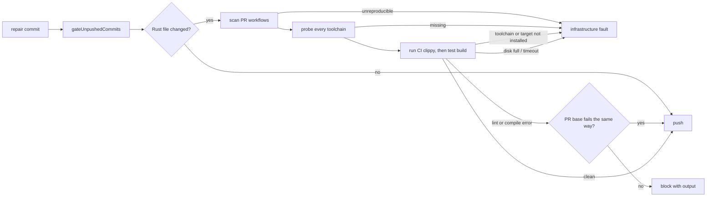

## Summary

Before a repair is pushed, the worker now runs the `cargo clippy` and
test-target compile commands that the repo's own pull-request workflows run. A
lint (`clippy::assert_is_empty`, `clippy::must_use_candidate`) or a test-only
compile error is therefore caught before the push, not by a CI run. Closes
#4630.

- `worker/deno/lib/ci_cargo_checks.ts` (new) reads the repo's tracked
  `.github/workflows/*.yml|yaml` as data. Only workflows triggered on
  `pull_request` count. It derives each `cargo clippy` command verbatim
  (toolchain, flags such as `--all-targets --locked -- -D warnings`,
  workspace/package/feature selection, working directory, cargo-relevant env).
  Output-directory overrides (`CARGO_TARGET_DIR` and `CARGO_BUILD_TARGET_DIR`)
  are excluded so the worker retains its own cache isolation; target-specific
  compiler and linker settings remain. Where no clippy run already compiles the
  same test targets, it derives a `cargo test --no-run` from a CI `cargo test`,
  `cargo nextest run` or `cargo llvm-cov`, keeping only build flags. A clippy
  run with `--all-targets` or `--tests` covers a test build only when the
  directory, toolchain, package/workspace selection, features, profile, target,
  manifest path and env all match; otherwise the test build is kept.
- `worker/deno/lib/pre_push_gate.ts` plans those checks after `cargo fmt`, for
  each directory a pushed Rust-relevant file touches. Before any CI cargo
  command runs, every distinct toolchain the plan uses is probed
  (`cargo +T
  --version`, and `cargo +T clippy --version` where a clippy check
  uses it). A failing lint or test build blocks the push with its output, unless
  the PR base already fails the same way (below). A missing toolchain, component
  or `--target` (probe failure, or rustup/rustc output saying it is not
  installed), a command that cannot start or times out, registry/network or host
  disk-full output, a working directory that is missing or escapes the repo, or
  a CI command the scanner cannot reproduce is a
  `PrePushGateInfrastructureError`: the push is refused but the branch is not
  blamed, and the checked set is never reduced.
- Base-failure comparison: the repair processors pass the PR base independently
  of whether they merge it into the repair branch; the completion gate uses its
  `baseRef`. A failing CI cargo check is re-run, as CI wrote it, in a detached
  worktree of that base. If every diagnostic the push shows (message, file and
  how many times; not line) is also on the base, the failure is a
  `[PRE_PUSH_WARNING]`, not a verdict. A base that passes or lacks a diagnostic
  leaves it a verdict. An unavailable repair base or a host failure during
  comparison is infrastructure, not a branch verdict.
- Scanner fixes: a `cd <dir>` on its own line now holds for the rest of that
  step's run block (any `cd` form it cannot follow, including `pushd`, `popd`, a
  `cd` after `then`/`do`/`else`/`{` and a `cd ... || true`, makes the later
  cargo lines of the step unverifiable), and `cargo nextest run` /
  `cargo llvm-cov nextest` drop `--profile`/`-P` (a nextest profile) and map
  `--cargo-profile` to cargo's `--profile`.
- `worker/deno/lib/git_push.ts` wires `repoCiCargoChecks` into
  `gateUnpushedCommits` (so Step 1b of `commitAndPushPending` and the completion
  phase run it). New `CI_CARGO_ONLY_PRE_FLIGHT` spec; `pr_ci_processor.ts` and
  `pr_feedback_processor.ts` pass it when a repo has no pre-flight commands, so
  repair pushes run only the CI cargo checks, the ShellCheck policy and the
  `cargo deny` gate that every gate run applies (#4631, #4626, merged from
  main).
- The agent's own `git push` now runs the same checks (Issue #4630 review):
  before the agent starts, `claude_runner.ts` scans the repo's workflows with
  `repoCiCargoChecks` (loaded with a dynamic `import()` inside
  `scanAgentCiCargoChecks`, not a top-level import, so scripts that reach
  `claude_runner.ts` without the worker's import map, such as the
  review-fleet-prs helpers, never load the YAML parser) and writes the derived
  checks (and any unverifiable reasons) into the hook's `pre-push-spec.json`.
  `pre_push_gate_cli.ts` reads that entry and passes it back as `findCiCargo`,
  so the `--no-config` hook runs the CI cargo checks without loading the YAML
  parser itself. A self-pushed Rust change that fails CI clippy or the test
  build is refused, exactly as the worker's own gates refuse it.
- Infrastructure is not charged, up to a cap (new
  `worker/deno/lib/gate_infra_release.ts`): when the pre-push gate fails with
  `PrePushGateInfrastructureError` (on the first push or on the retry after push
  recovery), `pr_ci_processor.ts` writes no attempt marker and replies that the
  gate could not run on this host, and `pr_feedback_processor.ts` posts a short
  comment and releases the comment uncharged through its existing host-fault
  release path (`releaseUncharged`). Each release carries a
  `vibe-gate-infra-release` marker; after two fleet-authored markers for the
  same comment (feedback) or failure signature (CI fix) the next fault is
  charged like any failed attempt, so a lasting fault cannot re-run the agent
  without end. An unreadable PR or no trusted author is unknown, and releases
  again. A lint or compile failure still blocks the push and is charged, unless
  the PR base already has it (see "Base-failure comparison").
- Merge with main (#4631, #4909): the ShellCheck policy and `shellcheckOnly`
  stay as main has them. The cargo checks are planned from a changed-file list
  that keeps a file reached through a symlinked parent directory
  (`listPushedFiles(..., containToCheckout = false)`), so the cargo working
  directory containment check still refuses a crate symlinked outside the
  repository, while main's other changed-file checks keep skipping such files.
- Docs: `docs/CONFIGURATION.md` (pre-flight / pre-push gate section) and
  `docs/INTERNALS.md`; `docs/audits/lib-sweep-coverage/top-up-4630.json` also
  lists the new module.
- Not done here: the `cargo deny` implementation itself (owned by #4626, merged
  from main). `ciCargoOnly` only keeps it running for changed cargo inputs.

## Spec

### Intent and Rationale

- The same CI step failed on 9, then 50+, fleet PRs; matching CI's own
  invocation (rather than a generic `cargo clippy`) is what makes the local
  result agree with CI.
- Reading the workflow YAML keeps one source of truth: nothing is hard-coded per
  repo.

### Essential Design Decisions

- The scanner is opt-in (`findCiCargo`) and loaded by dynamic import in
  `gateUnpushedCommits`. The agent's `--no-config` pre-push hook cannot resolve
  `@std/yaml`, so it never scans the workflows itself; the worker scans them
  before the agent runs and writes the derived scan into the hook's spec, which
  the hook passes back as `findCiCargo`.
- Anything the scanner cannot reproduce faithfully fails loud as infrastructure
  instead of dropping to a smaller check set (the issue requires this).
- A failure the PR base already has is compared by diagnostic message, file and
  count, not line number, on a detached worktree of the base: cheap, and it
  never excuses a diagnostic the base lacks. Re-running on the base costs one
  extra cargo build, only when a check has already failed.
- Repair processors use a cargo-only spec for repos without pre-flight, so the
  full changed-file gate does not newly apply to repair pushes. The ShellCheck
  policy (#4631) and the cargo-deny gate (#4626, for changed cargo inputs) run
  in every gate, so these repairs keep both. The spelling and merge-conflict
  repairs keep main's `resolveRepairPreFlightSpec` (`shellcheckOnly`), with no
  cargo check.

### Undiscoverable Facts

- #4625 (shared validation contract) is closed; #4626 (cargo deny) is merged
  from main and its gate is kept under `ciCargoOnly`.
- `docs/audits/lib-sweep-coverage/top-up-4630.json` registers the new lib module
  with the security-sweep ledger.

## Evidence

Backend/CLI change, no UI files. Tests (all under `worker/deno/`):

- `tests/ci_cargo_checks_test.ts`: verbatim clippy argv,
  workspace/package/features/locked, working directory (step, job, workflow,
  `cd`), `RUSTFLAGS`, toolchain, unverifiable forms, test-build derivation,
  hostile 200,000-character input. Added for the completion-check findings: a
  test build is kept when clippy `--all-targets` lacks `--workspace` and the
  test run has `--workspace --all-features` (and for differing `-p`, features,
  profile, target, manifest path, env and toolchain), and dropped when the
  selection matches in another order or spelling; every kept env key, every kept
  test-build flag (both `--flag v` and `--flag=v`), and a workflow that parses
  to `null` or a list are each pinned, so deleting one entry or the `isMapping`
  null/array guard turns a test red (each checked by hand).
- `tests/pre_push_gate_test.ts` (fixtures' covered test build now uses the same
  selection as its clippy):
  `a clippy lint denied by -D warnings blocks the push, and is not infrastructure`
  (`clippy::must_use_candidate`, `clippy::assert_is_empty`),
  `a compile failure in a test target from CI's test build blocks the push with its output`
  (`E0432`), probe / disk-full / timeout / symlink-escape infrastructure cases,
  `ciCargoOnly` cases.
- `tests/git_push_preflight_test.ts`, `tests/pr_ci_processor_test.ts`,
  `tests/pr_feedback_processor_pre_flight_4630_test.ts`: wiring of the
  cargo-only spec into both repair processors and the ungated WIP path;
  `pr_ci_processor_test.ts` and `pr_feedback_review_dismissal_3383_test.ts` also
  pin the uncharged release of an infrastructure gate failure.
- `tests/pre_push_hook_test.ts` and `tests/pre_push_gate_cli_test.ts`: the
  precomputed `ciCargo` scan is written into the hook spec and the CLI passes it
  back as `findCiCargo` (a malformed `ciCargo` blocks the hook without running
  the gate).
- `tests/git_push_preflight_test.ts::commitAndPushPending - requireCargoBaseComparison with no readable base is infrastructure (PR #4896)`:
  a repair push that must compare the base but has no readable base fails a
  failing clippy as `PrePushGateInfrastructureError`, never as a charged
  verdict.
- `tests/pr_feedback_processor_test.ts::processPrFeedback - a gated-head fix branch compares the PR base and requires the comparison`:
  the fix-branch push carries `compareBaseBranch` (the PR base) and
  `requireCargoBaseComparison: true` with no `syncBaseBranch`.

## Test Plan

- From `worker/deno`, `deno fmt --check`, `deno lint`, `deno task check` and
  `deno task check:manifests` cover the Deno tree and pass on the head. The
  changed suites were run with `deno test`: `tests/claude_runner_test.ts` (56
  passed), `tests/git_push_preflight_test.ts` (29 passed) and
  `tests/pre_push_gate_cli_test.ts` (11 passed). The suites whose tests push
  through the agent's real `--no-config` pre-push hook —
  `tests/pre_push_hook_test.ts`, `tests/pr_feedback_processor_test.ts` and
  `tests/pre_push_gate_test.ts` — pass in CI but not in this container, because
  the hook resolves `jsr:@std/yaml@^1.0.12`, which needs the JSR registry; the
  non-push tests in each pass here (4 of 6, 45 of 54, 64 of 133). The real
  ShellCheck publication suite ran separately: 7 passed.
- The obsolete environment contract copied the CI output directory into local
  builds. The remaining contract preserves target-specific settings while
  ignoring both output directory keys, including expressions:
  `worker/deno/tests/ci_cargo_checks_test.ts::cargo output directories are ignored even when expressions`
  and `::every cargo-relevant env key is kept and an unrelated key is dropped`.
- The old repair spec used `shellcheckOnly`; the replacement uses
  `CI_CARGO_ONLY_PRE_FLIGHT` while retaining ShellCheck and cargo-deny checks.
  Coverage:
  `worker/deno/tests/shellcheck_publication_test.ts::commitAndPushPending: a cargo-only repair blocks a real ShellCheck diagnostic`
  and
  `worker/deno/tests/pre_push_gate_cargo_deny_test.ts::cargo deny: ciCargoOnly mode checks Cargo.lock`.
  The changed spec expectations in `pr_feedback_review_dismissal_3383_test.ts`
  and `pr_round_repo_formatters_test.ts` still verify processor wiring.
- The former two-log Git call sequence in the ls-files failure test became three
  logs because the cargo check collects its own changed-file list. Failure to
  list tracked files still blocks:
  `worker/deno/tests/pre_push_gate_test.ts::runPrePushGate: git ls-files failure is an error`.
- A failed or unavailable base comparison formerly produced a branch verdict; it
  now produces infrastructure when the base cannot be checked, while a new
  diagnostic remains blocking. Coverage:
  `worker/deno/tests/pre_push_gate_test.ts::runPrePushGate: an unavailable base comparison is infrastructure`,
  `::runPrePushGate: a base host fault is infrastructure` and
  `::runPrePushGate: a clippy failure that is new on the push blocks, whatever the base shows`.
  `worker/deno/tests/git_push_preflight_test.ts::commitAndPushPending - a fix branch compares the PR base without merging it`
  and the gated-head case in `pr_ci_processor_test.ts` cover the independent
  comparison ref. Registry refusal on the head is covered by
  `worker/deno/tests/pre_push_gate_test.ts::runPrePushGate: an unreachable registry is infrastructure`.
- The agent hook now passes the precomputed CI cargo scan from its spec, but no
  base-comparison ref: a self-pushed CI cargo failure is a verdict, since the
  hook does not know the PR base. Coverage:
  `worker/deno/tests/pre_push_hook_test.ts::installPrePushHook: writes ciCargo into the spec`
  and
  `worker/deno/tests/pre_push_gate_cli_test.ts::pre-push cli: a ciCargo spec passes findCiCargo returning the scan`
  (deleting the `findCiCargo` wiring turns that test red). The unreadable-base
  path is
  `worker/deno/tests/git_push_preflight_test.ts::commitAndPushPending - requireCargoBaseComparison with no readable base is infrastructure (PR #4896)`,
  and the feedback fix-branch wiring is
  `worker/deno/tests/pr_feedback_processor_test.ts::processPrFeedback - a gated-head fix branch compares the PR base and requires the comparison`.
  Spelling and merge-conflict repairs retain the base branch's ShellCheck-only
  policy. No twinned copy of the changed environment or base-comparison rules
  was found.
- Not checked: a real cargo clippy run against a Rust repository (the tests use
  injected runners and real workflow scans). Workflow conditions, matrices,
  reusable workflows and the llvm-cov nextest build profile are not reproduced.
