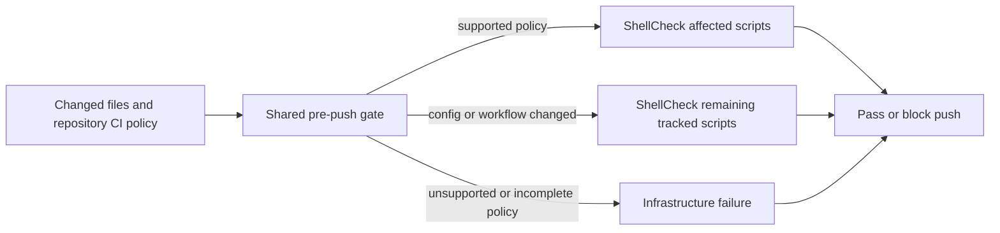

## Summary

The shared pre-push gate now runs a repository's supported ShellCheck CI policy on affected shell scripts, and rechecks tracked scripts when ShellCheck configuration changes. Unsupported or unreadable policy, and an unavailable or mismatched binary, produce an incomplete result. This shifts ShellCheck diagnostics before completion and repair pushes. Closes #4631.

Version bump: none; no version file was changed.

## Spec

### Intent and Rationale

- CI failures on changed shell scripts should be caught by the shared runner before a PR or repair push.
- Reusing the runner from #4625 keeps issue completion and repair validation on the same path without adding a second scheduler.

### Essential Design Decisions

- The gate supports the repository-owned `find . -name "*.sh" -type f -exec shellcheck … {} +` workflow form, carrying its flags, exclusions, and explicit dialect.
- ShellCheck runs from the repository root. Tracked `.shellcheckrc` and `shellcheckrc` files in script ancestry, plus a configured `--rcfile`, remain effective.
- Changes to a tracked ShellCheck workflow or configuration revalidate remaining tracked `.sh` files; deleted scripts are not passed to ShellCheck.
- Unsupported, delegated, unreadable, unavailable, or version-mismatched policy is incomplete and blocks success.
- The blanket scan remains out of `quality_gate.ts`; the shared runner applies each target repository's policy to affected files.

### Undiscoverable Facts

- Issue #4625 is closed and PR #4826 is merged. Its shared runner is `worker/deno/lib/pre_push_gate.ts::runPrePushGate`.
- VibeCoder CI pins ShellCheck 0.11.0 and invokes `find . -name "*.sh" -type f -exec shellcheck -e SC1091 -e SC2034 {} +` from the repository root, as recorded in `.github/workflows/validate-scripts.yml`.
- The environment used for the behavioural tests provided ShellCheck 0.11.0.

## Evidence

This is a backend/CLI validation change; no visual surface changed.

The Deno-native implementation adds no Node tooling or dependency and changes no lockfile.

## Test Plan

- `worker/deno/tests/pre_push_gate_test.ts`: a real SC2086 diagnostic blocks the gate; clean and excluded diagnostics pass; explicit dialect and filenames with spaces are handled; deleted and non-shell files are skipped; root and nested config changes recheck tracked scripts; unsupported/delegated workflows and unreadable configuration fail incomplete; missing-tool recovery revalidates; CI/tool version mismatch fails incomplete; a later edit invalidates a prior clean result.
- `worker/deno/tests/git_push_preflight_test.ts`, `worker/deno/tests/completion_phase_pre_push_gate_3689_test.ts`, `worker/deno/tests/claude_runner_pre_push_3394_test.ts`, and `worker/deno/tests/pre_push_hook_test.ts`: shared-runner blocking and completion/repair paths remain covered.
- `deno fmt --check lib/pre_push_gate.ts lib/quality_gate.ts tests/pre_push_gate_test.ts` from `worker/deno`: passed.
- `deno lint lib/pre_push_gate.ts lib/quality_gate.ts tests/pre_push_gate_test.ts` from `worker/deno`: passed.
- `deno check lib/pre_push_gate.ts tests/pre_push_gate_test.ts` from `worker/deno`: passed.
- `deno task test:unit tests/pre_push_gate_test.ts tests/git_push_preflight_test.ts tests/completion_phase_pre_push_gate_3689_test.ts tests/quality_gate_docs_consistency_test.ts tests/claude_runner_pre_push_3394_test.ts tests/pre_push_hook_test.ts` from `worker/deno`: 124 passed, 0 failed.
- `./quality.sh < /dev/null`: the last completed run failed with 33,014 passed, 36 failed, and 5 ignored. The failures traced to a `bash_ci_gate_scanner.ts` import resolving `@std/yaml/parse` as “not a dependency” in temporary-repository subprocesses. That import was removed and the delegation check was implemented locally; the targeted six-file suite then passed. The full gate was not rerun after that correction because the three full-gate attempts for this run had been used. Full-gate status on the final code is unverified.
- `deno task pr-summary-check --base origin/main --issue-body-file /tmp/issue-4631-body.md --labels enhancement,work-on ../../docs/archive/pr-summaries/pr-summary-4631.md` from `worker/deno`: passed; 0 blocked and 0 not checked.
- `markdownlint-cli2 docs/archive/pr-summaries/pr-summary-4631.md`: passed; 0 issues.

## Not checked

The full quality gate was not rerun after the final correction. No PR was created because the required full gate did not pass on a verified final head.
