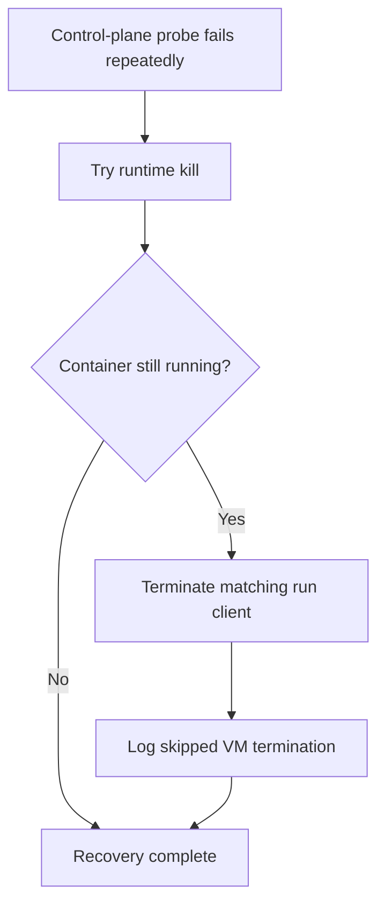

## Summary

Stopped `loop.sh` from signalling every launchd Virtualization VM after a
wedged-container recovery. The supervisor still tries the runtime kill and
terminates the matching host-side run client, then logs and skips VM termination
because the current runtime interface cannot tie a VM PID to the target
container. Closes #4632.

Version bump: none; no version file changed for this fix.

## Spec

### Intent and Rationale

- A PPID of 1 does not prove a Virtualization VM is orphaned or belongs to the
  container being recovered.
- Apple `container inspect` does not expose a host VM PID, so the recovery keeps
  unrelated VMs untouched and records that VM termination was skipped.

### Essential Design Decisions

- Runtime kill and container-specific client termination remain in place.
- VM termination is skipped while no supported ownership mapping is available; a
  wedged VM may remain until the runtime or host recovers it.

### Undiscoverable Facts

- Apple `container` source at commit
  [`af7c4391`](https://github.com/apple/container/tree/af7c4391c238dbe0a1fa45cfebec386b97d71eeb)
  implements `container inspect` by serialising `ManagedContainer` snapshots.
  The snapshot has configuration, runtime status, network attachments and a
  start date, with no host VM PID. `launchctl procinfo` is documented as a
  diagnostic command whose output must not be relied on in production.

## Evidence

Backend supervisor change; no UI surface changed.

- `worker/deno/tests/loop_force_stop_container_test.ts` intercepts all
  fabricated PIDs (client 5555 and VMs 6661/6662), recording signals instead of
  forwarding them to the real kill builtin. Its signal log must contain exactly
  TERM and KILL for the fake client, so signalling either unrelated VM fails the
  test.
- Apple source:
  [`ContainerInspect.swift`](https://github.com/apple/container/blob/af7c4391c238dbe0a1fa45cfebec386b97d71eeb/Sources/ContainerCommands/Container/ContainerInspect.swift#L37-L53),
  [`ContainerSnapshot.swift`](https://github.com/apple/container/blob/af7c4391c238dbe0a1fa45cfebec386b97d71eeb/Sources/ContainerResource/Container/ContainerSnapshot.swift#L20-L42),
  and
  [`ManagedContainer.swift`](https://github.com/apple/container/blob/af7c4391c238dbe0a1fa45cfebec386b97d71eeb/Sources/ContainerResource/Container/ManagedContainer.swift#L20-L28)
  establish the inspected fields and identity.
- Apple
  [`launchctl` manual](https://man.freebsd.org/cgi/man.cgi?apropos=0&manpath=macOS+13.6.5&query=launchctl&sektion=1#procinfo)
  marks `procinfo` output diagnostic-only and not a production interface.

## Test Plan

- Safely reproduced the verifier finding at the previous head: instrumenting the
  kill wrapper's fallback recorded `UNINTERCEPTED -TERM 5555` and
  `UNINTERCEPTED -KILL 5555` without delivering either signal. The wrapper now
  intercepts client PID 5555 as well as both fake VM PIDs.
- `worker/deno/tests/loop_force_stop_container_test.ts`: the updated exact
  signal assertion failed when the original global VM sweep was temporarily
  restored alongside the skip log, because the log additionally contained
  `-TERM 6661` and `-TERM 6662`. All three fake PIDs were safely intercepted.
  Restored the production script before the final passing run. Final command
  from `worker/deno`:
  `deno test --frozen --lock=deno.lock --allow-read --allow-env
  --allow-run --allow-write --allow-sys=hostname
  tests/loop_force_stop_container_test.ts tests/integration_test_manifest_test.ts`
  passed (11 tests).
- `worker/deno/tests/integration_test_manifest_test.ts`: included above (10
  tests), confirming the shell-driving regression is classified as an
  integration test.
- `deno lint` and `deno fmt --check` on the changed TypeScript files passed.
- `bash -n loop.sh`, `shellcheck loop.sh` and `git diff --check` passed.
- The test proves the runtime-kill-failed path and the unavailable-ownership
  outcome. A positive owned-VM case is not implemented: Apple `container`
  exposes no supported host VM identity to confirm, and diagnostic launchd
  output is not a production-safe substitute.
- `timeout 900 ./quality.sh < /dev/null`: timed out at 900 seconds while
  `cargo test --lib --tests --all-features -- --test-threads=2` was still
  running. The last emitted gate result before timeout was
  `release-tag
  ruleset: PASSED`; the full gate did not complete.

## Deno regression avoided

The script-driving test uses the repository's Deno test harness; no Node tooling
or lockfile changes were introduced.
