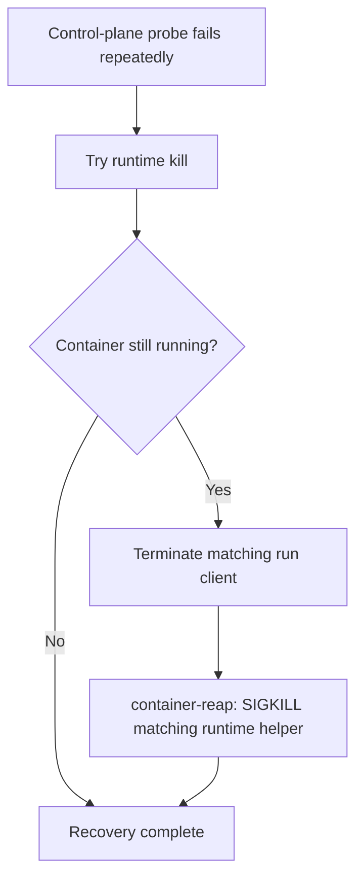

## Summary

Stopped `loop.sh` from signalling every launchd Virtualization VM after a
wedged-container recovery. After the runtime kill and the matching `container
run` client termination, `force_stop_container` now calls the watchdog's
`container-reap` command for the container name. That command SIGKILLs only
runtime helpers whose executable and argv identify the container, and
`reapWedgedContainer` logs when no helper matches. No Virtualization VM is
signalled by name or PPID. Closes #4632.

Version bump: none; no version file changed for this fix.

## Spec

### Intent and Rationale

- A PPID of 1 does not prove a Virtualization VM is orphaned or belongs to the
  container being recovered.
- Apple `container inspect` does not expose a host VM PID, so `container-reap`
  identifies the VM's runtime helper by executable and container-name argv.
  It leaves unrelated VMs untouched and logs when no helper matches.

### Essential Design Decisions

- Runtime kill and container-specific client termination remain in place.
- The VM-sweep is replaced by the watchdog's existing process selector
  (`container-reap --grace-seconds 0`), so the signalled set is bounded by
  container-name ownership rather than a global process-name match.
- `force_stop_container` returns 1 if Deno or the worker module is unavailable,
  and logs when the reaper fails or finds no helper.

### Undiscoverable Facts

- Apple `container` source at commit
  [`af7c4391`](https://github.com/apple/container/tree/af7c4391c238dbe0a1fa45cfebec386b97d71eeb)
  implements `container inspect` by serialising `ManagedContainer` snapshots.
  The snapshot has configuration, runtime status, network attachments and a
  start date, with no host VM PID. `launchctl procinfo` is documented as a
  diagnostic command whose output must not be relied on in production.

## Evidence

Backend supervisor change; no UI surface changed.

- `worker/deno/tests/loop_force_stop_container_test.ts` drives the real
  `loop.sh` path with three real `sleep` helpers listed by a fake `ps`: one
  `container-runtime-linux vibe-coder-worker` (target), one for
  `vibe-coder-other`, and one `Virtualization.VirtualMachine`. After
  "container reaper finished", the target helper must have been killed
  (unsuccessful exit status) while the other two stay alive, and the fake client
  and fake VM PIDs receive only the expected signals.
- Apple source:
  [`ContainerInspect.swift`](https://github.com/apple/container/blob/af7c4391c238dbe0a1fa45cfebec386b97d71eeb/Sources/ContainerCommands/Container/ContainerInspect.swift#L37-L53),
  [`ContainerSnapshot.swift`](https://github.com/apple/container/blob/af7c4391c238dbe0a1fa45cfebec386b97d71eeb/Sources/ContainerResource/Container/ContainerSnapshot.swift#L20-L42),
  and
  [`ManagedContainer.swift`](https://github.com/apple/container/blob/af7c4391c238dbe0a1fa45cfebec386b97d71eeb/Sources/ContainerResource/Container/ManagedContainer.swift#L20-L28)
  establish the inspected fields and identity.
- Apple
  [`launchctl` manual](https://man.freebsd.org/cgi/man.cgi?apropos=0&manpath=macOS+13.6.5&query=launchctl&sektion=1#procinfo)
  marks `procinfo` output diagnostic-only and not a production interface.

## Test Plan

- Head `a1830c00` replaced the earlier "log and skip" recovery with the
  `container-reap` call; this summary was rewritten for that head.
- `worker/deno/tests/loop_force_stop_container_test.ts`: from `worker/deno`,
  `deno test --frozen --lock=deno.lock --allow-read --allow-env --allow-run
  --allow-write --allow-sys=hostname tests/loop_force_stop_container_test.ts
  tests/integration_test_manifest_test.ts` passed (11 tests) on this head.
  The test waits (15 s deadline) for "container reaper finished", asserts the
  name-matched helper was killed and the unrelated runtime helper and
  Virtualization VM survived. Earlier iterations showed that restoring the
  global VM sweep made the signal log contain `-TERM 6661` and `-TERM 6662`.
- `worker/deno/tests/integration_test_manifest_test.ts`: included above (10
  tests), confirming the shell-driving regression is classified as an
  integration test.
- `worker/deno/tests/container_watchdog_test.ts` (37 tests at head): two new
  `reapWedgedContainer` cases. With only an unrelated Virtualization VM and a
  `container-runtime-linux vibe-coder-other` helper listed, nothing is killed
  and the log contains `no runtime helper found for vibe-coder-66770`; with a
  matching helper listed, only it is killed and the line is absent. Branch
  outcomes: `holders.length === 0` true and false are both reached; replacing
  the condition with `false` turns the first case red (PR #4638 review).
- `loop_force_stop_container_test.ts` also sets `XDG_STATE_HOME` inside the
  temp directory and asserts a `launch-*.log` is created under it, so the
  launch-log directory cannot escape the sandbox. `deno test -A` over both
  files passed (38 tests) on this head.
- Summary freshness (#3768): the CI failure was this file being older than the
  code commit; fixed by this rewrite.
- `deno lint` and `deno fmt --check` on the changed TypeScript files passed.
- `bash -n loop.sh`, `shellcheck loop.sh` and `git diff --check` passed.
- `timeout 900 ./quality.sh < /dev/null`: timed out at 900 seconds while
  `cargo test --lib --tests --all-features -- --test-threads=2` was still
  running. The last emitted gate result before timeout was
  `release-tag
  ruleset: PASSED`; the full gate did not complete.

## Deno regression avoided

The script-driving test uses the repository's Deno test harness; no Node tooling
or lockfile changes were introduced.
