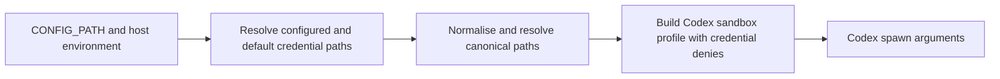

## Summary

The babysitter's Codex sandbox now denies host GitHub and SSH credentials resolved from the worker's configuration and environment, including canonical symlink targets and missing-path tails. Closes #4633.

Version bump: no version changed for this issue.

## Spec

### Intent and Rationale

- Prevent review text from steering the babysitter agent to read credentials that could write to fleet repositories or approve pull requests.
- Extend the existing deny-list profile, preserving its read-only root grant and existing babysitter-specific protections.

### Essential Design Decisions

- Read raw credential fields from the same `CONFIG_PATH` file used by the babysitter because `loadConfig` does not retain the reviewer App settings.
- Deny configured paths and their canonical targets after normalising traversal; resolve absent tails through the longest existing prefix and fail on unexpected resolution errors.
- Reject clone or scratch directories that overlap a protected credential path in either direction.

### Undiscoverable Facts

- The issue comment also identified configured `ssh_key_path` as a host credential; it is covered alongside the paths in the issue description.

## Evidence

This is a backend/CLI sandbox change. Tests inspect the actual arguments passed to the Codex spawn and exercise path resolution with temporary credential fixtures.

## Test Plan

- `worker/deno/tests/fleet_babysitter_sandbox_test.ts` and `worker/deno/tests/fleet_babysitter_app_test.ts`: `deno task test:unit tests/fleet_babysitter_sandbox_test.ts tests/fleet_babysitter_app_test.ts` — passed (33 tests).
- `worker/deno/tests/cross_file_anchors_test.ts`: `deno task test:unit tests/cross_file_anchors_test.ts` — passed (12 tests).
- Manifest check: `deno task check:manifests` — passed (846 passed, 0 failed, 1 ignored).
- Targeted Deno formatting, lint and type checks for changed TypeScript files — passed.
- Protection mutation checks: removing configured SSH-path collection failed the spawn-argument assertion; removing canonical path protection failed symlink target assertions; removing clone/scratch overlap protection failed both overlap tests. Changes were restored and the targeted tests passed.
- `git diff --check` — passed.
- `./quality.sh < /dev/null` — failed on the unit-test duration budget for untouched `worker/deno/tests/launcher_harness_reclaim_stub_test.ts`: `every test in tests/launcher_harness_reclaim_stub_test.ts (2, 10.42s) is over the 1.00s unit-test budget`. The isolated run also exceeded the budget (2.00s and 1.53s); its test outcomes passed. Other quality stages passed; config integration and Checkov were skipped by the gate. This full-gate failure remains unresolved because the slow test is outside this issue's scope.
- Runtime Codex sandbox enforcement was not exercised; the spawn profile arguments were verified by tests.

### Deno regression avoided

Used Deno-native tasks and tooling; no Node tooling or dependency was added.
