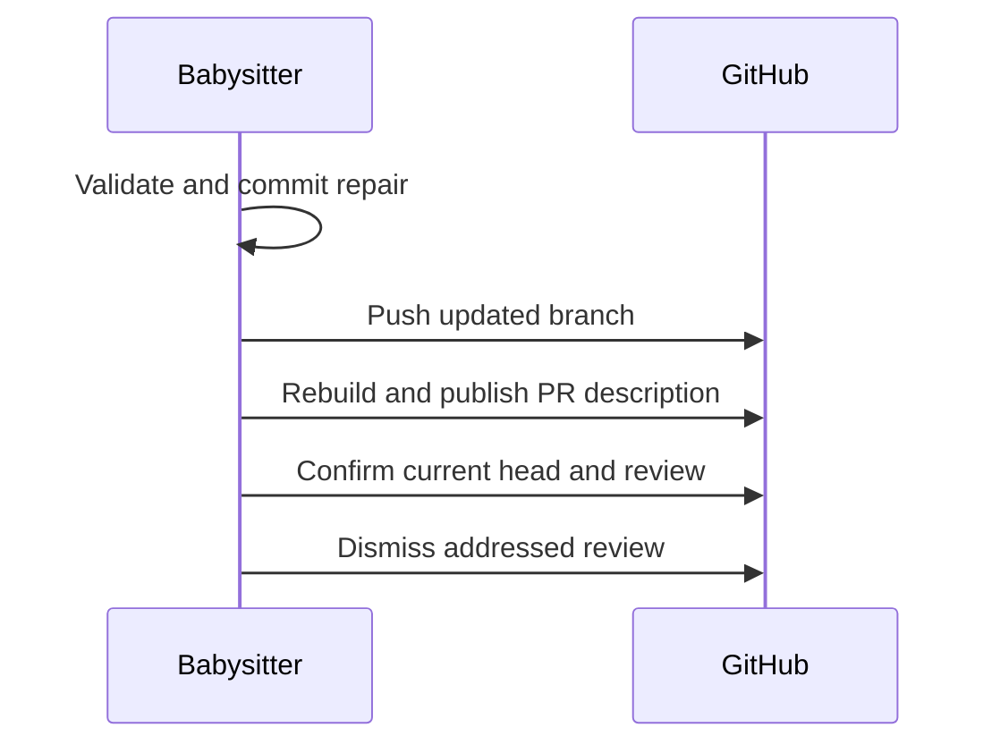

## Summary

The fleet PR babysitter now rebuilds the PR description from the archived summary after a repair push, and also retries that sync when a later run finds no working-tree changes. It dismisses addressed reviews only after the body is current or the sync reports a harmless skip. Closes #4637.

Version bump: `VERSION` is not touched by this change; the merged commit records the final version.

## Spec

### Intent and Rationale

- A repair could update the summary while leaving GitHub's PR description stale, so the babysitter now uses the existing summary-to-body synchroniser before dismissing the review.
- Syncing the clean-tree retry lets a later run repair a description whose earlier publication failed.

### Essential Design Decisions

- The sync uses the original PR head as `beforeSha`, the remote PR branch name, and the repair checkout, preserving marker-less adoption rules owned by `syncPrBodyFromSummary`.
- A sync error or stale-checkout skip leaves reviews open. Explicit harmless skips for unrelated marker-less bodies, unchanged or deleted summaries, and already-current bodies allow dismissal.
- The babysitter calls `syncPrBodyFromSummary` directly because `runPrBodySync` logs failures without failing its caller.

### Undiscoverable Facts

- The issue's historical PR #4611 state was not present during this run: the live PR had since moved to an unrelated Discovery #2422 repair. The regression was reproduced locally with the production sync function and a fake GitHub service.
- No live PR body was edited during verification.

## Evidence

This is a backend workflow change. Tests use a temporary Git repository and a fake GitHub service to exercise the production body synchroniser and the babysitter completion path. The GitHub CLI documents `gh pr edit --body-file` as reading the replacement description from the given file: [gh pr edit manual](https://cli.github.com/manual/gh_pr_edit).

The live read `gh pr view 4611 --repo stSoftwareAU/VibeCoder --json body,files,headRefOid,headRefName,closingIssuesReferences,author` showed that #4611 no longer represented the issue's reported state, so it was not used as a live reproduction.

### Deno regression avoided

- Validation used Deno's formatter, linter, checker, targeted test task, and repository quality script; no Node tooling or manifests were added.

## Test Plan

- Added `worker/deno/tests/fleet_pr_babysitter_test.ts` coverage in `a clean-tree babysitter retry repairs a marker-less stale body before dismissal`, `the production clean-tree completion path syncs before review dismissal`, `a pushed fix syncs the legacy body from its original head before dismissal`, `a failed body publication keeps reviews open and a retry publishes before dismissal`, `an already-current PR body is harmless and does not need a second edit`, `an unrelated marker-less PR is not adopted and can still dismiss its review`, and `a stale repair checkout cannot dismiss reviews after body sync skips`.
- `deno task test:unit tests/fleet_pr_babysitter_test.ts < /dev/null` from `worker/deno`: passed, 25 passed and 0 failed.
- Mutation check: reverting the sync call in `finishBabysitterRepair` made the production clean-tree and push completion tests fail; restoring it returned the targeted suite to green.
- Mutation check: replacing the sync result with an already-current result made the sync ordering, publication failure, legacy body, and stale checkout tests fail; restored afterward.
- `deno lint commands/fleet_pr_babysitter.ts tests/fleet_pr_babysitter_test.ts lib/pr_body_sync.ts lib/pr_body_reconcile.ts lib/run_core.ts`: passed.
- `deno check --frozen --lock=deno.lock commands/fleet_pr_babysitter.ts tests/fleet_pr_babysitter_test.ts`: passed.
- `deno task check:manifests < /dev/null` from `worker/deno`: passed, 846 passed, 0 failed, 1 ignored.
- `deno fmt` on the changed TypeScript files and `git diff --check`: passed.
- `timeout 900 ./quality.sh < /dev/null`: failed at the unit-test time-budget gate. The untouched `worker/deno/tests/launcher_harness_reclaim_stub_test.ts` exceeded the 1.00s per-test limit (2 tests, 5.48s total; each about 2.7s). Running that file alone reproduced the same gate failure (2 tests, 5.05s; each about 2.5s). The test, unit-test runner and manifest are unchanged from `origin/main`. Other completed quality stages reported by the gate passed, including formatting, lint, type checks, semgrep, markdownlint, Mermaid validation and completeness. The full gate therefore remains red for this existing timing issue.

- Existing test assertions removed: none.
- Changed completion entry points checked: pushed repair and no-working-tree-change retry, both through `finishBabysitterRepair`; the sync call mutation made both tests fail.
- Harmless sync outcomes checked here: unrelated marker-less PR and already-current body. The shared sync suite already covers `summary unchanged` and `summary file deleted`; the babysitter rejects the other skip, including `checkout is not the PR head`, which the stale-checkout test verifies leaves the review open.
