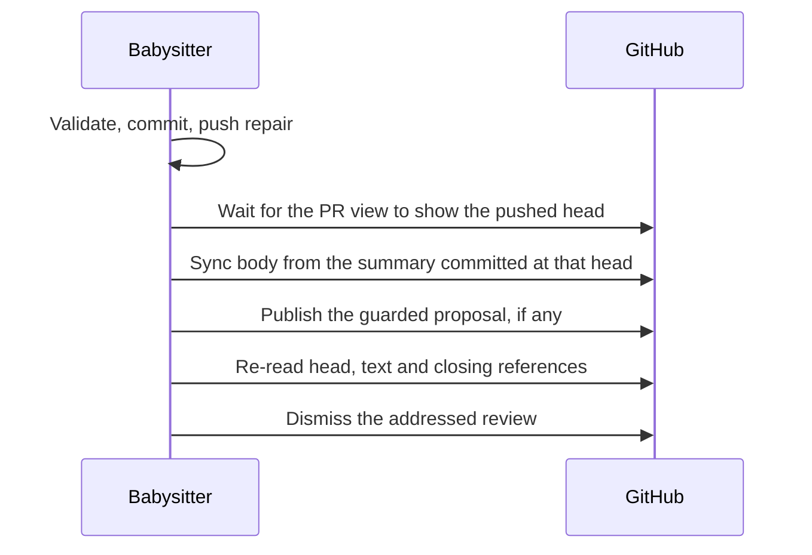

## Summary

After a successful push (or a no-change retry), the fleet PR babysitter now
synchronises the live PR description from the summary committed at the verified
pushed head, publishes any description the agent proposed through a guard, and
dismisses an addressed review only after the head, the published text and
GitHub's closing references are checked. The guard keeps the worker's hidden
markers, keeps an association the proposal dropped, and never lets a proposal
restore a close that an unmet (`partial` / `missing`) criterion withholds (the
#4716 regression). A no-change retry now also refreshes a legacy worker body
that has no summary digest.

Review round (PR #4779): a body that lost its worker marker is governed by the
issue its worker branch names; a fully met issue gets `Closes` back unless the
text already has a closing keyword or an explicit `Part of`, so a bare mention
no longer drops it; a repair that pushed nothing does not publish a proposal
where a committed summary governs the body; and a failed publication is resumed
by the next scan without the agent, which the per-host attempt marker would
otherwise block.

Version bump: `VERSION` is not touched by this change; the merged commit records
the final version.

## Spec

### Intent and Rationale

- A repair could update the archived summary while the live description stayed
  stale until a later sweep, and the proposal path replaced the whole body,
  dropping the worker markers and re-adding `Closes #N` from the old body.
- The existing canonical assembler (`syncPrBodyFromSummary`) and the #4712
  committed-summary loader are reused; the new module only decides what a
  proposal may publish.

### Essential Design Decisions

- The guarded proposal uses the runner-owned exchange directory and exclusive
  writer from #4731; agent proposals use the no-follow reader.
- The sync is pinned to the pushed head (`committedHeadSha`, #4712). A commit
  with no summary is a harmless skip; `pushed head moved`,
  `could not be verified` and `checkout moved off the committed head` throw, so
  the review stays open and the next scan retries.
- Unknown evidence never closes: no committed summary, or an unmet criterion in
  the summary or in the proposal, gives `Part of #N`. The summary's own wording
  does not decide it: with a fully met summary, `Closes #N` is appended unless
  the text already has a closing keyword for the issue (plain, colon or
  full-URL) or an explicit `Part of #N`. A bare mention, or another repository's
  `owner/repo#N`, does not count. `assemblePrBody` appends `Closes` whenever no
  closing keyword is present, so the two differ only for an explicit
  `Part of #N` the proposal chose, which the guard respects.
- The governing issue is the worker marker in the live body, else the issue the
  worker branch (`issue-N-...`) names (`governingIssueNumber`), the identity the
  sync's adoption also validates. A marker-less worker-branch PR with no
  committed summary therefore has its close withheld, with or without a
  proposal.
- With nothing pushed, a proposal is not published where a committed summary
  governs the body: the sync already rebuilt the body from that summary, which
  is the text the pushed head supports, and the agent prompt tells it to change
  the summary instead. The proposal is still published (through the guard) when
  no committed summary governs the body, and when the repair pushed. This limits
  what the proposal can assert; it does not check a proposal's prose against the
  diff.
- A repair that addresses reviews writes `<attempt key>--publication.json` (the
  proposal and whether the repair pushed) before the sync, and removes it once
  the reviews are dismissed. `fix()` looks for it before it merges the base or
  starts the agent (`resumePendingPublication`), so a publication that failed is
  retried on the next scan although the attempt marker blocks a second agent run
  at that head and review.
- A no-change retry diffs the committed summary against git's empty tree, so a
  legacy worker body with no summary digest is rebuilt. The sync still edits
  only when the rebuilt body differs, so a second retry makes no edit.
- Negated sentences ("does not close #N"), `Closes: #N` and full-URL closing
  forms for the governing issue are rewritten, because GitHub honours them.
- The proposal is rejected at intake over 65,536 characters (agent files are
  unbounded input to the marker scan); the composed body is checked again at
  publication.

### Undiscoverable Facts

- The historical PR #4611 no longer shows the reported state, so the regression
  was reproduced with the production sync function and a fake GitHub service.
- In this sandbox `babysitter default heartbeat resolves its checkout revision`,
  `verifyResolvedTree - the repository's own task sees only the allowlisted
  environment`
  fail for network and `/tmp` account reasons unrelated to this change.

## Evidence

Backend workflow change; no UI. Tests use temporary git repositories and a fake
GitHub service that drives the production body synchroniser and
`finishBabysitterRepair`. `gh pr edit --body-file` reads the replacement body
from the file ([gh pr edit manual](https://cli.github.com/manual/gh_pr_edit)).

### Deno regression avoided

- Only Deno tooling was used; no Node manifests were added.

Related existing rules checked: `docs/workflows/fleet-pr-babysitter.md` (updated
steps), `missing_criterion_close_guard.ts` (reused, `CLOSING_KEYWORD_RE`
exported), `pr_body_sync.ts` / `pr_summary_loader.ts` (#4712, reused). Doc
comments in `pr_body_sync.ts`, `pr_body_reconcile.ts` and `run_core.ts` that
listed the post-push sync callers were updated. Issues cited as provenance:
#4712 (committed-summary adoption), #4716 (proposal re-closed a partial issue),
#4644 (close guard), #4668 (agent proposal).

## Acceptance Criteria

<!-- vibe-spec-review inputs="diff+issue-body" -->

- **met** — Immediately after a successful babysitter push, synchronise the live
  description through the canonical assembly path, including marker-less worker
  issue PRs and summary-only repairs — evidence:
  `worker/deno/tests/fleet_pr_babysitter_test.ts::a clean-tree babysitter retry repairs a marker-less stale body before dismissal`
  — reviewer: met
- **met** — Read the canonical summary from the verified pushed commit, reusing
  #4712; never publish uncommitted or unpushed claims — evidence:
  `worker/deno/tests/fleet_pr_babysitter_test.ts::an uncommitted working-tree summary never reaches the adopted body`
  — reviewer: partial — reason: the reviewer saw a hand-written HEAD reader; it
  now calls `loadCommittedPrSummary` at the pushed sha
  (`a summary committed only at the legacy docs/pr-summary-N.md path at the head is found and governs the close`)
- **met** — Apply the #4644 `partial`/`missing` close guard consistently to
  assembled bodies and agent proposals; `Part of` must not restore `Closes` —
  evidence:
  `worker/deno/tests/babysitter_pr_body_guard_test.ts::a proposal that re-closes a partial issue is withheld, with no closing keyword left (Issue #4716)`
  and
  `a fully met summary with no closing keyword keeps the close, as the assembler does`
  — reviewer: met
- **met** — When a proposal drops an issue association, preserve it and choose
  closing versus non-closing from the acceptance result, keeping unrelated
  content and links — evidence:
  `worker/deno/tests/fleet_pr_babysitter_test.ts::a proposal that omits a withheld issue gets Part of #N, not Closes #N`
  and
  `a fully met summary with no closing keyword keeps the close after a repair, with or without a proposal (Issue #4637)`
  and
  `worker/deno/tests/babysitter_pr_body_guard_test.ts::a proposal that only mentions a fully met issue still gets Closes #N (PR #4779 review)`
  — reviewer: met
- **met** — Treat publication as part of a description repair: recheck head,
  body and closing references; retry idempotently; keep the finding outstanding
  and record a recoverable next action until verified — evidence:
  `worker/deno/tests/fleet_pr_babysitter_test.ts::a failed description edit keeps reviews open, and a retry at the same head publishes and dismisses`
  and
  `a legacy worker body with no summary digest is rebuilt on a no-change retry, and a second retry makes no edit (Issue #4637)`,
  `a failed publication is resumed by the next scan without the agent, and the record is cleared (PR #4779 review)`
  and
  `a resumed publication for a pushed head still publishes the proposal that the push backs (PR #4779 review)`
  — reviewer: met
- **met** — On a no-code-change repair, publish only an independently
  supportable correction; a proposal is data, not authority — evidence:
  `worker/deno/tests/fleet_pr_babysitter_test.ts::with nothing pushed, a proposal over a governing committed summary is not published, and the same proposal is once a push backs it (PR #4779 review)`,
  `with nothing pushed and no committed summary, a proposal is published through the guard and never closes the issue (PR #4779 review)`
  and
  `a repair with no code change withholds the close after the sync and dismisses last`
  — reviewer: met
- **met** — Marker-less #4611-style body, marker-bearing stale digest and
  summary-only repair are updated before the repair is reported complete —
  evidence:
  `worker/deno/tests/fleet_pr_babysitter_test.ts::a clean-tree babysitter retry repairs a marker-less stale body before dismissal`
  and
  `a marker-bearing body with a stale summary digest is rebuilt before dismissal, and a retry at the same head makes no second edit (Issue #4637)`
  — reviewer: met
- **met** — #4716 regression: the old body's closing keyword for #4674 becomes
  `Part of #4674` beside a `partial` criterion, so the final body and GitHub's
  closing references leave #4674 open — evidence:
  `worker/deno/tests/fleet_pr_babysitter_test.ts::Issue #4716: a proposal that re-closes a partial issue is withheld, and reviews stay open while GitHub still links it`
  — reviewer: met
- **met** — Cover `missing` as well as `partial`, accidentally omitted
  association, multiple issue references, and a fully met issue whose closing
  reference remains — evidence:
  `worker/deno/tests/babysitter_pr_body_guard_test.ts::a proposal that re-closes a missing issue is withheld, with no closing keyword left (Issue #4716)`,
  `several references to a withheld issue are all withheld, and another issue's reference is kept (Issue #4716)`,
  `a fully met issue keeps its legitimate Closes, with no duplicate` and
  `worker/deno/tests/fleet_pr_babysitter_test.ts::a missing criterion withholds the close at finish level and keeps another issue's reference (Issue #4716)`
  — reviewer: met
- **met** — Cover dirty/unpushed summaries, missing committed summary, failed
  publication, head movement, retry at the same head, no-code-change
  publication; unknown evidence never closes — evidence:
  `worker/deno/tests/fleet_pr_babysitter_test.ts::an uncommitted working-tree summary never reaches the adopted body`,
  `a head that moved before publication publishes nothing and keeps reviews open`,
  `a retry at the same head with the description already current makes no second edit`,
  `a legacy worker body with no summary digest is rebuilt on a no-change retry, and a second retry makes no edit (Issue #4637)`
  — reviewer: met
- **met** — Preserve existing security checks and normal CI/review requirements;
  no new prose-format gate — evidence:
  `worker/deno/tests/fleet_pr_babysitter_test.ts::a stale repair checkout cannot dismiss reviews after body sync skips`
  — reviewer: met
- **unrequested** — `PR_BODY_LIMIT` now lives in the guard module and
  `takePrBodyProposal` still enforces it at intake — reviewer: unrequested —
  reason: a move of the existing constant so the guard and intake share one
  limit; behaviour is unchanged
- **unrequested** — wording-only comment edits in
  `worker/deno/lib/pr_body_reconcile.ts`, `worker/deno/lib/run_core.ts`,
  `worker/deno/lib/pr_body_sync.ts` — reviewer: unrequested — reason: they list
  the babysitter as a post-push sync caller, which the code now does

## Standards Review

<!-- vibe-standards-review inputs="diff+CODING-STANDARDS.md" -->

- **violation** — a pushed repair read the PR view once and lost the wait for
  GitHub's lag — evidence: `worker/deno/commands/fleet_pr_babysitter.ts:1199` —
  reason: fixed in this diff (`waitForPushedHead` before the sync; tests for a
  late head and a never-reached head)
- **violation** — a missing `closingIssuesReferences` key was read as the empty
  state — evidence: `worker/deno/commands/fleet_pr_babysitter.ts:998` — reason:
  fixed in this diff (`readPrBodyState` rejects it by field name;
  `a PR view that omits closingIssuesReferences is refused by name`)
- **violation** — marker regexes were quadratic and the proposal had no intake
  size cap — evidence: `worker/deno/lib/babysitter_pr_body_guard.ts:328` —
  reason: fixed in this diff (linear scan, intake cap, hostile tests per
  pattern)
- **violation** — live markers were read without masking code spans, and
  unclosed comments were not neutralised — evidence:
  `worker/deno/lib/babysitter_pr_body_guard.ts:302` — reason: fixed in this diff
  (masked scan; `neutraliseAgentMarkers`)
- **violation** — colon and full-URL closing forms were not covered — evidence:
  `worker/deno/lib/babysitter_pr_body_guard.ts:447` — reason: fixed in this diff
- **violation** — workflow doc steps 4 and 5 and the guard diagram did not match
  the code — evidence: `docs/workflows/fleet-pr-babysitter.md:210` — reason:
  fixed in this diff
- **violation** — harmless-skip, head-moved-after-publish and
  description-mismatch outcomes had no test — evidence:
  `worker/deno/commands/fleet_pr_babysitter.ts:839` — reason: fixed in this diff
- **violation** — the edited oversized-proposal test no longer guarded anything
  — evidence: `worker/deno/tests/fleet_pr_babysitter_test.ts:3088` — reason:
  fixed in this diff (intake rejection restored and asserted)
- **clean** — Australian English, no hidden paths staged, tests call real code,
  named test files exist, no workflow changes, `issueNumberFromMarker` /
  `summaryDigestFromBody` read the last occurrence

## Test Plan

- `worker/deno/tests/babysitter_pr_body_guard_test.ts` (new): the #4716 cases
  for `partial` and `missing`, an omitted association, a fully met close kept,
  other issues' references kept, negated sentences, colon and URL closing forms,
  forged and unterminated markers, code-span markers, unclosed comment openers,
  the size limit at and one over the limit, and one hostile input per new
  pattern. Red-checks: defusing, masking, neutralisation and the colon/URL
  rewrite were each removed and a test went red.
- `worker/deno/tests/fleet_pr_babysitter_test.ts` (extended): marker-less and
  clean-tree retries, sync pinned to the pushed head (push and no-change), the
  harmless and unknown skip reasons, a dirty working tree never published, a
  failed edit then a retry, head moved before and after publication, a
  description that does not read back, a lagging and a never-reached PR view, a
  missing `closingIssuesReferences`, an unreadable committed summary, a summary
  only at the legacy path, and intake rejection of an oversized proposal. Each
  production branch was broken once and the matching test went red.
- Added after the pre-PR verifier: `isIssueCloseAllowed` no longer needs a
  closing keyword (guard tests for a fully met summary with no keyword, with and
  without a proposal; a `finishBabysitterRepair` test for the same); a
  marker-bearing stale-digest body rebuilt before dismissal with a
  no-second-edit retry; a legacy digest-less body rebuilt on a no-change retry
  (red when the empty-tree base is reverted).
- PR #4779 review round. Guard
  (`worker/deno/tests/babysitter_pr_body_guard_test.ts`, 41 tests at head): a
  proposal that only mentions a fully met issue (three forms, one an
  `owner/other#N` qualified mention) still gets `Closes`; a closing keyword, a
  colon form, a full-URL form or an explicit `Part of` settles the close without
  a second `Closes`; a marker-less `issue-N-...` branch is governed (with and
  without a proposal, with a no-issue branch as the positive control); and a
  marker-less branch with a fully met committed summary keeps the close. Finish
  level (`worker/deno/tests/fleet_pr_babysitter_test.ts`, 112 tests at head): a
  pushed repair whose proposal only mentions a fully met issue still closes it;
  nothing pushed over a governing summary does not publish the proposal, and the
  same proposal is published once a push backs it; nothing pushed with no
  committed summary publishes through the guard; a marker-less worker branch
  never closes, with and without a proposal; a failed publication is resumed
  through `resumePendingPublication` and its record cleared; a resumed pushed
  head still publishes its proposal; the store keeps one record per head and
  review and ignores a damaged one. Red-checks, each by breaking only that
  branch and running the `PR #4779 review` tests: `mentionsIssue` in place of
  `namesClosingOrPartOf` (3 red); no branch fallback in `governingIssueNumber`
  (3 red); no-change suppression removed (1 red); `pushedByEarlierRepair` not
  passed on resume (1 red); `save` writing another head's key (2 red); `clear`
  removed (1 red). `fix()` itself is not driven (see Not done).
- Test changes in this round (TDD rule 3). Obsolete: with nothing pushed, a
  proposal over a governing committed summary was published; it is not now.
  Remaining: a proposal is still published through the guard when the repair
  pushed (`a proposal that omits a fully met issue gets Closes #N` and
  `a summary committed only at the legacy docs/pr-summary-N.md path at the head is found and governs the close`
  now run as pushed repairs and assert the proposal text and `Closes #N`) and
  when no summary governs.
  `a repair with no code change publishes its proposal after the sync and dismisses last`
  is renamed
  `a repair with no code change withholds the close after the sync and dismisses last`
  and still asserts the order and that no closing keyword is left.
  `the proposal is returned as written, and the guard restores closing references`
  (was `a proposed PR description keeps the closing references it dropped`):
  `takePrBodyProposal` returns the proposal as written, and restoring the
  dropped references moved to `guardPrBodyProposal`, covered by
  `worker/deno/tests/babysitter_pr_body_guard_test.ts::Moved to babysitter_pr_body_guard: a proposed PR description keeps the closing references it dropped`.
  Every `guardPrBodyProposal` call in the guard tests gained the now required
  `headRefName`. Existing assertions removed: none.
- Existing test edits: `fakePrBodyService` answers `git ls-remote` with the fake
  PR head; the oversized-proposal test now asserts rejection at intake (the
  original assertion); `tests/fixtures/fleet_babysitter_repair_preload.ts` gains
  `body` and `closingIssuesReferences`. Existing assertions removed: none.
- CI repair: the offline GitHub fixture now returns the newly edited PR body on
  subsequent reads, matching a successful edit. The existing
  `worker/deno/tests/fleet_babysitter_app_test.ts::production repair forwards CONFIG_PATH and denies canonical credential targets`
  exercises publication and read-back through the real repair orchestration.
- `docs/audits/lib-sweep-coverage/top-up-4637.json` registers the new module.
- `deno task test:unit` over `babysitter_pr_body_guard_test.ts`,
  `fleet_pr_babysitter_test.ts`, `pr_body_sync_test.ts`,
  `missing_criterion_close_guard_3177_test.ts`,
  `fleet_pr_babysitter_single_push_test.ts`, `vibe_env_registry_test.ts`,
  `lib_sweep_coverage_test.ts`, `fleet_babysitter_app_test.ts`; and
  `deno task check:manifests`: passed, apart from the sandbox-only heartbeat
  test named above.
- `deno fmt --check`, `deno lint` and `deno check` on the changed TypeScript:
  passed.
- `./quality.sh < /dev/null`: the first run failed on `completeness checks` (the
  new module and a `VIBE_`-prefixed constant name), the fixture used by
  `fleet_babysitter_app_test.ts`, and two sandbox-only tests. After the fixes
  the second full run passed every stage except `deno tests`, whose only two
  failures are the sandbox-only tests named above
  (`babysitter default
  heartbeat resolves its checkout revision`, which cannot
  download JSR metadata, and
  `verifyResolvedTree - the repository's own task sees only the allowlisted
  environment`,
  which cannot use a `/tmp` account); neither touches this change.

## Not done

- `fix()` passes `proposal`, `gh`, `checkBaseline`, `mergedBase` and the
  pending-publication store into `finishBabysitterRepair`
  (`worker/deno/commands/fleet_pr_babysitter.ts:1752`), and calls
  `resumePendingPublication` before the base merge and the attempt marker
  (`worker/deno/commands/fleet_pr_babysitter.ts:1665`), with no test through
  `fix()` itself. `fix()` clones the repository, reads the PR's reviews through
  the real `gh` and spawns the Codex agent, and the two test files that call it
  (`worker/deno/tests/fleet_pr_babysitter_test.ts`,
  `worker/deno/tests/fleet_pr_babysitter_single_push_test.ts`) stop before that
  step. `finishBabysitterRepair`, `resumePendingPublication` and the store are
  tested directly; that `fix()` calls the resume before the marker rests on the
  code order.
- Fix-run syncs (feedback, CI, merge-conflict, reconcile) still read the working
  tree, as noted in #4712.
- The pending-publication record is written only for a repair that addresses
  reviews, and cleared only when its reviews are dismissed. If the review is
  withdrawn first, the small file stays until the same head and review recur.
  The next scan finds it only while it still sees that requested review at that
  head (a head with failing CI is repaired for the CI first, with no reviews).
- The mutation and coverage carry-over checks could not run: their baseline
  includes `babysitter default heartbeat resolves its checkout revision`, which
  fails at the merge base too because the sandbox cannot download JSR metadata
  (`https://jsr.io/@std/crypto/meta.json`). It is unrelated to this change;
  every other test in `fleet_babysitter_app_test.ts`,
  `fleet_pr_babysitter_single_push_test.ts` and `fleet_pr_babysitter_test.ts`
  passes. Neither check can be fixed in this change, since both flags are
  repository settings.
