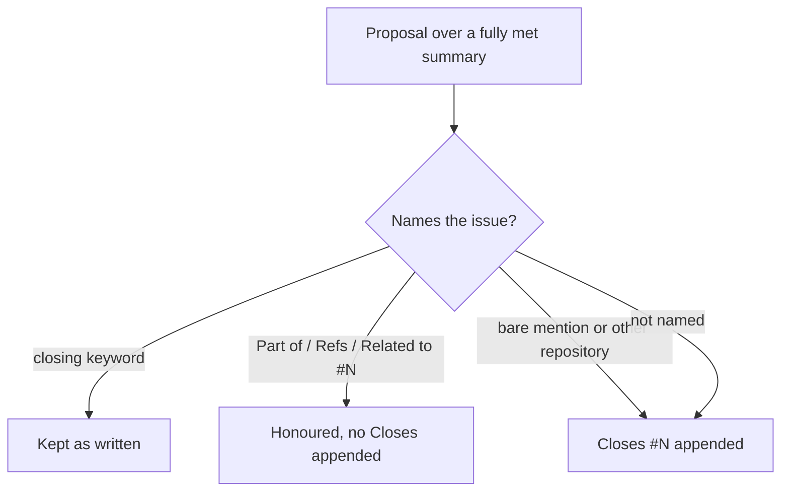

## Summary

Follow-up to the babysitter body-publication work already on `main` (PR #4779).
That work publishes the committed summary straight after a push, applies the
`partial`/`missing` close guard to proposals, and verifies publication. One case
from the issue's latest comment was still wrong: with a fully met summary, the
proposal guard appended `Closes #N` unless the proposal already had a closing
keyword or `Part of #N`. An agent that deliberately changed `Closes #N` to
`Refs #N` (the issue had been closed by another PR) was closed again, and GitHub
listed the issue in `closingIssuesReferences`. `Ref`, `Refs`, `References`,
`Related to` and `Relates to` (with `#N` or `owner/repo#N` for this repository)
are now explicit non-closing references the guard honours. A bare mention still
gets `Closes #N`. Part of #4637.

Version bump: `VERSION` is not changed by this PR.

## Spec

### Intent and Rationale

- The proposal is the agent's deliberate choice. A non-closing reference can
  only leave an issue open, so honouring it never closes anything on agent
  authority. The unmet-criterion path is unchanged and still withholds the
  close.

### Essential Design Decisions

- The guard deliberately differs from `assemblePrBody`/`ensurePrReferencesIssue`
  (`worker/deno/lib/pr_body.ts`), which appends `Closes #N` whenever the summary
  has no closing keyword, even beside `Part of #N` or `Refs #N`. `Part of #N`
  was already an exception in the guard; this adds the other non-closing forms.
  The summary path and `pr_summary_check.ts` are untouched (the issue is about
  proposals). Comments and `docs/workflows/fleet-pr-babysitter.md` now say the
  difference is intentional instead of "as the assembler does".
- Only the masked text is read (code spans and fences are ignored), and the
  qualifier must be this repository or absent.

### Undiscoverable Facts

- The `Refs #N` case comes from the review-fleet-prs comment on this issue
  (2026-11-04), seen on a private fleet repo PR.

## Evidence

- `deno task test:unit tests/babysitter_pr_body_guard_test.ts
  tests/fleet_pr_babysitter_test.ts`:
  163 tests passed before the review fixes;
  `tests/babysitter_pr_body_guard_test.ts` alone: 48 passed after them.
- Production reader of the new constant: `NON_CLOSING_REF_RE` is read in
  `namesClosingOrPartOf` in `worker/deno/lib/babysitter_pr_body_guard.ts`.
- Issue numbers cited: #4637 (this issue), #4716 and #4779 as named in the code
  and issue (`gh issue view 4637` comments).
- Regex vetting: no two quantifiers overlap (separator is `(?::\s*|\s+)` after a
  fixed word, repository runs are split by a literal `/`); three hostile inputs
  are tested.

## Acceptance Criteria

<!-- vibe-spec-review inputs="diff+issue-body" -->

- **met** — Publish the description immediately after a successful babysitter
  push, including marker-less and summary-only repairs — evidence:
  `worker/deno/tests/fleet_pr_babysitter_test.ts::a clean-tree babysitter retry repairs a marker-less stale body before dismissal`
  — reviewer: met
- **met** — Read the canonical summary from the verified pushed commit; never
  publish uncommitted summary claims — evidence:
  `worker/deno/tests/fleet_pr_babysitter_test.ts::an uncommitted working-tree summary never reaches the adopted body`
  — reviewer: met
- **met** — Apply the `partial`/`missing` close guard consistently to assembled
  bodies and agent proposals — evidence:
  `worker/deno/tests/babysitter_pr_body_guard_test.ts::a proposal that re-closes a partial issue is withheld, with no closing keyword left (Issue #4716)`
  — reviewer: partial — reason: the reviewer noted that for a fully met summary
  the guard honours `Part of`/`Refs` where the assembler appends `Closes`; that
  difference is deliberate, only leaves an issue open, and never affects an
  unmet criterion, which both paths withhold identically
- **met** — Preserve a dropped association and choose closing versus non-closing
  from the acceptance result — evidence:
  `worker/deno/tests/babysitter_pr_body_guard_test.ts::a fully met issue that the proposal names as Refs or Related to is not closed again (Issue #4637)`
  — reviewer: met
- **met** — Recheck head, body and closing references; retry idempotently; keep
  the finding outstanding until publication is verified — evidence:
  `worker/deno/tests/fleet_pr_babysitter_test.ts::a failed description edit keeps reviews open, and a retry at the same head publishes and dismisses`
  — reviewer: met
- **partial** — On a no-code-change repair, publish only a supportable correction; a
  proposal is data, not authority — evidence:
  `worker/deno/tests/fleet_pr_babysitter_test.ts::a repair with no code change withholds the close after the sync and dismisses last`
  — reviewer: partial — reason: that test has an earlier push. When nothing was
  pushed and no committed summary exists, proposal prose is still published and
  reviews dismissed without verifying its claims, although the close is withheld.
  The remaining path is covered by
  `worker/deno/tests/fleet_pr_babysitter_test.ts::with nothing pushed and no committed summary, a proposal is published through the guard and never closes the issue (PR #4779 review)`.
- **met** — Marker-less body, marker-bearing stale digest and summary-only
  repair are updated before the repair is reported complete — evidence:
  `worker/deno/tests/fleet_pr_babysitter_test.ts::a clean-tree babysitter retry repairs a marker-less stale body before dismissal`
  — reviewer: met
- **met** — #4716 regression: `Closes #4674` becomes `Part of #4674` beside a
  `partial` criterion and the issue is not closed — evidence:
  `worker/deno/tests/fleet_pr_babysitter_test.ts::Issue #4716: a proposal that re-closes a partial issue is withheld, and reviews stay open while GitHub still links it`
  — reviewer: met
- **met** — Cover `missing` as well as `partial`, an omitted association,
  multiple issue references, and a fully met issue whose legitimate closing
  reference remains — evidence:
  `worker/deno/tests/babysitter_pr_body_guard_test.ts::a fully met issue keeps its legitimate Closes, with no duplicate`
  — reviewer: met
- **met** — Cover dirty/unpushed summaries, missing committed summary, failed
  publication, head movement, same-head retry and no-code-change publication;
  unknown evidence never closes — evidence:
  `worker/deno/tests/babysitter_pr_body_guard_test.ts::with no committed summary the close is unknown evidence and is withheld`
  — reviewer: met
- **met** — Preserve existing security checks; no new prose-format gate —
  evidence: the diff touches no security code and adds no gate — reviewer: met
- **unrequested** — the `Refs`/`Related to` exception in `NON_CLOSING_REF_RE` —
  reviewer: unrequested — reason: the reviewer could not see the issue's
  2026-11-04 comment, which asks for a regression test where the close is
  allowed and the proposal says `Refs #N`; the change is traceable to it

## Standards Review

<!-- vibe-standards-review inputs="diff+CODING-STANDARDS.md" -->

- **violation** — "as `assemblePrBody` does" was false for the new exceptions —
  evidence: `worker/deno/lib/babysitter_pr_body_guard.ts:163` — reason: fixed in
  this diff (comment and `docs/workflows/fleet-pr-babysitter.md` now state the
  intentional difference)
- **violation** — the hostile regex test did not stress the quantifiers —
  evidence: `worker/deno/tests/babysitter_pr_body_guard_test.ts:283` — reason:
  fixed in this diff (three inputs: a label then a long space run, `related`
  then spaces, and a label then a long repository run)
- **clean** — Australian English, regex overlap check, test red-ability, docs
  sync, no stubs of another repository, no workflow changes, no member read only
  by tests

## Test Plan

- Added in `worker/deno/tests/babysitter_pr_body_guard_test.ts`: seven `Ref`
  forms are not closed again; another repository's `Refs` does not settle the
  close; a `Refs` in a code span or fence does not; a partly met issue with
  `Refs` adds no closing keyword; three hostile inputs; a proposal that starts
  with `Refs #4637`. Also a `Refs`/`Related to`/`Part of` naming a different
  issue in this repository does not settle the governing issue's close (kills
  the mutant that dropped `Number(match[3]) === issueNumber` at
  `babysitter_pr_body_guard.ts:417`; the test goes red with that operand
  replaced by `true`).
- Added in `worker/deno/tests/fleet_pr_babysitter_test.ts`:
  `a proposal that
  names a fully met issue as Refs is not given Closes #N (Issue #4637)`.
- Red checks: removing `NON_CLOSING_REF_RE` from `namesClosingOrPartOf` turned
  the Refs test red (`Values are not equal: Refs #4637`); changing the lead
  `(^|[^\w/])` to `([^\w/])` turned the start-of-proposal test red; the
  cross-repository and code-span tests go red if the qualifier or the masking is
  dropped. The partly met `Refs` test pins existing behaviour and is green on
  base.
- Existing tests are unchanged; no assertion is removed.
- Twinned rule: `ensurePrReferencesIssue` (`worker/deno/lib/pr_body.ts`) and
  `PART_OR_REFS_RE` (`worker/deno/lib/pr_summary_check.ts`) are separate by
  design and left alone.
- Quality gate: `./quality.sh < /dev/null` on the code head: PASSED (config
  integration and checkov skipped, not installed here).
