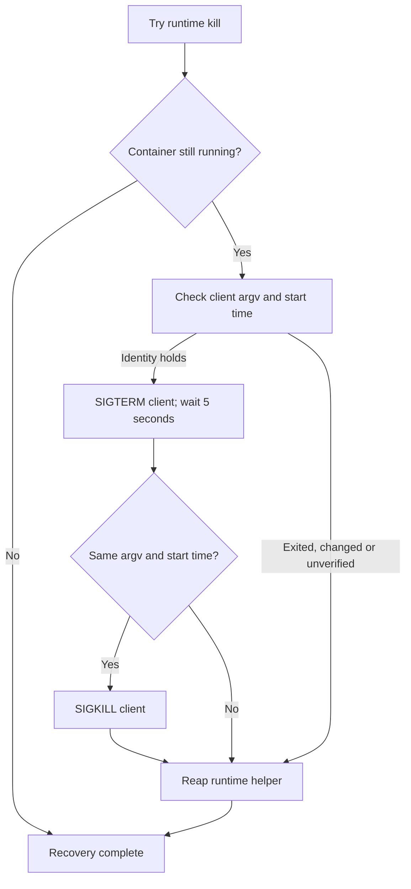

## Summary

Guard `loop.sh` client TERM and KILL signals with an exact container-command
match and an unchanged process start time. If identity cannot be verified, skip
that signal and continue to the runtime-helper reaper when Deno and the worker
module are available. Closes #4642.

## Spec

### Intent and Rationale

- Prevent a recycled client PID from receiving SIGKILL after the five-second
  grace period.

### Essential Design Decisions

- Use `ps -p <pid> -o lstart=` and re-run the exact `pgrep` match immediately
  before each signal. The five-second grace and subsequent helper-reap path
  remain in place.
- Start-time sampling and signalling cannot be atomic; a small PID-reuse race
  remains between the final check and signal.

### Undiscoverable Facts

- This environment has GNU Bash 5.2 and GNU `ps`; Bash 3.2 and BSD `ps` were not
  installed. Compatibility was checked against the Bash 3.2 reference manual and
  FreeBSD `ps(1)` documentation.

## Evidence

Backend shell-supervisor change; no visual surface changed. `#4642`:
[loop.sh force-stop client PID can be reused before SIGKILL](https://github.com/stSoftwareAU/VibeCoder/issues/4642).

On Linux, `ps -p $$ -o lstart=` returned `Mon Nov  2 01:38:06 2026`. FreeBSD
`ps(1)` documents `-p`, `-o`, and the `lstart` keyword
([FreeBSD manual](https://man.freebsd.org/cgi/man.cgi?apropos=0&manpath=FreeBSD+14.4-RELEASE+and+Ports&query=ps&sektion=1));
the Bash 3.2 manual documents `[[ value =~ regex ]]`
([Bash 3.2 reference manual](https://www.bashcookbook.com/bashinfo/source/bash-3.2/doc/bashref.pdf)).

## Test Plan

- Coverage carry-over (completion finding 1): the completion check reported
  `error: Test failed` for `worker/deno/tests/loop_force_stop_container_test.ts`
  at merge base `018ddd53dfd014e7eddd5c08c388fe2712d48fae` with `origin/main`.
  The base-test failure prevented the coverage comparison; it produced no
  line-level uncovered-code report. Automated coverage carry-over remains
  unverified, despite the retained assertions and seven passing head scenarios
  described below. This summary correction does not repair the base-test failure
  or enable `skip_coverage_carryover_check`; that finding remains for the
  reviewer.
- `worker/deno/tests/loop_force_stop_container_test.ts`: the reused-PID
  regression first failed against the unfixed `loop.sh`, recording `-TERM 5555`
  followed by `-KILL 5555` where only TERM was expected. The final targeted
  integration run passed all seven scenarios.
- Scenario coverage: `unchanged-client` receives TERM then KILL;
  `exit-after-term` and `missing-start-after-term` receive no KILL;
  `reused-after-term` has matching argv but a changed start time and receives no
  KILL; `missing-start`, `changed-start-before-term`, and
  `changed-owner-before-term` receive no signal. Every scenario also asserts
  runtime-helper recovery and leaves unrelated Virtualization VM PIDs untouched.
  Fabricated PIDs are intercepted; shell sleep is stubbed.
- Guard mutations each made their named test fail: removing the TERM
  start-time-presence check → `missing-start`; removing the TERM timestamp
  comparison → `changed-start-before-term`; removing the TERM argv-match check →
  `changed-owner-before-term`; removing the KILL timestamp comparison →
  `reused-after-term` and `missing-start-after-term`; removing the KILL
  argv-match check → `exit-after-term`.
- The prior signal expectation `"-TERM 5555\n-KILL 5555\n"` was replaced with
  per-scenario signal expectations. Required by #4642: “Skip the SIGKILL when
  the client has already gone.” Existing recovery-event, launch-log,
  target-helper, and unrelated-VM assertions remain.
- `timeout 900 deno task test tests/loop_force_stop_container_test.ts < /dev/null`
  (from `worker/deno`): passed, 7 tests.
- `deno lint tests/loop_force_stop_container_test.ts` and
  `deno check --frozen --lock=deno.lock tests/loop_force_stop_container_test.ts`
  (from `worker/deno`): passed.
- `deno fmt --check worker/deno/tests/loop_force_stop_container_test.ts`,
  `shellcheck loop.sh`, `bash -n loop.sh`, and `git diff --check`: passed.
  Mermaid and markdownlint passed in the full gate.
- `timeout 900 ./quality.sh < /dev/null`: failed only the unit-test time-budget
  check for unchanged `worker/deno/tests/launcher_harness_reclaim_stub_test.ts`
  (2 tests, 9.98 seconds against the 1-second limit). Deno tests otherwise
  passed; lint, type check, format, Mermaid, markdownlint, Semgrep, workflow
  checks, and release-tag rules passed. Config integration and Checkov were
  skipped by the gate.
- No assertions were removed from the unrelated-VM, event, launch-log, or
  runtime-helper checks. Related docs checked:
  `docs/workflows/resilience-and-concurrency.md`'s container watchdog section.
  Other client-SIGKILL descriptions in `docs/CONTAINER.md`,
  `docs/DEPLOYMENT.md`, and `docs/TROUBLESHOOTING.md` describe the separate
  launcher watchdog reaper and remain accurate.

Version bump: No `VERSION` change was made for this issue.
