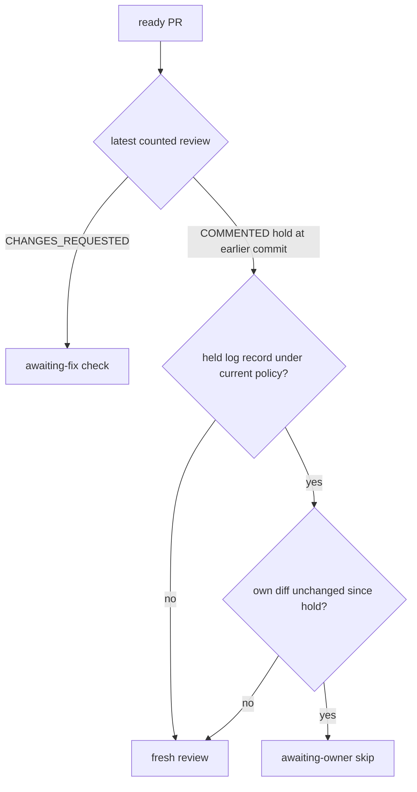

## Summary

A PR the review-fleet-prs skill held for the owner is no longer given a fresh
full review when the only commits since the hold leave its own diff unchanged (a
base merge, for example). The gate skips it as `awaiting-owner`, the same way it
already skips a sent-back PR as `awaiting-fix`, so the hold stands and `post.ts`
no longer removes `needs-human` because the base branch moved. Closes #4643.
Version bump: not part of this change.

## Spec

### Intent and Rationale

- `sentBackAt()` only sees `CHANGES_REQUESTED` reviews, so a held (`COMMENTED`)
  PR was `ready` at every new head. A sibling `heldAt()` plus a third skip in
  `skipReason()` reuses the existing `ownDiffUnchanged()` comparison instead of
  a new one.
- A hold has no findings, so the comparison takes its strict path (context must
  match, a file that left the own diff means a fresh review), as the issue says.

### Essential Design Decisions

- The skip needs this host's `log.jsonl` to hold a `held` record for the hold's
  commit (`heldPolicyAt`). A hold with no local record (for example posted from
  another host) is reviewed afresh: the safe side, which is the old behaviour.
- Per the issue's 2 November merge-throughput comment, holds carry a
  `holdPolicy` (`HOLD_POLICY_VERSION`, `review_log.ts`, currently 1; a record
  without the field counts as 1). The skip applies only when the record's
  version equals the current one, so a later change to the owner-hold policy
  (#4655 is open and not implemented here) bumps the constant and every existing
  hold is reassessed once, even on an unchanged head.
- The skip is the same own-diff comparison used for send-backs. Unchanged
  own-diff text is not proof a base dependency did not change; the reassessment
  triggers are an own-diff change and a policy bump. Documented in
  `references/edge-cases.md#awaiting-owner`.

### Undiscoverable Facts

- Cross-host holds are not skipped (the log is per host); the issue's wording
  ("marker-carrying `COMMENTED` review") was narrowed by the log requirement so
  a policy version can be read.

## Evidence

Backend/skill change, no UI. Real code is driven through `skipReason()` with the
real `ownDiffUnchanged()` over faked `gh` compare responses, as the existing
`awaiting-fix` tests do.

## Test Plan

- `worker/deno/tests/review_fleet_prs_gate_2675_test.ts` (9 new tests, named
  "(Issue #4643)"): merge-only head after a hold is `awaiting-owner`; changed
  own diff, no log record, older or newer policy, an unmarked owner comment, and
  a dropped file (strict path) all give `null`; `CHANGES_REQUESTED` still gives
  `awaiting-fix` without consulting the hold lookup; a hold at the head is
  `already-reviewed`; `heldAt` unit cases.
- `worker/deno/tests/review_fleet_prs_log_2678_test.ts` (1 new test):
  `heldPolicyAt` for a legacy record, an explicit version, the latest of two,
  and other head/PR/outcome.
- `worker/deno/tests/review_fleet_prs_upkeep_failure_2891_test.ts` (1 new
  `pass()`-level test, "(Issue #4643)"): a marker-bearing `COMMENTED` review at
  an earlier commit, merge-only compare responses and a `held` record in
  `log.jsonl` give `skipped["awaiting-owner"] === 1` and nothing ready; the
  negative cases stay ready: no log record, a `holdPolicy` of another version,
  and a record for another head commit, PR number or repo.
- Mutation checks, each seen red then restored: policy comparison replaced by
  `!== null`; `ownDiffUnchangedSince` called with the head instead of the held
  commit; the `COMMENTED` state check removed from `heldAt`; the marker check
  bypassed in `heldAt`; and `pass()`'s hold lookup replaced by `(_oid) => null`
  (red in the new `pass()` test, which the `skipReason` tests alone missed).
- Ran 21 `review_fleet_prs_*`/post/gate-related test files: 304 passed, 0
  failed.
- Callers of `skipReason` checked: the only production caller is `pass()` in
  `gate.ts`, which now passes the hold lookup; the new parameter defaults to "no
  hold known", so the other test callers keep today's behaviour.
- Docs read and updated: `SKILL.md` rule 8 and the slots sentence,
  `references/edge-cases.md` (new "Awaiting-owner" section). Rule 4 and the
  hold-posting passages in `SKILL.md` make no skip claim and stay true.
- `./quality.sh` ran and reported FAILED on one stage, "deno tests":
  `tests/completion_phase_repo_formatters_test.ts` lines 480 and 567 ("formatter
  should commit the Rust fix"). It fails identically on a checkout of the base
  commit without this change (6 passed, 2 failed), so it is not caused here. Its
  serial pass did not run because the parallel pass failed. Every other stage
  passed except config integration and checkov, which the gate skipped.
