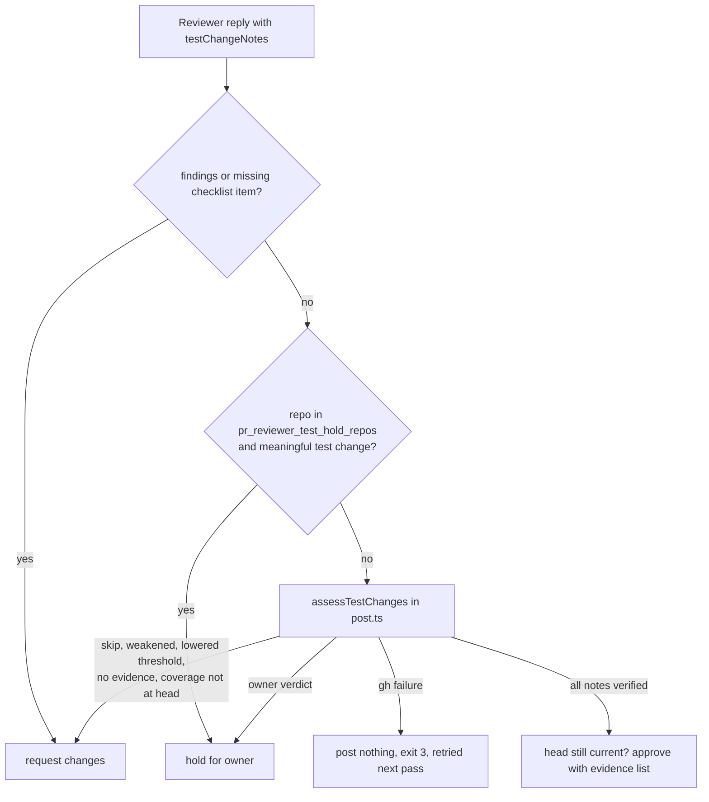

## Summary

The fleet reviewer no longer holds a PR for the owner just because it changes or
removes a test. Under the owner-approved policy (2 November 2026) every repo now
gets an evidence review: the reviewer says, for each substantive test change,
which old behaviour is obsolete, which required behaviour remains and which
replacement or existing coverage proves it; `post.ts` then checks that evidence
itself at the head commit. Justified changes are approved. Lost protection,
skips, weakened assertions, lowered thresholds and missing evidence are sent
back with a request for changes. Only an `owner` verdict (unclear product
contract) or an explicit per-repo override holds the PR. The #3397 opt-in
(`pr_reviewer_auto_release`) and its expected-value-only / five-word-quote rules
are removed. Hold policy version 2 makes every existing reviewer-owned hold be
reassessed once, even at an unchanged head. Version bump: no `VERSION` change in
this diff; the merged commit records the final version. Closes #4655.

## Spec

### Intent and Rationale

- Issue #4655: rule 4 and `auto_release.ts` held every removed or changed-expectation test for a human, so legitimate requested changes (#4645, #4639) waited. The restriction that remains is against getting a clean build by losing useful protection.
- The model judges substance; the script verifies what can be verified (cited files and names at the head, base-ref existence for `gone` coverage, the governing issue and quote) so a boolean claim never approves.

### Essential Design Decisions

- New `scripts/test_change_policy.ts` replaces `auto_release.ts`. `weakened-assertion`, `added-skip` and `threshold-reduced` notes are never approvable; a removed test file with no note is a finding; a gh failure is a `retry` (nothing posted, exit 3), never an approval or a hold.
- Governing issues come from `closingIssuesReferences`, the `issue-<N>-…` branch of a fleet PR, or an anchored `Part of #N` line. The issue itself is fetched; it counts only if its author is trusted (`author_association` OWNER/MEMBER/COLLABORATOR or a login in `allowed_authors`/`authorized_commenters`/`pr_reviewers`). PR prose never authorises anything. The five-word minimum is gone; a supplied quote must be verbatim in the issue and `expected-value` requires one.
- Migration from #3397: the policy is on by default (no opt-in). `pr_reviewer_test_hold_repos` is the explicit owner override (old comment-only hold). `pr_reviewer_auto_release` is tolerated, ignored and reported. Effective version and overrides: gate JSON `testPolicy`, `post.ts` result and `log.jsonl` `testPolicy`, and a `summary.md` line.
- Reassessment: `HOLD_POLICY_VERSION` is 2 and a hold review carries a whole-line `<!-- vibe-hold-policy v=N -->` marker. `reviewedAtHead` treats a comment-only hold under an older policy (no marker = 1) as not reviewed, so it is re-reviewed once even at the same head. The existing label logic removes `needs-human` only when the skill's own record shows it added it, so human/security holds are kept.
- The head is re-checked right before posting (`headStillCurrent`); a head that moved is never approved. `--no-model` audit send-backs skip the assessment.

### Undiscoverable Facts

- `gone` coverage must have existed at the base ref and be gone at the head, otherwise an invented path would "prove" removed functionality (found in self-review of the first cut).
- The worker's pre-PR verifier shares the brief, so it applies the same policy through its findings. It does not act on an `owner` verdict: only the fleet reviewer's `post.ts` holds.

## Evidence

Backend/skill/docs change, no UI. Real functions are driven with a fake `gh` whose shapes were copied from `gh pr view … --json closingIssuesReferences,headRefName,body` and `gh api repos/…/issues/N` output. Replay: a held review without the marker (version 1) is not skipped by `skipReason` at the same head; `decidePostOutcome` then approves or sends it back, and `syncNeedsHumanLabel` removes `needs-human` only when the earlier record says the skill added it.

- `worker/deno/tests/review_fleet_prs_test_policy_4655_test.ts` (policy module: config, governing issues, six approvals, the negatives).
- `worker/deno/tests/review_fleet_prs_test_policy_wiring_4655_test.ts` (decideOutcome, decidePostOutcome end to end, bodies, `headStillCurrent`, gate `reviewedAtHead`/`skipReason`, replay, exposure).
- `worker/deno/tests/pre_pr_verifier_test_notes_4655_test.ts` (note parsing).
- Docs: `CODING-STANDARDS.md` (canonical, first), `prompts/pr_review_brief/prompt.md`, `prompts/issue/prompt.md`, `prompts/pr_feedback/prompt.md`, `.claude/skills/review-fleet-prs/SKILL.md` and `references/edge-cases.md`, `docs/CONFIGURATION.md`, `docs/THREAT-MODEL.md` R14, `CONTRIBUTING.md`, `docs/GITHUB-ACTIONS-AUDIT-SCAN.md`, `prompts/best_practices/buckets/general.md`, `.github/CODEOWNERS` comment, `repo_settings_harden.ts` text.

## Test Plan

- Ran from `worker/deno`: `deno task test:unit` over the three new files plus every test importing the review-fleet-prs scripts (458 passed, 0 failed), `tests/review_fleet_prs_runner_test.ts` directly (70 passed), and 59 prompt-pin tests for `pr_feedback` (672 passed). `deno check`, `deno lint`, `deno fmt` clean.
- Full `./quality.sh`: every stage passed except `deno tests`, which failed on three tests: `babysitter default heartbeat resolves its checkout revision` (JSR download), `verifyResolvedTree … allowlisted environment (Issue #4659)` (agent-account probe) and `createFallbackFlagFiler - routes the label creation through the caller's gh (Issue #2310)`. All three fail the same way on the base commit `bffbc3bb` (checked in a clean worktree for the third), so none comes from this diff. The serial pass did not run after the parallel failure; CI runs it.
- Red checks (break, run, restore), all went red: `HOLD_POLICY_VERSION` back to 1 (8 tests); unanchored hold marker (prose-marker test); stale hold counted as reviewed (6); head re-check ignoring a moved head (2); assessment findings not appended (12); hold-all override disabled; retry ignored; `testChangesReviewed` written when false; summary policy line dropped; in the policy module the blocked-kind check, verdict check, coverage existence and name checks, quote-found, verification vacuity, path allow-list, trusted-author check, anchored `Part of` regex and the base-ref probe for `gone` entries; inverting the `--no-model` skip turned 24 tests red.
- Removed/edited tests (policy change, each replaced): `review_fleet_prs_auto_release_3397_test.ts` deleted. Its still-true checks are carried over (note-shape back-compat, `postedResult` field presence, summary marker, needs-human sync); opt-in, `autoReleaseDecision`, 5-word quote and expected-value-only cases are replaced by the approval/negative tests above. Edited: `review_fleet_prs_log_2678_test.ts` and `review_fleet_prs_checklists_3594_test.ts` (`decideOutcome` meaningful change now approved; `hold: true` held), `review_fleet_prs_gate_2675_test.ts` (a marker-less hold at the head is no longer `already-reviewed`; a v2-marked hold is).
- Callers checked: `decideOutcome` (post.ts), `reviewBody` (post.ts), `renderSummary`/`writeSummary` (gate.ts, post.ts), `reviewedAtHead` (both gate call sites), `postedResult` (post.ts only).

## Known gaps

- No unit test drives `post.ts` `main()` (log-record assignment, exit 3 print, legacy-key stderr line) or the gate `main()` fail-loud exit; their building blocks are tested.
- Held-review notes and `review.summary` in a hold body are still raw text, as before this change.
- The worker's pre-PR verifier ignores `owner` verdicts.
