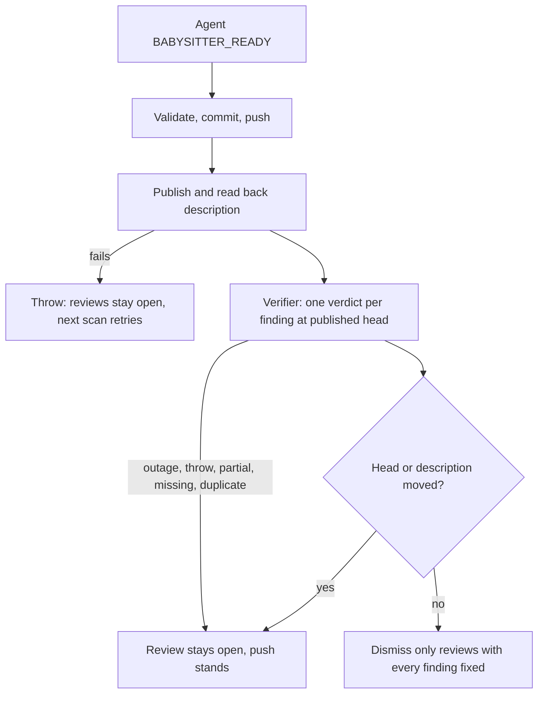

## Summary

The fleet PR babysitter no longer dismisses a requested review because its agent
said `BABYSITTER_READY`. After the fix is pushed and the description is
published and read back, the existing independent review-fix verifier judges
each review's findings at that head and description. Only a review whose every
finding is judged `fixed` is dismissed. A verifier outage, a partial, missing or
duplicate verdict, or a head or description that moves during verification keeps
the review open and never blocks the push. Closes #4657.

## Spec

### Intent and Rationale

- The agent that implemented the fix also reported it complete, and PR #4611
  showed the cost: the archived summary was fixed, the review dismissed, and the
  live body was still wrong. The independent verifier the worker already uses
  for review-fix rounds now decides dismissal, so there is no second review
  policy.
- Verification sits after body publication, so a description finding is judged
  against the body GitHub shows, not only the local summary.

### Essential Design Decisions

- One verifier call covers all requested reviews (findings numbered
  contiguously). A review is verified only when it has at least one readable
  finding and each has exactly one `fixed` verdict. Findings the verifier raises
  on its own do not un-verify a review whose findings are fixed.
- Failure to verify never throws out of the finish: the push has already
  happened, so the review stays open and the reviewer's review of the pushed
  head, or the next scan, decides. This avoids a new permanent hold. A failed
  body publication still throws as before (#4637).
- Evidence is not stored across scans. A moved head or changed description
  during verification discards it, and the next scan re-verifies.
- A review with an empty body has no findings to verify, so it stays open rather
  than being dismissed on an empty diff. The verifier is also not called when no
  review has a readable finding.
- #4625 (deterministic local-check results) is open and not delivered, so
  nothing here uses it; the verifier prompt stays the single source of check
  evidence.

### Undiscoverable Facts

- PR #4611's reviews were read with
  `gh api repos/stSoftwareAU/VibeCoder/pulls/4611/reviews`; review 5727298859
  (verdict `partly`: summary fixed, live body still `Part of`) is the basis of
  the fixture.
- On a default verifier the babysitter host needs the Claude CLI; where it is
  missing the verifier reports `not_checked`, reviews stay open, and the push is
  unaffected.

## Evidence

- Real tool observed:
  `gh api repos/stSoftwareAU/VibeCoder/pulls/4611/reviews --jq '.[] | {id,state,user:.user.login,body}'`
  returns `id`, `state`, `user.login` and `body` per review, so `body` flows
  through `requestedReviews` unchanged into `Review.body`.
- Verification path reused: `runPrePrVerifier` and `extractEarlierFindings`, the
  same calls `lib/pr_feedback_verifier.ts` makes for the worker's review-fix
  rounds. The tests stand in the verifier with a fake that returns the
  `earlierFindings` verdict shape (`fixed`, `partly`, `not fixed`) that
  `parseEarlierVerdicts` produces.
- Callers of `finishBabysitterRepair` checked: `fix()` and
  `resumePendingPublication` both pass `verifyReviews`; the type makes it
  required, so no caller can fall back to dismissing without it.
  `dismissAddressedReviews` is unchanged and still re-reads current requested
  reviews before dismissing.
- Docs updated: `docs/workflows/fleet-pr-babysitter.md` (overview, sequence
  diagram, description step 5). The agent prompt clause in `buildRepairPrompt`
  ("counts as addressed") is reworded to match. Docs sweep for stem `dismiss\w*`
  / `addressed` in `docs/` (excluding archive): `docs/USAGE.md` and
  `docs/INTERNALS.md` describe the worker's `pr_review` path, not the
  babysitter, and stay true.

## Test Plan

- Added `worker/deno/tests/babysitter_review_verifier_4657_test.ts` (13 tests):
  complete fix, partial fix, false-positive rebuttal, no-op completion, outage,
  throw, missing and duplicate verdict, blank body, extra new findings, input
  shape, and the PR #4611 stale-body then published-body fixture. Result: 13
  passed, 0 failed.
- Added `worker/deno/tests/babysitter_review_dismissal_4657_test.ts` (16 tests)
  driving the real `finishBabysitterRepair`: complete fix, partial fix (only the
  verified review dismissed), false-positive rebuttal on a no-change run, no-op
  completion, stale body, PR #4611 fixture, failed publication, verifier outage,
  verifier throw, head movement during verification, a description edited during
  verification, a head that moved before verification (rejects, verifier never
  called), outside-id verdict, duplicate verdict, a review arriving during
  repair, and a CI repair with no reviews. Result: 16 passed, 0 failed.
- Existing tests edited only to supply the new required `verifyReviews` dep
  (`worker/deno/tests/fleet_pr_babysitter_test.ts`,
  `worker/deno/tests/babysitter_fix_orchestration_test.ts`); no assertion
  removed or changed. Those files plus `fleet_pr_babysitter_single_push_test.ts`
  and `fleet_pr_babysitter_pass_4658_test.ts`: 182 passed, 0 failed.
- Red checks (each restored afterwards): verifier treats `partly` as fixed →
  partial-fix tests red (2 failed); dismissing all `reviews` regardless of
  verdict → 8 failed including partial fix, no-op, outage and head movement;
  removing the head/description-moved check → head-movement test red; removing
  the head check before the verifier runs → the moved-before-verification test
  red (1 failed); removing the `sameDescription` check after it → the
  description-changed test red (1 failed); letting a verifier throw escape →
  verifier-throws test red.
- `docs/audits/lib-sweep-coverage/top-up-4657.json` claims the new module;
  `deno task test:unit tests/lib_sweep_coverage_test.ts`: 39 passed.
- The ledger's `sweptAt` points to the merge base on `origin/main`, rather than
  a temporary feature-branch checkpoint, so it survives a squash merge.
- Full gate `./quality.sh`: the one change-related failure (completeness checks,
  the unclaimed module) is fixed by the ledger entry above;
  `deno task check:manifests` now passes (847 passed, 0 failed). `deno tests`
  still fails on
  `completion - an unformatted Rust change is formatted and committed, then passes the gate`
  and
  `completion - cargo fmt stages only the branch's .rs files, not an unrelated uncommitted edit`
  in `completion_phase_repo_formatters_test.ts`, which this change does not
  touch (they also failed on #4786's run); the gate was not re-run end to end
  after the ledger entry.
- Mutation check and the independent Spec/Standards reviewers were not run: the
  issue states no `## Acceptance Criteria` list.

Not done / risk: no live babysitter run against a real PR; the default verifier
needs the Claude CLI on the babysitter host and fails closed (reviews stay open)
where it is absent; a review with only inline comments and an empty body is
never auto-dismissed.
