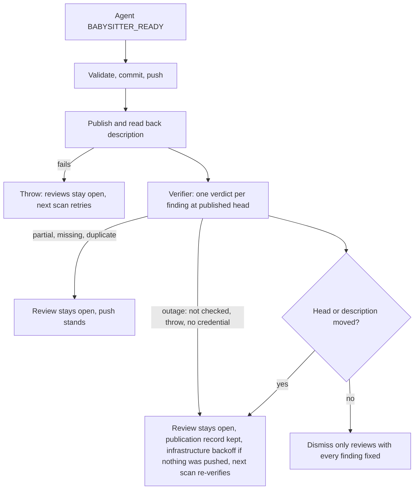

## Summary

The fleet PR babysitter no longer dismisses a requested review because its agent
said `BABYSITTER_READY`. After the fix is pushed and the description is
published and read back, the existing independent review-fix verifier judges
each review's findings at that head and description. Only a review whose every
finding is judged `fixed` is dismissed. A partial, missing or duplicate verdict
keeps the review open and never blocks the push. A verifier outage (including a
head or description that moves during verification) also keeps the review open
and keeps the pending publication, so the next scan re-verifies without running
the agent; a pass that pushed nothing also backs off as an infrastructure
failure. The verifier runs read-only: its own read-only token, no Bash, Edit or
Write, and no project settings, never the runner's write token. Closes #4657.

## Spec

### Intent and Rationale

- The agent that implemented the fix also reported it complete, and PR #4611
  showed the cost: the archived summary was fixed, the review dismissed, and the
  live body was still wrong. The independent verifier the worker already uses
  for review-fix rounds now decides dismissal, so there is no second review
  policy.
- Verification sits after body publication, so a description finding is judged
  against the body GitHub shows, not only the local summary.

### Essential Design Decisions

- One verifier call covers all requested reviews (findings numbered
  contiguously). A review is verified only when it has at least one readable
  finding and each has exactly one `fixed` verdict. Findings the verifier raises
  on its own do not un-verify a review whose findings are fixed.
- Failure to verify never blocks a push that already happened. A judgement
  (partial, missing, duplicate verdict) leaves the review open; a no-change pass
  is then recorded as a failed repair and journalled. An outage (the verifier
  failed, was not checked, had no credential, or the head or description moved)
  is different: `finishBabysitterRepair` returns the outage, keeps the
  pending-publication record, and on a pass that pushed nothing, or on a resumed
  publication, `fix()` throws an infrastructure `BabysitterFailure`. The retry
  record then carries the reason in `lastOutcome`, spends no substantive
  attempt, and the next scan resumes publication and verification without the
  agent, so an outage cannot reach the no-progress handoff hold. After a push
  the record is kept too and the next scan resumes it. A failed body publication
  still throws as before (#4637).
- The verifier is a Claude model that reads untrusted review text and runs in
  the runner's process, so it gets the Codex agent's boundary (#4572): a
  per-verification read-only token for the target repository passed as the
  child's `GH_TOKEN` (`babysitterVerifierCredentials`), `Read` denied on
  `babysitterProtectedPaths` and `/proc`, and (PR #4849 review) the pre-PR
  verifier's new `readOnly` mode: `Bash`, `Edit`, `Write` and `NotebookEdit`
  denied, and the Claude CLI started with `--setting-sources ""` and
  `--strict-mcp-config` (`isolateClaudeConfig` on the run options, emitted by
  `buildClaudeCliArgs`), so a hook committed to the PR's `.claude/settings.json`
  cannot run a command and the verifier cannot write a file the runner later
  executes. Without a credential and without a test stand-in, the pass is an
  outage and the model is never started. With no shell the verifier cannot run
  `git diff`, so in `readOnly` mode `verifyInCheckout` writes the
  `git diff base...head` to `change.diff` and a read-only base tree to `base/`
  outside the checkout, and the prompt (`buildPrePrVerifierPrompt`) says the
  tools are unavailable, points at those files, and replaces the `git diff`,
  `git show` and "rerun a test" directions. A check that needs a command run is
  reported as not run, not judged fixed. The trade-off: the verifier reads and
  judges but does not run repository code, so a requested red run is judged from
  the code and the reply's evidence.
- Evidence is not stored across scans. A moved head or changed description
  during verification discards it, and the next scan re-verifies.
- A review with an empty body has no findings to verify, so it stays open rather
  than being dismissed on an empty diff. The verifier is also not called when no
  review has a readable finding.
- #4625 (deterministic local-check results) is open and not delivered, so
  nothing here uses it; the verifier prompt stays the single source of check
  evidence.

### Undiscoverable Facts

- PR #4611's reviews were read with
  `gh api repos/stSoftwareAU/VibeCoder/pulls/4611/reviews`; review 5727298859
  (verdict `partly`: summary fixed, live body still `Part of`) is the basis of
  the fixture.
- On a default verifier the babysitter host needs the Claude CLI and a working
  Claude credential; where they are missing the verifier reports `not_checked`,
  reviews stay open, the push is unaffected, and the retry is an infrastructure
  wait. The host requirements in `docs/workflows/fleet-pr-babysitter.md` now say
  so.

## Evidence

- CI repair: the isolated-provider refusal test now injects the same fake clock
  as the other runner calls in its file, keeping its deadline independent of
  parallel load. `parallel_unsafe_test_manifest_test.ts::parallel-unsafe manifest - no wall-clock test is missing from it (Issue #940)`
  covers the classification; no twinned rule was found.
- Real tool observed:
  `gh api repos/stSoftwareAU/VibeCoder/pulls/4611/reviews --jq '.[] | {id,state,user:.user.login,body}'`
  returns `id`, `state`, `user.login` and `body` per review, so `body` flows
  through `requestedReviews` unchanged into `Review.body`.
- Verification path reused: `runPrePrVerifier` and `extractEarlierFindings`, the
  same calls `lib/pr_feedback_verifier.ts` makes for the worker's review-fix
  rounds. The tests stand in the verifier with a fake that returns the
  `earlierFindings` verdict shape (`fixed`, `partly`, `not fixed`) that
  `parseEarlierVerdicts` produces.
- Callers of `finishBabysitterRepair` checked: `fix()` and
  `resumePendingPublication` both pass `verifyReviews` (now
  `deps.verifyReviews ?? readOnlyReviewVerifier(...)` in `fix()`); the type
  makes it required, so no caller can fall back to dismissing without it. Both
  read the returned `BabysitterRepairFinish`: `resumePendingPublication` and the
  no-push branch of `fix()` throw on an outage, and `fix()` journals a no-push
  pass unless `reviewsDismissed`. Every other caller is a test.
  `dismissAddressedReviews` is unchanged and still re-reads current requested
  reviews before dismissing.
- The merge with main retains both the verifier and attempt-journal dependency
  hooks on `FixDeps`, so review verification and attempt auditing remain wired.
- The dismissal fixture uses `createExchangeDir`, matching the hardened
  canonical-directory contract on hosts whose temporary path contains a symlink.
  `worker/deno/tests/babysitter_review_dismissal_4657_test.ts::the verifier judges the published description, not the stale one (Issue #4657)`
  continues to cover publishing the description before verification; accepting a
  noncanonical exchange path is not supported.
- Docs updated: `docs/workflows/fleet-pr-babysitter.md` (overview, sequence
  diagram, host requirements, credential boundary, description step 5),
  `docs/THREAT-MODEL.md` (C36) and the `babysitter_attempt_audit.ts` header. The
  agent prompt clause in `buildRepairPrompt` ("counts as addressed") is reworded
  to match. Docs sweep for stem `dismiss\w*` / `addressed` in `docs/` (excluding
  archive): `docs/USAGE.md` and `docs/INTERNALS.md` describe the worker's
  `pr_review` path, not the babysitter, and stay true.

## Test Plan

- PR #4849 review: read-only verification pins the Claude provider and refuses
  any non-Claude fallback before spawning, preserving its tool and configuration
  boundary. `worker/deno/tests/pre_pr_verifier_3395_test.ts::runPrePrVerifier readOnly: no shell or edit tools, isolated config, the evidence as files, and a prompt that names no denied tool (PR #4849 review)`
  checks the provider and actual base-file content;
  `worker/deno/tests/claude_runner_provider_fallback_4034_test.ts::isolated Claude configuration refuses a non-Claude provider before spawn`
  checks the fallback boundary. The old file-existence assertion could not
  distinguish head from base; the content assertion retains the evidence check
  and proves the base revision is used. No twinned rule was found.

- Added `worker/deno/tests/babysitter_review_verifier_4657_test.ts` (18 tests at
  head): complete fix, partial fix, false-positive rebuttal, no-op completion,
  outage, throw, missing and duplicate verdict, blank body, extra new findings,
  input shape, the PR #4611 stale-body then published-body fixture, and (PR
  #4849 review) credentials passed to the pass, no credential never starts the
  model, a credential mint failure is an outage, a not-fixed verdict is not an
  outage, and the pass runs `readOnly`. Result: 18 passed, 0 failed.
- Added `worker/deno/tests/babysitter_review_dismissal_4657_test.ts` (16 tests)
  driving the real `finishBabysitterRepair`: complete fix, partial fix (only the
  verified review dismissed), false-positive rebuttal on a no-change run, no-op
  completion, stale body, PR #4611 fixture, failed publication, verifier outage,
  verifier throw, head movement during verification, a description edited during
  verification, a head that moved before verification (rejects, verifier never
  called), outside-id verdict, duplicate verdict, a review arriving during
  repair, and a CI repair with no reviews. Result: 16 passed, 0 failed.
- PR #4849 review, added to
  `worker/deno/tests/babysitter_fix_orchestration_test.ts` (47 tests at head),
  all through the real `fix()`: a no-change repair with a verifier outage
  (infrastructure class, no substantive attempt, no escalation, one journalled
  attempt, publication kept, next scan re-verifies and dismisses with no second
  agent session); a resumed publication whose verifier is still down (record
  kept, second infrastructure attempt, still one agent session); a no-change
  repair judged not fixed (journalled once, record cleared, class `code`); the
  production `readOnlyReviewVerifier` failing closed when its token cannot be
  minted. `worker/deno/tests/fleet_babysitter_app_test.ts` gained two tests for
  `babysitterVerifierCredentials` (read-only token replaces the runner's
  `GH_TOKEN`, no runner token anywhere in the result, Bash and the protected
  paths and `/proc` denied; a write-granting token is refused), and
  `worker/deno/tests/pre_pr_verifier_3395_test.ts` one test for `parentEnv` and
  `extraDisallowedTools` reaching the model run. Re-run at the head, 0 failed
  in each: `worker/deno/tests/babysitter_fix_orchestration_test.ts` (47 tests at
  head), `worker/deno/tests/pre_pr_verifier_3395_test.ts` (76 tests at head) and
  `worker/deno/tests/fleet_pr_babysitter_test.ts` (116 tests at head).
- PR #4849 review red checks (each restored): `fix()` not throwing on an outage
  → both outage tests red; journalling only when `reviews.length === 0` → the
  not-fixed journal test red; `GH_TOKEN ??= minted.token` (keeps the runner's) →
  the credentials test red; clearing the publication record on an outage → both
  outage tests red; `resumePendingPublication` not throwing → the resumed-outage
  test red.
- PR #4849 review (read-only verifier, no shell): added
  `worker/deno/tests/pre_pr_verifier_3395_test.ts` (76 tests at head) `readOnly`
  test, which runs the real prompt builder and `verifyInCheckout`: `Bash`,
  `Edit`, `Write` and `NotebookEdit` denied (and allowed in the control run),
  `isolateClaudeConfig` set, `change.diff` holding the diff and `base/` holding
  the base tree, and a prompt that has none of "Read the change with", "rerun a
  test" or "git show" (the control prompt has the first two).
  `worker/deno/tests/agent_provider_test.ts` pins the `--setting-sources ""` and
  `--strict-mcp-config` argv;
  `worker/deno/tests/agent_containment_limits_3701_test.ts` runs
  `runClaudeWithTimeout` against a stub claude and reads its argv, so the run
  option reaches the CLI. `babysitter_review_verifier_4657_test.ts` asserts the
  babysitter pass sets `readOnly: true`. Re-run at the head, 0 failed in each:
  `worker/deno/tests/pre_pr_verifier_3395_test.ts` (76 tests at head),
  `worker/deno/tests/babysitter_fix_orchestration_test.ts` (47 tests at head)
  and `worker/deno/tests/fleet_pr_babysitter_test.ts` (116 tests at head).
  Red checks (each restored): drop `isolateClaudeConfig`
  from the verifier's ask, replace `Edit` in the read-only denial list, build
  the prompt without the read-only branch, write an empty diff file, and drop
  the runner's forwarding of `isolateClaudeConfig` → the corresponding test red
  each time. The babysitter's `readOnly: true` call site: not red-checked
  separately beyond its own assertion.
- Existing tests edited only to supply the new required `verifyReviews` dep
  (`worker/deno/tests/fleet_pr_babysitter_test.ts`,
  `worker/deno/tests/babysitter_fix_orchestration_test.ts`); the one assertion
  changed is the verifier-throws expectation in
  `babysitter_review_verifier_4657_test.ts`, which now also expects
  `unavailable: true` on the outcome (it still asserts the fail-closed result).
- Red checks (each restored afterwards): verifier treats `partly` as fixed →
  partial-fix tests red (2 failed); dismissing all `reviews` regardless of
  verdict → 8 failed including partial fix, no-op, outage and head movement;
  removing the head/description-moved check → head-movement test red; removing
  the head check before the verifier runs → the moved-before-verification test
  red (1 failed); removing the `sameDescription` check after it → the
  description-changed test red (1 failed); letting a verifier throw escape →
  verifier-throws test red.
- `docs/audits/lib-sweep-coverage/top-up-4657.json` claims the new module;
  `worker/deno/tests/lib_sweep_coverage_test.ts` (39 tests at head, 0 failed)
  reads that ledger.
- The ledger's `sweptAt` points to the merge base on `origin/main`, rather than
  a temporary feature-branch checkpoint, so it survives a squash merge.
- Full gate `./quality.sh` at the head after the PR #4849 review fixes: every
  check passed (fmt, lint, type check, markdownlint, completeness, manifests)
  except `deno tests`: 32859 passed, 2 failed. The two failures are
  `completion - an unformatted Rust change is formatted and committed, then passes the gate`
  and
  `completion - cargo fmt stages only the branch's .rs files, not an unrelated uncommitted edit`
  in `completion_phase_repo_formatters_test.ts`, which this change does not
  touch (they also failed on #4786's run).
- Mutation survivors (PR #4849): `fleet_pr_babysitter.ts` `verdict?.unavailable`
  guard carried a redundant `unavailable === undefined` operand (the result is
  `unavailable ?? outage` either way), so the operand was removed; the `finish`
  initial value was never read (the publication callback always runs or the sync
  throws), so it is now a definite-assignment declaration.
- Mutation check and the independent Spec/Standards reviewers were not run: the
  issue states no `## Acceptance Criteria` list.

Not done / risk: no live babysitter run against a real PR; the default verifier
needs the Claude CLI on the babysitter host and fails closed (reviews stay open)
where it is absent; a review with only inline comments and an empty body is
never auto-dismissed. The verifier no longer runs repository code (`Bash`,
`Edit`, `Write` and `NotebookEdit` are denied, and the CLI starts with no
project settings), so it cannot flip a line and re-run a test; Claude's `Read`
path rules are best-effort rather than an OS sandbox, which is why the shell and
the write tools are removed and the token is read-only.
