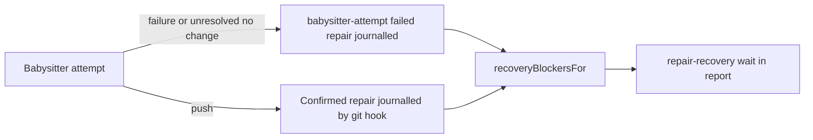

## Summary

The last open item of the completion report was babysitter retry cooldowns from
failed attempts that deliver no repair push. The babysitter now journals such an
attempt (an agent failure, an infrastructure, capability or race cooldown, or an
agent that made no change and left the blocker in place) as a verified, failed
`repair` in its hash-chained audit journal. The `repair-recovery` interval in
the collector measures the wait until the next confirmed repair push or
verified fleet dismissal, or to the PR's merge or close. The provisional
90%-within-24-hours target stays an operational
evaluation after rollout; no baseline or achieved result is claimed. Closes
#4658.

## Spec

### Intent and Rationale

- Retry cooldowns after a failed attempt left no trusted record, so they never
  appeared as a waiting blocker. The collector already turns a failed verified
  repair into a wait, so the fix is to supply that evidence, not a second
  mechanism.

### Essential Design Decisions

- The entry reuses `component: "babysitter"`, `actionKind: "repair"` and
  `outcome: "error"` with the verb `babysitter-attempt`. No new action kind was
  added, so existing readers of the journal and the report stay compatible; a
  failed repair is never counted as a fix round (only confirmed repairs are).
- Owner holds are not journalled (already `needs-human` waits). A failure after
  a push is not journalled either, because a confirmed push already exists.
- A no-push publication that dismisses the addressed reviews is successful,
  and a verified fleet dismissal closes an earlier failed-repair wait.
- Journalling is best-effort and never replaces the repair's real error, but a
  refused append or invalid input is logged as
  `[SECURITY]
  [AUDIT_JOURNAL_REFUSED]`, and nothing is recorded for invalid
  input.

### Undiscoverable Facts

- No live fleet cohort or two-week post-rollout measurement was collected.
- A wait is attributed only once the babysitter host's audit directory is
  supplied to the collector with `--audit-dir`; absent evidence stays unknown.

## Evidence

Backend change; no visual evidence applies.

Docs: `docs/INTERNALS.md`, **PR completion evidence report** section (the
`repair-recovery` paragraph) now describes the journalled attempt. The
neighbouring passage on failed fleet attempts remaining verified history is
still true (`pr_completion_report.ts` counts only confirmed repairs as fix
rounds). The collector no longer reports the obsolete blanket claim that
babysitter retry cooldowns without a push are unmeasured; missing audit
directories remain visible in coverage notes.

## Acceptance Criteria

The issue states no acceptance-criteria heading, and no part of what it asks is
left undone: the earlier PRs (#4709, #4842, #4846) delivered the other items and
this PR delivers the last one named in their summaries.

## Test Plan

- Review fix: a successful no-push review publication and dismissal no longer
  records a failed attempt; an earlier failed attempt ends at a confirmed,
  verified fleet dismissal. The obsolete behaviour charged the subsequent
  review wait to repair recovery. Unsuccessful no-change repairs still open a
  recovery wait, and unverified, human or failed dismissals cannot close it.
  Coverage: `worker/deno/tests/babysitter_fix_orchestration_test.ts::a no-push review repair dismisses the review without journalling failure`,
  `worker/deno/tests/babysitter_fix_orchestration_test.ts::fix resumes a failed publication without another agent session (PR #4779 review)`,
  and `worker/deno/tests/pr_completion_snapshot_test.ts::recovery boundaries - trust, kind, outcomes, ordering and terminal caps`.
  Both new boundary assertions failed before the fix. The recovery rule has
  one implementation, `recoveryBlockersFor`; no twinned rule was found.

- New `worker/deno/tests/babysitter_attempt_audit_test.ts` (12 tests): entry
  journalled at its head, round-trip through `prActionsFromAuditJournal` and
  `recoveryBlockersFor` (wait to the next confirmed repair; wait to the PR end
  cap), unverified chain measures nothing, disabled journal and no audit
  directory write nothing, invalid input refused (including a non-string repo or
  head that stringifies to a valid one), a successful append logs nothing, a
  refused append is logged, and an unexpected error is logged for both an
  `Error` and a non-`Error` thrown value. Passed (12).
- Mutation survivors closed: dropping the `typeof` operand on the repo (line 61)
  or head (line 73), negating the `!result.ok` check (line 92) and negating the
  `instanceof Error` ternary (line 101) in `babysitter_attempt_audit.ts` each
  turn at least one of those tests red.
- New tests in `worker/deno/tests/babysitter_fix_orchestration_test.ts`
  (infrastructure failure, code failure, no change, owner-class failure, a
  successful push, a failure after a confirmed push). The file passed (42).
- Red checks, each restored afterwards: removing the no-change call site, the
  catch call site, the `blockerClass !== "owner"` operand and the `!pushed`
  operand each turned at least one test red.
- `fleet_pr_babysitter_audit_test.ts` (3) and `pr_completion_snapshot_test.ts`
  (111) passed. `deno task check:manifests` passed (847 passed, one ignored).
  `deno fmt`, `deno lint` and `deno check` passed on the changed TypeScript.
- Callers checked: `fix` is the only caller of `journalBabysitterAttempt`; the
  new `journalAttempt` dependency defaults to it, so production passes nothing.
- Review fix: the obsolete unconditional cooldown coverage note is removed;
  missing audit evidence remains reported. Coverage:
  `worker/deno/tests/pr_completion_snapshot_test.ts::collect - coverage does not claim babysitter retry cooldowns are unmeasured`
  and `worker/deno/tests/pr_completion_snapshot_test.ts::collect - no audit directory means the actions are not complete`.
  The new assertion failed before the fix. The attempt audit tests now remove
  their temporary directories in a `finally` block.
