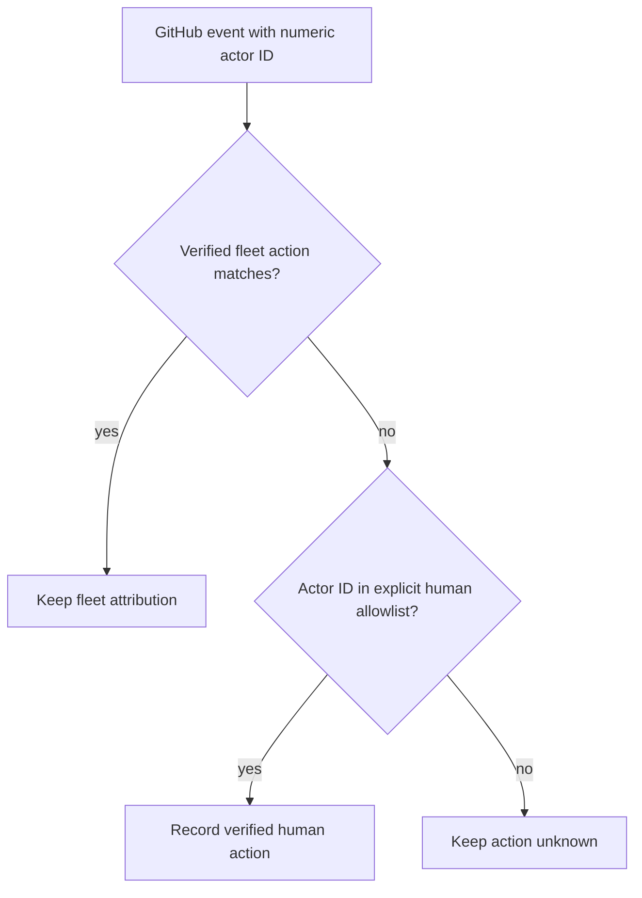

## Summary

Extended the existing PR completion collector to read GitHub numeric actor IDs
and use an explicit `--human-actor-id` allowlist as affirmative human-action
evidence. Verified fleet journal actions retain precedence, and unmatched
history stays unknown by default. The collector still cannot verify genuine
owner-only gates, so this is Part of #4658.

## Spec

### Intent and Rationale

- GitHub login names and merge identity alone cannot distinguish human repair
  from automated actions performed with a user account.
- Numeric actor IDs are matched only when an operator supplies them; the
  collector does not infer human status from a login or bot suffix.

### Essential Design Decisions

- A verified fleet journal match wins over the human-ID allowlist, including
  when the event uses an account listed as human.
- The same allowlist can verify a GitHub actor attached to a review-log match;
  the unchained review log remains supporting evidence only.
- Missing or malformed actor identity data fails collection rather than being
  treated as an empty identity.

### Undiscoverable Facts

- `gh api` returned numeric `author.id` and `user.id` fields for the observed
  commit and review responses, and a numeric `actor.id` for the merged issue
  event. The commands are recorded under Evidence.
- No fleet-wide data or live measurement window was collected; this change
  claims no baseline or achieved target.

## Evidence

This is a backend and CLI change. The report flow remains read-only.

Observed GitHub response shapes with:

- `gh api repos/stSoftwareAU/VibeCoder/pulls/4709/commits --paginate --jq '.[0] | {sha: .sha, author: .author, committer: .committer, commit_author: .commit.author}'`
  — the commit's `author` object included a numeric `id`.
- `gh api repos/stSoftwareAU/VibeCoder/pulls/4709/reviews --paginate --jq '.[0] | {id, user: {id: .user.id, login: .user.login}, submitted_at}'`
  — the review's `user` object included a numeric `id`.
- `gh api repos/stSoftwareAU/VibeCoder/issues/4709/events --paginate --jq '[.[] | select(.event == "merged") | {id, event, actor: {id: .actor.id, login: .actor.login}, created_at}]'`
  — the merge event included a numeric event ID and numeric `actor.id`.

## Acceptance Criteria

- **missing** — "Verify genuine owner gates separately from generic needs-human
  labels." — reason: live collection still sets `ownerGateVerified` to false
  because no trusted owner-only gate evidence source is recorded; generic
  `needs-human` labels remain separately reported as unverified.
- **missing** — "Report genuine owner-only exceptions and regressions alongside
  it." — reason: genuine owner-only exceptions cannot yet be counted from
  collected evidence; regression reporting remains available independently.

## Test Plan

- `worker/deno/tests/pr_completion_snapshot_test.ts::collect - unmatched GitHub merges and approvals are unknown, never human or fleet`
  — passed; unlisted actors remain unknown.
- `worker/deno/tests/pr_completion_snapshot_test.ts::collect - configured numeric GitHub actors identify unmatched human actions`
  — passed; matching commits, reviews and merge events are classified as human.
- `worker/deno/tests/pr_completion_snapshot_test.ts::collect - a configured human repair followed by a bot merge is human-assisted`
  — passed; a human repair remains visible when a bot merges.
- `worker/deno/tests/pr_completion_snapshot_test.ts::collect - malformed GitHub actor identities fail loudly`
  — passed; missing IDs and non-numeric IDs are rejected.
- `worker/deno/tests/pr_completion_snapshot_test.ts::collect - a review log needs an allowlisted GitHub actor to verify its human attribution`
  — passed; the actor allowlist, not the unchained log, establishes attribution.
- `worker/deno/tests/pr_completion_snapshot_test.ts::collect - a verified fleet merge takes precedence over a configured human actor`
  — passed; a deliberate fleet-to-human mutation made this test fail (`fleet`
  became `human`).
- `worker/deno/tests/pr_completion_report_command_test.ts::pr-completion-report --collect notes a --review-log it cannot read, and notes the missing review-log source when none is given`
  — passed; removing CLI forwarding made the new allowlist case fail (1 expected
  review round, 0 observed).
- `worker/deno/tests/pr_completion_report_command_test.ts::pr-completion-report --collect rejects a non-numeric --human-actor-id before any read`
  — passed.
- The configured-actor test failed when actor classification was disabled
  (`unknown` instead of `human`). The review-log attribution test failed when
  the allowlist promotion was removed (`unknown` instead of `human`).
- `deno fmt --check`, `deno lint`, and `deno check` on the five changed Deno
  files — passed.
- `deno task test:unit tests/pr_completion_snapshot_test.ts tests/pr_completion_report_command_test.ts`
  — passed, 101 tests.
- `./quality.sh` — failed: the parallel and serial Deno test runs passed, but
  the unit-test time budget rejected unchanged
  `worker/deno/tests/launcher_harness_reclaim_stub_test.ts` (2 tests, 4.30s;
  limit 1s). Deno lint, type check and formatting passed. Config integration and
  Checkov were skipped by the gate because their prerequisites were unavailable.
- No assertions were removed from existing tests. Existing fixtures gained
  GitHub actor IDs to match the observed API response shape.
- The CLI entry point `runPrCompletionCollect` is covered through its command
  test; the collector's verified-match, unknown, human and malformed-ID outcomes
  are covered through snapshot tests.

### Deno regression avoided

Used Deno tasks, formatter, linter and type checker; no Node tooling or
dependencies were added.
