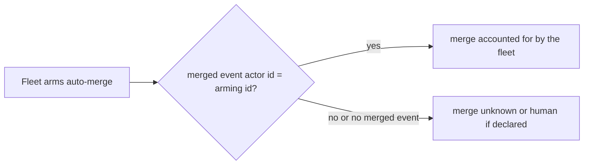

## Summary

Continues the PR completion report from #4709. Arming auto-merge no longer
accounts for a merge a different account completed (the real PR #4709 was armed
by the fleet account and merged 14 hours later by the owner). Operators can
declare human actor ids so unmatched events by those ids become recorded human
intervention. CI is read on every head, `ci-failing` waiting intervals and
post-merge default-branch check failures are reported, and deployment health is
evaluated per host. Milestone sync pushes, and the host babysitter's own pushes
(through a new `VIBE_AUDIT_DIR`), are now journalled with provenance. Several
parts of the issue remain (see Acceptance Criteria), so this is Part of #4658.

The `pr-summary-check` and `pr-summary-ci` tasks in `worker/deno/deno.json` also
allow `VIBE_AUDIT_DIR` in their `--allow-env` list.

Version bump: `VERSION` is not touched by this change.

### Deno regression avoided

Deno commands and tasks only; no Node tooling, `package.json` or `deno.lock`
change.

## Spec

### Intent and Rationale

- A merge is accounted for by a fleet `merge` action only when the account that
  merged is the account that armed auto-merge (GitHub attributes an auto-merge
  to its enabler), or, with no arm observed, when a direct merge lies inside the
  match window. Two actor ids are compared as consistency evidence; no label is
  derived from a login.
- `WORK_DIR` would have changed other readers in the babysitter process, so the
  babysitter gets its own `VIBE_AUDIT_DIR` instead.

### Essential Design Decisions

- A merge with no `merged` event, or an arm followed by a different merger, is
  `unknown`, never `human` (fail closed). Accepted limit: a person merging with
  the arming account cannot be told apart from the fleet.
- `--human-actor-id` ids are operator-declared people; an automated action under
  one is counted as human, which only lowers the unattended rate.
- Caller matching in the audit hook is now by whole file name, because
  substrings matched `declared_handoff_phase.ts` and the babysitter's sibling
  modules.
- `resolveBaseDir` throws on a relative or `..` `VIBE_AUDIT_DIR` (loud, by
  design); unset leaves behaviour unchanged.

### Undiscoverable Facts

- Observed with `gh api repos/stSoftwareAU/VibeCoder/issues/4709/events`:
  `auto_squash_enabled` by the fleet account at 04:52, `merged` by the owner at
  18:31 (`merged_by` is the owner). Events are `auto_merge_enabled`,
  `auto_squash_enabled`, `auto_rebase_enabled` and `auto_merge_disabled`.
- No baseline or two-week result exists; none is invented.

## Evidence

Backend and CLI only. Docs read and updated: `docs/INTERNALS.md` (section "PR
completion evidence report") and `docs/AGENT-ACCOUNTABILITY.md` (journal switch,
storage, `component`/`actionKind`, babysitter export).

## Acceptance Criteria

- **missing** — "Record trusted automation provenance for
  implementation/repair/review/dismissal/merge actions": reviewer reviews stay
  on the lower-trust review log, dismissals through `pr_comments.ts` and
  milestone rollback pushes stay `unknown` — reason: `pr_comments.ts` is shared
  with the babysitter and the rollback push goes through `rollbackGitFn` in
  `lib/run_core_production_deps.ts`; neither is named by the hook yet.
- **missing** — "genuinely owner-only exceptions": `--collect` still sets
  `ownerGateVerified` false and produces no hold blockers — reason: no recorded
  hold marker exists to read.
- **missing** — "previously stranded PRs re-enter ordinary discovery": the
  rollout check is unchanged from #4709 — reason: rediscovery still means a
  verified fleet action after rollout, and no test demonstrates the discovery
  path itself.
- **missing** — "post-merge failure/regression view" resolution: failed runs are
  reported but `resolved` is always false — reason: no later-success matching
  was built.

## Test Plan

- Added or extended: `worker/deno/tests/pr_completion_snapshot_test.ts` (arm vs
  merger, disarm, direct-merge window, declared humans, all-head CI,
  `ci-failing`, post-merge, host rows, conclusion handling),
  `worker/deno/tests/pr_completion_report_test.ts`,
  `worker/deno/tests/pr_completion_report_command_test.ts`,
  `worker/deno/tests/audit_hook_test.ts`,
  `worker/deno/tests/audit_journal_test.ts`,
  `worker/deno/tests/fleet_pr_babysitter_audit_4658_test.ts`,
  `worker/deno/tests/fleet_pr_babysitter_test.ts`,
  `worker/deno/tests/review_round_test.ts`,
  `worker/deno/tests/review_round_command_4658_test.ts`.
- Each new guard was broken on purpose and the named test went red, then the
  guard was restored. The `git_pull` repair-push entry in `lib/audit_hook.ts` is
  pinned by
  `audit_hook_test.ts::actionKindFor names a repair push from the
  babysitter and the PR processors`
  (`pushKind(git_pull.ts)` is `repair`); deleting the entry turned that test
  red. After independent review, three edited snapshot tests that no longer
  reached their guard were fixed and re-broken red.
- Existing fixtures gained `merged` events, review `user.id` and check-run
  `conclusion` because those keys are now required. No assertion was removed.
- `worker/deno/deno.json`: the `pr-summary-check` and `pr-summary-ci` tasks now
  allow the `VIBE_AUDIT_DIR` env var, because the audit hook reads it and the
  tasks' `--allow-env` list denied it (commit 9f2908c4). Verified by running
  `deno task pr-summary-ci --base main --head-branch <branch>` from
  `worker/deno`, which no longer fails on the env permission.
- Old-shape tests: `review-run.json` and `deployment-health.json` without `host`
  still read as host-less rows; snapshot input without the new fields reports
  unchanged values.
- Targeted run on the final head: `deno task test:unit` over the ten files above
  plus `tests/vibe_env_registry_test.ts` and
  `tests/self_diagnostic_attestation_test.ts`: 243 passed, 0 failed.
- <!-- vibe-quality-gate-skipped reason="`./quality.sh` hit its 590 s bound in the test stage; every stage before it passed (workflow hygiene, completeness, markdownlint, semgrep, mermaid); CI and the worker's own gate run the full suite" -->
  The full gate was not completed.

🤖 Generated with [Claude Code](https://claude.com/claude-code)
